<div align="center">


<a href="https://skillicons.dev"></a>


</div>

<div align="center">

### 🪐 [Entrar no meu universo interativo →](https://niinacanteiro.github.io/niinacanteiro/)

Sistema Solar em 3D, laboratório de experimentos, fliperama com 4 joguinhos e mapa de constelações.

<a href="https://niinacanteiro.github.io/niinacanteiro/"></a>
<a href="https://niinacanteiro.github.io/eletrons-e-estrelas/"></a>

</div>


## `whoami`

```python
nina = {
    "nome": "Nicoly Canteiro Araújo",
    "curso": "Bacharelado em Engenharia Elétrica - IFMT Campus Pontes e Lacerda",
    "local": "Pontes e Lacerda, MT, Brasil",
    "estudando": ["Python", "análise de dados", "inteligência artificial", "métodos numéricos"],
    "documentação": "relatórios técnicos em LaTeX",
}
```


## 🌳 Minha árvore de conhecimento


## ⚡ A equação que mais escrevi este semestre

Carga de um capacitor num circuito RC, do meu [relatório de laboratório](https://github.com/niinacanteiro/relatorios-latex):

$$
v_C(t) = V_s\left(1 - e^{-t/RC}\right), \qquad \tau = RC
$$


## 🌌 Relatividade geral

<p align="center"><a href="https://niinacanteiro.github.io/niinacanteiro/relatividade.html"></a></p>

<p align="center"><a href="https://niinacanteiro.github.io/niinacanteiro/relatividade.html"><b>🌀 Abrir em 3D e girar com o mouse</b></a></p>


## 📂 Projetos

| | Projeto | O que tem |
|---|---|---|
| 📐 | [**relatorios-latex**](https://github.com/niinacanteiro/relatorios-latex) | Relatórios de circuitos em LaTeX com `circuitikz`, `pgfplots` e `tcolorbox` |
| 🐍 | [**Metodos_Computacionais**](https://github.com/niinacanteiro/Metodos_Computacionais) | Interpolação quadrática em Python |
| 🚦 | [**Manual-de-Instrucao-LaTex**](https://github.com/niinacanteiro/Manual-de-Instrucao-LaTex) | Manual de semáforo com Arduino |
| ⚡ | [**tinkercad-circuitos**](https://github.com/niinacanteiro/tinkercad-circuitos) | Simulações no Tinkercad: semáforo, cancela automática com sensor ultrassônico, botão de pedestre e LEDs |

<details>
<summary><b>🔭 O que estou fazendo agora</b> (clique para abrir)</summary>
<br>

- 🐍 Estudando Python, análise de dados e inteligência artificial
- 📐 Praticando métodos numéricos e documentação técnica em LaTeX
- 🤖 Projeto de extensão em robótica com Arduino

</details>

<details>
<summary><b>⌨️ Atalho favorito</b></summary>
<br>

<kbd>Ctrl</kbd> + <kbd>Enter</kbd> no Overleaf: compila o PDF na hora.

</details>


## 🎮 Fliperama

A cobra anda sozinha aqui, mas no meu portfólio é você quem joga: Cobrinha, Memória dos Planetas, 2048 e Foguete.

<a href="https://niinacanteiro.github.io/niinacanteiro/#cobrinha">
  <picture>
    <source media="(prefers-color-scheme: dark)" srcset="https://raw.githubusercontent.com/niinacanteiro/niinacanteiro/output/github-snake-dark.svg" />
    <source media="(prefers-color-scheme: light)" srcset="https://raw.githubusercontent.com/niinacanteiro/niinacanteiro/output/github-snake.svg" />
    
  </picture>
</a>

<div align="center">

<a href="https://niinacanteiro.github.io/niinacanteiro/#cobrinha"></a>

</div>

<div align="center">


</div>


<div align="center">

<a href="https://www.linkedin.com/in/nicoly-canteiro"></a>
<a href="https://www.tinkercad.com/users/eocUsKhVAQR"></a>


</div>
