<div align="center">


<a href="https://skillicons.dev"></a>


</div>

<div align="center">

### 🪐 [Entrar no meu universo interativo →](https://niinacanteiro.github.io/niinacanteiro/)

Sistema Solar em 3D, laboratório de experimentos, fliperama com 4 joguinhos e mapa de constelações.

<a href="https://niinacanteiro.github.io/niinacanteiro/"></a>
<a href="https://niinacanteiro.github.io/eletrons-e-estrelas/"></a>

</div>


## `whoami`

```python
nina = {
    "nome": "Nicoly Canteiro Araújo",
    "curso": "Bacharelado em Engenharia Elétrica - IFMT Campus Pontes e Lacerda",
    "local": "Pontes e Lacerda, MT, Brasil",
    "estudando": ["Python", "análise de dados", "inteligência artificial", "métodos numéricos"],
    "documentação": "relatórios técnicos em LaTeX",
}
```


## 🌳 Minha árvore de conhecimento




## ⚡ A equação que mais escrevi este semestre

Carga de um capacitor num circuito RC, do meu [relatório de laboratório](https://github.com/niinacanteiro/relatorios-latex):

$$
v_C(t) = V_s\left(1 - e^{-t/RC}\right), \qquad \tau = RC
$$


## 🌌 Relatividade geral em 3D (gire com o mouse ou o dedo)

A estrela afunda o tecido do espaço-tempo e o planeta segue a curva: $G_{\mu\nu} + \Lambda g_{\mu\nu} = \frac{8\pi G}{c^4} T_{\mu\nu}$

```stl
solid relatividade
facet normal 0.02 0.02 1
outer loop
vertex -10 -10 -0.42
vertex -9.09 -10 -0.44
vertex -9.09 -9.09 -0.47
endloop
endfacet
facet normal 0.02 0.02 1
outer loop
vertex -10 -10 -0.42
vertex -9.09 -9.09 -0.47
vertex -10 -9.09 -0.44
endloop
endfacet
facet normal -0.02 -0.02 -1
outer loop
vertex -10 -10 -0.54
vertex -9.09 -9.09 -0.59
vertex -9.09 -10 -0.56
endloop
endfacet
facet normal -0.02 -0.02 -1
outer loop
vertex -10 -10 -0.54
vertex -10 -9.09 -0.56
vertex -9.09 -9.09 -0.59
endloop
endfacet
facet normal 0.02 0.03 1
outer loop
vertex -10 -9.09 -0.44
vertex -9.09 -9.09 -0.47
vertex -9.09 -8.18 -0.49
endloop
endfacet
facet normal 0.03 0.02 1
outer loop
vertex -10 -9.09 -0.44
vertex -9.09 -8.18 -0.49
vertex -10 -8.18 -0.46
endloop
endfacet
facet normal -0.02 -0.03 -1
outer loop
vertex -10 -9.09 -0.56
vertex -9.09 -8.18 -0.61
vertex -9.09 -9.09 -0.59
endloop
endfacet
facet normal -0.03 -0.02 -1
outer loop
vertex -10 -9.09 -0.56
vertex -10 -8.18 -0.58
vertex -9.09 -8.18 -0.61
endloop
endfacet
facet normal 0.03 0.03 1
outer loop
vertex -10 -8.18 -0.46
vertex -9.09 -8.18 -0.49
vertex -9.09 -7.27 -0.51
endloop
endfacet
facet normal 0.03 0.02 1
outer loop
vertex -10 -8.18 -0.46
vertex -9.09 -7.27 -0.51
vertex -10 -7.27 -0.48
endloop
endfacet
facet normal -0.03 -0.03 -1
outer loop
vertex -10 -8.18 -0.58
vertex -9.09 -7.27 -0.63
vertex -9.09 -8.18 -0.61
endloop
endfacet
facet normal -0.03 -0.02 -1
outer loop
vertex -10 -8.18 -0.58
vertex -10 -7.27 -0.6
vertex -9.09 -7.27 -0.63
endloop
endfacet
facet normal 0.03 0.03 1
outer loop
vertex -10 -7.27 -0.48
vertex -9.09 -7.27 -0.51
vertex -9.09 -6.36 -0.54
endloop
endfacet
facet normal 0.04 0.02 1
outer loop
vertex -10 -7.27 -0.48
vertex -9.09 -6.36 -0.54
vertex -10 -6.36 -0.5
endloop
endfacet
facet normal -0.03 -0.03 -1
outer loop
vertex -10 -7.27 -0.6
vertex -9.09 -6.36 -0.66
vertex -9.09 -7.27 -0.63
endloop
endfacet
facet normal -0.04 -0.02 -1
outer loop
vertex -10 -7.27 -0.6
vertex -10 -6.36 -0.62
vertex -9.09 -6.36 -0.66
endloop
endfacet
facet normal 0.04 0.03 1
outer loop
vertex -10 -6.36 -0.5
vertex -9.09 -6.36 -0.54
vertex -9.09 -5.45 -0.56
endloop
endfacet
facet normal 0.04 0.02 1
outer loop
vertex -10 -6.36 -0.5
vertex -9.09 -5.45 -0.56
vertex -10 -5.45 -0.52
endloop
endfacet
facet normal -0.04 -0.03 -1
outer loop
vertex -10 -6.36 -0.62
vertex -9.09 -5.45 -0.68
vertex -9.09 -6.36 -0.66
endloop
endfacet
facet normal -0.04 -0.02 -1
outer loop
vertex -10 -6.36 -0.62
vertex -10 -5.45 -0.64
vertex -9.09 -5.45 -0.68
endloop
endfacet
facet normal 0.04 0.03 1
outer loop
vertex -10 -5.45 -0.52
vertex -9.09 -5.45 -0.56
vertex -9.09 -4.55 -0.59
endloop
endfacet
facet normal 0.05 0.02 1
outer loop
vertex -10 -5.45 -0.52
vertex -9.09 -4.55 -0.59
vertex -10 -4.55 -0.54
endloop
endfacet
facet normal -0.04 -0.03 -1
outer loop
vertex -10 -5.45 -0.64
vertex -9.09 -4.55 -0.71
vertex -9.09 -5.45 -0.68
endloop
endfacet
facet normal -0.05 -0.02 -1
outer loop
vertex -10 -5.45 -0.64
vertex -10 -4.55 -0.66
vertex -9.09 -4.55 -0.71
endloop
endfacet
facet normal 0.05 0.02 1
outer loop
vertex -10 -4.55 -0.54
vertex -9.09 -4.55 -0.59
vertex -9.09 -3.64 -0.61
endloop
endfacet
facet normal 0.05 0.02 1
outer loop
vertex -10 -4.55 -0.54
vertex -9.09 -3.64 -0.61
vertex -10 -3.64 -0.56
endloop
endfacet
facet normal -0.05 -0.02 -1
outer loop
vertex -10 -4.55 -0.66
vertex -9.09 -3.64 -0.73
vertex -9.09 -4.55 -0.71
endloop
endfacet
facet normal -0.05 -0.02 -1
outer loop
vertex -10 -4.55 -0.66
vertex -10 -3.64 -0.68
vertex -9.09 -3.64 -0.73
endloop
endfacet
facet normal 0.05 0.02 1
outer loop
vertex -10 -3.64 -0.56
vertex -9.09 -3.64 -0.61
vertex -9.09 -2.73 -0.63
endloop
endfacet
facet normal 0.06 0.02 1
outer loop
vertex -10 -3.64 -0.56
vertex -9.09 -2.73 -0.63
vertex -10 -2.73 -0.58
endloop
endfacet
facet normal -0.05 -0.02 -1
outer loop
vertex -10 -3.64 -0.68
vertex -9.09 -2.73 -0.75
vertex -9.09 -3.64 -0.73
endloop
endfacet
facet normal -0.06 -0.02 -1
outer loop
vertex -10 -3.64 -0.68
vertex -10 -2.73 -0.7
vertex -9.09 -2.73 -0.75
endloop
endfacet
facet normal 0.06 0.02 1
outer loop
vertex -10 -2.73 -0.58
vertex -9.09 -2.73 -0.63
vertex -9.09 -1.82 -0.64
endloop
endfacet
facet normal 0.06 0.01 1
outer loop
vertex -10 -2.73 -0.58
vertex -9.09 -1.82 -0.64
vertex -10 -1.82 -0.59
endloop
endfacet
facet normal -0.06 -0.02 -1
outer loop
vertex -10 -2.73 -0.7
vertex -9.09 -1.82 -0.76
vertex -9.09 -2.73 -0.75
endloop
endfacet
facet normal -0.06 -0.01 -1
outer loop
vertex -10 -2.73 -0.7
vertex -10 -1.82 -0.71
vertex -9.09 -1.82 -0.76
endloop
endfacet
facet normal 0.06 0.01 1
outer loop
vertex -10 -1.82 -0.59
vertex -9.09 -1.82 -0.64
vertex -9.09 -0.91 -0.65
endloop
endfacet
facet normal 0.06 0.01 1
outer loop
vertex -10 -1.82 -0.59
vertex -9.09 -0.91 -0.65
vertex -10 -0.91 -0.59
endloop
endfacet
facet normal -0.06 -0.01 -1
outer loop
vertex -10 -1.82 -0.71
vertex -9.09 -0.91 -0.77
vertex -9.09 -1.82 -0.76
endloop
endfacet
facet normal -0.06 -0.01 -1
outer loop
vertex -10 -1.82 -0.71
vertex -10 -0.91 -0.71
vertex -9.09 -0.91 -0.77
endloop
endfacet
facet normal 0.06 0 1
outer loop
vertex -10 -0.91 -0.59
vertex -9.09 -0.91 -0.65
vertex -9.09 0 -0.66
endloop
endfacet
facet normal 0.06 0 1
outer loop
vertex -10 -0.91 -0.59
vertex -9.09 0 -0.66
vertex -10 0 -0.6
endloop
endfacet
facet normal -0.06 -0 -1
outer loop
vertex -10 -0.91 -0.71
vertex -9.09 0 -0.78
vertex -9.09 -0.91 -0.77
endloop
endfacet
facet normal -0.06 -0 -1
outer loop
vertex -10 -0.91 -0.71
vertex -10 0 -0.72
vertex -9.09 0 -0.78
endloop
endfacet
facet normal 0.06 -0 1
outer loop
vertex -10 0 -0.6
vertex -9.09 0 -0.66
vertex -9.09 0.91 -0.65
endloop
endfacet
facet normal 0.06 -0 1
outer loop
vertex -10 0 -0.6
vertex -9.09 0.91 -0.65
vertex -10 0.91 -0.59
endloop
endfacet
facet normal -0.06 0 -1
outer loop
vertex -10 0 -0.72
vertex -9.09 0.91 -0.77
vertex -9.09 0 -0.78
endloop
endfacet
facet normal -0.06 0 -1
outer loop
vertex -10 0 -0.72
vertex -10 0.91 -0.71
vertex -9.09 0.91 -0.77
endloop
endfacet
facet normal 0.06 -0.01 1
outer loop
vertex -10 0.91 -0.59
vertex -9.09 0.91 -0.65
vertex -9.09 1.82 -0.64
endloop
endfacet
facet normal 0.06 -0.01 1
outer loop
vertex -10 0.91 -0.59
vertex -9.09 1.82 -0.64
vertex -10 1.82 -0.59
endloop
endfacet
facet normal -0.06 0.01 -1
outer loop
vertex -10 0.91 -0.71
vertex -9.09 1.82 -0.76
vertex -9.09 0.91 -0.77
endloop
endfacet
facet normal -0.06 0.01 -1
outer loop
vertex -10 0.91 -0.71
vertex -10 1.82 -0.71
vertex -9.09 1.82 -0.76
endloop
endfacet
facet normal 0.06 -0.02 1
outer loop
vertex -10 1.82 -0.59
vertex -9.09 1.82 -0.64
vertex -9.09 2.73 -0.63
endloop
endfacet
facet normal 0.06 -0.01 1
outer loop
vertex -10 1.82 -0.59
vertex -9.09 2.73 -0.63
vertex -10 2.73 -0.58
endloop
endfacet
facet normal -0.06 0.02 -1
outer loop
vertex -10 1.82 -0.71
vertex -9.09 2.73 -0.75
vertex -9.09 1.82 -0.76
endloop
endfacet
facet normal -0.06 0.01 -1
outer loop
vertex -10 1.82 -0.71
vertex -10 2.73 -0.7
vertex -9.09 2.73 -0.75
endloop
endfacet
facet normal 0.06 -0.02 1
outer loop
vertex -10 2.73 -0.58
vertex -9.09 2.73 -0.63
vertex -9.09 3.64 -0.61
endloop
endfacet
facet normal 0.05 -0.02 1
outer loop
vertex -10 2.73 -0.58
vertex -9.09 3.64 -0.61
vertex -10 3.64 -0.56
endloop
endfacet
facet normal -0.06 0.02 -1
outer loop
vertex -10 2.73 -0.7
vertex -9.09 3.64 -0.73
vertex -9.09 2.73 -0.75
endloop
endfacet
facet normal -0.05 0.02 -1
outer loop
vertex -10 2.73 -0.7
vertex -10 3.64 -0.68
vertex -9.09 3.64 -0.73
endloop
endfacet
facet normal 0.05 -0.02 1
outer loop
vertex -10 3.64 -0.56
vertex -9.09 3.64 -0.61
vertex -9.09 4.55 -0.59
endloop
endfacet
facet normal 0.05 -0.02 1
outer loop
vertex -10 3.64 -0.56
vertex -9.09 4.55 -0.59
vertex -10 4.55 -0.54
endloop
endfacet
facet normal -0.05 0.02 -1
outer loop
vertex -10 3.64 -0.68
vertex -9.09 4.55 -0.71
vertex -9.09 3.64 -0.73
endloop
endfacet
facet normal -0.05 0.02 -1
outer loop
vertex -10 3.64 -0.68
vertex -10 4.55 -0.66
vertex -9.09 4.55 -0.71
endloop
endfacet
facet normal 0.05 -0.03 1
outer loop
vertex -10 4.55 -0.54
vertex -9.09 4.55 -0.59
vertex -9.09 5.45 -0.56
endloop
endfacet
facet normal 0.04 -0.02 1
outer loop
vertex -10 4.55 -0.54
vertex -9.09 5.45 -0.56
vertex -10 5.45 -0.52
endloop
endfacet
facet normal -0.05 0.03 -1
outer loop
vertex -10 4.55 -0.66
vertex -9.09 5.45 -0.68
vertex -9.09 4.55 -0.71
endloop
endfacet
facet normal -0.04 0.02 -1
outer loop
vertex -10 4.55 -0.66
vertex -10 5.45 -0.64
vertex -9.09 5.45 -0.68
endloop
endfacet
facet normal 0.04 -0.03 1
outer loop
vertex -10 5.45 -0.52
vertex -9.09 5.45 -0.56
vertex -9.09 6.36 -0.54
endloop
endfacet
facet normal 0.04 -0.02 1
outer loop
vertex -10 5.45 -0.52
vertex -9.09 6.36 -0.54
vertex -10 6.36 -0.5
endloop
endfacet
facet normal -0.04 0.03 -1
outer loop
vertex -10 5.45 -0.64
vertex -9.09 6.36 -0.66
vertex -9.09 5.45 -0.68
endloop
endfacet
facet normal -0.04 0.02 -1
outer loop
vertex -10 5.45 -0.64
vertex -10 6.36 -0.62
vertex -9.09 6.36 -0.66
endloop
endfacet
facet normal 0.04 -0.03 1
outer loop
vertex -10 6.36 -0.5
vertex -9.09 6.36 -0.54
vertex -9.09 7.27 -0.51
endloop
endfacet
facet normal 0.03 -0.02 1
outer loop
vertex -10 6.36 -0.5
vertex -9.09 7.27 -0.51
vertex -10 7.27 -0.48
endloop
endfacet
facet normal -0.04 0.03 -1
outer loop
vertex -10 6.36 -0.62
vertex -9.09 7.27 -0.63
vertex -9.09 6.36 -0.66
endloop
endfacet
facet normal -0.03 0.02 -1
outer loop
vertex -10 6.36 -0.62
vertex -10 7.27 -0.6
vertex -9.09 7.27 -0.63
endloop
endfacet
facet normal 0.03 -0.03 1
outer loop
vertex -10 7.27 -0.48
vertex -9.09 7.27 -0.51
vertex -9.09 8.18 -0.49
endloop
endfacet
facet normal 0.03 -0.02 1
outer loop
vertex -10 7.27 -0.48
vertex -9.09 8.18 -0.49
vertex -10 8.18 -0.46
endloop
endfacet
facet normal -0.03 0.03 -1
outer loop
vertex -10 7.27 -0.6
vertex -9.09 8.18 -0.61
vertex -9.09 7.27 -0.63
endloop
endfacet
facet normal -0.03 0.02 -1
outer loop
vertex -10 7.27 -0.6
vertex -10 8.18 -0.58
vertex -9.09 8.18 -0.61
endloop
endfacet
facet normal 0.03 -0.03 1
outer loop
vertex -10 8.18 -0.46
vertex -9.09 8.18 -0.49
vertex -9.09 9.09 -0.47
endloop
endfacet
facet normal 0.02 -0.02 1
outer loop
vertex -10 8.18 -0.46
vertex -9.09 9.09 -0.47
vertex -10 9.09 -0.44
endloop
endfacet
facet normal -0.03 0.03 -1
outer loop
vertex -10 8.18 -0.58
vertex -9.09 9.09 -0.59
vertex -9.09 8.18 -0.61
endloop
endfacet
facet normal -0.02 0.02 -1
outer loop
vertex -10 8.18 -0.58
vertex -10 9.09 -0.56
vertex -9.09 9.09 -0.59
endloop
endfacet
facet normal 0.02 -0.02 1
outer loop
vertex -10 9.09 -0.44
vertex -9.09 9.09 -0.47
vertex -9.09 10 -0.44
endloop
endfacet
facet normal 0.02 -0.02 1
outer loop
vertex -10 9.09 -0.44
vertex -9.09 10 -0.44
vertex -10 10 -0.42
endloop
endfacet
facet normal -0.02 0.02 -1
outer loop
vertex -10 9.09 -0.56
vertex -9.09 10 -0.56
vertex -9.09 9.09 -0.59
endloop
endfacet
facet normal -0.02 0.02 -1
outer loop
vertex -10 9.09 -0.56
vertex -10 10 -0.54
vertex -9.09 10 -0.56
endloop
endfacet
facet normal 0.02 0.03 1
outer loop
vertex -9.09 -10 -0.44
vertex -8.18 -10 -0.46
vertex -8.18 -9.09 -0.49
endloop
endfacet
facet normal 0.03 0.02 1
outer loop
vertex -9.09 -10 -0.44
vertex -8.18 -9.09 -0.49
vertex -9.09 -9.09 -0.47
endloop
endfacet
facet normal -0.02 -0.03 -1
outer loop
vertex -9.09 -10 -0.56
vertex -8.18 -9.09 -0.61
vertex -8.18 -10 -0.58
endloop
endfacet
facet normal -0.03 -0.02 -1
outer loop
vertex -9.09 -10 -0.56
vertex -9.09 -9.09 -0.59
vertex -8.18 -9.09 -0.61
endloop
endfacet
facet normal 0.03 0.03 1
outer loop
vertex -9.09 -9.09 -0.47
vertex -8.18 -9.09 -0.49
vertex -8.18 -8.18 -0.52
endloop
endfacet
facet normal 0.03 0.03 1
outer loop
vertex -9.09 -9.09 -0.47
vertex -8.18 -8.18 -0.52
vertex -9.09 -8.18 -0.49
endloop
endfacet
facet normal -0.03 -0.03 -1
outer loop
vertex -9.09 -9.09 -0.59
vertex -8.18 -8.18 -0.64
vertex -8.18 -9.09 -0.61
endloop
endfacet
facet normal -0.03 -0.03 -1
outer loop
vertex -9.09 -9.09 -0.59
vertex -9.09 -8.18 -0.61
vertex -8.18 -8.18 -0.64
endloop
endfacet
facet normal 0.03 0.03 1
outer loop
vertex -9.09 -8.18 -0.49
vertex -8.18 -8.18 -0.52
vertex -8.18 -7.27 -0.55
endloop
endfacet
facet normal 0.04 0.03 1
outer loop
vertex -9.09 -8.18 -0.49
vertex -8.18 -7.27 -0.55
vertex -9.09 -7.27 -0.51
endloop
endfacet
facet normal -0.03 -0.03 -1
outer loop
vertex -9.09 -8.18 -0.61
vertex -8.18 -7.27 -0.67
vertex -8.18 -8.18 -0.64
endloop
endfacet
facet normal -0.04 -0.03 -1
outer loop
vertex -9.09 -8.18 -0.61
vertex -9.09 -7.27 -0.63
vertex -8.18 -7.27 -0.67
endloop
endfacet
facet normal 0.04 0.03 1
outer loop
vertex -9.09 -7.27 -0.51
vertex -8.18 -7.27 -0.55
vertex -8.18 -6.36 -0.58
endloop
endfacet
facet normal 0.04 0.03 1
outer loop
vertex -9.09 -7.27 -0.51
vertex -8.18 -6.36 -0.58
vertex -9.09 -6.36 -0.54
endloop
endfacet
facet normal -0.04 -0.03 -1
outer loop
vertex -9.09 -7.27 -0.63
vertex -8.18 -6.36 -0.7
vertex -8.18 -7.27 -0.67
endloop
endfacet
facet normal -0.04 -0.03 -1
outer loop
vertex -9.09 -7.27 -0.63
vertex -9.09 -6.36 -0.66
vertex -8.18 -6.36 -0.7
endloop
endfacet
facet normal 0.04 0.03 1
outer loop
vertex -9.09 -6.36 -0.54
vertex -8.18 -6.36 -0.58
vertex -8.18 -5.45 -0.61
endloop
endfacet
facet normal 0.05 0.03 1
outer loop
vertex -9.09 -6.36 -0.54
vertex -8.18 -5.45 -0.61
vertex -9.09 -5.45 -0.56
endloop
endfacet
facet normal -0.04 -0.03 -1
outer loop
vertex -9.09 -6.36 -0.66
vertex -8.18 -5.45 -0.73
vertex -8.18 -6.36 -0.7
endloop
endfacet
facet normal -0.05 -0.03 -1
outer loop
vertex -9.09 -6.36 -0.66
vertex -9.09 -5.45 -0.68
vertex -8.18 -5.45 -0.73
endloop
endfacet
facet normal 0.05 0.03 1
outer loop
vertex -9.09 -5.45 -0.56
vertex -8.18 -5.45 -0.61
vertex -8.18 -4.55 -0.64
endloop
endfacet
facet normal 0.05 0.03 1
outer loop
vertex -9.09 -5.45 -0.56
vertex -8.18 -4.55 -0.64
vertex -9.09 -4.55 -0.59
endloop
endfacet
facet normal -0.05 -0.03 -1
outer loop
vertex -9.09 -5.45 -0.68
vertex -8.18 -4.55 -0.76
vertex -8.18 -5.45 -0.73
endloop
endfacet
facet normal -0.05 -0.03 -1
outer loop
vertex -9.09 -5.45 -0.68
vertex -9.09 -4.55 -0.71
vertex -8.18 -4.55 -0.76
endloop
endfacet
facet normal 0.05 0.03 1
outer loop
vertex -9.09 -4.55 -0.59
vertex -8.18 -4.55 -0.64
vertex -8.18 -3.64 -0.67
endloop
endfacet
facet normal 0.06 0.02 1
outer loop
vertex -9.09 -4.55 -0.59
vertex -8.18 -3.64 -0.67
vertex -9.09 -3.64 -0.61
endloop
endfacet
facet normal -0.05 -0.03 -1
outer loop
vertex -9.09 -4.55 -0.71
vertex -8.18 -3.64 -0.79
vertex -8.18 -4.55 -0.76
endloop
endfacet
facet normal -0.06 -0.02 -1
outer loop
vertex -9.09 -4.55 -0.71
vertex -9.09 -3.64 -0.73
vertex -8.18 -3.64 -0.79
endloop
endfacet
facet normal 0.06 0.03 1
outer loop
vertex -9.09 -3.64 -0.61
vertex -8.18 -3.64 -0.67
vertex -8.18 -2.73 -0.69
endloop
endfacet
facet normal 0.07 0.02 1
outer loop
vertex -9.09 -3.64 -0.61
vertex -8.18 -2.73 -0.69
vertex -9.09 -2.73 -0.63
endloop
endfacet
facet normal -0.06 -0.03 -1
outer loop
vertex -9.09 -3.64 -0.73
vertex -8.18 -2.73 -0.81
vertex -8.18 -3.64 -0.79
endloop
endfacet
facet normal -0.07 -0.02 -1
outer loop
vertex -9.09 -3.64 -0.73
vertex -9.09 -2.73 -0.75
vertex -8.18 -2.73 -0.81
endloop
endfacet
facet normal 0.07 0.02 1
outer loop
vertex -9.09 -2.73 -0.63
vertex -8.18 -2.73 -0.69
vertex -8.18 -1.82 -0.71
endloop
endfacet
facet normal 0.07 0.02 1
outer loop
vertex -9.09 -2.73 -0.63
vertex -8.18 -1.82 -0.71
vertex -9.09 -1.82 -0.64
endloop
endfacet
facet normal -0.07 -0.02 -1
outer loop
vertex -9.09 -2.73 -0.75
vertex -8.18 -1.82 -0.83
vertex -8.18 -2.73 -0.81
endloop
endfacet
facet normal -0.07 -0.02 -1
outer loop
vertex -9.09 -2.73 -0.75
vertex -9.09 -1.82 -0.76
vertex -8.18 -1.82 -0.83
endloop
endfacet
facet normal 0.07 0.01 1
outer loop
vertex -9.09 -1.82 -0.64
vertex -8.18 -1.82 -0.71
vertex -8.18 -0.91 -0.72
endloop
endfacet
facet normal 0.08 0.01 1
outer loop
vertex -9.09 -1.82 -0.64
vertex -8.18 -0.91 -0.72
vertex -9.09 -0.91 -0.65
endloop
endfacet
facet normal -0.07 -0.01 -1
outer loop
vertex -9.09 -1.82 -0.76
vertex -8.18 -0.91 -0.84
vertex -8.18 -1.82 -0.83
endloop
endfacet
facet normal -0.08 -0.01 -1
outer loop
vertex -9.09 -1.82 -0.76
vertex -9.09 -0.91 -0.77
vertex -8.18 -0.91 -0.84
endloop
endfacet
facet normal 0.08 0 1
outer loop
vertex -9.09 -0.91 -0.65
vertex -8.18 -0.91 -0.72
vertex -8.18 0 -0.73
endloop
endfacet
facet normal 0.08 0 1
outer loop
vertex -9.09 -0.91 -0.65
vertex -8.18 0 -0.73
vertex -9.09 0 -0.66
endloop
endfacet
facet normal -0.08 -0 -1
outer loop
vertex -9.09 -0.91 -0.77
vertex -8.18 0 -0.85
vertex -8.18 -0.91 -0.84
endloop
endfacet
facet normal -0.08 -0 -1
outer loop
vertex -9.09 -0.91 -0.77
vertex -9.09 0 -0.78
vertex -8.18 0 -0.85
endloop
endfacet
facet normal 0.08 -0 1
outer loop
vertex -9.09 0 -0.66
vertex -8.18 0 -0.73
vertex -8.18 0.91 -0.72
endloop
endfacet
facet normal 0.08 -0 1
outer loop
vertex -9.09 0 -0.66
vertex -8.18 0.91 -0.72
vertex -9.09 0.91 -0.65
endloop
endfacet
facet normal -0.08 0 -1
outer loop
vertex -9.09 0 -0.78
vertex -8.18 0.91 -0.84
vertex -8.18 0 -0.85
endloop
endfacet
facet normal -0.08 0 -1
outer loop
vertex -9.09 0 -0.78
vertex -9.09 0.91 -0.77
vertex -8.18 0.91 -0.84
endloop
endfacet
facet normal 0.08 -0.01 1
outer loop
vertex -9.09 0.91 -0.65
vertex -8.18 0.91 -0.72
vertex -8.18 1.82 -0.71
endloop
endfacet
facet normal 0.07 -0.01 1
outer loop
vertex -9.09 0.91 -0.65
vertex -8.18 1.82 -0.71
vertex -9.09 1.82 -0.64
endloop
endfacet
facet normal -0.08 0.01 -1
outer loop
vertex -9.09 0.91 -0.77
vertex -8.18 1.82 -0.83
vertex -8.18 0.91 -0.84
endloop
endfacet
facet normal -0.07 0.01 -1
outer loop
vertex -9.09 0.91 -0.77
vertex -9.09 1.82 -0.76
vertex -8.18 1.82 -0.83
endloop
endfacet
facet normal 0.07 -0.02 1
outer loop
vertex -9.09 1.82 -0.64
vertex -8.18 1.82 -0.71
vertex -8.18 2.73 -0.69
endloop
endfacet
facet normal 0.07 -0.02 1
outer loop
vertex -9.09 1.82 -0.64
vertex -8.18 2.73 -0.69
vertex -9.09 2.73 -0.63
endloop
endfacet
facet normal -0.07 0.02 -1
outer loop
vertex -9.09 1.82 -0.76
vertex -8.18 2.73 -0.81
vertex -8.18 1.82 -0.83
endloop
endfacet
facet normal -0.07 0.02 -1
outer loop
vertex -9.09 1.82 -0.76
vertex -9.09 2.73 -0.75
vertex -8.18 2.73 -0.81
endloop
endfacet
facet normal 0.07 -0.03 1
outer loop
vertex -9.09 2.73 -0.63
vertex -8.18 2.73 -0.69
vertex -8.18 3.64 -0.67
endloop
endfacet
facet normal 0.06 -0.02 1
outer loop
vertex -9.09 2.73 -0.63
vertex -8.18 3.64 -0.67
vertex -9.09 3.64 -0.61
endloop
endfacet
facet normal -0.07 0.03 -1
outer loop
vertex -9.09 2.73 -0.75
vertex -8.18 3.64 -0.79
vertex -8.18 2.73 -0.81
endloop
endfacet
facet normal -0.06 0.02 -1
outer loop
vertex -9.09 2.73 -0.75
vertex -9.09 3.64 -0.73
vertex -8.18 3.64 -0.79
endloop
endfacet
facet normal 0.06 -0.03 1
outer loop
vertex -9.09 3.64 -0.61
vertex -8.18 3.64 -0.67
vertex -8.18 4.55 -0.64
endloop
endfacet
facet normal 0.05 -0.02 1
outer loop
vertex -9.09 3.64 -0.61
vertex -8.18 4.55 -0.64
vertex -9.09 4.55 -0.59
endloop
endfacet
facet normal -0.06 0.03 -1
outer loop
vertex -9.09 3.64 -0.73
vertex -8.18 4.55 -0.76
vertex -8.18 3.64 -0.79
endloop
endfacet
facet normal -0.05 0.02 -1
outer loop
vertex -9.09 3.64 -0.73
vertex -9.09 4.55 -0.71
vertex -8.18 4.55 -0.76
endloop
endfacet
facet normal 0.05 -0.03 1
outer loop
vertex -9.09 4.55 -0.59
vertex -8.18 4.55 -0.64
vertex -8.18 5.45 -0.61
endloop
endfacet
facet normal 0.05 -0.03 1
outer loop
vertex -9.09 4.55 -0.59
vertex -8.18 5.45 -0.61
vertex -9.09 5.45 -0.56
endloop
endfacet
facet normal -0.05 0.03 -1
outer loop
vertex -9.09 4.55 -0.71
vertex -8.18 5.45 -0.73
vertex -8.18 4.55 -0.76
endloop
endfacet
facet normal -0.05 0.03 -1
outer loop
vertex -9.09 4.55 -0.71
vertex -9.09 5.45 -0.68
vertex -8.18 5.45 -0.73
endloop
endfacet
facet normal 0.05 -0.03 1
outer loop
vertex -9.09 5.45 -0.56
vertex -8.18 5.45 -0.61
vertex -8.18 6.36 -0.58
endloop
endfacet
facet normal 0.04 -0.03 1
outer loop
vertex -9.09 5.45 -0.56
vertex -8.18 6.36 -0.58
vertex -9.09 6.36 -0.54
endloop
endfacet
facet normal -0.05 0.03 -1
outer loop
vertex -9.09 5.45 -0.68
vertex -8.18 6.36 -0.7
vertex -8.18 5.45 -0.73
endloop
endfacet
facet normal -0.04 0.03 -1
outer loop
vertex -9.09 5.45 -0.68
vertex -9.09 6.36 -0.66
vertex -8.18 6.36 -0.7
endloop
endfacet
facet normal 0.04 -0.03 1
outer loop
vertex -9.09 6.36 -0.54
vertex -8.18 6.36 -0.58
vertex -8.18 7.27 -0.55
endloop
endfacet
facet normal 0.04 -0.03 1
outer loop
vertex -9.09 6.36 -0.54
vertex -8.18 7.27 -0.55
vertex -9.09 7.27 -0.51
endloop
endfacet
facet normal -0.04 0.03 -1
outer loop
vertex -9.09 6.36 -0.66
vertex -8.18 7.27 -0.67
vertex -8.18 6.36 -0.7
endloop
endfacet
facet normal -0.04 0.03 -1
outer loop
vertex -9.09 6.36 -0.66
vertex -9.09 7.27 -0.63
vertex -8.18 7.27 -0.67
endloop
endfacet
facet normal 0.04 -0.03 1
outer loop
vertex -9.09 7.27 -0.51
vertex -8.18 7.27 -0.55
vertex -8.18 8.18 -0.52
endloop
endfacet
facet normal 0.03 -0.03 1
outer loop
vertex -9.09 7.27 -0.51
vertex -8.18 8.18 -0.52
vertex -9.09 8.18 -0.49
endloop
endfacet
facet normal -0.04 0.03 -1
outer loop
vertex -9.09 7.27 -0.63
vertex -8.18 8.18 -0.64
vertex -8.18 7.27 -0.67
endloop
endfacet
facet normal -0.03 0.03 -1
outer loop
vertex -9.09 7.27 -0.63
vertex -9.09 8.18 -0.61
vertex -8.18 8.18 -0.64
endloop
endfacet
facet normal 0.03 -0.03 1
outer loop
vertex -9.09 8.18 -0.49
vertex -8.18 8.18 -0.52
vertex -8.18 9.09 -0.49
endloop
endfacet
facet normal 0.03 -0.03 1
outer loop
vertex -9.09 8.18 -0.49
vertex -8.18 9.09 -0.49
vertex -9.09 9.09 -0.47
endloop
endfacet
facet normal -0.03 0.03 -1
outer loop
vertex -9.09 8.18 -0.61
vertex -8.18 9.09 -0.61
vertex -8.18 8.18 -0.64
endloop
endfacet
facet normal -0.03 0.03 -1
outer loop
vertex -9.09 8.18 -0.61
vertex -9.09 9.09 -0.59
vertex -8.18 9.09 -0.61
endloop
endfacet
facet normal 0.03 -0.03 1
outer loop
vertex -9.09 9.09 -0.47
vertex -8.18 9.09 -0.49
vertex -8.18 10 -0.46
endloop
endfacet
facet normal 0.02 -0.02 1
outer loop
vertex -9.09 9.09 -0.47
vertex -8.18 10 -0.46
vertex -9.09 10 -0.44
endloop
endfacet
facet normal -0.03 0.03 -1
outer loop
vertex -9.09 9.09 -0.59
vertex -8.18 10 -0.58
vertex -8.18 9.09 -0.61
endloop
endfacet
facet normal -0.02 0.02 -1
outer loop
vertex -9.09 9.09 -0.59
vertex -9.09 10 -0.56
vertex -8.18 10 -0.58
endloop
endfacet
facet normal 0.02 0.03 1
outer loop
vertex -8.18 -10 -0.46
vertex -7.27 -10 -0.48
vertex -7.27 -9.09 -0.51
endloop
endfacet
facet normal 0.03 0.03 1
outer loop
vertex -8.18 -10 -0.46
vertex -7.27 -9.09 -0.51
vertex -8.18 -9.09 -0.49
endloop
endfacet
facet normal -0.02 -0.03 -1
outer loop
vertex -8.18 -10 -0.58
vertex -7.27 -9.09 -0.63
vertex -7.27 -10 -0.6
endloop
endfacet
facet normal -0.03 -0.03 -1
outer loop
vertex -8.18 -10 -0.58
vertex -8.18 -9.09 -0.61
vertex -7.27 -9.09 -0.63
endloop
endfacet
facet normal 0.03 0.04 1
outer loop
vertex -8.18 -9.09 -0.49
vertex -7.27 -9.09 -0.51
vertex -7.27 -8.18 -0.55
endloop
endfacet
facet normal 0.03 0.03 1
outer loop
vertex -8.18 -9.09 -0.49
vertex -7.27 -8.18 -0.55
vertex -8.18 -8.18 -0.52
endloop
endfacet
facet normal -0.03 -0.04 -1
outer loop
vertex -8.18 -9.09 -0.61
vertex -7.27 -8.18 -0.67
vertex -7.27 -9.09 -0.63
endloop
endfacet
facet normal -0.03 -0.03 -1
outer loop
vertex -8.18 -9.09 -0.61
vertex -8.18 -8.18 -0.64
vertex -7.27 -8.18 -0.67
endloop
endfacet
facet normal 0.03 0.04 1
outer loop
vertex -8.18 -8.18 -0.52
vertex -7.27 -8.18 -0.55
vertex -7.27 -7.27 -0.58
endloop
endfacet
facet normal 0.04 0.03 1
outer loop
vertex -8.18 -8.18 -0.52
vertex -7.27 -7.27 -0.58
vertex -8.18 -7.27 -0.55
endloop
endfacet
facet normal -0.03 -0.04 -1
outer loop
vertex -8.18 -8.18 -0.64
vertex -7.27 -7.27 -0.7
vertex -7.27 -8.18 -0.67
endloop
endfacet
facet normal -0.04 -0.03 -1
outer loop
vertex -8.18 -8.18 -0.64
vertex -8.18 -7.27 -0.67
vertex -7.27 -7.27 -0.7
endloop
endfacet
facet normal 0.04 0.04 1
outer loop
vertex -8.18 -7.27 -0.55
vertex -7.27 -7.27 -0.58
vertex -7.27 -6.36 -0.62
endloop
endfacet
facet normal 0.05 0.03 1
outer loop
vertex -8.18 -7.27 -0.55
vertex -7.27 -6.36 -0.62
vertex -8.18 -6.36 -0.58
endloop
endfacet
facet normal -0.04 -0.04 -1
outer loop
vertex -8.18 -7.27 -0.67
vertex -7.27 -6.36 -0.74
vertex -7.27 -7.27 -0.7
endloop
endfacet
facet normal -0.05 -0.03 -1
outer loop
vertex -8.18 -7.27 -0.67
vertex -8.18 -6.36 -0.7
vertex -7.27 -6.36 -0.74
endloop
endfacet
facet normal 0.05 0.04 1
outer loop
vertex -8.18 -6.36 -0.58
vertex -7.27 -6.36 -0.62
vertex -7.27 -5.45 -0.66
endloop
endfacet
facet normal 0.05 0.03 1
outer loop
vertex -8.18 -6.36 -0.58
vertex -7.27 -5.45 -0.66
vertex -8.18 -5.45 -0.61
endloop
endfacet
facet normal -0.05 -0.04 -1
outer loop
vertex -8.18 -6.36 -0.7
vertex -7.27 -5.45 -0.78
vertex -7.27 -6.36 -0.74
endloop
endfacet
facet normal -0.05 -0.03 -1
outer loop
vertex -8.18 -6.36 -0.7
vertex -8.18 -5.45 -0.73
vertex -7.27 -5.45 -0.78
endloop
endfacet
facet normal 0.05 0.04 1
outer loop
vertex -8.18 -5.45 -0.61
vertex -7.27 -5.45 -0.66
vertex -7.27 -4.55 -0.69
endloop
endfacet
facet normal 0.06 0.03 1
outer loop
vertex -8.18 -5.45 -0.61
vertex -7.27 -4.55 -0.69
vertex -8.18 -4.55 -0.64
endloop
endfacet
facet normal -0.05 -0.04 -1
outer loop
vertex -8.18 -5.45 -0.73
vertex -7.27 -4.55 -0.81
vertex -7.27 -5.45 -0.78
endloop
endfacet
facet normal -0.06 -0.03 -1
outer loop
vertex -8.18 -5.45 -0.73
vertex -8.18 -4.55 -0.76
vertex -7.27 -4.55 -0.81
endloop
endfacet
facet normal 0.06 0.04 1
outer loop
vertex -8.18 -4.55 -0.64
vertex -7.27 -4.55 -0.69
vertex -7.27 -3.64 -0.73
endloop
endfacet
facet normal 0.07 0.03 1
outer loop
vertex -8.18 -4.55 -0.64
vertex -7.27 -3.64 -0.73
vertex -8.18 -3.64 -0.67
endloop
endfacet
facet normal -0.06 -0.04 -1
outer loop
vertex -8.18 -4.55 -0.76
vertex -7.27 -3.64 -0.85
vertex -7.27 -4.55 -0.81
endloop
endfacet
facet normal -0.07 -0.03 -1
outer loop
vertex -8.18 -4.55 -0.76
vertex -8.18 -3.64 -0.79
vertex -7.27 -3.64 -0.85
endloop
endfacet
facet normal 0.07 0.04 1
outer loop
vertex -8.18 -3.64 -0.67
vertex -7.27 -3.64 -0.73
vertex -7.27 -2.73 -0.76
endloop
endfacet
facet normal 0.08 0.03 1
outer loop
vertex -8.18 -3.64 -0.67
vertex -7.27 -2.73 -0.76
vertex -8.18 -2.73 -0.69
endloop
endfacet
facet normal -0.07 -0.04 -1
outer loop
vertex -8.18 -3.64 -0.79
vertex -7.27 -2.73 -0.88
vertex -7.27 -3.64 -0.85
endloop
endfacet
facet normal -0.08 -0.03 -1
outer loop
vertex -8.18 -3.64 -0.79
vertex -8.18 -2.73 -0.81
vertex -7.27 -2.73 -0.88
endloop
endfacet
facet normal 0.08 0.03 1
outer loop
vertex -8.18 -2.73 -0.69
vertex -7.27 -2.73 -0.76
vertex -7.27 -1.82 -0.79
endloop
endfacet
facet normal 0.09 0.02 1
outer loop
vertex -8.18 -2.73 -0.69
vertex -7.27 -1.82 -0.79
vertex -8.18 -1.82 -0.71
endloop
endfacet
facet normal -0.08 -0.03 -1
outer loop
vertex -8.18 -2.73 -0.81
vertex -7.27 -1.82 -0.91
vertex -7.27 -2.73 -0.88
endloop
endfacet
facet normal -0.09 -0.02 -1
outer loop
vertex -8.18 -2.73 -0.81
vertex -8.18 -1.82 -0.83
vertex -7.27 -1.82 -0.91
endloop
endfacet
facet normal 0.09 0.02 1
outer loop
vertex -8.18 -1.82 -0.71
vertex -7.27 -1.82 -0.79
vertex -7.27 -0.91 -0.81
endloop
endfacet
facet normal 0.1 0.01 1
outer loop
vertex -8.18 -1.82 -0.71
vertex -7.27 -0.91 -0.81
vertex -8.18 -0.91 -0.72
endloop
endfacet
facet normal -0.09 -0.02 -1
outer loop
vertex -8.18 -1.82 -0.83
vertex -7.27 -0.91 -0.93
vertex -7.27 -1.82 -0.91
endloop
endfacet
facet normal -0.1 -0.01 -1
outer loop
vertex -8.18 -1.82 -0.83
vertex -8.18 -0.91 -0.84
vertex -7.27 -0.91 -0.93
endloop
endfacet
facet normal 0.1 0.01 1
outer loop
vertex -8.18 -0.91 -0.72
vertex -7.27 -0.91 -0.81
vertex -7.27 0 -0.82
endloop
endfacet
facet normal 0.1 0 1
outer loop
vertex -8.18 -0.91 -0.72
vertex -7.27 0 -0.82
vertex -8.18 0 -0.73
endloop
endfacet
facet normal -0.1 -0.01 -1
outer loop
vertex -8.18 -0.91 -0.84
vertex -7.27 0 -0.94
vertex -7.27 -0.91 -0.93
endloop
endfacet
facet normal -0.1 -0 -1
outer loop
vertex -8.18 -0.91 -0.84
vertex -8.18 0 -0.85
vertex -7.27 0 -0.94
endloop
endfacet
facet normal 0.1 -0.01 1
outer loop
vertex -8.18 0 -0.73
vertex -7.27 0 -0.82
vertex -7.27 0.91 -0.81
endloop
endfacet
facet normal 0.1 -0 1
outer loop
vertex -8.18 0 -0.73
vertex -7.27 0.91 -0.81
vertex -8.18 0.91 -0.72
endloop
endfacet
facet normal -0.1 0.01 -1
outer loop
vertex -8.18 0 -0.85
vertex -7.27 0.91 -0.93
vertex -7.27 0 -0.94
endloop
endfacet
facet normal -0.1 0 -1
outer loop
vertex -8.18 0 -0.85
vertex -8.18 0.91 -0.84
vertex -7.27 0.91 -0.93
endloop
endfacet
facet normal 0.1 -0.02 1
outer loop
vertex -8.18 0.91 -0.72
vertex -7.27 0.91 -0.81
vertex -7.27 1.82 -0.79
endloop
endfacet
facet normal 0.09 -0.01 1
outer loop
vertex -8.18 0.91 -0.72
vertex -7.27 1.82 -0.79
vertex -8.18 1.82 -0.71
endloop
endfacet
facet normal -0.1 0.02 -1
outer loop
vertex -8.18 0.91 -0.84
vertex -7.27 1.82 -0.91
vertex -7.27 0.91 -0.93
endloop
endfacet
facet normal -0.09 0.01 -1
outer loop
vertex -8.18 0.91 -0.84
vertex -8.18 1.82 -0.83
vertex -7.27 1.82 -0.91
endloop
endfacet
facet normal 0.09 -0.03 1
outer loop
vertex -8.18 1.82 -0.71
vertex -7.27 1.82 -0.79
vertex -7.27 2.73 -0.76
endloop
endfacet
facet normal 0.08 -0.02 1
outer loop
vertex -8.18 1.82 -0.71
vertex -7.27 2.73 -0.76
vertex -8.18 2.73 -0.69
endloop
endfacet
facet normal -0.09 0.03 -1
outer loop
vertex -8.18 1.82 -0.83
vertex -7.27 2.73 -0.88
vertex -7.27 1.82 -0.91
endloop
endfacet
facet normal -0.08 0.02 -1
outer loop
vertex -8.18 1.82 -0.83
vertex -8.18 2.73 -0.81
vertex -7.27 2.73 -0.88
endloop
endfacet
facet normal 0.08 -0.04 1
outer loop
vertex -8.18 2.73 -0.69
vertex -7.27 2.73 -0.76
vertex -7.27 3.64 -0.73
endloop
endfacet
facet normal 0.07 -0.03 1
outer loop
vertex -8.18 2.73 -0.69
vertex -7.27 3.64 -0.73
vertex -8.18 3.64 -0.67
endloop
endfacet
facet normal -0.08 0.04 -1
outer loop
vertex -8.18 2.73 -0.81
vertex -7.27 3.64 -0.85
vertex -7.27 2.73 -0.88
endloop
endfacet
facet normal -0.07 0.03 -1
outer loop
vertex -8.18 2.73 -0.81
vertex -8.18 3.64 -0.79
vertex -7.27 3.64 -0.85
endloop
endfacet
facet normal 0.07 -0.04 1
outer loop
vertex -8.18 3.64 -0.67
vertex -7.27 3.64 -0.73
vertex -7.27 4.55 -0.69
endloop
endfacet
facet normal 0.06 -0.03 1
outer loop
vertex -8.18 3.64 -0.67
vertex -7.27 4.55 -0.69
vertex -8.18 4.55 -0.64
endloop
endfacet
facet normal -0.07 0.04 -1
outer loop
vertex -8.18 3.64 -0.79
vertex -7.27 4.55 -0.81
vertex -7.27 3.64 -0.85
endloop
endfacet
facet normal -0.06 0.03 -1
outer loop
vertex -8.18 3.64 -0.79
vertex -8.18 4.55 -0.76
vertex -7.27 4.55 -0.81
endloop
endfacet
facet normal 0.06 -0.04 1
outer loop
vertex -8.18 4.55 -0.64
vertex -7.27 4.55 -0.69
vertex -7.27 5.45 -0.66
endloop
endfacet
facet normal 0.05 -0.03 1
outer loop
vertex -8.18 4.55 -0.64
vertex -7.27 5.45 -0.66
vertex -8.18 5.45 -0.61
endloop
endfacet
facet normal -0.06 0.04 -1
outer loop
vertex -8.18 4.55 -0.76
vertex -7.27 5.45 -0.78
vertex -7.27 4.55 -0.81
endloop
endfacet
facet normal -0.05 0.03 -1
outer loop
vertex -8.18 4.55 -0.76
vertex -8.18 5.45 -0.73
vertex -7.27 5.45 -0.78
endloop
endfacet
facet normal 0.05 -0.04 1
outer loop
vertex -8.18 5.45 -0.61
vertex -7.27 5.45 -0.66
vertex -7.27 6.36 -0.62
endloop
endfacet
facet normal 0.05 -0.03 1
outer loop
vertex -8.18 5.45 -0.61
vertex -7.27 6.36 -0.62
vertex -8.18 6.36 -0.58
endloop
endfacet
facet normal -0.05 0.04 -1
outer loop
vertex -8.18 5.45 -0.73
vertex -7.27 6.36 -0.74
vertex -7.27 5.45 -0.78
endloop
endfacet
facet normal -0.05 0.03 -1
outer loop
vertex -8.18 5.45 -0.73
vertex -8.18 6.36 -0.7
vertex -7.27 6.36 -0.74
endloop
endfacet
facet normal 0.05 -0.04 1
outer loop
vertex -8.18 6.36 -0.58
vertex -7.27 6.36 -0.62
vertex -7.27 7.27 -0.58
endloop
endfacet
facet normal 0.04 -0.03 1
outer loop
vertex -8.18 6.36 -0.58
vertex -7.27 7.27 -0.58
vertex -8.18 7.27 -0.55
endloop
endfacet
facet normal -0.05 0.04 -1
outer loop
vertex -8.18 6.36 -0.7
vertex -7.27 7.27 -0.7
vertex -7.27 6.36 -0.74
endloop
endfacet
facet normal -0.04 0.03 -1
outer loop
vertex -8.18 6.36 -0.7
vertex -8.18 7.27 -0.67
vertex -7.27 7.27 -0.7
endloop
endfacet
facet normal 0.04 -0.04 1
outer loop
vertex -8.18 7.27 -0.55
vertex -7.27 7.27 -0.58
vertex -7.27 8.18 -0.55
endloop
endfacet
facet normal 0.03 -0.03 1
outer loop
vertex -8.18 7.27 -0.55
vertex -7.27 8.18 -0.55
vertex -8.18 8.18 -0.52
endloop
endfacet
facet normal -0.04 0.04 -1
outer loop
vertex -8.18 7.27 -0.67
vertex -7.27 8.18 -0.67
vertex -7.27 7.27 -0.7
endloop
endfacet
facet normal -0.03 0.03 -1
outer loop
vertex -8.18 7.27 -0.67
vertex -8.18 8.18 -0.64
vertex -7.27 8.18 -0.67
endloop
endfacet
facet normal 0.03 -0.04 1
outer loop
vertex -8.18 8.18 -0.52
vertex -7.27 8.18 -0.55
vertex -7.27 9.09 -0.51
endloop
endfacet
facet normal 0.03 -0.03 1
outer loop
vertex -8.18 8.18 -0.52
vertex -7.27 9.09 -0.51
vertex -8.18 9.09 -0.49
endloop
endfacet
facet normal -0.03 0.04 -1
outer loop
vertex -8.18 8.18 -0.64
vertex -7.27 9.09 -0.63
vertex -7.27 8.18 -0.67
endloop
endfacet
facet normal -0.03 0.03 -1
outer loop
vertex -8.18 8.18 -0.64
vertex -8.18 9.09 -0.61
vertex -7.27 9.09 -0.63
endloop
endfacet
facet normal 0.03 -0.03 1
outer loop
vertex -8.18 9.09 -0.49
vertex -7.27 9.09 -0.51
vertex -7.27 10 -0.48
endloop
endfacet
facet normal 0.02 -0.03 1
outer loop
vertex -8.18 9.09 -0.49
vertex -7.27 10 -0.48
vertex -8.18 10 -0.46
endloop
endfacet
facet normal -0.03 0.03 -1
outer loop
vertex -8.18 9.09 -0.61
vertex -7.27 10 -0.6
vertex -7.27 9.09 -0.63
endloop
endfacet
facet normal -0.02 0.03 -1
outer loop
vertex -8.18 9.09 -0.61
vertex -8.18 10 -0.58
vertex -7.27 10 -0.6
endloop
endfacet
facet normal 0.02 0.04 1
outer loop
vertex -7.27 -10 -0.48
vertex -6.36 -10 -0.5
vertex -6.36 -9.09 -0.54
endloop
endfacet
facet normal 0.03 0.03 1
outer loop
vertex -7.27 -10 -0.48
vertex -6.36 -9.09 -0.54
vertex -7.27 -9.09 -0.51
endloop
endfacet
facet normal -0.02 -0.04 -1
outer loop
vertex -7.27 -10 -0.6
vertex -6.36 -9.09 -0.66
vertex -6.36 -10 -0.62
endloop
endfacet
facet normal -0.03 -0.03 -1
outer loop
vertex -7.27 -10 -0.6
vertex -7.27 -9.09 -0.63
vertex -6.36 -9.09 -0.66
endloop
endfacet
facet normal 0.03 0.04 1
outer loop
vertex -7.27 -9.09 -0.51
vertex -6.36 -9.09 -0.54
vertex -6.36 -8.18 -0.58
endloop
endfacet
facet normal 0.03 0.04 1
outer loop
vertex -7.27 -9.09 -0.51
vertex -6.36 -8.18 -0.58
vertex -7.27 -8.18 -0.55
endloop
endfacet
facet normal -0.03 -0.04 -1
outer loop
vertex -7.27 -9.09 -0.63
vertex -6.36 -8.18 -0.7
vertex -6.36 -9.09 -0.66
endloop
endfacet
facet normal -0.03 -0.04 -1
outer loop
vertex -7.27 -9.09 -0.63
vertex -7.27 -8.18 -0.67
vertex -6.36 -8.18 -0.7
endloop
endfacet
facet normal 0.03 0.05 1
outer loop
vertex -7.27 -8.18 -0.55
vertex -6.36 -8.18 -0.58
vertex -6.36 -7.27 -0.62
endloop
endfacet
facet normal 0.04 0.04 1
outer loop
vertex -7.27 -8.18 -0.55
vertex -6.36 -7.27 -0.62
vertex -7.27 -7.27 -0.58
endloop
endfacet
facet normal -0.03 -0.05 -1
outer loop
vertex -7.27 -8.18 -0.67
vertex -6.36 -7.27 -0.74
vertex -6.36 -8.18 -0.7
endloop
endfacet
facet normal -0.04 -0.04 -1
outer loop
vertex -7.27 -8.18 -0.67
vertex -7.27 -7.27 -0.7
vertex -6.36 -7.27 -0.74
endloop
endfacet
facet normal 0.04 0.05 1
outer loop
vertex -7.27 -7.27 -0.58
vertex -6.36 -7.27 -0.62
vertex -6.36 -6.36 -0.66
endloop
endfacet
facet normal 0.05 0.04 1
outer loop
vertex -7.27 -7.27 -0.58
vertex -6.36 -6.36 -0.66
vertex -7.27 -6.36 -0.62
endloop
endfacet
facet normal -0.04 -0.05 -1
outer loop
vertex -7.27 -7.27 -0.7
vertex -6.36 -6.36 -0.78
vertex -6.36 -7.27 -0.74
endloop
endfacet
facet normal -0.05 -0.04 -1
outer loop
vertex -7.27 -7.27 -0.7
vertex -7.27 -6.36 -0.74
vertex -6.36 -6.36 -0.78
endloop
endfacet
facet normal 0.05 0.05 1
outer loop
vertex -7.27 -6.36 -0.62
vertex -6.36 -6.36 -0.66
vertex -6.36 -5.45 -0.71
endloop
endfacet
facet normal 0.06 0.04 1
outer loop
vertex -7.27 -6.36 -0.62
vertex -6.36 -5.45 -0.71
vertex -7.27 -5.45 -0.66
endloop
endfacet
facet normal -0.05 -0.05 -1
outer loop
vertex -7.27 -6.36 -0.74
vertex -6.36 -5.45 -0.83
vertex -6.36 -6.36 -0.78
endloop
endfacet
facet normal -0.06 -0.04 -1
outer loop
vertex -7.27 -6.36 -0.74
vertex -7.27 -5.45 -0.78
vertex -6.36 -5.45 -0.83
endloop
endfacet
facet normal 0.06 0.05 1
outer loop
vertex -7.27 -5.45 -0.66
vertex -6.36 -5.45 -0.71
vertex -6.36 -4.55 -0.76
endloop
endfacet
facet normal 0.07 0.04 1
outer loop
vertex -7.27 -5.45 -0.66
vertex -6.36 -4.55 -0.76
vertex -7.27 -4.55 -0.69
endloop
endfacet
facet normal -0.06 -0.05 -1
outer loop
vertex -7.27 -5.45 -0.78
vertex -6.36 -4.55 -0.88
vertex -6.36 -5.45 -0.83
endloop
endfacet
facet normal -0.07 -0.04 -1
outer loop
vertex -7.27 -5.45 -0.78
vertex -7.27 -4.55 -0.81
vertex -6.36 -4.55 -0.88
endloop
endfacet
facet normal 0.07 0.05 1
outer loop
vertex -7.27 -4.55 -0.69
vertex -6.36 -4.55 -0.76
vertex -6.36 -3.64 -0.81
endloop
endfacet
facet normal 0.09 0.04 1
outer loop
vertex -7.27 -4.55 -0.69
vertex -6.36 -3.64 -0.81
vertex -7.27 -3.64 -0.73
endloop
endfacet
facet normal -0.07 -0.05 -1
outer loop
vertex -7.27 -4.55 -0.81
vertex -6.36 -3.64 -0.93
vertex -6.36 -4.55 -0.88
endloop
endfacet
facet normal -0.09 -0.04 -1
outer loop
vertex -7.27 -4.55 -0.81
vertex -7.27 -3.64 -0.85
vertex -6.36 -3.64 -0.93
endloop
endfacet
facet normal 0.09 0.05 1
outer loop
vertex -7.27 -3.64 -0.73
vertex -6.36 -3.64 -0.81
vertex -6.36 -2.73 -0.86
endloop
endfacet
facet normal 0.1 0.04 0.99
outer loop
vertex -7.27 -3.64 -0.73
vertex -6.36 -2.73 -0.86
vertex -7.27 -2.73 -0.76
endloop
endfacet
facet normal -0.09 -0.05 -1
outer loop
vertex -7.27 -3.64 -0.85
vertex -6.36 -2.73 -0.98
vertex -6.36 -3.64 -0.93
endloop
endfacet
facet normal -0.1 -0.04 -0.99
outer loop
vertex -7.27 -3.64 -0.85
vertex -7.27 -2.73 -0.88
vertex -6.36 -2.73 -0.98
endloop
endfacet
facet normal 0.1 0.04 0.99
outer loop
vertex -7.27 -2.73 -0.76
vertex -6.36 -2.73 -0.86
vertex -6.36 -1.82 -0.89
endloop
endfacet
facet normal 0.11 0.03 0.99
outer loop
vertex -7.27 -2.73 -0.76
vertex -6.36 -1.82 -0.89
vertex -7.27 -1.82 -0.79
endloop
endfacet
facet normal -0.1 -0.04 -0.99
outer loop
vertex -7.27 -2.73 -0.88
vertex -6.36 -1.82 -1.01
vertex -6.36 -2.73 -0.98
endloop
endfacet
facet normal -0.11 -0.03 -0.99
outer loop
vertex -7.27 -2.73 -0.88
vertex -7.27 -1.82 -0.91
vertex -6.36 -1.82 -1.01
endloop
endfacet
facet normal 0.11 0.03 0.99
outer loop
vertex -7.27 -1.82 -0.79
vertex -6.36 -1.82 -0.89
vertex -6.36 -0.91 -0.92
endloop
endfacet
facet normal 0.12 0.02 0.99
outer loop
vertex -7.27 -1.82 -0.79
vertex -6.36 -0.91 -0.92
vertex -7.27 -0.91 -0.81
endloop
endfacet
facet normal -0.11 -0.03 -0.99
outer loop
vertex -7.27 -1.82 -0.91
vertex -6.36 -0.91 -1.04
vertex -6.36 -1.82 -1.01
endloop
endfacet
facet normal -0.12 -0.02 -0.99
outer loop
vertex -7.27 -1.82 -0.91
vertex -7.27 -0.91 -0.93
vertex -6.36 -0.91 -1.04
endloop
endfacet
facet normal 0.12 0.01 0.99
outer loop
vertex -7.27 -0.91 -0.81
vertex -6.36 -0.91 -0.92
vertex -6.36 0 -0.93
endloop
endfacet
facet normal 0.12 0.01 0.99
outer loop
vertex -7.27 -0.91 -0.81
vertex -6.36 0 -0.93
vertex -7.27 0 -0.82
endloop
endfacet
facet normal -0.12 -0.01 -0.99
outer loop
vertex -7.27 -0.91 -0.93
vertex -6.36 0 -1.05
vertex -6.36 -0.91 -1.04
endloop
endfacet
facet normal -0.12 -0.01 -0.99
outer loop
vertex -7.27 -0.91 -0.93
vertex -7.27 0 -0.94
vertex -6.36 0 -1.05
endloop
endfacet
facet normal 0.12 -0.01 0.99
outer loop
vertex -7.27 0 -0.82
vertex -6.36 0 -0.93
vertex -6.36 0.91 -0.92
endloop
endfacet
facet normal 0.12 -0.01 0.99
outer loop
vertex -7.27 0 -0.82
vertex -6.36 0.91 -0.92
vertex -7.27 0.91 -0.81
endloop
endfacet
facet normal -0.12 0.01 -0.99
outer loop
vertex -7.27 0 -0.94
vertex -6.36 0.91 -1.04
vertex -6.36 0 -1.05
endloop
endfacet
facet normal -0.12 0.01 -0.99
outer loop
vertex -7.27 0 -0.94
vertex -7.27 0.91 -0.93
vertex -6.36 0.91 -1.04
endloop
endfacet
facet normal 0.12 -0.03 0.99
outer loop
vertex -7.27 0.91 -0.81
vertex -6.36 0.91 -0.92
vertex -6.36 1.82 -0.89
endloop
endfacet
facet normal 0.11 -0.02 0.99
outer loop
vertex -7.27 0.91 -0.81
vertex -6.36 1.82 -0.89
vertex -7.27 1.82 -0.79
endloop
endfacet
facet normal -0.12 0.03 -0.99
outer loop
vertex -7.27 0.91 -0.93
vertex -6.36 1.82 -1.01
vertex -6.36 0.91 -1.04
endloop
endfacet
facet normal -0.11 0.02 -0.99
outer loop
vertex -7.27 0.91 -0.93
vertex -7.27 1.82 -0.91
vertex -6.36 1.82 -1.01
endloop
endfacet
facet normal 0.11 -0.04 0.99
outer loop
vertex -7.27 1.82 -0.79
vertex -6.36 1.82 -0.89
vertex -6.36 2.73 -0.86
endloop
endfacet
facet normal 0.1 -0.03 0.99
outer loop
vertex -7.27 1.82 -0.79
vertex -6.36 2.73 -0.86
vertex -7.27 2.73 -0.76
endloop
endfacet
facet normal -0.11 0.04 -0.99
outer loop
vertex -7.27 1.82 -0.91
vertex -6.36 2.73 -0.98
vertex -6.36 1.82 -1.01
endloop
endfacet
facet normal -0.1 0.03 -0.99
outer loop
vertex -7.27 1.82 -0.91
vertex -7.27 2.73 -0.88
vertex -6.36 2.73 -0.98
endloop
endfacet
facet normal 0.1 -0.05 0.99
outer loop
vertex -7.27 2.73 -0.76
vertex -6.36 2.73 -0.86
vertex -6.36 3.64 -0.81
endloop
endfacet
facet normal 0.09 -0.04 1
outer loop
vertex -7.27 2.73 -0.76
vertex -6.36 3.64 -0.81
vertex -7.27 3.64 -0.73
endloop
endfacet
facet normal -0.1 0.05 -0.99
outer loop
vertex -7.27 2.73 -0.88
vertex -6.36 3.64 -0.93
vertex -6.36 2.73 -0.98
endloop
endfacet
facet normal -0.09 0.04 -1
outer loop
vertex -7.27 2.73 -0.88
vertex -7.27 3.64 -0.85
vertex -6.36 3.64 -0.93
endloop
endfacet
facet normal 0.09 -0.05 0.99
outer loop
vertex -7.27 3.64 -0.73
vertex -6.36 3.64 -0.81
vertex -6.36 4.55 -0.76
endloop
endfacet
facet normal 0.07 -0.04 1
outer loop
vertex -7.27 3.64 -0.73
vertex -6.36 4.55 -0.76
vertex -7.27 4.55 -0.69
endloop
endfacet
facet normal -0.09 0.05 -0.99
outer loop
vertex -7.27 3.64 -0.85
vertex -6.36 4.55 -0.88
vertex -6.36 3.64 -0.93
endloop
endfacet
facet normal -0.07 0.04 -1
outer loop
vertex -7.27 3.64 -0.85
vertex -7.27 4.55 -0.81
vertex -6.36 4.55 -0.88
endloop
endfacet
facet normal 0.07 -0.05 1
outer loop
vertex -7.27 4.55 -0.69
vertex -6.36 4.55 -0.76
vertex -6.36 5.45 -0.71
endloop
endfacet
facet normal 0.06 -0.04 1
outer loop
vertex -7.27 4.55 -0.69
vertex -6.36 5.45 -0.71
vertex -7.27 5.45 -0.66
endloop
endfacet
facet normal -0.07 0.05 -1
outer loop
vertex -7.27 4.55 -0.81
vertex -6.36 5.45 -0.83
vertex -6.36 4.55 -0.88
endloop
endfacet
facet normal -0.06 0.04 -1
outer loop
vertex -7.27 4.55 -0.81
vertex -7.27 5.45 -0.78
vertex -6.36 5.45 -0.83
endloop
endfacet
facet normal 0.06 -0.05 1
outer loop
vertex -7.27 5.45 -0.66
vertex -6.36 5.45 -0.71
vertex -6.36 6.36 -0.66
endloop
endfacet
facet normal 0.05 -0.04 1
outer loop
vertex -7.27 5.45 -0.66
vertex -6.36 6.36 -0.66
vertex -7.27 6.36 -0.62
endloop
endfacet
facet normal -0.06 0.05 -1
outer loop
vertex -7.27 5.45 -0.78
vertex -6.36 6.36 -0.78
vertex -6.36 5.45 -0.83
endloop
endfacet
facet normal -0.05 0.04 -1
outer loop
vertex -7.27 5.45 -0.78
vertex -7.27 6.36 -0.74
vertex -6.36 6.36 -0.78
endloop
endfacet
facet normal 0.05 -0.05 1
outer loop
vertex -7.27 6.36 -0.62
vertex -6.36 6.36 -0.66
vertex -6.36 7.27 -0.62
endloop
endfacet
facet normal 0.04 -0.04 1
outer loop
vertex -7.27 6.36 -0.62
vertex -6.36 7.27 -0.62
vertex -7.27 7.27 -0.58
endloop
endfacet
facet normal -0.05 0.05 -1
outer loop
vertex -7.27 6.36 -0.74
vertex -6.36 7.27 -0.74
vertex -6.36 6.36 -0.78
endloop
endfacet
facet normal -0.04 0.04 -1
outer loop
vertex -7.27 6.36 -0.74
vertex -7.27 7.27 -0.7
vertex -6.36 7.27 -0.74
endloop
endfacet
facet normal 0.04 -0.05 1
outer loop
vertex -7.27 7.27 -0.58
vertex -6.36 7.27 -0.62
vertex -6.36 8.18 -0.58
endloop
endfacet
facet normal 0.03 -0.04 1
outer loop
vertex -7.27 7.27 -0.58
vertex -6.36 8.18 -0.58
vertex -7.27 8.18 -0.55
endloop
endfacet
facet normal -0.04 0.05 -1
outer loop
vertex -7.27 7.27 -0.7
vertex -6.36 8.18 -0.7
vertex -6.36 7.27 -0.74
endloop
endfacet
facet normal -0.03 0.04 -1
outer loop
vertex -7.27 7.27 -0.7
vertex -7.27 8.18 -0.67
vertex -6.36 8.18 -0.7
endloop
endfacet
facet normal 0.03 -0.04 1
outer loop
vertex -7.27 8.18 -0.55
vertex -6.36 8.18 -0.58
vertex -6.36 9.09 -0.54
endloop
endfacet
facet normal 0.03 -0.04 1
outer loop
vertex -7.27 8.18 -0.55
vertex -6.36 9.09 -0.54
vertex -7.27 9.09 -0.51
endloop
endfacet
facet normal -0.03 0.04 -1
outer loop
vertex -7.27 8.18 -0.67
vertex -6.36 9.09 -0.66
vertex -6.36 8.18 -0.7
endloop
endfacet
facet normal -0.03 0.04 -1
outer loop
vertex -7.27 8.18 -0.67
vertex -7.27 9.09 -0.63
vertex -6.36 9.09 -0.66
endloop
endfacet
facet normal 0.03 -0.04 1
outer loop
vertex -7.27 9.09 -0.51
vertex -6.36 9.09 -0.54
vertex -6.36 10 -0.5
endloop
endfacet
facet normal 0.02 -0.03 1
outer loop
vertex -7.27 9.09 -0.51
vertex -6.36 10 -0.5
vertex -7.27 10 -0.48
endloop
endfacet
facet normal -0.03 0.04 -1
outer loop
vertex -7.27 9.09 -0.63
vertex -6.36 10 -0.62
vertex -6.36 9.09 -0.66
endloop
endfacet
facet normal -0.02 0.03 -1
outer loop
vertex -7.27 9.09 -0.63
vertex -7.27 10 -0.6
vertex -6.36 10 -0.62
endloop
endfacet
facet normal 0.02 0.04 1
outer loop
vertex -6.36 -10 -0.5
vertex -5.45 -10 -0.52
vertex -5.45 -9.09 -0.56
endloop
endfacet
facet normal 0.03 0.04 1
outer loop
vertex -6.36 -10 -0.5
vertex -5.45 -9.09 -0.56
vertex -6.36 -9.09 -0.54
endloop
endfacet
facet normal -0.02 -0.04 -1
outer loop
vertex -6.36 -10 -0.62
vertex -5.45 -9.09 -0.68
vertex -5.45 -10 -0.64
endloop
endfacet
facet normal -0.03 -0.04 -1
outer loop
vertex -6.36 -10 -0.62
vertex -6.36 -9.09 -0.66
vertex -5.45 -9.09 -0.68
endloop
endfacet
facet normal 0.03 0.05 1
outer loop
vertex -6.36 -9.09 -0.54
vertex -5.45 -9.09 -0.56
vertex -5.45 -8.18 -0.61
endloop
endfacet
facet normal 0.03 0.04 1
outer loop
vertex -6.36 -9.09 -0.54
vertex -5.45 -8.18 -0.61
vertex -6.36 -8.18 -0.58
endloop
endfacet
facet normal -0.03 -0.05 -1
outer loop
vertex -6.36 -9.09 -0.66
vertex -5.45 -8.18 -0.73
vertex -5.45 -9.09 -0.68
endloop
endfacet
facet normal -0.03 -0.04 -1
outer loop
vertex -6.36 -9.09 -0.66
vertex -6.36 -8.18 -0.7
vertex -5.45 -8.18 -0.73
endloop
endfacet
facet normal 0.03 0.05 1
outer loop
vertex -6.36 -8.18 -0.58
vertex -5.45 -8.18 -0.61
vertex -5.45 -7.27 -0.66
endloop
endfacet
facet normal 0.04 0.05 1
outer loop
vertex -6.36 -8.18 -0.58
vertex -5.45 -7.27 -0.66
vertex -6.36 -7.27 -0.62
endloop
endfacet
facet normal -0.03 -0.05 -1
outer loop
vertex -6.36 -8.18 -0.7
vertex -5.45 -7.27 -0.78
vertex -5.45 -8.18 -0.73
endloop
endfacet
facet normal -0.04 -0.05 -1
outer loop
vertex -6.36 -8.18 -0.7
vertex -6.36 -7.27 -0.74
vertex -5.45 -7.27 -0.78
endloop
endfacet
facet normal 0.04 0.06 1
outer loop
vertex -6.36 -7.27 -0.62
vertex -5.45 -7.27 -0.66
vertex -5.45 -6.36 -0.71
endloop
endfacet
facet normal 0.05 0.05 1
outer loop
vertex -6.36 -7.27 -0.62
vertex -5.45 -6.36 -0.71
vertex -6.36 -6.36 -0.66
endloop
endfacet
facet normal -0.04 -0.06 -1
outer loop
vertex -6.36 -7.27 -0.74
vertex -5.45 -6.36 -0.83
vertex -5.45 -7.27 -0.78
endloop
endfacet
facet normal -0.05 -0.05 -1
outer loop
vertex -6.36 -7.27 -0.74
vertex -6.36 -6.36 -0.78
vertex -5.45 -6.36 -0.83
endloop
endfacet
facet normal 0.05 0.07 1
outer loop
vertex -6.36 -6.36 -0.66
vertex -5.45 -6.36 -0.71
vertex -5.45 -5.45 -0.77
endloop
endfacet
facet normal 0.07 0.05 1
outer loop
vertex -6.36 -6.36 -0.66
vertex -5.45 -5.45 -0.77
vertex -6.36 -5.45 -0.71
endloop
endfacet
facet normal -0.05 -0.07 -1
outer loop
vertex -6.36 -6.36 -0.78
vertex -5.45 -5.45 -0.89
vertex -5.45 -6.36 -0.83
endloop
endfacet
facet normal -0.07 -0.05 -1
outer loop
vertex -6.36 -6.36 -0.78
vertex -6.36 -5.45 -0.83
vertex -5.45 -5.45 -0.89
endloop
endfacet
facet normal 0.07 0.07 1
outer loop
vertex -6.36 -5.45 -0.71
vertex -5.45 -5.45 -0.77
vertex -5.45 -4.55 -0.84
endloop
endfacet
facet normal 0.08 0.05 1
outer loop
vertex -6.36 -5.45 -0.71
vertex -5.45 -4.55 -0.84
vertex -6.36 -4.55 -0.76
endloop
endfacet
facet normal -0.07 -0.07 -1
outer loop
vertex -6.36 -5.45 -0.83
vertex -5.45 -4.55 -0.96
vertex -5.45 -5.45 -0.89
endloop
endfacet
facet normal -0.08 -0.05 -1
outer loop
vertex -6.36 -5.45 -0.83
vertex -6.36 -4.55 -0.88
vertex -5.45 -4.55 -0.96
endloop
endfacet
facet normal 0.08 0.07 0.99
outer loop
vertex -6.36 -4.55 -0.76
vertex -5.45 -4.55 -0.84
vertex -5.45 -3.64 -0.9
endloop
endfacet
facet normal 0.1 0.05 0.99
outer loop
vertex -6.36 -4.55 -0.76
vertex -5.45 -3.64 -0.9
vertex -6.36 -3.64 -0.81
endloop
endfacet
facet normal -0.08 -0.07 -0.99
outer loop
vertex -6.36 -4.55 -0.88
vertex -5.45 -3.64 -1.02
vertex -5.45 -4.55 -0.96
endloop
endfacet
facet normal -0.1 -0.05 -0.99
outer loop
vertex -6.36 -4.55 -0.88
vertex -6.36 -3.64 -0.93
vertex -5.45 -3.64 -1.02
endloop
endfacet
facet normal 0.1 0.07 0.99
outer loop
vertex -6.36 -3.64 -0.81
vertex -5.45 -3.64 -0.9
vertex -5.45 -2.73 -0.97
endloop
endfacet
facet normal 0.12 0.05 0.99
outer loop
vertex -6.36 -3.64 -0.81
vertex -5.45 -2.73 -0.97
vertex -6.36 -2.73 -0.86
endloop
endfacet
facet normal -0.1 -0.07 -0.99
outer loop
vertex -6.36 -3.64 -0.93
vertex -5.45 -2.73 -1.09
vertex -5.45 -3.64 -1.02
endloop
endfacet
facet normal -0.12 -0.05 -0.99
outer loop
vertex -6.36 -3.64 -0.93
vertex -6.36 -2.73 -0.98
vertex -5.45 -2.73 -1.09
endloop
endfacet
facet normal 0.12 0.06 0.99
outer loop
vertex -6.36 -2.73 -0.86
vertex -5.45 -2.73 -0.97
vertex -5.45 -1.82 -1.03
endloop
endfacet
facet normal 0.14 0.04 0.99
outer loop
vertex -6.36 -2.73 -0.86
vertex -5.45 -1.82 -1.03
vertex -6.36 -1.82 -0.89
endloop
endfacet
facet normal -0.12 -0.06 -0.99
outer loop
vertex -6.36 -2.73 -0.98
vertex -5.45 -1.82 -1.15
vertex -5.45 -2.73 -1.09
endloop
endfacet
facet normal -0.14 -0.04 -0.99
outer loop
vertex -6.36 -2.73 -0.98
vertex -6.36 -1.82 -1.01
vertex -5.45 -1.82 -1.15
endloop
endfacet
facet normal 0.14 0.04 0.99
outer loop
vertex -6.36 -1.82 -0.89
vertex -5.45 -1.82 -1.03
vertex -5.45 -0.91 -1.06
endloop
endfacet
facet normal 0.16 0.03 0.99
outer loop
vertex -6.36 -1.82 -0.89
vertex -5.45 -0.91 -1.06
vertex -6.36 -0.91 -0.92
endloop
endfacet
facet normal -0.14 -0.04 -0.99
outer loop
vertex -6.36 -1.82 -1.01
vertex -5.45 -0.91 -1.18
vertex -5.45 -1.82 -1.15
endloop
endfacet
facet normal -0.16 -0.03 -0.99
outer loop
vertex -6.36 -1.82 -1.01
vertex -6.36 -0.91 -1.04
vertex -5.45 -0.91 -1.18
endloop
endfacet
facet normal 0.16 0.02 0.99
outer loop
vertex -6.36 -0.91 -0.92
vertex -5.45 -0.91 -1.06
vertex -5.45 0 -1.08
endloop
endfacet
facet normal 0.16 0.01 0.99
outer loop
vertex -6.36 -0.91 -0.92
vertex -5.45 0 -1.08
vertex -6.36 0 -0.93
endloop
endfacet
facet normal -0.16 -0.02 -0.99
outer loop
vertex -6.36 -0.91 -1.04
vertex -5.45 0 -1.2
vertex -5.45 -0.91 -1.18
endloop
endfacet
facet normal -0.16 -0.01 -0.99
outer loop
vertex -6.36 -0.91 -1.04
vertex -6.36 0 -1.05
vertex -5.45 0 -1.2
endloop
endfacet
facet normal 0.16 -0.02 0.99
outer loop
vertex -6.36 0 -0.93
vertex -5.45 0 -1.08
vertex -5.45 0.91 -1.06
endloop
endfacet
facet normal 0.16 -0.01 0.99
outer loop
vertex -6.36 0 -0.93
vertex -5.45 0.91 -1.06
vertex -6.36 0.91 -0.92
endloop
endfacet
facet normal -0.16 0.02 -0.99
outer loop
vertex -6.36 0 -1.05
vertex -5.45 0.91 -1.18
vertex -5.45 0 -1.2
endloop
endfacet
facet normal -0.16 0.01 -0.99
outer loop
vertex -6.36 0 -1.05
vertex -6.36 0.91 -1.04
vertex -5.45 0.91 -1.18
endloop
endfacet
facet normal 0.16 -0.04 0.99
outer loop
vertex -6.36 0.91 -0.92
vertex -5.45 0.91 -1.06
vertex -5.45 1.82 -1.03
endloop
endfacet
facet normal 0.14 -0.03 0.99
outer loop
vertex -6.36 0.91 -0.92
vertex -5.45 1.82 -1.03
vertex -6.36 1.82 -0.89
endloop
endfacet
facet normal -0.16 0.04 -0.99
outer loop
vertex -6.36 0.91 -1.04
vertex -5.45 1.82 -1.15
vertex -5.45 0.91 -1.18
endloop
endfacet
facet normal -0.14 0.03 -0.99
outer loop
vertex -6.36 0.91 -1.04
vertex -6.36 1.82 -1.01
vertex -5.45 1.82 -1.15
endloop
endfacet
facet normal 0.14 -0.06 0.99
outer loop
vertex -6.36 1.82 -0.89
vertex -5.45 1.82 -1.03
vertex -5.45 2.73 -0.97
endloop
endfacet
facet normal 0.12 -0.04 0.99
outer loop
vertex -6.36 1.82 -0.89
vertex -5.45 2.73 -0.97
vertex -6.36 2.73 -0.86
endloop
endfacet
facet normal -0.14 0.06 -0.99
outer loop
vertex -6.36 1.82 -1.01
vertex -5.45 2.73 -1.09
vertex -5.45 1.82 -1.15
endloop
endfacet
facet normal -0.12 0.04 -0.99
outer loop
vertex -6.36 1.82 -1.01
vertex -6.36 2.73 -0.98
vertex -5.45 2.73 -1.09
endloop
endfacet
facet normal 0.12 -0.07 0.99
outer loop
vertex -6.36 2.73 -0.86
vertex -5.45 2.73 -0.97
vertex -5.45 3.64 -0.9
endloop
endfacet
facet normal 0.1 -0.05 0.99
outer loop
vertex -6.36 2.73 -0.86
vertex -5.45 3.64 -0.9
vertex -6.36 3.64 -0.81
endloop
endfacet
facet normal -0.12 0.07 -0.99
outer loop
vertex -6.36 2.73 -0.98
vertex -5.45 3.64 -1.02
vertex -5.45 2.73 -1.09
endloop
endfacet
facet normal -0.1 0.05 -0.99
outer loop
vertex -6.36 2.73 -0.98
vertex -6.36 3.64 -0.93
vertex -5.45 3.64 -1.02
endloop
endfacet
facet normal 0.1 -0.07 0.99
outer loop
vertex -6.36 3.64 -0.81
vertex -5.45 3.64 -0.9
vertex -5.45 4.55 -0.84
endloop
endfacet
facet normal 0.08 -0.05 1
outer loop
vertex -6.36 3.64 -0.81
vertex -5.45 4.55 -0.84
vertex -6.36 4.55 -0.76
endloop
endfacet
facet normal -0.1 0.07 -0.99
outer loop
vertex -6.36 3.64 -0.93
vertex -5.45 4.55 -0.96
vertex -5.45 3.64 -1.02
endloop
endfacet
facet normal -0.08 0.05 -1
outer loop
vertex -6.36 3.64 -0.93
vertex -6.36 4.55 -0.88
vertex -5.45 4.55 -0.96
endloop
endfacet
facet normal 0.08 -0.07 0.99
outer loop
vertex -6.36 4.55 -0.76
vertex -5.45 4.55 -0.84
vertex -5.45 5.45 -0.77
endloop
endfacet
facet normal 0.07 -0.05 1
outer loop
vertex -6.36 4.55 -0.76
vertex -5.45 5.45 -0.77
vertex -6.36 5.45 -0.71
endloop
endfacet
facet normal -0.08 0.07 -0.99
outer loop
vertex -6.36 4.55 -0.88
vertex -5.45 5.45 -0.89
vertex -5.45 4.55 -0.96
endloop
endfacet
facet normal -0.07 0.05 -1
outer loop
vertex -6.36 4.55 -0.88
vertex -6.36 5.45 -0.83
vertex -5.45 5.45 -0.89
endloop
endfacet
facet normal 0.07 -0.07 1
outer loop
vertex -6.36 5.45 -0.71
vertex -5.45 5.45 -0.77
vertex -5.45 6.36 -0.71
endloop
endfacet
facet normal 0.05 -0.05 1
outer loop
vertex -6.36 5.45 -0.71
vertex -5.45 6.36 -0.71
vertex -6.36 6.36 -0.66
endloop
endfacet
facet normal -0.07 0.07 -1
outer loop
vertex -6.36 5.45 -0.83
vertex -5.45 6.36 -0.83
vertex -5.45 5.45 -0.89
endloop
endfacet
facet normal -0.05 0.05 -1
outer loop
vertex -6.36 5.45 -0.83
vertex -6.36 6.36 -0.78
vertex -5.45 6.36 -0.83
endloop
endfacet
facet normal 0.05 -0.06 1
outer loop
vertex -6.36 6.36 -0.66
vertex -5.45 6.36 -0.71
vertex -5.45 7.27 -0.66
endloop
endfacet
facet normal 0.04 -0.05 1
outer loop
vertex -6.36 6.36 -0.66
vertex -5.45 7.27 -0.66
vertex -6.36 7.27 -0.62
endloop
endfacet
facet normal -0.05 0.06 -1
outer loop
vertex -6.36 6.36 -0.78
vertex -5.45 7.27 -0.78
vertex -5.45 6.36 -0.83
endloop
endfacet
facet normal -0.04 0.05 -1
outer loop
vertex -6.36 6.36 -0.78
vertex -6.36 7.27 -0.74
vertex -5.45 7.27 -0.78
endloop
endfacet
facet normal 0.04 -0.05 1
outer loop
vertex -6.36 7.27 -0.62
vertex -5.45 7.27 -0.66
vertex -5.45 8.18 -0.61
endloop
endfacet
facet normal 0.03 -0.05 1
outer loop
vertex -6.36 7.27 -0.62
vertex -5.45 8.18 -0.61
vertex -6.36 8.18 -0.58
endloop
endfacet
facet normal -0.04 0.05 -1
outer loop
vertex -6.36 7.27 -0.74
vertex -5.45 8.18 -0.73
vertex -5.45 7.27 -0.78
endloop
endfacet
facet normal -0.03 0.05 -1
outer loop
vertex -6.36 7.27 -0.74
vertex -6.36 8.18 -0.7
vertex -5.45 8.18 -0.73
endloop
endfacet
facet normal 0.03 -0.05 1
outer loop
vertex -6.36 8.18 -0.58
vertex -5.45 8.18 -0.61
vertex -5.45 9.09 -0.56
endloop
endfacet
facet normal 0.03 -0.04 1
outer loop
vertex -6.36 8.18 -0.58
vertex -5.45 9.09 -0.56
vertex -6.36 9.09 -0.54
endloop
endfacet
facet normal -0.03 0.05 -1
outer loop
vertex -6.36 8.18 -0.7
vertex -5.45 9.09 -0.68
vertex -5.45 8.18 -0.73
endloop
endfacet
facet normal -0.03 0.04 -1
outer loop
vertex -6.36 8.18 -0.7
vertex -6.36 9.09 -0.66
vertex -5.45 9.09 -0.68
endloop
endfacet
facet normal 0.03 -0.04 1
outer loop
vertex -6.36 9.09 -0.54
vertex -5.45 9.09 -0.56
vertex -5.45 10 -0.52
endloop
endfacet
facet normal 0.02 -0.04 1
outer loop
vertex -6.36 9.09 -0.54
vertex -5.45 10 -0.52
vertex -6.36 10 -0.5
endloop
endfacet
facet normal -0.03 0.04 -1
outer loop
vertex -6.36 9.09 -0.66
vertex -5.45 10 -0.64
vertex -5.45 9.09 -0.68
endloop
endfacet
facet normal -0.02 0.04 -1
outer loop
vertex -6.36 9.09 -0.66
vertex -6.36 10 -0.62
vertex -5.45 10 -0.64
endloop
endfacet
facet normal 0.02 0.05 1
outer loop
vertex -5.45 -10 -0.52
vertex -4.55 -10 -0.54
vertex -4.55 -9.09 -0.59
endloop
endfacet
facet normal 0.03 0.04 1
outer loop
vertex -5.45 -10 -0.52
vertex -4.55 -9.09 -0.59
vertex -5.45 -9.09 -0.56
endloop
endfacet
facet normal -0.02 -0.05 -1
outer loop
vertex -5.45 -10 -0.64
vertex -4.55 -9.09 -0.71
vertex -4.55 -10 -0.66
endloop
endfacet
facet normal -0.03 -0.04 -1
outer loop
vertex -5.45 -10 -0.64
vertex -5.45 -9.09 -0.68
vertex -4.55 -9.09 -0.71
endloop
endfacet
facet normal 0.03 0.05 1
outer loop
vertex -5.45 -9.09 -0.56
vertex -4.55 -9.09 -0.59
vertex -4.55 -8.18 -0.64
endloop
endfacet
facet normal 0.03 0.05 1
outer loop
vertex -5.45 -9.09 -0.56
vertex -4.55 -8.18 -0.64
vertex -5.45 -8.18 -0.61
endloop
endfacet
facet normal -0.03 -0.05 -1
outer loop
vertex -5.45 -9.09 -0.68
vertex -4.55 -8.18 -0.76
vertex -4.55 -9.09 -0.71
endloop
endfacet
facet normal -0.03 -0.05 -1
outer loop
vertex -5.45 -9.09 -0.68
vertex -5.45 -8.18 -0.73
vertex -4.55 -8.18 -0.76
endloop
endfacet
facet normal 0.03 0.06 1
outer loop
vertex -5.45 -8.18 -0.61
vertex -4.55 -8.18 -0.64
vertex -4.55 -7.27 -0.69
endloop
endfacet
facet normal 0.04 0.05 1
outer loop
vertex -5.45 -8.18 -0.61
vertex -4.55 -7.27 -0.69
vertex -5.45 -7.27 -0.66
endloop
endfacet
facet normal -0.03 -0.06 -1
outer loop
vertex -5.45 -8.18 -0.73
vertex -4.55 -7.27 -0.81
vertex -4.55 -8.18 -0.76
endloop
endfacet
facet normal -0.04 -0.05 -1
outer loop
vertex -5.45 -8.18 -0.73
vertex -5.45 -7.27 -0.78
vertex -4.55 -7.27 -0.81
endloop
endfacet
facet normal 0.04 0.07 1
outer loop
vertex -5.45 -7.27 -0.66
vertex -4.55 -7.27 -0.69
vertex -4.55 -6.36 -0.76
endloop
endfacet
facet normal 0.05 0.06 1
outer loop
vertex -5.45 -7.27 -0.66
vertex -4.55 -6.36 -0.76
vertex -5.45 -6.36 -0.71
endloop
endfacet
facet normal -0.04 -0.07 -1
outer loop
vertex -5.45 -7.27 -0.78
vertex -4.55 -6.36 -0.88
vertex -4.55 -7.27 -0.81
endloop
endfacet
facet normal -0.05 -0.06 -1
outer loop
vertex -5.45 -7.27 -0.78
vertex -5.45 -6.36 -0.83
vertex -4.55 -6.36 -0.88
endloop
endfacet
facet normal 0.05 0.08 1
outer loop
vertex -5.45 -6.36 -0.71
vertex -4.55 -6.36 -0.76
vertex -4.55 -5.45 -0.84
endloop
endfacet
facet normal 0.07 0.07 1
outer loop
vertex -5.45 -6.36 -0.71
vertex -4.55 -5.45 -0.84
vertex -5.45 -5.45 -0.77
endloop
endfacet
facet normal -0.05 -0.08 -1
outer loop
vertex -5.45 -6.36 -0.83
vertex -4.55 -5.45 -0.96
vertex -4.55 -6.36 -0.88
endloop
endfacet
facet normal -0.07 -0.07 -1
outer loop
vertex -5.45 -6.36 -0.83
vertex -5.45 -5.45 -0.89
vertex -4.55 -5.45 -0.96
endloop
endfacet
facet normal 0.07 0.09 0.99
outer loop
vertex -5.45 -5.45 -0.77
vertex -4.55 -5.45 -0.84
vertex -4.55 -4.55 -0.92
endloop
endfacet
facet normal 0.09 0.07 0.99
outer loop
vertex -5.45 -5.45 -0.77
vertex -4.55 -4.55 -0.92
vertex -5.45 -4.55 -0.84
endloop
endfacet
facet normal -0.07 -0.09 -0.99
outer loop
vertex -5.45 -5.45 -0.89
vertex -4.55 -4.55 -1.04
vertex -4.55 -5.45 -0.96
endloop
endfacet
facet normal -0.09 -0.07 -0.99
outer loop
vertex -5.45 -5.45 -0.89
vertex -5.45 -4.55 -0.96
vertex -4.55 -4.55 -1.04
endloop
endfacet
facet normal 0.09 0.1 0.99
outer loop
vertex -5.45 -4.55 -0.84
vertex -4.55 -4.55 -0.92
vertex -4.55 -3.64 -1.01
endloop
endfacet
facet normal 0.12 0.07 0.99
outer loop
vertex -5.45 -4.55 -0.84
vertex -4.55 -3.64 -1.01
vertex -5.45 -3.64 -0.9
endloop
endfacet
facet normal -0.09 -0.1 -0.99
outer loop
vertex -5.45 -4.55 -0.96
vertex -4.55 -3.64 -1.13
vertex -4.55 -4.55 -1.04
endloop
endfacet
facet normal -0.12 -0.07 -0.99
outer loop
vertex -5.45 -4.55 -0.96
vertex -5.45 -3.64 -1.02
vertex -4.55 -3.64 -1.13
endloop
endfacet
facet normal 0.12 0.1 0.99
outer loop
vertex -5.45 -3.64 -0.9
vertex -4.55 -3.64 -1.01
vertex -4.55 -2.73 -1.11
endloop
endfacet
facet normal 0.15 0.07 0.99
outer loop
vertex -5.45 -3.64 -0.9
vertex -4.55 -2.73 -1.11
vertex -5.45 -2.73 -0.97
endloop
endfacet
facet normal -0.12 -0.1 -0.99
outer loop
vertex -5.45 -3.64 -1.02
vertex -4.55 -2.73 -1.23
vertex -4.55 -3.64 -1.13
endloop
endfacet
facet normal -0.15 -0.07 -0.99
outer loop
vertex -5.45 -3.64 -1.02
vertex -5.45 -2.73 -1.09
vertex -4.55 -2.73 -1.23
endloop
endfacet
facet normal 0.15 0.09 0.98
outer loop
vertex -5.45 -2.73 -0.97
vertex -4.55 -2.73 -1.11
vertex -4.55 -1.82 -1.2
endloop
endfacet
facet normal 0.18 0.06 0.98
outer loop
vertex -5.45 -2.73 -0.97
vertex -4.55 -1.82 -1.2
vertex -5.45 -1.82 -1.03
endloop
endfacet
facet normal -0.15 -0.09 -0.98
outer loop
vertex -5.45 -2.73 -1.09
vertex -4.55 -1.82 -1.32
vertex -4.55 -2.73 -1.23
endloop
endfacet
facet normal -0.18 -0.06 -0.98
outer loop
vertex -5.45 -2.73 -1.09
vertex -5.45 -1.82 -1.15
vertex -4.55 -1.82 -1.32
endloop
endfacet
facet normal 0.18 0.07 0.98
outer loop
vertex -5.45 -1.82 -1.03
vertex -4.55 -1.82 -1.2
vertex -4.55 -0.91 -1.26
endloop
endfacet
facet normal 0.21 0.04 0.98
outer loop
vertex -5.45 -1.82 -1.03
vertex -4.55 -0.91 -1.26
vertex -5.45 -0.91 -1.06
endloop
endfacet
facet normal -0.18 -0.07 -0.98
outer loop
vertex -5.45 -1.82 -1.15
vertex -4.55 -0.91 -1.38
vertex -4.55 -1.82 -1.32
endloop
endfacet
facet normal -0.21 -0.04 -0.98
outer loop
vertex -5.45 -1.82 -1.15
vertex -5.45 -0.91 -1.18
vertex -4.55 -0.91 -1.38
endloop
endfacet
facet normal 0.21 0.03 0.98
outer loop
vertex -5.45 -0.91 -1.06
vertex -4.55 -0.91 -1.26
vertex -4.55 0 -1.28
endloop
endfacet
facet normal 0.22 0.02 0.98
outer loop
vertex -5.45 -0.91 -1.06
vertex -4.55 0 -1.28
vertex -5.45 0 -1.08
endloop
endfacet
facet normal -0.21 -0.03 -0.98
outer loop
vertex -5.45 -0.91 -1.18
vertex -4.55 0 -1.4
vertex -4.55 -0.91 -1.38
endloop
endfacet
facet normal -0.22 -0.02 -0.98
outer loop
vertex -5.45 -0.91 -1.18
vertex -5.45 0 -1.2
vertex -4.55 0 -1.4
endloop
endfacet
facet normal 0.22 -0.03 0.98
outer loop
vertex -5.45 0 -1.08
vertex -4.55 0 -1.28
vertex -4.55 0.91 -1.26
endloop
endfacet
facet normal 0.21 -0.02 0.98
outer loop
vertex -5.45 0 -1.08
vertex -4.55 0.91 -1.26
vertex -5.45 0.91 -1.06
endloop
endfacet
facet normal -0.22 0.03 -0.98
outer loop
vertex -5.45 0 -1.2
vertex -4.55 0.91 -1.38
vertex -4.55 0 -1.4
endloop
endfacet
facet normal -0.21 0.02 -0.98
outer loop
vertex -5.45 0 -1.2
vertex -5.45 0.91 -1.18
vertex -4.55 0.91 -1.38
endloop
endfacet
facet normal 0.21 -0.07 0.98
outer loop
vertex -5.45 0.91 -1.06
vertex -4.55 0.91 -1.26
vertex -4.55 1.82 -1.2
endloop
endfacet
facet normal 0.18 -0.04 0.98
outer loop
vertex -5.45 0.91 -1.06
vertex -4.55 1.82 -1.2
vertex -5.45 1.82 -1.03
endloop
endfacet
facet normal -0.21 0.07 -0.98
outer loop
vertex -5.45 0.91 -1.18
vertex -4.55 1.82 -1.32
vertex -4.55 0.91 -1.38
endloop
endfacet
facet normal -0.18 0.04 -0.98
outer loop
vertex -5.45 0.91 -1.18
vertex -5.45 1.82 -1.15
vertex -4.55 1.82 -1.32
endloop
endfacet
facet normal 0.18 -0.09 0.98
outer loop
vertex -5.45 1.82 -1.03
vertex -4.55 1.82 -1.2
vertex -4.55 2.73 -1.11
endloop
endfacet
facet normal 0.15 -0.06 0.99
outer loop
vertex -5.45 1.82 -1.03
vertex -4.55 2.73 -1.11
vertex -5.45 2.73 -0.97
endloop
endfacet
facet normal -0.18 0.09 -0.98
outer loop
vertex -5.45 1.82 -1.15
vertex -4.55 2.73 -1.23
vertex -4.55 1.82 -1.32
endloop
endfacet
facet normal -0.15 0.06 -0.99
outer loop
vertex -5.45 1.82 -1.15
vertex -5.45 2.73 -1.09
vertex -4.55 2.73 -1.23
endloop
endfacet
facet normal 0.15 -0.1 0.98
outer loop
vertex -5.45 2.73 -0.97
vertex -4.55 2.73 -1.11
vertex -4.55 3.64 -1.01
endloop
endfacet
facet normal 0.12 -0.07 0.99
outer loop
vertex -5.45 2.73 -0.97
vertex -4.55 3.64 -1.01
vertex -5.45 3.64 -0.9
endloop
endfacet
facet normal -0.15 0.1 -0.98
outer loop
vertex -5.45 2.73 -1.09
vertex -4.55 3.64 -1.13
vertex -4.55 2.73 -1.23
endloop
endfacet
facet normal -0.12 0.07 -0.99
outer loop
vertex -5.45 2.73 -1.09
vertex -5.45 3.64 -1.02
vertex -4.55 3.64 -1.13
endloop
endfacet
facet normal 0.12 -0.1 0.99
outer loop
vertex -5.45 3.64 -0.9
vertex -4.55 3.64 -1.01
vertex -4.55 4.55 -0.92
endloop
endfacet
facet normal 0.09 -0.07 0.99
outer loop
vertex -5.45 3.64 -0.9
vertex -4.55 4.55 -0.92
vertex -5.45 4.55 -0.84
endloop
endfacet
facet normal -0.12 0.1 -0.99
outer loop
vertex -5.45 3.64 -1.02
vertex -4.55 4.55 -1.04
vertex -4.55 3.64 -1.13
endloop
endfacet
facet normal -0.09 0.07 -0.99
outer loop
vertex -5.45 3.64 -1.02
vertex -5.45 4.55 -0.96
vertex -4.55 4.55 -1.04
endloop
endfacet
facet normal 0.09 -0.09 0.99
outer loop
vertex -5.45 4.55 -0.84
vertex -4.55 4.55 -0.92
vertex -4.55 5.45 -0.84
endloop
endfacet
facet normal 0.07 -0.07 0.99
outer loop
vertex -5.45 4.55 -0.84
vertex -4.55 5.45 -0.84
vertex -5.45 5.45 -0.77
endloop
endfacet
facet normal -0.09 0.09 -0.99
outer loop
vertex -5.45 4.55 -0.96
vertex -4.55 5.45 -0.96
vertex -4.55 4.55 -1.04
endloop
endfacet
facet normal -0.07 0.07 -0.99
outer loop
vertex -5.45 4.55 -0.96
vertex -5.45 5.45 -0.89
vertex -4.55 5.45 -0.96
endloop
endfacet
facet normal 0.07 -0.08 0.99
outer loop
vertex -5.45 5.45 -0.77
vertex -4.55 5.45 -0.84
vertex -4.55 6.36 -0.76
endloop
endfacet
facet normal 0.05 -0.07 1
outer loop
vertex -5.45 5.45 -0.77
vertex -4.55 6.36 -0.76
vertex -5.45 6.36 -0.71
endloop
endfacet
facet normal -0.07 0.08 -0.99
outer loop
vertex -5.45 5.45 -0.89
vertex -4.55 6.36 -0.88
vertex -4.55 5.45 -0.96
endloop
endfacet
facet normal -0.05 0.07 -1
outer loop
vertex -5.45 5.45 -0.89
vertex -5.45 6.36 -0.83
vertex -4.55 6.36 -0.88
endloop
endfacet
facet normal 0.05 -0.07 1
outer loop
vertex -5.45 6.36 -0.71
vertex -4.55 6.36 -0.76
vertex -4.55 7.27 -0.69
endloop
endfacet
facet normal 0.04 -0.06 1
outer loop
vertex -5.45 6.36 -0.71
vertex -4.55 7.27 -0.69
vertex -5.45 7.27 -0.66
endloop
endfacet
facet normal -0.05 0.07 -1
outer loop
vertex -5.45 6.36 -0.83
vertex -4.55 7.27 -0.81
vertex -4.55 6.36 -0.88
endloop
endfacet
facet normal -0.04 0.06 -1
outer loop
vertex -5.45 6.36 -0.83
vertex -5.45 7.27 -0.78
vertex -4.55 7.27 -0.81
endloop
endfacet
facet normal 0.04 -0.06 1
outer loop
vertex -5.45 7.27 -0.66
vertex -4.55 7.27 -0.69
vertex -4.55 8.18 -0.64
endloop
endfacet
facet normal 0.03 -0.05 1
outer loop
vertex -5.45 7.27 -0.66
vertex -4.55 8.18 -0.64
vertex -5.45 8.18 -0.61
endloop
endfacet
facet normal -0.04 0.06 -1
outer loop
vertex -5.45 7.27 -0.78
vertex -4.55 8.18 -0.76
vertex -4.55 7.27 -0.81
endloop
endfacet
facet normal -0.03 0.05 -1
outer loop
vertex -5.45 7.27 -0.78
vertex -5.45 8.18 -0.73
vertex -4.55 8.18 -0.76
endloop
endfacet
facet normal 0.03 -0.05 1
outer loop
vertex -5.45 8.18 -0.61
vertex -4.55 8.18 -0.64
vertex -4.55 9.09 -0.59
endloop
endfacet
facet normal 0.03 -0.05 1
outer loop
vertex -5.45 8.18 -0.61
vertex -4.55 9.09 -0.59
vertex -5.45 9.09 -0.56
endloop
endfacet
facet normal -0.03 0.05 -1
outer loop
vertex -5.45 8.18 -0.73
vertex -4.55 9.09 -0.71
vertex -4.55 8.18 -0.76
endloop
endfacet
facet normal -0.03 0.05 -1
outer loop
vertex -5.45 8.18 -0.73
vertex -5.45 9.09 -0.68
vertex -4.55 9.09 -0.71
endloop
endfacet
facet normal 0.03 -0.05 1
outer loop
vertex -5.45 9.09 -0.56
vertex -4.55 9.09 -0.59
vertex -4.55 10 -0.54
endloop
endfacet
facet normal 0.02 -0.04 1
outer loop
vertex -5.45 9.09 -0.56
vertex -4.55 10 -0.54
vertex -5.45 10 -0.52
endloop
endfacet
facet normal -0.03 0.05 -1
outer loop
vertex -5.45 9.09 -0.68
vertex -4.55 10 -0.66
vertex -4.55 9.09 -0.71
endloop
endfacet
facet normal -0.02 0.04 -1
outer loop
vertex -5.45 9.09 -0.68
vertex -5.45 10 -0.64
vertex -4.55 10 -0.66
endloop
endfacet
facet normal 0.02 0.05 1
outer loop
vertex -4.55 -10 -0.54
vertex -3.64 -10 -0.56
vertex -3.64 -9.09 -0.61
endloop
endfacet
facet normal 0.02 0.05 1
outer loop
vertex -4.55 -10 -0.54
vertex -3.64 -9.09 -0.61
vertex -4.55 -9.09 -0.59
endloop
endfacet
facet normal -0.02 -0.05 -1
outer loop
vertex -4.55 -10 -0.66
vertex -3.64 -9.09 -0.73
vertex -3.64 -10 -0.68
endloop
endfacet
facet normal -0.02 -0.05 -1
outer loop
vertex -4.55 -10 -0.66
vertex -4.55 -9.09 -0.71
vertex -3.64 -9.09 -0.73
endloop
endfacet
facet normal 0.02 0.06 1
outer loop
vertex -4.55 -9.09 -0.59
vertex -3.64 -9.09 -0.61
vertex -3.64 -8.18 -0.67
endloop
endfacet
facet normal 0.03 0.05 1
outer loop
vertex -4.55 -9.09 -0.59
vertex -3.64 -8.18 -0.67
vertex -4.55 -8.18 -0.64
endloop
endfacet
facet normal -0.02 -0.06 -1
outer loop
vertex -4.55 -9.09 -0.71
vertex -3.64 -8.18 -0.79
vertex -3.64 -9.09 -0.73
endloop
endfacet
facet normal -0.03 -0.05 -1
outer loop
vertex -4.55 -9.09 -0.71
vertex -4.55 -8.18 -0.76
vertex -3.64 -8.18 -0.79
endloop
endfacet
facet normal 0.03 0.07 1
outer loop
vertex -4.55 -8.18 -0.64
vertex -3.64 -8.18 -0.67
vertex -3.64 -7.27 -0.73
endloop
endfacet
facet normal 0.04 0.06 1
outer loop
vertex -4.55 -8.18 -0.64
vertex -3.64 -7.27 -0.73
vertex -4.55 -7.27 -0.69
endloop
endfacet
facet normal -0.03 -0.07 -1
outer loop
vertex -4.55 -8.18 -0.76
vertex -3.64 -7.27 -0.85
vertex -3.64 -8.18 -0.79
endloop
endfacet
facet normal -0.04 -0.06 -1
outer loop
vertex -4.55 -8.18 -0.76
vertex -4.55 -7.27 -0.81
vertex -3.64 -7.27 -0.85
endloop
endfacet
facet normal 0.04 0.09 1
outer loop
vertex -4.55 -7.27 -0.69
vertex -3.64 -7.27 -0.73
vertex -3.64 -6.36 -0.81
endloop
endfacet
facet normal 0.05 0.07 1
outer loop
vertex -4.55 -7.27 -0.69
vertex -3.64 -6.36 -0.81
vertex -4.55 -6.36 -0.76
endloop
endfacet
facet normal -0.04 -0.09 -1
outer loop
vertex -4.55 -7.27 -0.81
vertex -3.64 -6.36 -0.93
vertex -3.64 -7.27 -0.85
endloop
endfacet
facet normal -0.05 -0.07 -1
outer loop
vertex -4.55 -7.27 -0.81
vertex -4.55 -6.36 -0.88
vertex -3.64 -6.36 -0.93
endloop
endfacet
facet normal 0.05 0.1 0.99
outer loop
vertex -4.55 -6.36 -0.76
vertex -3.64 -6.36 -0.81
vertex -3.64 -5.45 -0.9
endloop
endfacet
facet normal 0.07 0.08 0.99
outer loop
vertex -4.55 -6.36 -0.76
vertex -3.64 -5.45 -0.9
vertex -4.55 -5.45 -0.84
endloop
endfacet
facet normal -0.05 -0.1 -0.99
outer loop
vertex -4.55 -6.36 -0.88
vertex -3.64 -5.45 -1.02
vertex -3.64 -6.36 -0.93
endloop
endfacet
facet normal -0.07 -0.08 -0.99
outer loop
vertex -4.55 -6.36 -0.88
vertex -4.55 -5.45 -0.96
vertex -3.64 -5.45 -1.02
endloop
endfacet
facet normal 0.07 0.12 0.99
outer loop
vertex -4.55 -5.45 -0.84
vertex -3.64 -5.45 -0.9
vertex -3.64 -4.55 -1.01
endloop
endfacet
facet normal 0.1 0.09 0.99
outer loop
vertex -4.55 -5.45 -0.84
vertex -3.64 -4.55 -1.01
vertex -4.55 -4.55 -0.92
endloop
endfacet
facet normal -0.07 -0.12 -0.99
outer loop
vertex -4.55 -5.45 -0.96
vertex -3.64 -4.55 -1.13
vertex -3.64 -5.45 -1.02
endloop
endfacet
facet normal -0.1 -0.09 -0.99
outer loop
vertex -4.55 -5.45 -0.96
vertex -4.55 -4.55 -1.04
vertex -3.64 -4.55 -1.13
endloop
endfacet
facet normal 0.1 0.14 0.99
outer loop
vertex -4.55 -4.55 -0.92
vertex -3.64 -4.55 -1.01
vertex -3.64 -3.64 -1.14
endloop
endfacet
facet normal 0.14 0.1 0.99
outer loop
vertex -4.55 -4.55 -0.92
vertex -3.64 -3.64 -1.14
vertex -4.55 -3.64 -1.01
endloop
endfacet
facet normal -0.1 -0.14 -0.99
outer loop
vertex -4.55 -4.55 -1.04
vertex -3.64 -3.64 -1.26
vertex -3.64 -4.55 -1.13
endloop
endfacet
facet normal -0.14 -0.1 -0.99
outer loop
vertex -4.55 -4.55 -1.04
vertex -4.55 -3.64 -1.13
vertex -3.64 -3.64 -1.26
endloop
endfacet
facet normal 0.14 0.15 0.98
outer loop
vertex -4.55 -3.64 -1.01
vertex -3.64 -3.64 -1.14
vertex -3.64 -2.73 -1.28
endloop
endfacet
facet normal 0.19 0.1 0.98
outer loop
vertex -4.55 -3.64 -1.01
vertex -3.64 -2.73 -1.28
vertex -4.55 -2.73 -1.11
endloop
endfacet
facet normal -0.14 -0.15 -0.98
outer loop
vertex -4.55 -3.64 -1.13
vertex -3.64 -2.73 -1.4
vertex -3.64 -3.64 -1.26
endloop
endfacet
facet normal -0.19 -0.1 -0.98
outer loop
vertex -4.55 -3.64 -1.13
vertex -4.55 -2.73 -1.23
vertex -3.64 -2.73 -1.4
endloop
endfacet
facet normal 0.19 0.15 0.97
outer loop
vertex -4.55 -2.73 -1.11
vertex -3.64 -2.73 -1.28
vertex -3.64 -1.82 -1.42
endloop
endfacet
facet normal 0.24 0.09 0.97
outer loop
vertex -4.55 -2.73 -1.11
vertex -3.64 -1.82 -1.42
vertex -4.55 -1.82 -1.2
endloop
endfacet
facet normal -0.19 -0.15 -0.97
outer loop
vertex -4.55 -2.73 -1.23
vertex -3.64 -1.82 -1.54
vertex -3.64 -2.73 -1.4
endloop
endfacet
facet normal -0.24 -0.09 -0.97
outer loop
vertex -4.55 -2.73 -1.23
vertex -4.55 -1.82 -1.32
vertex -3.64 -1.82 -1.54
endloop
endfacet
facet normal 0.24 0.12 0.96
outer loop
vertex -4.55 -1.82 -1.2
vertex -3.64 -1.82 -1.42
vertex -3.64 -0.91 -1.54
endloop
endfacet
facet normal 0.29 0.07 0.95
outer loop
vertex -4.55 -1.82 -1.2
vertex -3.64 -0.91 -1.54
vertex -4.55 -0.91 -1.26
endloop
endfacet
facet normal -0.24 -0.12 -0.96
outer loop
vertex -4.55 -1.82 -1.32
vertex -3.64 -0.91 -1.66
vertex -3.64 -1.82 -1.54
endloop
endfacet
facet normal -0.29 -0.07 -0.95
outer loop
vertex -4.55 -1.82 -1.32
vertex -4.55 -0.91 -1.38
vertex -3.64 -0.91 -1.66
endloop
endfacet
facet normal 0.29 0.05 0.96
outer loop
vertex -4.55 -0.91 -1.26
vertex -3.64 -0.91 -1.54
vertex -3.64 0 -1.58
endloop
endfacet
facet normal 0.31 0.02 0.95
outer loop
vertex -4.55 -0.91 -1.26
vertex -3.64 0 -1.58
vertex -4.55 0 -1.28
endloop
endfacet
facet normal -0.29 -0.05 -0.96
outer loop
vertex -4.55 -0.91 -1.38
vertex -3.64 0 -1.7
vertex -3.64 -0.91 -1.66
endloop
endfacet
facet normal -0.31 -0.02 -0.95
outer loop
vertex -4.55 -0.91 -1.38
vertex -4.55 0 -1.4
vertex -3.64 0 -1.7
endloop
endfacet
facet normal 0.31 -0.05 0.95
outer loop
vertex -4.55 0 -1.28
vertex -3.64 0 -1.58
vertex -3.64 0.91 -1.54
endloop
endfacet
facet normal 0.29 -0.02 0.96
outer loop
vertex -4.55 0 -1.28
vertex -3.64 0.91 -1.54
vertex -4.55 0.91 -1.26
endloop
endfacet
facet normal -0.31 0.05 -0.95
outer loop
vertex -4.55 0 -1.4
vertex -3.64 0.91 -1.66
vertex -3.64 0 -1.7
endloop
endfacet
facet normal -0.29 0.02 -0.96
outer loop
vertex -4.55 0 -1.4
vertex -4.55 0.91 -1.38
vertex -3.64 0.91 -1.66
endloop
endfacet
facet normal 0.29 -0.12 0.95
outer loop
vertex -4.55 0.91 -1.26
vertex -3.64 0.91 -1.54
vertex -3.64 1.82 -1.42
endloop
endfacet
facet normal 0.24 -0.07 0.97
outer loop
vertex -4.55 0.91 -1.26
vertex -3.64 1.82 -1.42
vertex -4.55 1.82 -1.2
endloop
endfacet
facet normal -0.29 0.12 -0.95
outer loop
vertex -4.55 0.91 -1.38
vertex -3.64 1.82 -1.54
vertex -3.64 0.91 -1.66
endloop
endfacet
facet normal -0.24 0.07 -0.97
outer loop
vertex -4.55 0.91 -1.38
vertex -4.55 1.82 -1.32
vertex -3.64 1.82 -1.54
endloop
endfacet
facet normal 0.24 -0.15 0.96
outer loop
vertex -4.55 1.82 -1.2
vertex -3.64 1.82 -1.42
vertex -3.64 2.73 -1.28
endloop
endfacet
facet normal 0.19 -0.09 0.98
outer loop
vertex -4.55 1.82 -1.2
vertex -3.64 2.73 -1.28
vertex -4.55 2.73 -1.11
endloop
endfacet
facet normal -0.24 0.15 -0.96
outer loop
vertex -4.55 1.82 -1.32
vertex -3.64 2.73 -1.4
vertex -3.64 1.82 -1.54
endloop
endfacet
facet normal -0.19 0.09 -0.98
outer loop
vertex -4.55 1.82 -1.32
vertex -4.55 2.73 -1.23
vertex -3.64 2.73 -1.4
endloop
endfacet
facet normal 0.19 -0.15 0.97
outer loop
vertex -4.55 2.73 -1.11
vertex -3.64 2.73 -1.28
vertex -3.64 3.64 -1.14
endloop
endfacet
facet normal 0.14 -0.1 0.98
outer loop
vertex -4.55 2.73 -1.11
vertex -3.64 3.64 -1.14
vertex -4.55 3.64 -1.01
endloop
endfacet
facet normal -0.19 0.15 -0.97
outer loop
vertex -4.55 2.73 -1.23
vertex -3.64 3.64 -1.26
vertex -3.64 2.73 -1.4
endloop
endfacet
facet normal -0.14 0.1 -0.98
outer loop
vertex -4.55 2.73 -1.23
vertex -4.55 3.64 -1.13
vertex -3.64 3.64 -1.26
endloop
endfacet
facet normal 0.14 -0.14 0.98
outer loop
vertex -4.55 3.64 -1.01
vertex -3.64 3.64 -1.14
vertex -3.64 4.55 -1.01
endloop
endfacet
facet normal 0.1 -0.1 0.99
outer loop
vertex -4.55 3.64 -1.01
vertex -3.64 4.55 -1.01
vertex -4.55 4.55 -0.92
endloop
endfacet
facet normal -0.14 0.14 -0.98
outer loop
vertex -4.55 3.64 -1.13
vertex -3.64 4.55 -1.13
vertex -3.64 3.64 -1.26
endloop
endfacet
facet normal -0.1 0.1 -0.99
outer loop
vertex -4.55 3.64 -1.13
vertex -4.55 4.55 -1.04
vertex -3.64 4.55 -1.13
endloop
endfacet
facet normal 0.1 -0.12 0.99
outer loop
vertex -4.55 4.55 -0.92
vertex -3.64 4.55 -1.01
vertex -3.64 5.45 -0.9
endloop
endfacet
facet normal 0.07 -0.09 0.99
outer loop
vertex -4.55 4.55 -0.92
vertex -3.64 5.45 -0.9
vertex -4.55 5.45 -0.84
endloop
endfacet
facet normal -0.1 0.12 -0.99
outer loop
vertex -4.55 4.55 -1.04
vertex -3.64 5.45 -1.02
vertex -3.64 4.55 -1.13
endloop
endfacet
facet normal -0.07 0.09 -0.99
outer loop
vertex -4.55 4.55 -1.04
vertex -4.55 5.45 -0.96
vertex -3.64 5.45 -1.02
endloop
endfacet
facet normal 0.07 -0.1 0.99
outer loop
vertex -4.55 5.45 -0.84
vertex -3.64 5.45 -0.9
vertex -3.64 6.36 -0.81
endloop
endfacet
facet normal 0.05 -0.08 1
outer loop
vertex -4.55 5.45 -0.84
vertex -3.64 6.36 -0.81
vertex -4.55 6.36 -0.76
endloop
endfacet
facet normal -0.07 0.1 -0.99
outer loop
vertex -4.55 5.45 -0.96
vertex -3.64 6.36 -0.93
vertex -3.64 5.45 -1.02
endloop
endfacet
facet normal -0.05 0.08 -1
outer loop
vertex -4.55 5.45 -0.96
vertex -4.55 6.36 -0.88
vertex -3.64 6.36 -0.93
endloop
endfacet
facet normal 0.05 -0.09 0.99
outer loop
vertex -4.55 6.36 -0.76
vertex -3.64 6.36 -0.81
vertex -3.64 7.27 -0.73
endloop
endfacet
facet normal 0.04 -0.07 1
outer loop
vertex -4.55 6.36 -0.76
vertex -3.64 7.27 -0.73
vertex -4.55 7.27 -0.69
endloop
endfacet
facet normal -0.05 0.09 -0.99
outer loop
vertex -4.55 6.36 -0.88
vertex -3.64 7.27 -0.85
vertex -3.64 6.36 -0.93
endloop
endfacet
facet normal -0.04 0.07 -1
outer loop
vertex -4.55 6.36 -0.88
vertex -4.55 7.27 -0.81
vertex -3.64 7.27 -0.85
endloop
endfacet
facet normal 0.04 -0.07 1
outer loop
vertex -4.55 7.27 -0.69
vertex -3.64 7.27 -0.73
vertex -3.64 8.18 -0.67
endloop
endfacet
facet normal 0.03 -0.06 1
outer loop
vertex -4.55 7.27 -0.69
vertex -3.64 8.18 -0.67
vertex -4.55 8.18 -0.64
endloop
endfacet
facet normal -0.04 0.07 -1
outer loop
vertex -4.55 7.27 -0.81
vertex -3.64 8.18 -0.79
vertex -3.64 7.27 -0.85
endloop
endfacet
facet normal -0.03 0.06 -1
outer loop
vertex -4.55 7.27 -0.81
vertex -4.55 8.18 -0.76
vertex -3.64 8.18 -0.79
endloop
endfacet
facet normal 0.03 -0.06 1
outer loop
vertex -4.55 8.18 -0.64
vertex -3.64 8.18 -0.67
vertex -3.64 9.09 -0.61
endloop
endfacet
facet normal 0.02 -0.05 1
outer loop
vertex -4.55 8.18 -0.64
vertex -3.64 9.09 -0.61
vertex -4.55 9.09 -0.59
endloop
endfacet
facet normal -0.03 0.06 -1
outer loop
vertex -4.55 8.18 -0.76
vertex -3.64 9.09 -0.73
vertex -3.64 8.18 -0.79
endloop
endfacet
facet normal -0.02 0.05 -1
outer loop
vertex -4.55 8.18 -0.76
vertex -4.55 9.09 -0.71
vertex -3.64 9.09 -0.73
endloop
endfacet
facet normal 0.02 -0.05 1
outer loop
vertex -4.55 9.09 -0.59
vertex -3.64 9.09 -0.61
vertex -3.64 10 -0.56
endloop
endfacet
facet normal 0.02 -0.05 1
outer loop
vertex -4.55 9.09 -0.59
vertex -3.64 10 -0.56
vertex -4.55 10 -0.54
endloop
endfacet
facet normal -0.02 0.05 -1
outer loop
vertex -4.55 9.09 -0.71
vertex -3.64 10 -0.68
vertex -3.64 9.09 -0.73
endloop
endfacet
facet normal -0.02 0.05 -1
outer loop
vertex -4.55 9.09 -0.71
vertex -4.55 10 -0.66
vertex -3.64 10 -0.68
endloop
endfacet
facet normal 0.02 0.06 1
outer loop
vertex -3.64 -10 -0.56
vertex -2.73 -10 -0.58
vertex -2.73 -9.09 -0.63
endloop
endfacet
facet normal 0.02 0.05 1
outer loop
vertex -3.64 -10 -0.56
vertex -2.73 -9.09 -0.63
vertex -3.64 -9.09 -0.61
endloop
endfacet
facet normal -0.02 -0.06 -1
outer loop
vertex -3.64 -10 -0.68
vertex -2.73 -9.09 -0.75
vertex -2.73 -10 -0.7
endloop
endfacet
facet normal -0.02 -0.05 -1
outer loop
vertex -3.64 -10 -0.68
vertex -3.64 -9.09 -0.73
vertex -2.73 -9.09 -0.75
endloop
endfacet
facet normal 0.02 0.07 1
outer loop
vertex -3.64 -9.09 -0.61
vertex -2.73 -9.09 -0.63
vertex -2.73 -8.18 -0.69
endloop
endfacet
facet normal 0.03 0.06 1
outer loop
vertex -3.64 -9.09 -0.61
vertex -2.73 -8.18 -0.69
vertex -3.64 -8.18 -0.67
endloop
endfacet
facet normal -0.02 -0.07 -1
outer loop
vertex -3.64 -9.09 -0.73
vertex -2.73 -8.18 -0.81
vertex -2.73 -9.09 -0.75
endloop
endfacet
facet normal -0.03 -0.06 -1
outer loop
vertex -3.64 -9.09 -0.73
vertex -3.64 -8.18 -0.79
vertex -2.73 -8.18 -0.81
endloop
endfacet
facet normal 0.03 0.08 1
outer loop
vertex -3.64 -8.18 -0.67
vertex -2.73 -8.18 -0.69
vertex -2.73 -7.27 -0.76
endloop
endfacet
facet normal 0.04 0.07 1
outer loop
vertex -3.64 -8.18 -0.67
vertex -2.73 -7.27 -0.76
vertex -3.64 -7.27 -0.73
endloop
endfacet
facet normal -0.03 -0.08 -1
outer loop
vertex -3.64 -8.18 -0.79
vertex -2.73 -7.27 -0.88
vertex -2.73 -8.18 -0.81
endloop
endfacet
facet normal -0.04 -0.07 -1
outer loop
vertex -3.64 -8.18 -0.79
vertex -3.64 -7.27 -0.85
vertex -2.73 -7.27 -0.88
endloop
endfacet
facet normal 0.04 0.1 0.99
outer loop
vertex -3.64 -7.27 -0.73
vertex -2.73 -7.27 -0.76
vertex -2.73 -6.36 -0.86
endloop
endfacet
facet normal 0.05 0.09 1
outer loop
vertex -3.64 -7.27 -0.73
vertex -2.73 -6.36 -0.86
vertex -3.64 -6.36 -0.81
endloop
endfacet
facet normal -0.04 -0.1 -0.99
outer loop
vertex -3.64 -7.27 -0.85
vertex -2.73 -6.36 -0.98
vertex -2.73 -7.27 -0.88
endloop
endfacet
facet normal -0.05 -0.09 -1
outer loop
vertex -3.64 -7.27 -0.85
vertex -3.64 -6.36 -0.93
vertex -2.73 -6.36 -0.98
endloop
endfacet
facet normal 0.05 0.12 0.99
outer loop
vertex -3.64 -6.36 -0.81
vertex -2.73 -6.36 -0.86
vertex -2.73 -5.45 -0.97
endloop
endfacet
facet normal 0.07 0.1 0.99
outer loop
vertex -3.64 -6.36 -0.81
vertex -2.73 -5.45 -0.97
vertex -3.64 -5.45 -0.9
endloop
endfacet
facet normal -0.05 -0.12 -0.99
outer loop
vertex -3.64 -6.36 -0.93
vertex -2.73 -5.45 -1.09
vertex -2.73 -6.36 -0.98
endloop
endfacet
facet normal -0.07 -0.1 -0.99
outer loop
vertex -3.64 -6.36 -0.93
vertex -3.64 -5.45 -1.02
vertex -2.73 -5.45 -1.09
endloop
endfacet
facet normal 0.07 0.15 0.99
outer loop
vertex -3.64 -5.45 -0.9
vertex -2.73 -5.45 -0.97
vertex -2.73 -4.55 -1.11
endloop
endfacet
facet normal 0.1 0.12 0.99
outer loop
vertex -3.64 -5.45 -0.9
vertex -2.73 -4.55 -1.11
vertex -3.64 -4.55 -1.01
endloop
endfacet
facet normal -0.07 -0.15 -0.99
outer loop
vertex -3.64 -5.45 -1.02
vertex -2.73 -4.55 -1.23
vertex -2.73 -5.45 -1.09
endloop
endfacet
facet normal -0.1 -0.12 -0.99
outer loop
vertex -3.64 -5.45 -1.02
vertex -3.64 -4.55 -1.13
vertex -2.73 -4.55 -1.23
endloop
endfacet
facet normal 0.1 0.19 0.98
outer loop
vertex -3.64 -4.55 -1.01
vertex -2.73 -4.55 -1.11
vertex -2.73 -3.64 -1.28
endloop
endfacet
facet normal 0.15 0.14 0.98
outer loop
vertex -3.64 -4.55 -1.01
vertex -2.73 -3.64 -1.28
vertex -3.64 -3.64 -1.14
endloop
endfacet
facet normal -0.1 -0.19 -0.98
outer loop
vertex -3.64 -4.55 -1.13
vertex -2.73 -3.64 -1.4
vertex -2.73 -4.55 -1.23
endloop
endfacet
facet normal -0.15 -0.14 -0.98
outer loop
vertex -3.64 -4.55 -1.13
vertex -3.64 -3.64 -1.26
vertex -2.73 -3.64 -1.4
endloop
endfacet
facet normal 0.15 0.23 0.96
outer loop
vertex -3.64 -3.64 -1.14
vertex -2.73 -3.64 -1.28
vertex -2.73 -2.73 -1.5
endloop
endfacet
facet normal 0.23 0.15 0.96
outer loop
vertex -3.64 -3.64 -1.14
vertex -2.73 -2.73 -1.5
vertex -3.64 -2.73 -1.28
endloop
endfacet
facet normal -0.15 -0.23 -0.96
outer loop
vertex -3.64 -3.64 -1.26
vertex -2.73 -2.73 -1.62
vertex -2.73 -3.64 -1.4
endloop
endfacet
facet normal -0.23 -0.15 -0.96
outer loop
vertex -3.64 -3.64 -1.26
vertex -3.64 -2.73 -1.4
vertex -2.73 -2.73 -1.62
endloop
endfacet
facet normal 0.22 0.25 0.94
outer loop
vertex -3.64 -2.73 -1.28
vertex -2.73 -2.73 -1.5
vertex -2.73 -1.82 -1.74
endloop
endfacet
facet normal 0.32 0.15 0.94
outer loop
vertex -3.64 -2.73 -1.28
vertex -2.73 -1.82 -1.74
vertex -3.64 -1.82 -1.42
endloop
endfacet
facet normal -0.22 -0.25 -0.94
outer loop
vertex -3.64 -2.73 -1.4
vertex -2.73 -1.82 -1.86
vertex -2.73 -2.73 -1.62
endloop
endfacet
facet normal -0.32 -0.15 -0.94
outer loop
vertex -3.64 -2.73 -1.4
vertex -3.64 -1.82 -1.54
vertex -2.73 -1.82 -1.86
endloop
endfacet
facet normal 0.32 0.22 0.92
outer loop
vertex -3.64 -1.82 -1.42
vertex -2.73 -1.82 -1.74
vertex -2.73 -0.91 -1.95
endloop
endfacet
facet normal 0.41 0.11 0.9
outer loop
vertex -3.64 -1.82 -1.42
vertex -2.73 -0.91 -1.95
vertex -3.64 -0.91 -1.54
endloop
endfacet
facet normal -0.32 -0.22 -0.92
outer loop
vertex -3.64 -1.82 -1.54
vertex -2.73 -0.91 -2.07
vertex -2.73 -1.82 -1.86
endloop
endfacet
facet normal -0.41 -0.11 -0.9
outer loop
vertex -3.64 -1.82 -1.54
vertex -3.64 -0.91 -1.66
vertex -2.73 -0.91 -2.07
endloop
endfacet
facet normal 0.41 0.09 0.91
outer loop
vertex -3.64 -0.91 -1.54
vertex -2.73 -0.91 -1.95
vertex -2.73 0 -2.04
endloop
endfacet
facet normal 0.45 0.04 0.89
outer loop
vertex -3.64 -0.91 -1.54
vertex -2.73 0 -2.04
vertex -3.64 0 -1.58
endloop
endfacet
facet normal -0.41 -0.09 -0.91
outer loop
vertex -3.64 -0.91 -1.66
vertex -2.73 0 -2.16
vertex -2.73 -0.91 -2.07
endloop
endfacet
facet normal -0.45 -0.04 -0.89
outer loop
vertex -3.64 -0.91 -1.66
vertex -3.64 0 -1.7
vertex -2.73 0 -2.16
endloop
endfacet
facet normal 0.45 -0.09 0.89
outer loop
vertex -3.64 0 -1.58
vertex -2.73 0 -2.04
vertex -2.73 0.91 -1.95
endloop
endfacet
facet normal 0.41 -0.04 0.91
outer loop
vertex -3.64 0 -1.58
vertex -2.73 0.91 -1.95
vertex -3.64 0.91 -1.54
endloop
endfacet
facet normal -0.45 0.09 -0.89
outer loop
vertex -3.64 0 -1.7
vertex -2.73 0.91 -2.07
vertex -2.73 0 -2.16
endloop
endfacet
facet normal -0.41 0.04 -0.91
outer loop
vertex -3.64 0 -1.7
vertex -3.64 0.91 -1.66
vertex -2.73 0.91 -2.07
endloop
endfacet
facet normal 0.41 -0.21 0.89
outer loop
vertex -3.64 0.91 -1.54
vertex -2.73 0.91 -1.95
vertex -2.73 1.82 -1.74
endloop
endfacet
facet normal 0.32 -0.12 0.94
outer loop
vertex -3.64 0.91 -1.54
vertex -2.73 1.82 -1.74
vertex -3.64 1.82 -1.42
endloop
endfacet
facet normal -0.41 0.21 -0.89
outer loop
vertex -3.64 0.91 -1.66
vertex -2.73 1.82 -1.86
vertex -2.73 0.91 -2.07
endloop
endfacet
facet normal -0.32 0.12 -0.94
outer loop
vertex -3.64 0.91 -1.66
vertex -3.64 1.82 -1.54
vertex -2.73 1.82 -1.86
endloop
endfacet
facet normal 0.31 -0.24 0.92
outer loop
vertex -3.64 1.82 -1.42
vertex -2.73 1.82 -1.74
vertex -2.73 2.73 -1.5
endloop
endfacet
facet normal 0.23 -0.15 0.96
outer loop
vertex -3.64 1.82 -1.42
vertex -2.73 2.73 -1.5
vertex -3.64 2.73 -1.28
endloop
endfacet
facet normal -0.31 0.24 -0.92
outer loop
vertex -3.64 1.82 -1.54
vertex -2.73 2.73 -1.62
vertex -2.73 1.82 -1.86
endloop
endfacet
facet normal -0.23 0.15 -0.96
outer loop
vertex -3.64 1.82 -1.54
vertex -3.64 2.73 -1.4
vertex -2.73 2.73 -1.62
endloop
endfacet
facet normal 0.22 -0.22 0.95
outer loop
vertex -3.64 2.73 -1.28
vertex -2.73 2.73 -1.5
vertex -2.73 3.64 -1.28
endloop
endfacet
facet normal 0.15 -0.15 0.98
outer loop
vertex -3.64 2.73 -1.28
vertex -2.73 3.64 -1.28
vertex -3.64 3.64 -1.14
endloop
endfacet
facet normal -0.22 0.22 -0.95
outer loop
vertex -3.64 2.73 -1.4
vertex -2.73 3.64 -1.4
vertex -2.73 2.73 -1.62
endloop
endfacet
facet normal -0.15 0.15 -0.98
outer loop
vertex -3.64 2.73 -1.4
vertex -3.64 3.64 -1.26
vertex -2.73 3.64 -1.4
endloop
endfacet
facet normal 0.15 -0.19 0.97
outer loop
vertex -3.64 3.64 -1.14
vertex -2.73 3.64 -1.28
vertex -2.73 4.55 -1.11
endloop
endfacet
facet normal 0.1 -0.14 0.98
outer loop
vertex -3.64 3.64 -1.14
vertex -2.73 4.55 -1.11
vertex -3.64 4.55 -1.01
endloop
endfacet
facet normal -0.15 0.19 -0.97
outer loop
vertex -3.64 3.64 -1.26
vertex -2.73 4.55 -1.23
vertex -2.73 3.64 -1.4
endloop
endfacet
facet normal -0.1 0.14 -0.98
outer loop
vertex -3.64 3.64 -1.26
vertex -3.64 4.55 -1.13
vertex -2.73 4.55 -1.23
endloop
endfacet
facet normal 0.1 -0.15 0.98
outer loop
vertex -3.64 4.55 -1.01
vertex -2.73 4.55 -1.11
vertex -2.73 5.45 -0.97
endloop
endfacet
facet normal 0.07 -0.12 0.99
outer loop
vertex -3.64 4.55 -1.01
vertex -2.73 5.45 -0.97
vertex -3.64 5.45 -0.9
endloop
endfacet
facet normal -0.1 0.15 -0.98
outer loop
vertex -3.64 4.55 -1.13
vertex -2.73 5.45 -1.09
vertex -2.73 4.55 -1.23
endloop
endfacet
facet normal -0.07 0.12 -0.99
outer loop
vertex -3.64 4.55 -1.13
vertex -3.64 5.45 -1.02
vertex -2.73 5.45 -1.09
endloop
endfacet
facet normal 0.07 -0.12 0.99
outer loop
vertex -3.64 5.45 -0.9
vertex -2.73 5.45 -0.97
vertex -2.73 6.36 -0.86
endloop
endfacet
facet normal 0.05 -0.1 0.99
outer loop
vertex -3.64 5.45 -0.9
vertex -2.73 6.36 -0.86
vertex -3.64 6.36 -0.81
endloop
endfacet
facet normal -0.07 0.12 -0.99
outer loop
vertex -3.64 5.45 -1.02
vertex -2.73 6.36 -0.98
vertex -2.73 5.45 -1.09
endloop
endfacet
facet normal -0.05 0.1 -0.99
outer loop
vertex -3.64 5.45 -1.02
vertex -3.64 6.36 -0.93
vertex -2.73 6.36 -0.98
endloop
endfacet
facet normal 0.05 -0.1 0.99
outer loop
vertex -3.64 6.36 -0.81
vertex -2.73 6.36 -0.86
vertex -2.73 7.27 -0.76
endloop
endfacet
facet normal 0.04 -0.09 1
outer loop
vertex -3.64 6.36 -0.81
vertex -2.73 7.27 -0.76
vertex -3.64 7.27 -0.73
endloop
endfacet
facet normal -0.05 0.1 -0.99
outer loop
vertex -3.64 6.36 -0.93
vertex -2.73 7.27 -0.88
vertex -2.73 6.36 -0.98
endloop
endfacet
facet normal -0.04 0.09 -1
outer loop
vertex -3.64 6.36 -0.93
vertex -3.64 7.27 -0.85
vertex -2.73 7.27 -0.88
endloop
endfacet
facet normal 0.04 -0.08 1
outer loop
vertex -3.64 7.27 -0.73
vertex -2.73 7.27 -0.76
vertex -2.73 8.18 -0.69
endloop
endfacet
facet normal 0.03 -0.07 1
outer loop
vertex -3.64 7.27 -0.73
vertex -2.73 8.18 -0.69
vertex -3.64 8.18 -0.67
endloop
endfacet
facet normal -0.04 0.08 -1
outer loop
vertex -3.64 7.27 -0.85
vertex -2.73 8.18 -0.81
vertex -2.73 7.27 -0.88
endloop
endfacet
facet normal -0.03 0.07 -1
outer loop
vertex -3.64 7.27 -0.85
vertex -3.64 8.18 -0.79
vertex -2.73 8.18 -0.81
endloop
endfacet
facet normal 0.03 -0.07 1
outer loop
vertex -3.64 8.18 -0.67
vertex -2.73 8.18 -0.69
vertex -2.73 9.09 -0.63
endloop
endfacet
facet normal 0.02 -0.06 1
outer loop
vertex -3.64 8.18 -0.67
vertex -2.73 9.09 -0.63
vertex -3.64 9.09 -0.61
endloop
endfacet
facet normal -0.03 0.07 -1
outer loop
vertex -3.64 8.18 -0.79
vertex -2.73 9.09 -0.75
vertex -2.73 8.18 -0.81
endloop
endfacet
facet normal -0.02 0.06 -1
outer loop
vertex -3.64 8.18 -0.79
vertex -3.64 9.09 -0.73
vertex -2.73 9.09 -0.75
endloop
endfacet
facet normal 0.02 -0.06 1
outer loop
vertex -3.64 9.09 -0.61
vertex -2.73 9.09 -0.63
vertex -2.73 10 -0.58
endloop
endfacet
facet normal 0.02 -0.05 1
outer loop
vertex -3.64 9.09 -0.61
vertex -2.73 10 -0.58
vertex -3.64 10 -0.56
endloop
endfacet
facet normal -0.02 0.06 -1
outer loop
vertex -3.64 9.09 -0.73
vertex -2.73 10 -0.7
vertex -2.73 9.09 -0.75
endloop
endfacet
facet normal -0.02 0.05 -1
outer loop
vertex -3.64 9.09 -0.73
vertex -3.64 10 -0.68
vertex -2.73 10 -0.7
endloop
endfacet
facet normal 0.01 0.06 1
outer loop
vertex -2.73 -10 -0.58
vertex -1.82 -10 -0.59
vertex -1.82 -9.09 -0.64
endloop
endfacet
facet normal 0.02 0.06 1
outer loop
vertex -2.73 -10 -0.58
vertex -1.82 -9.09 -0.64
vertex -2.73 -9.09 -0.63
endloop
endfacet
facet normal -0.01 -0.06 -1
outer loop
vertex -2.73 -10 -0.7
vertex -1.82 -9.09 -0.76
vertex -1.82 -10 -0.71
endloop
endfacet
facet normal -0.02 -0.06 -1
outer loop
vertex -2.73 -10 -0.7
vertex -2.73 -9.09 -0.75
vertex -1.82 -9.09 -0.76
endloop
endfacet
facet normal 0.02 0.07 1
outer loop
vertex -2.73 -9.09 -0.63
vertex -1.82 -9.09 -0.64
vertex -1.82 -8.18 -0.71
endloop
endfacet
facet normal 0.02 0.07 1
outer loop
vertex -2.73 -9.09 -0.63
vertex -1.82 -8.18 -0.71
vertex -2.73 -8.18 -0.69
endloop
endfacet
facet normal -0.02 -0.07 -1
outer loop
vertex -2.73 -9.09 -0.75
vertex -1.82 -8.18 -0.83
vertex -1.82 -9.09 -0.76
endloop
endfacet
facet normal -0.02 -0.07 -1
outer loop
vertex -2.73 -9.09 -0.75
vertex -2.73 -8.18 -0.81
vertex -1.82 -8.18 -0.83
endloop
endfacet
facet normal 0.02 0.09 1
outer loop
vertex -2.73 -8.18 -0.69
vertex -1.82 -8.18 -0.71
vertex -1.82 -7.27 -0.79
endloop
endfacet
facet normal 0.03 0.08 1
outer loop
vertex -2.73 -8.18 -0.69
vertex -1.82 -7.27 -0.79
vertex -2.73 -7.27 -0.76
endloop
endfacet
facet normal -0.02 -0.09 -1
outer loop
vertex -2.73 -8.18 -0.81
vertex -1.82 -7.27 -0.91
vertex -1.82 -8.18 -0.83
endloop
endfacet
facet normal -0.03 -0.08 -1
outer loop
vertex -2.73 -8.18 -0.81
vertex -2.73 -7.27 -0.88
vertex -1.82 -7.27 -0.91
endloop
endfacet
facet normal 0.03 0.11 0.99
outer loop
vertex -2.73 -7.27 -0.76
vertex -1.82 -7.27 -0.79
vertex -1.82 -6.36 -0.89
endloop
endfacet
facet normal 0.04 0.1 0.99
outer loop
vertex -2.73 -7.27 -0.76
vertex -1.82 -6.36 -0.89
vertex -2.73 -6.36 -0.86
endloop
endfacet
facet normal -0.03 -0.11 -0.99
outer loop
vertex -2.73 -7.27 -0.88
vertex -1.82 -6.36 -1.01
vertex -1.82 -7.27 -0.91
endloop
endfacet
facet normal -0.04 -0.1 -0.99
outer loop
vertex -2.73 -7.27 -0.88
vertex -2.73 -6.36 -0.98
vertex -1.82 -6.36 -1.01
endloop
endfacet
facet normal 0.04 0.14 0.99
outer loop
vertex -2.73 -6.36 -0.86
vertex -1.82 -6.36 -0.89
vertex -1.82 -5.45 -1.03
endloop
endfacet
facet normal 0.06 0.12 0.99
outer loop
vertex -2.73 -6.36 -0.86
vertex -1.82 -5.45 -1.03
vertex -2.73 -5.45 -0.97
endloop
endfacet
facet normal -0.04 -0.14 -0.99
outer loop
vertex -2.73 -6.36 -0.98
vertex -1.82 -5.45 -1.15
vertex -1.82 -6.36 -1.01
endloop
endfacet
facet normal -0.06 -0.12 -0.99
outer loop
vertex -2.73 -6.36 -0.98
vertex -2.73 -5.45 -1.09
vertex -1.82 -5.45 -1.15
endloop
endfacet
facet normal 0.06 0.18 0.98
outer loop
vertex -2.73 -5.45 -0.97
vertex -1.82 -5.45 -1.03
vertex -1.82 -4.55 -1.2
endloop
endfacet
facet normal 0.09 0.15 0.98
outer loop
vertex -2.73 -5.45 -0.97
vertex -1.82 -4.55 -1.2
vertex -2.73 -4.55 -1.11
endloop
endfacet
facet normal -0.06 -0.18 -0.98
outer loop
vertex -2.73 -5.45 -1.09
vertex -1.82 -4.55 -1.32
vertex -1.82 -5.45 -1.15
endloop
endfacet
facet normal -0.09 -0.15 -0.98
outer loop
vertex -2.73 -5.45 -1.09
vertex -2.73 -4.55 -1.23
vertex -1.82 -4.55 -1.32
endloop
endfacet
facet normal 0.09 0.24 0.97
outer loop
vertex -2.73 -4.55 -1.11
vertex -1.82 -4.55 -1.2
vertex -1.82 -3.64 -1.42
endloop
endfacet
facet normal 0.15 0.19 0.97
outer loop
vertex -2.73 -4.55 -1.11
vertex -1.82 -3.64 -1.42
vertex -2.73 -3.64 -1.28
endloop
endfacet
facet normal -0.09 -0.24 -0.97
outer loop
vertex -2.73 -4.55 -1.23
vertex -1.82 -3.64 -1.54
vertex -1.82 -4.55 -1.32
endloop
endfacet
facet normal -0.15 -0.19 -0.97
outer loop
vertex -2.73 -4.55 -1.23
vertex -2.73 -3.64 -1.4
vertex -1.82 -3.64 -1.54
endloop
endfacet
facet normal 0.15 0.32 0.94
outer loop
vertex -2.73 -3.64 -1.28
vertex -1.82 -3.64 -1.42
vertex -1.82 -2.73 -1.74
endloop
endfacet
facet normal 0.25 0.22 0.94
outer loop
vertex -2.73 -3.64 -1.28
vertex -1.82 -2.73 -1.74
vertex -2.73 -2.73 -1.5
endloop
endfacet
facet normal -0.15 -0.32 -0.94
outer loop
vertex -2.73 -3.64 -1.4
vertex -1.82 -2.73 -1.86
vertex -1.82 -3.64 -1.54
endloop
endfacet
facet normal -0.25 -0.22 -0.94
outer loop
vertex -2.73 -3.64 -1.4
vertex -2.73 -2.73 -1.62
vertex -1.82 -2.73 -1.86
endloop
endfacet
facet normal 0.23 0.4 0.89
outer loop
vertex -2.73 -2.73 -1.5
vertex -1.82 -2.73 -1.74
vertex -1.82 -1.82 -2.15
endloop
endfacet
facet normal 0.4 0.23 0.89
outer loop
vertex -2.73 -2.73 -1.5
vertex -1.82 -1.82 -2.15
vertex -2.73 -1.82 -1.74
endloop
endfacet
facet normal -0.23 -0.4 -0.89
outer loop
vertex -2.73 -2.73 -1.62
vertex -1.82 -1.82 -2.27
vertex -1.82 -2.73 -1.86
endloop
endfacet
facet normal -0.4 -0.23 -0.89
outer loop
vertex -2.73 -2.73 -1.62
vertex -2.73 -1.82 -1.86
vertex -1.82 -1.82 -2.27
endloop
endfacet
facet normal 0.38 0.41 0.83
outer loop
vertex -2.73 -1.82 -1.74
vertex -1.82 -1.82 -2.15
vertex -1.82 -0.91 -2.6
endloop
endfacet
facet normal 0.57 0.19 0.8
outer loop
vertex -2.73 -1.82 -1.74
vertex -1.82 -0.91 -2.6
vertex -2.73 -0.91 -1.95
endloop
endfacet
facet normal -0.38 -0.41 -0.83
outer loop
vertex -2.73 -1.82 -1.86
vertex -1.82 -0.91 -2.72
vertex -1.82 -1.82 -2.27
endloop
endfacet
facet normal -0.57 -0.19 -0.8
outer loop
vertex -2.73 -1.82 -1.86
vertex -2.73 -0.91 -2.07
vertex -1.82 -0.91 -2.72
endloop
endfacet
facet normal 0.57 0.2 0.8
outer loop
vertex -2.73 -0.91 -1.95
vertex -1.82 -0.91 -2.6
vertex -1.82 0 -2.83
endloop
endfacet
facet normal 0.65 0.08 0.75
outer loop
vertex -2.73 -0.91 -1.95
vertex -1.82 0 -2.83
vertex -2.73 0 -2.04
endloop
endfacet
facet normal -0.57 -0.2 -0.8
outer loop
vertex -2.73 -0.91 -2.07
vertex -1.82 0 -2.95
vertex -1.82 -0.91 -2.72
endloop
endfacet
facet normal -0.65 -0.08 -0.75
outer loop
vertex -2.73 -0.91 -2.07
vertex -2.73 0 -2.16
vertex -1.82 0 -2.95
endloop
endfacet
facet normal 0.64 -0.19 0.74
outer loop
vertex -2.73 0 -2.04
vertex -1.82 0 -2.83
vertex -1.82 0.91 -2.6
endloop
endfacet
facet normal 0.58 -0.08 0.81
outer loop
vertex -2.73 0 -2.04
vertex -1.82 0.91 -2.6
vertex -2.73 0.91 -1.95
endloop
endfacet
facet normal -0.64 0.19 -0.74
outer loop
vertex -2.73 0 -2.16
vertex -1.82 0.91 -2.72
vertex -1.82 0 -2.95
endloop
endfacet
facet normal -0.58 0.08 -0.81
outer loop
vertex -2.73 0 -2.16
vertex -2.73 0.91 -2.07
vertex -1.82 0.91 -2.72
endloop
endfacet
facet normal 0.54 -0.37 0.75
outer loop
vertex -2.73 0.91 -1.95
vertex -1.82 0.91 -2.6
vertex -1.82 1.82 -2.15
endloop
endfacet
facet normal 0.4 -0.21 0.89
outer loop
vertex -2.73 0.91 -1.95
vertex -1.82 1.82 -2.15
vertex -2.73 1.82 -1.74
endloop
endfacet
facet normal -0.54 0.37 -0.75
outer loop
vertex -2.73 0.91 -2.07
vertex -1.82 1.82 -2.27
vertex -1.82 0.91 -2.72
endloop
endfacet
facet normal -0.4 0.21 -0.89
outer loop
vertex -2.73 0.91 -2.07
vertex -2.73 1.82 -1.86
vertex -1.82 1.82 -2.27
endloop
endfacet
facet normal 0.38 -0.38 0.84
outer loop
vertex -2.73 1.82 -1.74
vertex -1.82 1.82 -2.15
vertex -1.82 2.73 -1.74
endloop
endfacet
facet normal 0.25 -0.25 0.94
outer loop
vertex -2.73 1.82 -1.74
vertex -1.82 2.73 -1.74
vertex -2.73 2.73 -1.5
endloop
endfacet
facet normal -0.38 0.38 -0.84
outer loop
vertex -2.73 1.82 -1.86
vertex -1.82 2.73 -1.86
vertex -1.82 1.82 -2.27
endloop
endfacet
facet normal -0.25 0.25 -0.94
outer loop
vertex -2.73 1.82 -1.86
vertex -2.73 2.73 -1.62
vertex -1.82 2.73 -1.86
endloop
endfacet
facet normal 0.24 -0.31 0.92
outer loop
vertex -2.73 2.73 -1.5
vertex -1.82 2.73 -1.74
vertex -1.82 3.64 -1.42
endloop
endfacet
facet normal 0.15 -0.23 0.96
outer loop
vertex -2.73 2.73 -1.5
vertex -1.82 3.64 -1.42
vertex -2.73 3.64 -1.28
endloop
endfacet
facet normal -0.24 0.31 -0.92
outer loop
vertex -2.73 2.73 -1.62
vertex -1.82 3.64 -1.54
vertex -1.82 2.73 -1.86
endloop
endfacet
facet normal -0.15 0.23 -0.96
outer loop
vertex -2.73 2.73 -1.62
vertex -2.73 3.64 -1.4
vertex -1.82 3.64 -1.54
endloop
endfacet
facet normal 0.15 -0.24 0.96
outer loop
vertex -2.73 3.64 -1.28
vertex -1.82 3.64 -1.42
vertex -1.82 4.55 -1.2
endloop
endfacet
facet normal 0.09 -0.19 0.98
outer loop
vertex -2.73 3.64 -1.28
vertex -1.82 4.55 -1.2
vertex -2.73 4.55 -1.11
endloop
endfacet
facet normal -0.15 0.24 -0.96
outer loop
vertex -2.73 3.64 -1.4
vertex -1.82 4.55 -1.32
vertex -1.82 3.64 -1.54
endloop
endfacet
facet normal -0.09 0.19 -0.98
outer loop
vertex -2.73 3.64 -1.4
vertex -2.73 4.55 -1.23
vertex -1.82 4.55 -1.32
endloop
endfacet
facet normal 0.09 -0.18 0.98
outer loop
vertex -2.73 4.55 -1.11
vertex -1.82 4.55 -1.2
vertex -1.82 5.45 -1.03
endloop
endfacet
facet normal 0.06 -0.15 0.99
outer loop
vertex -2.73 4.55 -1.11
vertex -1.82 5.45 -1.03
vertex -2.73 5.45 -0.97
endloop
endfacet
facet normal -0.09 0.18 -0.98
outer loop
vertex -2.73 4.55 -1.23
vertex -1.82 5.45 -1.15
vertex -1.82 4.55 -1.32
endloop
endfacet
facet normal -0.06 0.15 -0.99
outer loop
vertex -2.73 4.55 -1.23
vertex -2.73 5.45 -1.09
vertex -1.82 5.45 -1.15
endloop
endfacet
facet normal 0.06 -0.14 0.99
outer loop
vertex -2.73 5.45 -0.97
vertex -1.82 5.45 -1.03
vertex -1.82 6.36 -0.89
endloop
endfacet
facet normal 0.04 -0.12 0.99
outer loop
vertex -2.73 5.45 -0.97
vertex -1.82 6.36 -0.89
vertex -2.73 6.36 -0.86
endloop
endfacet
facet normal -0.06 0.14 -0.99
outer loop
vertex -2.73 5.45 -1.09
vertex -1.82 6.36 -1.01
vertex -1.82 5.45 -1.15
endloop
endfacet
facet normal -0.04 0.12 -0.99
outer loop
vertex -2.73 5.45 -1.09
vertex -2.73 6.36 -0.98
vertex -1.82 6.36 -1.01
endloop
endfacet
facet normal 0.04 -0.11 0.99
outer loop
vertex -2.73 6.36 -0.86
vertex -1.82 6.36 -0.89
vertex -1.82 7.27 -0.79
endloop
endfacet
facet normal 0.03 -0.1 0.99
outer loop
vertex -2.73 6.36 -0.86
vertex -1.82 7.27 -0.79
vertex -2.73 7.27 -0.76
endloop
endfacet
facet normal -0.04 0.11 -0.99
outer loop
vertex -2.73 6.36 -0.98
vertex -1.82 7.27 -0.91
vertex -1.82 6.36 -1.01
endloop
endfacet
facet normal -0.03 0.1 -0.99
outer loop
vertex -2.73 6.36 -0.98
vertex -2.73 7.27 -0.88
vertex -1.82 7.27 -0.91
endloop
endfacet
facet normal 0.03 -0.09 1
outer loop
vertex -2.73 7.27 -0.76
vertex -1.82 7.27 -0.79
vertex -1.82 8.18 -0.71
endloop
endfacet
facet normal 0.02 -0.08 1
outer loop
vertex -2.73 7.27 -0.76
vertex -1.82 8.18 -0.71
vertex -2.73 8.18 -0.69
endloop
endfacet
facet normal -0.03 0.09 -1
outer loop
vertex -2.73 7.27 -0.88
vertex -1.82 8.18 -0.83
vertex -1.82 7.27 -0.91
endloop
endfacet
facet normal -0.02 0.08 -1
outer loop
vertex -2.73 7.27 -0.88
vertex -2.73 8.18 -0.81
vertex -1.82 8.18 -0.83
endloop
endfacet
facet normal 0.02 -0.07 1
outer loop
vertex -2.73 8.18 -0.69
vertex -1.82 8.18 -0.71
vertex -1.82 9.09 -0.64
endloop
endfacet
facet normal 0.02 -0.07 1
outer loop
vertex -2.73 8.18 -0.69
vertex -1.82 9.09 -0.64
vertex -2.73 9.09 -0.63
endloop
endfacet
facet normal -0.02 0.07 -1
outer loop
vertex -2.73 8.18 -0.81
vertex -1.82 9.09 -0.76
vertex -1.82 8.18 -0.83
endloop
endfacet
facet normal -0.02 0.07 -1
outer loop
vertex -2.73 8.18 -0.81
vertex -2.73 9.09 -0.75
vertex -1.82 9.09 -0.76
endloop
endfacet
facet normal 0.02 -0.06 1
outer loop
vertex -2.73 9.09 -0.63
vertex -1.82 9.09 -0.64
vertex -1.82 10 -0.59
endloop
endfacet
facet normal 0.01 -0.06 1
outer loop
vertex -2.73 9.09 -0.63
vertex -1.82 10 -0.59
vertex -2.73 10 -0.58
endloop
endfacet
facet normal -0.02 0.06 -1
outer loop
vertex -2.73 9.09 -0.75
vertex -1.82 10 -0.71
vertex -1.82 9.09 -0.76
endloop
endfacet
facet normal -0.01 0.06 -1
outer loop
vertex -2.73 9.09 -0.75
vertex -2.73 10 -0.7
vertex -1.82 10 -0.71
endloop
endfacet
facet normal 0.01 0.06 1
outer loop
vertex -1.82 -10 -0.59
vertex -0.91 -10 -0.59
vertex -0.91 -9.09 -0.65
endloop
endfacet
facet normal 0.01 0.06 1
outer loop
vertex -1.82 -10 -0.59
vertex -0.91 -9.09 -0.65
vertex -1.82 -9.09 -0.64
endloop
endfacet
facet normal -0.01 -0.06 -1
outer loop
vertex -1.82 -10 -0.71
vertex -0.91 -9.09 -0.77
vertex -0.91 -10 -0.71
endloop
endfacet
facet normal -0.01 -0.06 -1
outer loop
vertex -1.82 -10 -0.71
vertex -1.82 -9.09 -0.76
vertex -0.91 -9.09 -0.77
endloop
endfacet
facet normal 0.01 0.08 1
outer loop
vertex -1.82 -9.09 -0.64
vertex -0.91 -9.09 -0.65
vertex -0.91 -8.18 -0.72
endloop
endfacet
facet normal 0.01 0.07 1
outer loop
vertex -1.82 -9.09 -0.64
vertex -0.91 -8.18 -0.72
vertex -1.82 -8.18 -0.71
endloop
endfacet
facet normal -0.01 -0.08 -1
outer loop
vertex -1.82 -9.09 -0.76
vertex -0.91 -8.18 -0.84
vertex -0.91 -9.09 -0.77
endloop
endfacet
facet normal -0.01 -0.07 -1
outer loop
vertex -1.82 -9.09 -0.76
vertex -1.82 -8.18 -0.83
vertex -0.91 -8.18 -0.84
endloop
endfacet
facet normal 0.01 0.1 1
outer loop
vertex -1.82 -8.18 -0.71
vertex -0.91 -8.18 -0.72
vertex -0.91 -7.27 -0.81
endloop
endfacet
facet normal 0.02 0.09 1
outer loop
vertex -1.82 -8.18 -0.71
vertex -0.91 -7.27 -0.81
vertex -1.82 -7.27 -0.79
endloop
endfacet
facet normal -0.01 -0.1 -1
outer loop
vertex -1.82 -8.18 -0.83
vertex -0.91 -7.27 -0.93
vertex -0.91 -8.18 -0.84
endloop
endfacet
facet normal -0.02 -0.09 -1
outer loop
vertex -1.82 -8.18 -0.83
vertex -1.82 -7.27 -0.91
vertex -0.91 -7.27 -0.93
endloop
endfacet
facet normal 0.02 0.12 0.99
outer loop
vertex -1.82 -7.27 -0.79
vertex -0.91 -7.27 -0.81
vertex -0.91 -6.36 -0.92
endloop
endfacet
facet normal 0.03 0.11 0.99
outer loop
vertex -1.82 -7.27 -0.79
vertex -0.91 -6.36 -0.92
vertex -1.82 -6.36 -0.89
endloop
endfacet
facet normal -0.02 -0.12 -0.99
outer loop
vertex -1.82 -7.27 -0.91
vertex -0.91 -6.36 -1.04
vertex -0.91 -7.27 -0.93
endloop
endfacet
facet normal -0.03 -0.11 -0.99
outer loop
vertex -1.82 -7.27 -0.91
vertex -1.82 -6.36 -1.01
vertex -0.91 -6.36 -1.04
endloop
endfacet
facet normal 0.03 0.16 0.99
outer loop
vertex -1.82 -6.36 -0.89
vertex -0.91 -6.36 -0.92
vertex -0.91 -5.45 -1.06
endloop
endfacet
facet normal 0.04 0.14 0.99
outer loop
vertex -1.82 -6.36 -0.89
vertex -0.91 -5.45 -1.06
vertex -1.82 -5.45 -1.03
endloop
endfacet
facet normal -0.03 -0.16 -0.99
outer loop
vertex -1.82 -6.36 -1.01
vertex -0.91 -5.45 -1.18
vertex -0.91 -6.36 -1.04
endloop
endfacet
facet normal -0.04 -0.14 -0.99
outer loop
vertex -1.82 -6.36 -1.01
vertex -1.82 -5.45 -1.15
vertex -0.91 -5.45 -1.18
endloop
endfacet
facet normal 0.04 0.21 0.98
outer loop
vertex -1.82 -5.45 -1.03
vertex -0.91 -5.45 -1.06
vertex -0.91 -4.55 -1.26
endloop
endfacet
facet normal 0.07 0.18 0.98
outer loop
vertex -1.82 -5.45 -1.03
vertex -0.91 -4.55 -1.26
vertex -1.82 -4.55 -1.2
endloop
endfacet
facet normal -0.04 -0.21 -0.98
outer loop
vertex -1.82 -5.45 -1.15
vertex -0.91 -4.55 -1.38
vertex -0.91 -5.45 -1.18
endloop
endfacet
facet normal -0.07 -0.18 -0.98
outer loop
vertex -1.82 -5.45 -1.15
vertex -1.82 -4.55 -1.32
vertex -0.91 -4.55 -1.38
endloop
endfacet
facet normal 0.07 0.29 0.95
outer loop
vertex -1.82 -4.55 -1.2
vertex -0.91 -4.55 -1.26
vertex -0.91 -3.64 -1.54
endloop
endfacet
facet normal 0.12 0.24 0.96
outer loop
vertex -1.82 -4.55 -1.2
vertex -0.91 -3.64 -1.54
vertex -1.82 -3.64 -1.42
endloop
endfacet
facet normal -0.07 -0.29 -0.95
outer loop
vertex -1.82 -4.55 -1.32
vertex -0.91 -3.64 -1.66
vertex -0.91 -4.55 -1.38
endloop
endfacet
facet normal -0.12 -0.24 -0.96
outer loop
vertex -1.82 -4.55 -1.32
vertex -1.82 -3.64 -1.54
vertex -0.91 -3.64 -1.66
endloop
endfacet
facet normal 0.11 0.41 0.9
outer loop
vertex -1.82 -3.64 -1.42
vertex -0.91 -3.64 -1.54
vertex -0.91 -2.73 -1.95
endloop
endfacet
facet normal 0.22 0.32 0.92
outer loop
vertex -1.82 -3.64 -1.42
vertex -0.91 -2.73 -1.95
vertex -1.82 -2.73 -1.74
endloop
endfacet
facet normal -0.11 -0.41 -0.9
outer loop
vertex -1.82 -3.64 -1.54
vertex -0.91 -2.73 -2.07
vertex -0.91 -3.64 -1.66
endloop
endfacet
facet normal -0.22 -0.32 -0.92
outer loop
vertex -1.82 -3.64 -1.54
vertex -1.82 -2.73 -1.86
vertex -0.91 -2.73 -2.07
endloop
endfacet
facet normal 0.19 0.57 0.8
outer loop
vertex -1.82 -2.73 -1.74
vertex -0.91 -2.73 -1.95
vertex -0.91 -1.82 -2.6
endloop
endfacet
facet normal 0.41 0.38 0.83
outer loop
vertex -1.82 -2.73 -1.74
vertex -0.91 -1.82 -2.6
vertex -1.82 -1.82 -2.15
endloop
endfacet
facet normal -0.19 -0.57 -0.8
outer loop
vertex -1.82 -2.73 -1.86
vertex -0.91 -1.82 -2.72
vertex -0.91 -2.73 -2.07
endloop
endfacet
facet normal -0.41 -0.38 -0.83
outer loop
vertex -1.82 -2.73 -1.86
vertex -1.82 -1.82 -2.27
vertex -0.91 -1.82 -2.72
endloop
endfacet
facet normal 0.32 0.68 0.65
outer loop
vertex -1.82 -1.82 -2.15
vertex -0.91 -1.82 -2.6
vertex -0.91 -0.91 -3.55
endloop
endfacet
facet normal 0.68 0.32 0.65
outer loop
vertex -1.82 -1.82 -2.15
vertex -0.91 -0.91 -3.55
vertex -1.82 -0.91 -2.6
endloop
endfacet
facet normal -0.32 -0.68 -0.65
outer loop
vertex -1.82 -1.82 -2.27
vertex -0.91 -0.91 -3.67
vertex -0.91 -1.82 -2.72
endloop
endfacet
facet normal -0.68 -0.32 -0.65
outer loop
vertex -1.82 -1.82 -2.27
vertex -1.82 -0.91 -2.72
vertex -0.91 -0.91 -3.67
endloop
endfacet
facet normal 0.65 0.45 0.62
outer loop
vertex -1.82 -0.91 -2.6
vertex -0.91 -0.91 -3.55
vertex -0.91 0 -4.21
endloop
endfacet
facet normal 0.83 0.14 0.54
outer loop
vertex -1.82 -0.91 -2.6
vertex -0.91 0 -4.21
vertex -1.82 0 -2.83
endloop
endfacet
facet normal -0.65 -0.45 -0.62
outer loop
vertex -1.82 -0.91 -2.72
vertex -0.91 0 -4.33
vertex -0.91 -0.91 -3.67
endloop
endfacet
facet normal -0.83 -0.14 -0.54
outer loop
vertex -1.82 -0.91 -2.72
vertex -1.82 0 -2.95
vertex -0.91 0 -4.33
endloop
endfacet
facet normal 0.78 -0.37 0.51
outer loop
vertex -1.82 0 -2.83
vertex -0.91 0 -4.21
vertex -0.91 0.91 -3.55
endloop
endfacet
facet normal 0.71 -0.17 0.68
outer loop
vertex -1.82 0 -2.83
vertex -0.91 0.91 -3.55
vertex -1.82 0.91 -2.6
endloop
endfacet
facet normal -0.78 0.37 -0.51
outer loop
vertex -1.82 0 -2.95
vertex -0.91 0.91 -3.67
vertex -0.91 0 -4.33
endloop
endfacet
facet normal -0.71 0.17 -0.68
outer loop
vertex -1.82 0 -2.95
vertex -1.82 0.91 -2.72
vertex -0.91 0.91 -3.67
endloop
endfacet
facet normal 0.59 -0.59 0.56
outer loop
vertex -1.82 0.91 -2.6
vertex -0.91 0.91 -3.55
vertex -0.91 1.82 -2.6
endloop
endfacet
facet normal 0.41 -0.41 0.82
outer loop
vertex -1.82 0.91 -2.6
vertex -0.91 1.82 -2.6
vertex -1.82 1.82 -2.15
endloop
endfacet
facet normal -0.59 0.59 -0.56
outer loop
vertex -1.82 0.91 -2.72
vertex -0.91 1.82 -2.72
vertex -0.91 0.91 -3.67
endloop
endfacet
facet normal -0.41 0.41 -0.82
outer loop
vertex -1.82 0.91 -2.72
vertex -1.82 1.82 -2.27
vertex -0.91 1.82 -2.72
endloop
endfacet
facet normal 0.37 -0.54 0.75
outer loop
vertex -1.82 1.82 -2.15
vertex -0.91 1.82 -2.6
vertex -0.91 2.73 -1.95
endloop
endfacet
facet normal 0.21 -0.4 0.89
outer loop
vertex -1.82 1.82 -2.15
vertex -0.91 2.73 -1.95
vertex -1.82 2.73 -1.74
endloop
endfacet
facet normal -0.37 0.54 -0.75
outer loop
vertex -1.82 1.82 -2.27
vertex -0.91 2.73 -2.07
vertex -0.91 1.82 -2.72
endloop
endfacet
facet normal -0.21 0.4 -0.89
outer loop
vertex -1.82 1.82 -2.27
vertex -1.82 2.73 -1.86
vertex -0.91 2.73 -2.07
endloop
endfacet
facet normal 0.21 -0.41 0.89
outer loop
vertex -1.82 2.73 -1.74
vertex -0.91 2.73 -1.95
vertex -0.91 3.64 -1.54
endloop
endfacet
facet normal 0.12 -0.32 0.94
outer loop
vertex -1.82 2.73 -1.74
vertex -0.91 3.64 -1.54
vertex -1.82 3.64 -1.42
endloop
endfacet
facet normal -0.21 0.41 -0.89
outer loop
vertex -1.82 2.73 -1.86
vertex -0.91 3.64 -1.66
vertex -0.91 2.73 -2.07
endloop
endfacet
facet normal -0.12 0.32 -0.94
outer loop
vertex -1.82 2.73 -1.86
vertex -1.82 3.64 -1.54
vertex -0.91 3.64 -1.66
endloop
endfacet
facet normal 0.12 -0.29 0.95
outer loop
vertex -1.82 3.64 -1.42
vertex -0.91 3.64 -1.54
vertex -0.91 4.55 -1.26
endloop
endfacet
facet normal 0.07 -0.24 0.97
outer loop
vertex -1.82 3.64 -1.42
vertex -0.91 4.55 -1.26
vertex -1.82 4.55 -1.2
endloop
endfacet
facet normal -0.12 0.29 -0.95
outer loop
vertex -1.82 3.64 -1.54
vertex -0.91 4.55 -1.38
vertex -0.91 3.64 -1.66
endloop
endfacet
facet normal -0.07 0.24 -0.97
outer loop
vertex -1.82 3.64 -1.54
vertex -1.82 4.55 -1.32
vertex -0.91 4.55 -1.38
endloop
endfacet
facet normal 0.07 -0.21 0.98
outer loop
vertex -1.82 4.55 -1.2
vertex -0.91 4.55 -1.26
vertex -0.91 5.45 -1.06
endloop
endfacet
facet normal 0.04 -0.18 0.98
outer loop
vertex -1.82 4.55 -1.2
vertex -0.91 5.45 -1.06
vertex -1.82 5.45 -1.03
endloop
endfacet
facet normal -0.07 0.21 -0.98
outer loop
vertex -1.82 4.55 -1.32
vertex -0.91 5.45 -1.18
vertex -0.91 4.55 -1.38
endloop
endfacet
facet normal -0.04 0.18 -0.98
outer loop
vertex -1.82 4.55 -1.32
vertex -1.82 5.45 -1.15
vertex -0.91 5.45 -1.18
endloop
endfacet
facet normal 0.04 -0.16 0.99
outer loop
vertex -1.82 5.45 -1.03
vertex -0.91 5.45 -1.06
vertex -0.91 6.36 -0.92
endloop
endfacet
facet normal 0.03 -0.14 0.99
outer loop
vertex -1.82 5.45 -1.03
vertex -0.91 6.36 -0.92
vertex -1.82 6.36 -0.89
endloop
endfacet
facet normal -0.04 0.16 -0.99
outer loop
vertex -1.82 5.45 -1.15
vertex -0.91 6.36 -1.04
vertex -0.91 5.45 -1.18
endloop
endfacet
facet normal -0.03 0.14 -0.99
outer loop
vertex -1.82 5.45 -1.15
vertex -1.82 6.36 -1.01
vertex -0.91 6.36 -1.04
endloop
endfacet
facet normal 0.03 -0.12 0.99
outer loop
vertex -1.82 6.36 -0.89
vertex -0.91 6.36 -0.92
vertex -0.91 7.27 -0.81
endloop
endfacet
facet normal 0.02 -0.11 0.99
outer loop
vertex -1.82 6.36 -0.89
vertex -0.91 7.27 -0.81
vertex -1.82 7.27 -0.79
endloop
endfacet
facet normal -0.03 0.12 -0.99
outer loop
vertex -1.82 6.36 -1.01
vertex -0.91 7.27 -0.93
vertex -0.91 6.36 -1.04
endloop
endfacet
facet normal -0.02 0.11 -0.99
outer loop
vertex -1.82 6.36 -1.01
vertex -1.82 7.27 -0.91
vertex -0.91 7.27 -0.93
endloop
endfacet
facet normal 0.02 -0.1 1
outer loop
vertex -1.82 7.27 -0.79
vertex -0.91 7.27 -0.81
vertex -0.91 8.18 -0.72
endloop
endfacet
facet normal 0.01 -0.09 1
outer loop
vertex -1.82 7.27 -0.79
vertex -0.91 8.18 -0.72
vertex -1.82 8.18 -0.71
endloop
endfacet
facet normal -0.02 0.1 -1
outer loop
vertex -1.82 7.27 -0.91
vertex -0.91 8.18 -0.84
vertex -0.91 7.27 -0.93
endloop
endfacet
facet normal -0.01 0.09 -1
outer loop
vertex -1.82 7.27 -0.91
vertex -1.82 8.18 -0.83
vertex -0.91 8.18 -0.84
endloop
endfacet
facet normal 0.01 -0.08 1
outer loop
vertex -1.82 8.18 -0.71
vertex -0.91 8.18 -0.72
vertex -0.91 9.09 -0.65
endloop
endfacet
facet normal 0.01 -0.07 1
outer loop
vertex -1.82 8.18 -0.71
vertex -0.91 9.09 -0.65
vertex -1.82 9.09 -0.64
endloop
endfacet
facet normal -0.01 0.08 -1
outer loop
vertex -1.82 8.18 -0.83
vertex -0.91 9.09 -0.77
vertex -0.91 8.18 -0.84
endloop
endfacet
facet normal -0.01 0.07 -1
outer loop
vertex -1.82 8.18 -0.83
vertex -1.82 9.09 -0.76
vertex -0.91 9.09 -0.77
endloop
endfacet
facet normal 0.01 -0.06 1
outer loop
vertex -1.82 9.09 -0.64
vertex -0.91 9.09 -0.65
vertex -0.91 10 -0.59
endloop
endfacet
facet normal 0.01 -0.06 1
outer loop
vertex -1.82 9.09 -0.64
vertex -0.91 10 -0.59
vertex -1.82 10 -0.59
endloop
endfacet
facet normal -0.01 0.06 -1
outer loop
vertex -1.82 9.09 -0.76
vertex -0.91 10 -0.71
vertex -0.91 9.09 -0.77
endloop
endfacet
facet normal -0.01 0.06 -1
outer loop
vertex -1.82 9.09 -0.76
vertex -1.82 10 -0.71
vertex -0.91 10 -0.71
endloop
endfacet
facet normal 0 0.06 1
outer loop
vertex -0.91 -10 -0.59
vertex 0 -10 -0.6
vertex 0 -9.09 -0.66
endloop
endfacet
facet normal 0 0.06 1
outer loop
vertex -0.91 -10 -0.59
vertex 0 -9.09 -0.66
vertex -0.91 -9.09 -0.65
endloop
endfacet
facet normal -0 -0.06 -1
outer loop
vertex -0.91 -10 -0.71
vertex 0 -9.09 -0.78
vertex 0 -10 -0.72
endloop
endfacet
facet normal -0 -0.06 -1
outer loop
vertex -0.91 -10 -0.71
vertex -0.91 -9.09 -0.77
vertex 0 -9.09 -0.78
endloop
endfacet
facet normal 0 0.08 1
outer loop
vertex -0.91 -9.09 -0.65
vertex 0 -9.09 -0.66
vertex 0 -8.18 -0.73
endloop
endfacet
facet normal 0 0.08 1
outer loop
vertex -0.91 -9.09 -0.65
vertex 0 -8.18 -0.73
vertex -0.91 -8.18 -0.72
endloop
endfacet
facet normal -0 -0.08 -1
outer loop
vertex -0.91 -9.09 -0.77
vertex 0 -8.18 -0.85
vertex 0 -9.09 -0.78
endloop
endfacet
facet normal -0 -0.08 -1
outer loop
vertex -0.91 -9.09 -0.77
vertex -0.91 -8.18 -0.84
vertex 0 -8.18 -0.85
endloop
endfacet
facet normal 0 0.1 1
outer loop
vertex -0.91 -8.18 -0.72
vertex 0 -8.18 -0.73
vertex 0 -7.27 -0.82
endloop
endfacet
facet normal 0.01 0.1 1
outer loop
vertex -0.91 -8.18 -0.72
vertex 0 -7.27 -0.82
vertex -0.91 -7.27 -0.81
endloop
endfacet
facet normal -0 -0.1 -1
outer loop
vertex -0.91 -8.18 -0.84
vertex 0 -7.27 -0.94
vertex 0 -8.18 -0.85
endloop
endfacet
facet normal -0.01 -0.1 -1
outer loop
vertex -0.91 -8.18 -0.84
vertex -0.91 -7.27 -0.93
vertex 0 -7.27 -0.94
endloop
endfacet
facet normal 0.01 0.12 0.99
outer loop
vertex -0.91 -7.27 -0.81
vertex 0 -7.27 -0.82
vertex 0 -6.36 -0.93
endloop
endfacet
facet normal 0.01 0.12 0.99
outer loop
vertex -0.91 -7.27 -0.81
vertex 0 -6.36 -0.93
vertex -0.91 -6.36 -0.92
endloop
endfacet
facet normal -0.01 -0.12 -0.99
outer loop
vertex -0.91 -7.27 -0.93
vertex 0 -6.36 -1.05
vertex 0 -7.27 -0.94
endloop
endfacet
facet normal -0.01 -0.12 -0.99
outer loop
vertex -0.91 -7.27 -0.93
vertex -0.91 -6.36 -1.04
vertex 0 -6.36 -1.05
endloop
endfacet
facet normal 0.01 0.16 0.99
outer loop
vertex -0.91 -6.36 -0.92
vertex 0 -6.36 -0.93
vertex 0 -5.45 -1.08
endloop
endfacet
facet normal 0.02 0.16 0.99
outer loop
vertex -0.91 -6.36 -0.92
vertex 0 -5.45 -1.08
vertex -0.91 -5.45 -1.06
endloop
endfacet
facet normal -0.01 -0.16 -0.99
outer loop
vertex -0.91 -6.36 -1.04
vertex 0 -5.45 -1.2
vertex 0 -6.36 -1.05
endloop
endfacet
facet normal -0.02 -0.16 -0.99
outer loop
vertex -0.91 -6.36 -1.04
vertex -0.91 -5.45 -1.18
vertex 0 -5.45 -1.2
endloop
endfacet
facet normal 0.02 0.22 0.98
outer loop
vertex -0.91 -5.45 -1.06
vertex 0 -5.45 -1.08
vertex 0 -4.55 -1.28
endloop
endfacet
facet normal 0.03 0.21 0.98
outer loop
vertex -0.91 -5.45 -1.06
vertex 0 -4.55 -1.28
vertex -0.91 -4.55 -1.26
endloop
endfacet
facet normal -0.02 -0.22 -0.98
outer loop
vertex -0.91 -5.45 -1.18
vertex 0 -4.55 -1.4
vertex 0 -5.45 -1.2
endloop
endfacet
facet normal -0.03 -0.21 -0.98
outer loop
vertex -0.91 -5.45 -1.18
vertex -0.91 -4.55 -1.38
vertex 0 -4.55 -1.4
endloop
endfacet
facet normal 0.02 0.31 0.95
outer loop
vertex -0.91 -4.55 -1.26
vertex 0 -4.55 -1.28
vertex 0 -3.64 -1.58
endloop
endfacet
facet normal 0.05 0.29 0.96
outer loop
vertex -0.91 -4.55 -1.26
vertex 0 -3.64 -1.58
vertex -0.91 -3.64 -1.54
endloop
endfacet
facet normal -0.02 -0.31 -0.95
outer loop
vertex -0.91 -4.55 -1.38
vertex 0 -3.64 -1.7
vertex 0 -4.55 -1.4
endloop
endfacet
facet normal -0.05 -0.29 -0.96
outer loop
vertex -0.91 -4.55 -1.38
vertex -0.91 -3.64 -1.66
vertex 0 -3.64 -1.7
endloop
endfacet
facet normal 0.04 0.45 0.89
outer loop
vertex -0.91 -3.64 -1.54
vertex 0 -3.64 -1.58
vertex 0 -2.73 -2.04
endloop
endfacet
facet normal 0.09 0.41 0.91
outer loop
vertex -0.91 -3.64 -1.54
vertex 0 -2.73 -2.04
vertex -0.91 -2.73 -1.95
endloop
endfacet
facet normal -0.04 -0.45 -0.89
outer loop
vertex -0.91 -3.64 -1.66
vertex 0 -2.73 -2.16
vertex 0 -3.64 -1.7
endloop
endfacet
facet normal -0.09 -0.41 -0.91
outer loop
vertex -0.91 -3.64 -1.66
vertex -0.91 -2.73 -2.07
vertex 0 -2.73 -2.16
endloop
endfacet
facet normal 0.08 0.65 0.75
outer loop
vertex -0.91 -2.73 -1.95
vertex 0 -2.73 -2.04
vertex 0 -1.82 -2.83
endloop
endfacet
facet normal 0.2 0.57 0.8
outer loop
vertex -0.91 -2.73 -1.95
vertex 0 -1.82 -2.83
vertex -0.91 -1.82 -2.6
endloop
endfacet
facet normal -0.08 -0.65 -0.75
outer loop
vertex -0.91 -2.73 -2.07
vertex 0 -1.82 -2.95
vertex 0 -2.73 -2.16
endloop
endfacet
facet normal -0.2 -0.57 -0.8
outer loop
vertex -0.91 -2.73 -2.07
vertex -0.91 -1.82 -2.72
vertex 0 -1.82 -2.95
endloop
endfacet
facet normal 0.14 0.83 0.54
outer loop
vertex -0.91 -1.82 -2.6
vertex 0 -1.82 -2.83
vertex 0 -0.91 -4.21
endloop
endfacet
facet normal 0.45 0.65 0.62
outer loop
vertex -0.91 -1.82 -2.6
vertex 0 -0.91 -4.21
vertex -0.91 -0.91 -3.55
endloop
endfacet
facet normal -0.14 -0.83 -0.54
outer loop
vertex -0.91 -1.82 -2.72
vertex 0 -0.91 -4.33
vertex 0 -1.82 -2.95
endloop
endfacet
facet normal -0.45 -0.65 -0.62
outer loop
vertex -0.91 -1.82 -2.72
vertex -0.91 -0.91 -3.67
vertex 0 -0.91 -4.33
endloop
endfacet
facet normal 0.39 0.75 0.54
outer loop
vertex -0.91 -0.91 -3.55
vertex 0 -0.91 -4.21
vertex 0 0 -5.48
endloop
endfacet
facet normal 0.75 0.39 0.54
outer loop
vertex -0.91 -0.91 -3.55
vertex 0 0 -5.48
vertex -0.91 0 -4.21
endloop
endfacet
facet normal -0.39 -0.75 -0.54
outer loop
vertex -0.91 -0.91 -3.67
vertex 0 0 -5.6
vertex 0 -0.91 -4.33
endloop
endfacet
facet normal -0.75 -0.39 -0.54
outer loop
vertex -0.91 -0.91 -3.67
vertex -0.91 0 -4.33
vertex 0 0 -5.6
endloop
endfacet
facet normal 0.63 -0.63 0.45
outer loop
vertex -0.91 0 -4.21
vertex 0 0 -5.48
vertex 0 0.91 -4.21
endloop
endfacet
facet normal 0.51 -0.51 0.7
outer loop
vertex -0.91 0 -4.21
vertex 0 0.91 -4.21
vertex -0.91 0.91 -3.55
endloop
endfacet
facet normal -0.63 0.63 -0.45
outer loop
vertex -0.91 0 -4.33
vertex 0 0.91 -4.33
vertex 0 0 -5.6
endloop
endfacet
facet normal -0.51 0.51 -0.7
outer loop
vertex -0.91 0 -4.33
vertex -0.91 0.91 -3.67
vertex 0 0.91 -4.33
endloop
endfacet
facet normal 0.37 -0.78 0.51
outer loop
vertex -0.91 0.91 -3.55
vertex 0 0.91 -4.21
vertex 0 1.82 -2.83
endloop
endfacet
facet normal 0.17 -0.71 0.68
outer loop
vertex -0.91 0.91 -3.55
vertex 0 1.82 -2.83
vertex -0.91 1.82 -2.6
endloop
endfacet
facet normal -0.37 0.78 -0.51
outer loop
vertex -0.91 0.91 -3.67
vertex 0 1.82 -2.95
vertex 0 0.91 -4.33
endloop
endfacet
facet normal -0.17 0.71 -0.68
outer loop
vertex -0.91 0.91 -3.67
vertex -0.91 1.82 -2.72
vertex 0 1.82 -2.95
endloop
endfacet
facet normal 0.19 -0.64 0.74
outer loop
vertex -0.91 1.82 -2.6
vertex 0 1.82 -2.83
vertex 0 2.73 -2.04
endloop
endfacet
facet normal 0.08 -0.58 0.81
outer loop
vertex -0.91 1.82 -2.6
vertex 0 2.73 -2.04
vertex -0.91 2.73 -1.95
endloop
endfacet
facet normal -0.19 0.64 -0.74
outer loop
vertex -0.91 1.82 -2.72
vertex 0 2.73 -2.16
vertex 0 1.82 -2.95
endloop
endfacet
facet normal -0.08 0.58 -0.81
outer loop
vertex -0.91 1.82 -2.72
vertex -0.91 2.73 -2.07
vertex 0 2.73 -2.16
endloop
endfacet
facet normal 0.09 -0.45 0.89
outer loop
vertex -0.91 2.73 -1.95
vertex 0 2.73 -2.04
vertex 0 3.64 -1.58
endloop
endfacet
facet normal 0.04 -0.41 0.91
outer loop
vertex -0.91 2.73 -1.95
vertex 0 3.64 -1.58
vertex -0.91 3.64 -1.54
endloop
endfacet
facet normal -0.09 0.45 -0.89
outer loop
vertex -0.91 2.73 -2.07
vertex 0 3.64 -1.7
vertex 0 2.73 -2.16
endloop
endfacet
facet normal -0.04 0.41 -0.91
outer loop
vertex -0.91 2.73 -2.07
vertex -0.91 3.64 -1.66
vertex 0 3.64 -1.7
endloop
endfacet
facet normal 0.05 -0.31 0.95
outer loop
vertex -0.91 3.64 -1.54
vertex 0 3.64 -1.58
vertex 0 4.55 -1.28
endloop
endfacet
facet normal 0.02 -0.29 0.96
outer loop
vertex -0.91 3.64 -1.54
vertex 0 4.55 -1.28
vertex -0.91 4.55 -1.26
endloop
endfacet
facet normal -0.05 0.31 -0.95
outer loop
vertex -0.91 3.64 -1.66
vertex 0 4.55 -1.4
vertex 0 3.64 -1.7
endloop
endfacet
facet normal -0.02 0.29 -0.96
outer loop
vertex -0.91 3.64 -1.66
vertex -0.91 4.55 -1.38
vertex 0 4.55 -1.4
endloop
endfacet
facet normal 0.03 -0.22 0.98
outer loop
vertex -0.91 4.55 -1.26
vertex 0 4.55 -1.28
vertex 0 5.45 -1.08
endloop
endfacet
facet normal 0.02 -0.21 0.98
outer loop
vertex -0.91 4.55 -1.26
vertex 0 5.45 -1.08
vertex -0.91 5.45 -1.06
endloop
endfacet
facet normal -0.03 0.22 -0.98
outer loop
vertex -0.91 4.55 -1.38
vertex 0 5.45 -1.2
vertex 0 4.55 -1.4
endloop
endfacet
facet normal -0.02 0.21 -0.98
outer loop
vertex -0.91 4.55 -1.38
vertex -0.91 5.45 -1.18
vertex 0 5.45 -1.2
endloop
endfacet
facet normal 0.02 -0.16 0.99
outer loop
vertex -0.91 5.45 -1.06
vertex 0 5.45 -1.08
vertex 0 6.36 -0.93
endloop
endfacet
facet normal 0.01 -0.16 0.99
outer loop
vertex -0.91 5.45 -1.06
vertex 0 6.36 -0.93
vertex -0.91 6.36 -0.92
endloop
endfacet
facet normal -0.02 0.16 -0.99
outer loop
vertex -0.91 5.45 -1.18
vertex 0 6.36 -1.05
vertex 0 5.45 -1.2
endloop
endfacet
facet normal -0.01 0.16 -0.99
outer loop
vertex -0.91 5.45 -1.18
vertex -0.91 6.36 -1.04
vertex 0 6.36 -1.05
endloop
endfacet
facet normal 0.01 -0.12 0.99
outer loop
vertex -0.91 6.36 -0.92
vertex 0 6.36 -0.93
vertex 0 7.27 -0.82
endloop
endfacet
facet normal 0.01 -0.12 0.99
outer loop
vertex -0.91 6.36 -0.92
vertex 0 7.27 -0.82
vertex -0.91 7.27 -0.81
endloop
endfacet
facet normal -0.01 0.12 -0.99
outer loop
vertex -0.91 6.36 -1.04
vertex 0 7.27 -0.94
vertex 0 6.36 -1.05
endloop
endfacet
facet normal -0.01 0.12 -0.99
outer loop
vertex -0.91 6.36 -1.04
vertex -0.91 7.27 -0.93
vertex 0 7.27 -0.94
endloop
endfacet
facet normal 0.01 -0.1 1
outer loop
vertex -0.91 7.27 -0.81
vertex 0 7.27 -0.82
vertex 0 8.18 -0.73
endloop
endfacet
facet normal 0 -0.1 1
outer loop
vertex -0.91 7.27 -0.81
vertex 0 8.18 -0.73
vertex -0.91 8.18 -0.72
endloop
endfacet
facet normal -0.01 0.1 -1
outer loop
vertex -0.91 7.27 -0.93
vertex 0 8.18 -0.85
vertex 0 7.27 -0.94
endloop
endfacet
facet normal -0 0.1 -1
outer loop
vertex -0.91 7.27 -0.93
vertex -0.91 8.18 -0.84
vertex 0 8.18 -0.85
endloop
endfacet
facet normal 0 -0.08 1
outer loop
vertex -0.91 8.18 -0.72
vertex 0 8.18 -0.73
vertex 0 9.09 -0.66
endloop
endfacet
facet normal 0 -0.08 1
outer loop
vertex -0.91 8.18 -0.72
vertex 0 9.09 -0.66
vertex -0.91 9.09 -0.65
endloop
endfacet
facet normal -0 0.08 -1
outer loop
vertex -0.91 8.18 -0.84
vertex 0 9.09 -0.78
vertex 0 8.18 -0.85
endloop
endfacet
facet normal -0 0.08 -1
outer loop
vertex -0.91 8.18 -0.84
vertex -0.91 9.09 -0.77
vertex 0 9.09 -0.78
endloop
endfacet
facet normal 0 -0.06 1
outer loop
vertex -0.91 9.09 -0.65
vertex 0 9.09 -0.66
vertex 0 10 -0.6
endloop
endfacet
facet normal 0 -0.06 1
outer loop
vertex -0.91 9.09 -0.65
vertex 0 10 -0.6
vertex -0.91 10 -0.59
endloop
endfacet
facet normal -0 0.06 -1
outer loop
vertex -0.91 9.09 -0.77
vertex 0 10 -0.72
vertex 0 9.09 -0.78
endloop
endfacet
facet normal -0 0.06 -1
outer loop
vertex -0.91 9.09 -0.77
vertex -0.91 10 -0.71
vertex 0 10 -0.72
endloop
endfacet
facet normal -0 0.06 1
outer loop
vertex 0 -10 -0.6
vertex 0.91 -10 -0.59
vertex 0.91 -9.09 -0.65
endloop
endfacet
facet normal -0 0.06 1
outer loop
vertex 0 -10 -0.6
vertex 0.91 -9.09 -0.65
vertex 0 -9.09 -0.66
endloop
endfacet
facet normal 0 -0.06 -1
outer loop
vertex 0 -10 -0.72
vertex 0.91 -9.09 -0.77
vertex 0.91 -10 -0.71
endloop
endfacet
facet normal 0 -0.06 -1
outer loop
vertex 0 -10 -0.72
vertex 0 -9.09 -0.78
vertex 0.91 -9.09 -0.77
endloop
endfacet
facet normal -0 0.08 1
outer loop
vertex 0 -9.09 -0.66
vertex 0.91 -9.09 -0.65
vertex 0.91 -8.18 -0.72
endloop
endfacet
facet normal -0 0.08 1
outer loop
vertex 0 -9.09 -0.66
vertex 0.91 -8.18 -0.72
vertex 0 -8.18 -0.73
endloop
endfacet
facet normal 0 -0.08 -1
outer loop
vertex 0 -9.09 -0.78
vertex 0.91 -8.18 -0.84
vertex 0.91 -9.09 -0.77
endloop
endfacet
facet normal 0 -0.08 -1
outer loop
vertex 0 -9.09 -0.78
vertex 0 -8.18 -0.85
vertex 0.91 -8.18 -0.84
endloop
endfacet
facet normal -0 0.1 1
outer loop
vertex 0 -8.18 -0.73
vertex 0.91 -8.18 -0.72
vertex 0.91 -7.27 -0.81
endloop
endfacet
facet normal -0.01 0.1 1
outer loop
vertex 0 -8.18 -0.73
vertex 0.91 -7.27 -0.81
vertex 0 -7.27 -0.82
endloop
endfacet
facet normal 0 -0.1 -1
outer loop
vertex 0 -8.18 -0.85
vertex 0.91 -7.27 -0.93
vertex 0.91 -8.18 -0.84
endloop
endfacet
facet normal 0.01 -0.1 -1
outer loop
vertex 0 -8.18 -0.85
vertex 0 -7.27 -0.94
vertex 0.91 -7.27 -0.93
endloop
endfacet
facet normal -0.01 0.12 0.99
outer loop
vertex 0 -7.27 -0.82
vertex 0.91 -7.27 -0.81
vertex 0.91 -6.36 -0.92
endloop
endfacet
facet normal -0.01 0.12 0.99
outer loop
vertex 0 -7.27 -0.82
vertex 0.91 -6.36 -0.92
vertex 0 -6.36 -0.93
endloop
endfacet
facet normal 0.01 -0.12 -0.99
outer loop
vertex 0 -7.27 -0.94
vertex 0.91 -6.36 -1.04
vertex 0.91 -7.27 -0.93
endloop
endfacet
facet normal 0.01 -0.12 -0.99
outer loop
vertex 0 -7.27 -0.94
vertex 0 -6.36 -1.05
vertex 0.91 -6.36 -1.04
endloop
endfacet
facet normal -0.01 0.16 0.99
outer loop
vertex 0 -6.36 -0.93
vertex 0.91 -6.36 -0.92
vertex 0.91 -5.45 -1.06
endloop
endfacet
facet normal -0.02 0.16 0.99
outer loop
vertex 0 -6.36 -0.93
vertex 0.91 -5.45 -1.06
vertex 0 -5.45 -1.08
endloop
endfacet
facet normal 0.01 -0.16 -0.99
outer loop
vertex 0 -6.36 -1.05
vertex 0.91 -5.45 -1.18
vertex 0.91 -6.36 -1.04
endloop
endfacet
facet normal 0.02 -0.16 -0.99
outer loop
vertex 0 -6.36 -1.05
vertex 0 -5.45 -1.2
vertex 0.91 -5.45 -1.18
endloop
endfacet
facet normal -0.02 0.21 0.98
outer loop
vertex 0 -5.45 -1.08
vertex 0.91 -5.45 -1.06
vertex 0.91 -4.55 -1.26
endloop
endfacet
facet normal -0.03 0.22 0.98
outer loop
vertex 0 -5.45 -1.08
vertex 0.91 -4.55 -1.26
vertex 0 -4.55 -1.28
endloop
endfacet
facet normal 0.02 -0.21 -0.98
outer loop
vertex 0 -5.45 -1.2
vertex 0.91 -4.55 -1.38
vertex 0.91 -5.45 -1.18
endloop
endfacet
facet normal 0.03 -0.22 -0.98
outer loop
vertex 0 -5.45 -1.2
vertex 0 -4.55 -1.4
vertex 0.91 -4.55 -1.38
endloop
endfacet
facet normal -0.02 0.29 0.96
outer loop
vertex 0 -4.55 -1.28
vertex 0.91 -4.55 -1.26
vertex 0.91 -3.64 -1.54
endloop
endfacet
facet normal -0.05 0.31 0.95
outer loop
vertex 0 -4.55 -1.28
vertex 0.91 -3.64 -1.54
vertex 0 -3.64 -1.58
endloop
endfacet
facet normal 0.02 -0.29 -0.96
outer loop
vertex 0 -4.55 -1.4
vertex 0.91 -3.64 -1.66
vertex 0.91 -4.55 -1.38
endloop
endfacet
facet normal 0.05 -0.31 -0.95
outer loop
vertex 0 -4.55 -1.4
vertex 0 -3.64 -1.7
vertex 0.91 -3.64 -1.66
endloop
endfacet
facet normal -0.04 0.41 0.91
outer loop
vertex 0 -3.64 -1.58
vertex 0.91 -3.64 -1.54
vertex 0.91 -2.73 -1.95
endloop
endfacet
facet normal -0.09 0.45 0.89
outer loop
vertex 0 -3.64 -1.58
vertex 0.91 -2.73 -1.95
vertex 0 -2.73 -2.04
endloop
endfacet
facet normal 0.04 -0.41 -0.91
outer loop
vertex 0 -3.64 -1.7
vertex 0.91 -2.73 -2.07
vertex 0.91 -3.64 -1.66
endloop
endfacet
facet normal 0.09 -0.45 -0.89
outer loop
vertex 0 -3.64 -1.7
vertex 0 -2.73 -2.16
vertex 0.91 -2.73 -2.07
endloop
endfacet
facet normal -0.08 0.58 0.81
outer loop
vertex 0 -2.73 -2.04
vertex 0.91 -2.73 -1.95
vertex 0.91 -1.82 -2.6
endloop
endfacet
facet normal -0.19 0.64 0.74
outer loop
vertex 0 -2.73 -2.04
vertex 0.91 -1.82 -2.6
vertex 0 -1.82 -2.83
endloop
endfacet
facet normal 0.08 -0.58 -0.81
outer loop
vertex 0 -2.73 -2.16
vertex 0.91 -1.82 -2.72
vertex 0.91 -2.73 -2.07
endloop
endfacet
facet normal 0.19 -0.64 -0.74
outer loop
vertex 0 -2.73 -2.16
vertex 0 -1.82 -2.95
vertex 0.91 -1.82 -2.72
endloop
endfacet
facet normal -0.17 0.71 0.68
outer loop
vertex 0 -1.82 -2.83
vertex 0.91 -1.82 -2.6
vertex 0.91 -0.91 -3.55
endloop
endfacet
facet normal -0.37 0.78 0.51
outer loop
vertex 0 -1.82 -2.83
vertex 0.91 -0.91 -3.55
vertex 0 -0.91 -4.21
endloop
endfacet
facet normal 0.17 -0.71 -0.68
outer loop
vertex 0 -1.82 -2.95
vertex 0.91 -0.91 -3.67
vertex 0.91 -1.82 -2.72
endloop
endfacet
facet normal 0.37 -0.78 -0.51
outer loop
vertex 0 -1.82 -2.95
vertex 0 -0.91 -4.33
vertex 0.91 -0.91 -3.67
endloop
endfacet
facet normal -0.51 0.51 0.7
outer loop
vertex 0 -0.91 -4.21
vertex 0.91 -0.91 -3.55
vertex 0.91 0 -4.21
endloop
endfacet
facet normal -0.63 0.63 0.45
outer loop
vertex 0 -0.91 -4.21
vertex 0.91 0 -4.21
vertex 0 0 -5.48
endloop
endfacet
facet normal 0.51 -0.51 -0.7
outer loop
vertex 0 -0.91 -4.33
vertex 0.91 0 -4.33
vertex 0.91 -0.91 -3.67
endloop
endfacet
facet normal 0.63 -0.63 -0.45
outer loop
vertex 0 -0.91 -4.33
vertex 0 0 -5.6
vertex 0.91 0 -4.33
endloop
endfacet
facet normal -0.75 -0.39 0.54
outer loop
vertex 0 0 -5.48
vertex 0.91 0 -4.21
vertex 0.91 0.91 -3.55
endloop
endfacet
facet normal -0.39 -0.75 0.54
outer loop
vertex 0 0 -5.48
vertex 0.91 0.91 -3.55
vertex 0 0.91 -4.21
endloop
endfacet
facet normal 0.75 0.39 -0.54
outer loop
vertex 0 0 -5.6
vertex 0.91 0.91 -3.67
vertex 0.91 0 -4.33
endloop
endfacet
facet normal 0.39 0.75 -0.54
outer loop
vertex 0 0 -5.6
vertex 0 0.91 -4.33
vertex 0.91 0.91 -3.67
endloop
endfacet
facet normal -0.45 -0.65 0.62
outer loop
vertex 0 0.91 -4.21
vertex 0.91 0.91 -3.55
vertex 0.91 1.82 -2.6
endloop
endfacet
facet normal -0.14 -0.83 0.54
outer loop
vertex 0 0.91 -4.21
vertex 0.91 1.82 -2.6
vertex 0 1.82 -2.83
endloop
endfacet
facet normal 0.45 0.65 -0.62
outer loop
vertex 0 0.91 -4.33
vertex 0.91 1.82 -2.72
vertex 0.91 0.91 -3.67
endloop
endfacet
facet normal 0.14 0.83 -0.54
outer loop
vertex 0 0.91 -4.33
vertex 0 1.82 -2.95
vertex 0.91 1.82 -2.72
endloop
endfacet
facet normal -0.2 -0.57 0.8
outer loop
vertex 0 1.82 -2.83
vertex 0.91 1.82 -2.6
vertex 0.91 2.73 -1.95
endloop
endfacet
facet normal -0.08 -0.65 0.75
outer loop
vertex 0 1.82 -2.83
vertex 0.91 2.73 -1.95
vertex 0 2.73 -2.04
endloop
endfacet
facet normal 0.2 0.57 -0.8
outer loop
vertex 0 1.82 -2.95
vertex 0.91 2.73 -2.07
vertex 0.91 1.82 -2.72
endloop
endfacet
facet normal 0.08 0.65 -0.75
outer loop
vertex 0 1.82 -2.95
vertex 0 2.73 -2.16
vertex 0.91 2.73 -2.07
endloop
endfacet
facet normal -0.09 -0.41 0.91
outer loop
vertex 0 2.73 -2.04
vertex 0.91 2.73 -1.95
vertex 0.91 3.64 -1.54
endloop
endfacet
facet normal -0.04 -0.45 0.89
outer loop
vertex 0 2.73 -2.04
vertex 0.91 3.64 -1.54
vertex 0 3.64 -1.58
endloop
endfacet
facet normal 0.09 0.41 -0.91
outer loop
vertex 0 2.73 -2.16
vertex 0.91 3.64 -1.66
vertex 0.91 2.73 -2.07
endloop
endfacet
facet normal 0.04 0.45 -0.89
outer loop
vertex 0 2.73 -2.16
vertex 0 3.64 -1.7
vertex 0.91 3.64 -1.66
endloop
endfacet
facet normal -0.05 -0.29 0.96
outer loop
vertex 0 3.64 -1.58
vertex 0.91 3.64 -1.54
vertex 0.91 4.55 -1.26
endloop
endfacet
facet normal -0.02 -0.31 0.95
outer loop
vertex 0 3.64 -1.58
vertex 0.91 4.55 -1.26
vertex 0 4.55 -1.28
endloop
endfacet
facet normal 0.05 0.29 -0.96
outer loop
vertex 0 3.64 -1.7
vertex 0.91 4.55 -1.38
vertex 0.91 3.64 -1.66
endloop
endfacet
facet normal 0.02 0.31 -0.95
outer loop
vertex 0 3.64 -1.7
vertex 0 4.55 -1.4
vertex 0.91 4.55 -1.38
endloop
endfacet
facet normal -0.03 -0.21 0.98
outer loop
vertex 0 4.55 -1.28
vertex 0.91 4.55 -1.26
vertex 0.91 5.45 -1.06
endloop
endfacet
facet normal -0.02 -0.22 0.98
outer loop
vertex 0 4.55 -1.28
vertex 0.91 5.45 -1.06
vertex 0 5.45 -1.08
endloop
endfacet
facet normal 0.03 0.21 -0.98
outer loop
vertex 0 4.55 -1.4
vertex 0.91 5.45 -1.18
vertex 0.91 4.55 -1.38
endloop
endfacet
facet normal 0.02 0.22 -0.98
outer loop
vertex 0 4.55 -1.4
vertex 0 5.45 -1.2
vertex 0.91 5.45 -1.18
endloop
endfacet
facet normal -0.02 -0.16 0.99
outer loop
vertex 0 5.45 -1.08
vertex 0.91 5.45 -1.06
vertex 0.91 6.36 -0.92
endloop
endfacet
facet normal -0.01 -0.16 0.99
outer loop
vertex 0 5.45 -1.08
vertex 0.91 6.36 -0.92
vertex 0 6.36 -0.93
endloop
endfacet
facet normal 0.02 0.16 -0.99
outer loop
vertex 0 5.45 -1.2
vertex 0.91 6.36 -1.04
vertex 0.91 5.45 -1.18
endloop
endfacet
facet normal 0.01 0.16 -0.99
outer loop
vertex 0 5.45 -1.2
vertex 0 6.36 -1.05
vertex 0.91 6.36 -1.04
endloop
endfacet
facet normal -0.01 -0.12 0.99
outer loop
vertex 0 6.36 -0.93
vertex 0.91 6.36 -0.92
vertex 0.91 7.27 -0.81
endloop
endfacet
facet normal -0.01 -0.12 0.99
outer loop
vertex 0 6.36 -0.93
vertex 0.91 7.27 -0.81
vertex 0 7.27 -0.82
endloop
endfacet
facet normal 0.01 0.12 -0.99
outer loop
vertex 0 6.36 -1.05
vertex 0.91 7.27 -0.93
vertex 0.91 6.36 -1.04
endloop
endfacet
facet normal 0.01 0.12 -0.99
outer loop
vertex 0 6.36 -1.05
vertex 0 7.27 -0.94
vertex 0.91 7.27 -0.93
endloop
endfacet
facet normal -0.01 -0.1 1
outer loop
vertex 0 7.27 -0.82
vertex 0.91 7.27 -0.81
vertex 0.91 8.18 -0.72
endloop
endfacet
facet normal -0 -0.1 1
outer loop
vertex 0 7.27 -0.82
vertex 0.91 8.18 -0.72
vertex 0 8.18 -0.73
endloop
endfacet
facet normal 0.01 0.1 -1
outer loop
vertex 0 7.27 -0.94
vertex 0.91 8.18 -0.84
vertex 0.91 7.27 -0.93
endloop
endfacet
facet normal 0 0.1 -1
outer loop
vertex 0 7.27 -0.94
vertex 0 8.18 -0.85
vertex 0.91 8.18 -0.84
endloop
endfacet
facet normal -0 -0.08 1
outer loop
vertex 0 8.18 -0.73
vertex 0.91 8.18 -0.72
vertex 0.91 9.09 -0.65
endloop
endfacet
facet normal -0 -0.08 1
outer loop
vertex 0 8.18 -0.73
vertex 0.91 9.09 -0.65
vertex 0 9.09 -0.66
endloop
endfacet
facet normal 0 0.08 -1
outer loop
vertex 0 8.18 -0.85
vertex 0.91 9.09 -0.77
vertex 0.91 8.18 -0.84
endloop
endfacet
facet normal 0 0.08 -1
outer loop
vertex 0 8.18 -0.85
vertex 0 9.09 -0.78
vertex 0.91 9.09 -0.77
endloop
endfacet
facet normal -0 -0.06 1
outer loop
vertex 0 9.09 -0.66
vertex 0.91 9.09 -0.65
vertex 0.91 10 -0.59
endloop
endfacet
facet normal -0 -0.06 1
outer loop
vertex 0 9.09 -0.66
vertex 0.91 10 -0.59
vertex 0 10 -0.6
endloop
endfacet
facet normal 0 0.06 -1
outer loop
vertex 0 9.09 -0.78
vertex 0.91 10 -0.71
vertex 0.91 9.09 -0.77
endloop
endfacet
facet normal 0 0.06 -1
outer loop
vertex 0 9.09 -0.78
vertex 0 10 -0.72
vertex 0.91 10 -0.71
endloop
endfacet
facet normal -0.01 0.06 1
outer loop
vertex 0.91 -10 -0.59
vertex 1.82 -10 -0.59
vertex 1.82 -9.09 -0.64
endloop
endfacet
facet normal -0.01 0.06 1
outer loop
vertex 0.91 -10 -0.59
vertex 1.82 -9.09 -0.64
vertex 0.91 -9.09 -0.65
endloop
endfacet
facet normal 0.01 -0.06 -1
outer loop
vertex 0.91 -10 -0.71
vertex 1.82 -9.09 -0.76
vertex 1.82 -10 -0.71
endloop
endfacet
facet normal 0.01 -0.06 -1
outer loop
vertex 0.91 -10 -0.71
vertex 0.91 -9.09 -0.77
vertex 1.82 -9.09 -0.76
endloop
endfacet
facet normal -0.01 0.07 1
outer loop
vertex 0.91 -9.09 -0.65
vertex 1.82 -9.09 -0.64
vertex 1.82 -8.18 -0.71
endloop
endfacet
facet normal -0.01 0.08 1
outer loop
vertex 0.91 -9.09 -0.65
vertex 1.82 -8.18 -0.71
vertex 0.91 -8.18 -0.72
endloop
endfacet
facet normal 0.01 -0.07 -1
outer loop
vertex 0.91 -9.09 -0.77
vertex 1.82 -8.18 -0.83
vertex 1.82 -9.09 -0.76
endloop
endfacet
facet normal 0.01 -0.08 -1
outer loop
vertex 0.91 -9.09 -0.77
vertex 0.91 -8.18 -0.84
vertex 1.82 -8.18 -0.83
endloop
endfacet
facet normal -0.01 0.09 1
outer loop
vertex 0.91 -8.18 -0.72
vertex 1.82 -8.18 -0.71
vertex 1.82 -7.27 -0.79
endloop
endfacet
facet normal -0.02 0.1 1
outer loop
vertex 0.91 -8.18 -0.72
vertex 1.82 -7.27 -0.79
vertex 0.91 -7.27 -0.81
endloop
endfacet
facet normal 0.01 -0.09 -1
outer loop
vertex 0.91 -8.18 -0.84
vertex 1.82 -7.27 -0.91
vertex 1.82 -8.18 -0.83
endloop
endfacet
facet normal 0.02 -0.1 -1
outer loop
vertex 0.91 -8.18 -0.84
vertex 0.91 -7.27 -0.93
vertex 1.82 -7.27 -0.91
endloop
endfacet
facet normal -0.02 0.11 0.99
outer loop
vertex 0.91 -7.27 -0.81
vertex 1.82 -7.27 -0.79
vertex 1.82 -6.36 -0.89
endloop
endfacet
facet normal -0.03 0.12 0.99
outer loop
vertex 0.91 -7.27 -0.81
vertex 1.82 -6.36 -0.89
vertex 0.91 -6.36 -0.92
endloop
endfacet
facet normal 0.02 -0.11 -0.99
outer loop
vertex 0.91 -7.27 -0.93
vertex 1.82 -6.36 -1.01
vertex 1.82 -7.27 -0.91
endloop
endfacet
facet normal 0.03 -0.12 -0.99
outer loop
vertex 0.91 -7.27 -0.93
vertex 0.91 -6.36 -1.04
vertex 1.82 -6.36 -1.01
endloop
endfacet
facet normal -0.03 0.14 0.99
outer loop
vertex 0.91 -6.36 -0.92
vertex 1.82 -6.36 -0.89
vertex 1.82 -5.45 -1.03
endloop
endfacet
facet normal -0.04 0.16 0.99
outer loop
vertex 0.91 -6.36 -0.92
vertex 1.82 -5.45 -1.03
vertex 0.91 -5.45 -1.06
endloop
endfacet
facet normal 0.03 -0.14 -0.99
outer loop
vertex 0.91 -6.36 -1.04
vertex 1.82 -5.45 -1.15
vertex 1.82 -6.36 -1.01
endloop
endfacet
facet normal 0.04 -0.16 -0.99
outer loop
vertex 0.91 -6.36 -1.04
vertex 0.91 -5.45 -1.18
vertex 1.82 -5.45 -1.15
endloop
endfacet
facet normal -0.04 0.18 0.98
outer loop
vertex 0.91 -5.45 -1.06
vertex 1.82 -5.45 -1.03
vertex 1.82 -4.55 -1.2
endloop
endfacet
facet normal -0.07 0.21 0.98
outer loop
vertex 0.91 -5.45 -1.06
vertex 1.82 -4.55 -1.2
vertex 0.91 -4.55 -1.26
endloop
endfacet
facet normal 0.04 -0.18 -0.98
outer loop
vertex 0.91 -5.45 -1.18
vertex 1.82 -4.55 -1.32
vertex 1.82 -5.45 -1.15
endloop
endfacet
facet normal 0.07 -0.21 -0.98
outer loop
vertex 0.91 -5.45 -1.18
vertex 0.91 -4.55 -1.38
vertex 1.82 -4.55 -1.32
endloop
endfacet
facet normal -0.07 0.24 0.97
outer loop
vertex 0.91 -4.55 -1.26
vertex 1.82 -4.55 -1.2
vertex 1.82 -3.64 -1.42
endloop
endfacet
facet normal -0.12 0.29 0.95
outer loop
vertex 0.91 -4.55 -1.26
vertex 1.82 -3.64 -1.42
vertex 0.91 -3.64 -1.54
endloop
endfacet
facet normal 0.07 -0.24 -0.97
outer loop
vertex 0.91 -4.55 -1.38
vertex 1.82 -3.64 -1.54
vertex 1.82 -4.55 -1.32
endloop
endfacet
facet normal 0.12 -0.29 -0.95
outer loop
vertex 0.91 -4.55 -1.38
vertex 0.91 -3.64 -1.66
vertex 1.82 -3.64 -1.54
endloop
endfacet
facet normal -0.12 0.32 0.94
outer loop
vertex 0.91 -3.64 -1.54
vertex 1.82 -3.64 -1.42
vertex 1.82 -2.73 -1.74
endloop
endfacet
facet normal -0.21 0.41 0.89
outer loop
vertex 0.91 -3.64 -1.54
vertex 1.82 -2.73 -1.74
vertex 0.91 -2.73 -1.95
endloop
endfacet
facet normal 0.12 -0.32 -0.94
outer loop
vertex 0.91 -3.64 -1.66
vertex 1.82 -2.73 -1.86
vertex 1.82 -3.64 -1.54
endloop
endfacet
facet normal 0.21 -0.41 -0.89
outer loop
vertex 0.91 -3.64 -1.66
vertex 0.91 -2.73 -2.07
vertex 1.82 -2.73 -1.86
endloop
endfacet
facet normal -0.21 0.4 0.89
outer loop
vertex 0.91 -2.73 -1.95
vertex 1.82 -2.73 -1.74
vertex 1.82 -1.82 -2.15
endloop
endfacet
facet normal -0.37 0.54 0.75
outer loop
vertex 0.91 -2.73 -1.95
vertex 1.82 -1.82 -2.15
vertex 0.91 -1.82 -2.6
endloop
endfacet
facet normal 0.21 -0.4 -0.89
outer loop
vertex 0.91 -2.73 -2.07
vertex 1.82 -1.82 -2.27
vertex 1.82 -2.73 -1.86
endloop
endfacet
facet normal 0.37 -0.54 -0.75
outer loop
vertex 0.91 -2.73 -2.07
vertex 0.91 -1.82 -2.72
vertex 1.82 -1.82 -2.27
endloop
endfacet
facet normal -0.41 0.41 0.82
outer loop
vertex 0.91 -1.82 -2.6
vertex 1.82 -1.82 -2.15
vertex 1.82 -0.91 -2.6
endloop
endfacet
facet normal -0.59 0.59 0.56
outer loop
vertex 0.91 -1.82 -2.6
vertex 1.82 -0.91 -2.6
vertex 0.91 -0.91 -3.55
endloop
endfacet
facet normal 0.41 -0.41 -0.82
outer loop
vertex 0.91 -1.82 -2.72
vertex 1.82 -0.91 -2.72
vertex 1.82 -1.82 -2.27
endloop
endfacet
facet normal 0.59 -0.59 -0.56
outer loop
vertex 0.91 -1.82 -2.72
vertex 0.91 -0.91 -3.67
vertex 1.82 -0.91 -2.72
endloop
endfacet
facet normal -0.71 0.17 0.68
outer loop
vertex 0.91 -0.91 -3.55
vertex 1.82 -0.91 -2.6
vertex 1.82 0 -2.83
endloop
endfacet
facet normal -0.78 0.37 0.51
outer loop
vertex 0.91 -0.91 -3.55
vertex 1.82 0 -2.83
vertex 0.91 0 -4.21
endloop
endfacet
facet normal 0.71 -0.17 -0.68
outer loop
vertex 0.91 -0.91 -3.67
vertex 1.82 0 -2.95
vertex 1.82 -0.91 -2.72
endloop
endfacet
facet normal 0.78 -0.37 -0.51
outer loop
vertex 0.91 -0.91 -3.67
vertex 0.91 0 -4.33
vertex 1.82 0 -2.95
endloop
endfacet
facet normal -0.83 -0.14 0.54
outer loop
vertex 0.91 0 -4.21
vertex 1.82 0 -2.83
vertex 1.82 0.91 -2.6
endloop
endfacet
facet normal -0.65 -0.45 0.62
outer loop
vertex 0.91 0 -4.21
vertex 1.82 0.91 -2.6
vertex 0.91 0.91 -3.55
endloop
endfacet
facet normal 0.83 0.14 -0.54
outer loop
vertex 0.91 0 -4.33
vertex 1.82 0.91 -2.72
vertex 1.82 0 -2.95
endloop
endfacet
facet normal 0.65 0.45 -0.62
outer loop
vertex 0.91 0 -4.33
vertex 0.91 0.91 -3.67
vertex 1.82 0.91 -2.72
endloop
endfacet
facet normal -0.68 -0.32 0.65
outer loop
vertex 0.91 0.91 -3.55
vertex 1.82 0.91 -2.6
vertex 1.82 1.82 -2.15
endloop
endfacet
facet normal -0.32 -0.68 0.65
outer loop
vertex 0.91 0.91 -3.55
vertex 1.82 1.82 -2.15
vertex 0.91 1.82 -2.6
endloop
endfacet
facet normal 0.68 0.32 -0.65
outer loop
vertex 0.91 0.91 -3.67
vertex 1.82 1.82 -2.27
vertex 1.82 0.91 -2.72
endloop
endfacet
facet normal 0.32 0.68 -0.65
outer loop
vertex 0.91 0.91 -3.67
vertex 0.91 1.82 -2.72
vertex 1.82 1.82 -2.27
endloop
endfacet
facet normal -0.41 -0.38 0.83
outer loop
vertex 0.91 1.82 -2.6
vertex 1.82 1.82 -2.15
vertex 1.82 2.73 -1.74
endloop
endfacet
facet normal -0.19 -0.57 0.8
outer loop
vertex 0.91 1.82 -2.6
vertex 1.82 2.73 -1.74
vertex 0.91 2.73 -1.95
endloop
endfacet
facet normal 0.41 0.38 -0.83
outer loop
vertex 0.91 1.82 -2.72
vertex 1.82 2.73 -1.86
vertex 1.82 1.82 -2.27
endloop
endfacet
facet normal 0.19 0.57 -0.8
outer loop
vertex 0.91 1.82 -2.72
vertex 0.91 2.73 -2.07
vertex 1.82 2.73 -1.86
endloop
endfacet
facet normal -0.22 -0.32 0.92
outer loop
vertex 0.91 2.73 -1.95
vertex 1.82 2.73 -1.74
vertex 1.82 3.64 -1.42
endloop
endfacet
facet normal -0.11 -0.41 0.9
outer loop
vertex 0.91 2.73 -1.95
vertex 1.82 3.64 -1.42
vertex 0.91 3.64 -1.54
endloop
endfacet
facet normal 0.22 0.32 -0.92
outer loop
vertex 0.91 2.73 -2.07
vertex 1.82 3.64 -1.54
vertex 1.82 2.73 -1.86
endloop
endfacet
facet normal 0.11 0.41 -0.9
outer loop
vertex 0.91 2.73 -2.07
vertex 0.91 3.64 -1.66
vertex 1.82 3.64 -1.54
endloop
endfacet
facet normal -0.12 -0.24 0.96
outer loop
vertex 0.91 3.64 -1.54
vertex 1.82 3.64 -1.42
vertex 1.82 4.55 -1.2
endloop
endfacet
facet normal -0.07 -0.29 0.95
outer loop
vertex 0.91 3.64 -1.54
vertex 1.82 4.55 -1.2
vertex 0.91 4.55 -1.26
endloop
endfacet
facet normal 0.12 0.24 -0.96
outer loop
vertex 0.91 3.64 -1.66
vertex 1.82 4.55 -1.32
vertex 1.82 3.64 -1.54
endloop
endfacet
facet normal 0.07 0.29 -0.95
outer loop
vertex 0.91 3.64 -1.66
vertex 0.91 4.55 -1.38
vertex 1.82 4.55 -1.32
endloop
endfacet
facet normal -0.07 -0.18 0.98
outer loop
vertex 0.91 4.55 -1.26
vertex 1.82 4.55 -1.2
vertex 1.82 5.45 -1.03
endloop
endfacet
facet normal -0.04 -0.21 0.98
outer loop
vertex 0.91 4.55 -1.26
vertex 1.82 5.45 -1.03
vertex 0.91 5.45 -1.06
endloop
endfacet
facet normal 0.07 0.18 -0.98
outer loop
vertex 0.91 4.55 -1.38
vertex 1.82 5.45 -1.15
vertex 1.82 4.55 -1.32
endloop
endfacet
facet normal 0.04 0.21 -0.98
outer loop
vertex 0.91 4.55 -1.38
vertex 0.91 5.45 -1.18
vertex 1.82 5.45 -1.15
endloop
endfacet
facet normal -0.04 -0.14 0.99
outer loop
vertex 0.91 5.45 -1.06
vertex 1.82 5.45 -1.03
vertex 1.82 6.36 -0.89
endloop
endfacet
facet normal -0.03 -0.16 0.99
outer loop
vertex 0.91 5.45 -1.06
vertex 1.82 6.36 -0.89
vertex 0.91 6.36 -0.92
endloop
endfacet
facet normal 0.04 0.14 -0.99
outer loop
vertex 0.91 5.45 -1.18
vertex 1.82 6.36 -1.01
vertex 1.82 5.45 -1.15
endloop
endfacet
facet normal 0.03 0.16 -0.99
outer loop
vertex 0.91 5.45 -1.18
vertex 0.91 6.36 -1.04
vertex 1.82 6.36 -1.01
endloop
endfacet
facet normal -0.03 -0.11 0.99
outer loop
vertex 0.91 6.36 -0.92
vertex 1.82 6.36 -0.89
vertex 1.82 7.27 -0.79
endloop
endfacet
facet normal -0.02 -0.12 0.99
outer loop
vertex 0.91 6.36 -0.92
vertex 1.82 7.27 -0.79
vertex 0.91 7.27 -0.81
endloop
endfacet
facet normal 0.03 0.11 -0.99
outer loop
vertex 0.91 6.36 -1.04
vertex 1.82 7.27 -0.91
vertex 1.82 6.36 -1.01
endloop
endfacet
facet normal 0.02 0.12 -0.99
outer loop
vertex 0.91 6.36 -1.04
vertex 0.91 7.27 -0.93
vertex 1.82 7.27 -0.91
endloop
endfacet
facet normal -0.02 -0.09 1
outer loop
vertex 0.91 7.27 -0.81
vertex 1.82 7.27 -0.79
vertex 1.82 8.18 -0.71
endloop
endfacet
facet normal -0.01 -0.1 1
outer loop
vertex 0.91 7.27 -0.81
vertex 1.82 8.18 -0.71
vertex 0.91 8.18 -0.72
endloop
endfacet
facet normal 0.02 0.09 -1
outer loop
vertex 0.91 7.27 -0.93
vertex 1.82 8.18 -0.83
vertex 1.82 7.27 -0.91
endloop
endfacet
facet normal 0.01 0.1 -1
outer loop
vertex 0.91 7.27 -0.93
vertex 0.91 8.18 -0.84
vertex 1.82 8.18 -0.83
endloop
endfacet
facet normal -0.01 -0.07 1
outer loop
vertex 0.91 8.18 -0.72
vertex 1.82 8.18 -0.71
vertex 1.82 9.09 -0.64
endloop
endfacet
facet normal -0.01 -0.08 1
outer loop
vertex 0.91 8.18 -0.72
vertex 1.82 9.09 -0.64
vertex 0.91 9.09 -0.65
endloop
endfacet
facet normal 0.01 0.07 -1
outer loop
vertex 0.91 8.18 -0.84
vertex 1.82 9.09 -0.76
vertex 1.82 8.18 -0.83
endloop
endfacet
facet normal 0.01 0.08 -1
outer loop
vertex 0.91 8.18 -0.84
vertex 0.91 9.09 -0.77
vertex 1.82 9.09 -0.76
endloop
endfacet
facet normal -0.01 -0.06 1
outer loop
vertex 0.91 9.09 -0.65
vertex 1.82 9.09 -0.64
vertex 1.82 10 -0.59
endloop
endfacet
facet normal -0.01 -0.06 1
outer loop
vertex 0.91 9.09 -0.65
vertex 1.82 10 -0.59
vertex 0.91 10 -0.59
endloop
endfacet
facet normal 0.01 0.06 -1
outer loop
vertex 0.91 9.09 -0.77
vertex 1.82 10 -0.71
vertex 1.82 9.09 -0.76
endloop
endfacet
facet normal 0.01 0.06 -1
outer loop
vertex 0.91 9.09 -0.77
vertex 0.91 10 -0.71
vertex 1.82 10 -0.71
endloop
endfacet
facet normal -0.01 0.06 1
outer loop
vertex 1.82 -10 -0.59
vertex 2.73 -10 -0.58
vertex 2.73 -9.09 -0.63
endloop
endfacet
facet normal -0.02 0.06 1
outer loop
vertex 1.82 -10 -0.59
vertex 2.73 -9.09 -0.63
vertex 1.82 -9.09 -0.64
endloop
endfacet
facet normal 0.01 -0.06 -1
outer loop
vertex 1.82 -10 -0.71
vertex 2.73 -9.09 -0.75
vertex 2.73 -10 -0.7
endloop
endfacet
facet normal 0.02 -0.06 -1
outer loop
vertex 1.82 -10 -0.71
vertex 1.82 -9.09 -0.76
vertex 2.73 -9.09 -0.75
endloop
endfacet
facet normal -0.02 0.07 1
outer loop
vertex 1.82 -9.09 -0.64
vertex 2.73 -9.09 -0.63
vertex 2.73 -8.18 -0.69
endloop
endfacet
facet normal -0.02 0.07 1
outer loop
vertex 1.82 -9.09 -0.64
vertex 2.73 -8.18 -0.69
vertex 1.82 -8.18 -0.71
endloop
endfacet
facet normal 0.02 -0.07 -1
outer loop
vertex 1.82 -9.09 -0.76
vertex 2.73 -8.18 -0.81
vertex 2.73 -9.09 -0.75
endloop
endfacet
facet normal 0.02 -0.07 -1
outer loop
vertex 1.82 -9.09 -0.76
vertex 1.82 -8.18 -0.83
vertex 2.73 -8.18 -0.81
endloop
endfacet
facet normal -0.02 0.08 1
outer loop
vertex 1.82 -8.18 -0.71
vertex 2.73 -8.18 -0.69
vertex 2.73 -7.27 -0.76
endloop
endfacet
facet normal -0.03 0.09 1
outer loop
vertex 1.82 -8.18 -0.71
vertex 2.73 -7.27 -0.76
vertex 1.82 -7.27 -0.79
endloop
endfacet
facet normal 0.02 -0.08 -1
outer loop
vertex 1.82 -8.18 -0.83
vertex 2.73 -7.27 -0.88
vertex 2.73 -8.18 -0.81
endloop
endfacet
facet normal 0.03 -0.09 -1
outer loop
vertex 1.82 -8.18 -0.83
vertex 1.82 -7.27 -0.91
vertex 2.73 -7.27 -0.88
endloop
endfacet
facet normal -0.03 0.1 0.99
outer loop
vertex 1.82 -7.27 -0.79
vertex 2.73 -7.27 -0.76
vertex 2.73 -6.36 -0.86
endloop
endfacet
facet normal -0.04 0.11 0.99
outer loop
vertex 1.82 -7.27 -0.79
vertex 2.73 -6.36 -0.86
vertex 1.82 -6.36 -0.89
endloop
endfacet
facet normal 0.03 -0.1 -0.99
outer loop
vertex 1.82 -7.27 -0.91
vertex 2.73 -6.36 -0.98
vertex 2.73 -7.27 -0.88
endloop
endfacet
facet normal 0.04 -0.11 -0.99
outer loop
vertex 1.82 -7.27 -0.91
vertex 1.82 -6.36 -1.01
vertex 2.73 -6.36 -0.98
endloop
endfacet
facet normal -0.04 0.12 0.99
outer loop
vertex 1.82 -6.36 -0.89
vertex 2.73 -6.36 -0.86
vertex 2.73 -5.45 -0.97
endloop
endfacet
facet normal -0.06 0.14 0.99
outer loop
vertex 1.82 -6.36 -0.89
vertex 2.73 -5.45 -0.97
vertex 1.82 -5.45 -1.03
endloop
endfacet
facet normal 0.04 -0.12 -0.99
outer loop
vertex 1.82 -6.36 -1.01
vertex 2.73 -5.45 -1.09
vertex 2.73 -6.36 -0.98
endloop
endfacet
facet normal 0.06 -0.14 -0.99
outer loop
vertex 1.82 -6.36 -1.01
vertex 1.82 -5.45 -1.15
vertex 2.73 -5.45 -1.09
endloop
endfacet
facet normal -0.06 0.15 0.99
outer loop
vertex 1.82 -5.45 -1.03
vertex 2.73 -5.45 -0.97
vertex 2.73 -4.55 -1.11
endloop
endfacet
facet normal -0.09 0.18 0.98
outer loop
vertex 1.82 -5.45 -1.03
vertex 2.73 -4.55 -1.11
vertex 1.82 -4.55 -1.2
endloop
endfacet
facet normal 0.06 -0.15 -0.99
outer loop
vertex 1.82 -5.45 -1.15
vertex 2.73 -4.55 -1.23
vertex 2.73 -5.45 -1.09
endloop
endfacet
facet normal 0.09 -0.18 -0.98
outer loop
vertex 1.82 -5.45 -1.15
vertex 1.82 -4.55 -1.32
vertex 2.73 -4.55 -1.23
endloop
endfacet
facet normal -0.09 0.19 0.98
outer loop
vertex 1.82 -4.55 -1.2
vertex 2.73 -4.55 -1.11
vertex 2.73 -3.64 -1.28
endloop
endfacet
facet normal -0.15 0.24 0.96
outer loop
vertex 1.82 -4.55 -1.2
vertex 2.73 -3.64 -1.28
vertex 1.82 -3.64 -1.42
endloop
endfacet
facet normal 0.09 -0.19 -0.98
outer loop
vertex 1.82 -4.55 -1.32
vertex 2.73 -3.64 -1.4
vertex 2.73 -4.55 -1.23
endloop
endfacet
facet normal 0.15 -0.24 -0.96
outer loop
vertex 1.82 -4.55 -1.32
vertex 1.82 -3.64 -1.54
vertex 2.73 -3.64 -1.4
endloop
endfacet
facet normal -0.15 0.23 0.96
outer loop
vertex 1.82 -3.64 -1.42
vertex 2.73 -3.64 -1.28
vertex 2.73 -2.73 -1.5
endloop
endfacet
facet normal -0.24 0.31 0.92
outer loop
vertex 1.82 -3.64 -1.42
vertex 2.73 -2.73 -1.5
vertex 1.82 -2.73 -1.74
endloop
endfacet
facet normal 0.15 -0.23 -0.96
outer loop
vertex 1.82 -3.64 -1.54
vertex 2.73 -2.73 -1.62
vertex 2.73 -3.64 -1.4
endloop
endfacet
facet normal 0.24 -0.31 -0.92
outer loop
vertex 1.82 -3.64 -1.54
vertex 1.82 -2.73 -1.86
vertex 2.73 -2.73 -1.62
endloop
endfacet
facet normal -0.25 0.25 0.94
outer loop
vertex 1.82 -2.73 -1.74
vertex 2.73 -2.73 -1.5
vertex 2.73 -1.82 -1.74
endloop
endfacet
facet normal -0.38 0.38 0.84
outer loop
vertex 1.82 -2.73 -1.74
vertex 2.73 -1.82 -1.74
vertex 1.82 -1.82 -2.15
endloop
endfacet
facet normal 0.25 -0.25 -0.94
outer loop
vertex 1.82 -2.73 -1.86
vertex 2.73 -1.82 -1.86
vertex 2.73 -2.73 -1.62
endloop
endfacet
facet normal 0.38 -0.38 -0.84
outer loop
vertex 1.82 -2.73 -1.86
vertex 1.82 -1.82 -2.27
vertex 2.73 -1.82 -1.86
endloop
endfacet
facet normal -0.4 0.21 0.89
outer loop
vertex 1.82 -1.82 -2.15
vertex 2.73 -1.82 -1.74
vertex 2.73 -0.91 -1.95
endloop
endfacet
facet normal -0.54 0.37 0.75
outer loop
vertex 1.82 -1.82 -2.15
vertex 2.73 -0.91 -1.95
vertex 1.82 -0.91 -2.6
endloop
endfacet
facet normal 0.4 -0.21 -0.89
outer loop
vertex 1.82 -1.82 -2.27
vertex 2.73 -0.91 -2.07
vertex 2.73 -1.82 -1.86
endloop
endfacet
facet normal 0.54 -0.37 -0.75
outer loop
vertex 1.82 -1.82 -2.27
vertex 1.82 -0.91 -2.72
vertex 2.73 -0.91 -2.07
endloop
endfacet
facet normal -0.58 0.08 0.81
outer loop
vertex 1.82 -0.91 -2.6
vertex 2.73 -0.91 -1.95
vertex 2.73 0 -2.04
endloop
endfacet
facet normal -0.64 0.19 0.74
outer loop
vertex 1.82 -0.91 -2.6
vertex 2.73 0 -2.04
vertex 1.82 0 -2.83
endloop
endfacet
facet normal 0.58 -0.08 -0.81
outer loop
vertex 1.82 -0.91 -2.72
vertex 2.73 0 -2.16
vertex 2.73 -0.91 -2.07
endloop
endfacet
facet normal 0.64 -0.19 -0.74
outer loop
vertex 1.82 -0.91 -2.72
vertex 1.82 0 -2.95
vertex 2.73 0 -2.16
endloop
endfacet
facet normal -0.65 -0.08 0.75
outer loop
vertex 1.82 0 -2.83
vertex 2.73 0 -2.04
vertex 2.73 0.91 -1.95
endloop
endfacet
facet normal -0.57 -0.2 0.8
outer loop
vertex 1.82 0 -2.83
vertex 2.73 0.91 -1.95
vertex 1.82 0.91 -2.6
endloop
endfacet
facet normal 0.65 0.08 -0.75
outer loop
vertex 1.82 0 -2.95
vertex 2.73 0.91 -2.07
vertex 2.73 0 -2.16
endloop
endfacet
facet normal 0.57 0.2 -0.8
outer loop
vertex 1.82 0 -2.95
vertex 1.82 0.91 -2.72
vertex 2.73 0.91 -2.07
endloop
endfacet
facet normal -0.57 -0.19 0.8
outer loop
vertex 1.82 0.91 -2.6
vertex 2.73 0.91 -1.95
vertex 2.73 1.82 -1.74
endloop
endfacet
facet normal -0.38 -0.41 0.83
outer loop
vertex 1.82 0.91 -2.6
vertex 2.73 1.82 -1.74
vertex 1.82 1.82 -2.15
endloop
endfacet
facet normal 0.57 0.19 -0.8
outer loop
vertex 1.82 0.91 -2.72
vertex 2.73 1.82 -1.86
vertex 2.73 0.91 -2.07
endloop
endfacet
facet normal 0.38 0.41 -0.83
outer loop
vertex 1.82 0.91 -2.72
vertex 1.82 1.82 -2.27
vertex 2.73 1.82 -1.86
endloop
endfacet
facet normal -0.4 -0.23 0.89
outer loop
vertex 1.82 1.82 -2.15
vertex 2.73 1.82 -1.74
vertex 2.73 2.73 -1.5
endloop
endfacet
facet normal -0.23 -0.4 0.89
outer loop
vertex 1.82 1.82 -2.15
vertex 2.73 2.73 -1.5
vertex 1.82 2.73 -1.74
endloop
endfacet
facet normal 0.4 0.23 -0.89
outer loop
vertex 1.82 1.82 -2.27
vertex 2.73 2.73 -1.62
vertex 2.73 1.82 -1.86
endloop
endfacet
facet normal 0.23 0.4 -0.89
outer loop
vertex 1.82 1.82 -2.27
vertex 1.82 2.73 -1.86
vertex 2.73 2.73 -1.62
endloop
endfacet
facet normal -0.25 -0.22 0.94
outer loop
vertex 1.82 2.73 -1.74
vertex 2.73 2.73 -1.5
vertex 2.73 3.64 -1.28
endloop
endfacet
facet normal -0.15 -0.32 0.94
outer loop
vertex 1.82 2.73 -1.74
vertex 2.73 3.64 -1.28
vertex 1.82 3.64 -1.42
endloop
endfacet
facet normal 0.25 0.22 -0.94
outer loop
vertex 1.82 2.73 -1.86
vertex 2.73 3.64 -1.4
vertex 2.73 2.73 -1.62
endloop
endfacet
facet normal 0.15 0.32 -0.94
outer loop
vertex 1.82 2.73 -1.86
vertex 1.82 3.64 -1.54
vertex 2.73 3.64 -1.4
endloop
endfacet
facet normal -0.15 -0.19 0.97
outer loop
vertex 1.82 3.64 -1.42
vertex 2.73 3.64 -1.28
vertex 2.73 4.55 -1.11
endloop
endfacet
facet normal -0.09 -0.24 0.97
outer loop
vertex 1.82 3.64 -1.42
vertex 2.73 4.55 -1.11
vertex 1.82 4.55 -1.2
endloop
endfacet
facet normal 0.15 0.19 -0.97
outer loop
vertex 1.82 3.64 -1.54
vertex 2.73 4.55 -1.23
vertex 2.73 3.64 -1.4
endloop
endfacet
facet normal 0.09 0.24 -0.97
outer loop
vertex 1.82 3.64 -1.54
vertex 1.82 4.55 -1.32
vertex 2.73 4.55 -1.23
endloop
endfacet
facet normal -0.09 -0.15 0.98
outer loop
vertex 1.82 4.55 -1.2
vertex 2.73 4.55 -1.11
vertex 2.73 5.45 -0.97
endloop
endfacet
facet normal -0.06 -0.18 0.98
outer loop
vertex 1.82 4.55 -1.2
vertex 2.73 5.45 -0.97
vertex 1.82 5.45 -1.03
endloop
endfacet
facet normal 0.09 0.15 -0.98
outer loop
vertex 1.82 4.55 -1.32
vertex 2.73 5.45 -1.09
vertex 2.73 4.55 -1.23
endloop
endfacet
facet normal 0.06 0.18 -0.98
outer loop
vertex 1.82 4.55 -1.32
vertex 1.82 5.45 -1.15
vertex 2.73 5.45 -1.09
endloop
endfacet
facet normal -0.06 -0.12 0.99
outer loop
vertex 1.82 5.45 -1.03
vertex 2.73 5.45 -0.97
vertex 2.73 6.36 -0.86
endloop
endfacet
facet normal -0.04 -0.14 0.99
outer loop
vertex 1.82 5.45 -1.03
vertex 2.73 6.36 -0.86
vertex 1.82 6.36 -0.89
endloop
endfacet
facet normal 0.06 0.12 -0.99
outer loop
vertex 1.82 5.45 -1.15
vertex 2.73 6.36 -0.98
vertex 2.73 5.45 -1.09
endloop
endfacet
facet normal 0.04 0.14 -0.99
outer loop
vertex 1.82 5.45 -1.15
vertex 1.82 6.36 -1.01
vertex 2.73 6.36 -0.98
endloop
endfacet
facet normal -0.04 -0.1 0.99
outer loop
vertex 1.82 6.36 -0.89
vertex 2.73 6.36 -0.86
vertex 2.73 7.27 -0.76
endloop
endfacet
facet normal -0.03 -0.11 0.99
outer loop
vertex 1.82 6.36 -0.89
vertex 2.73 7.27 -0.76
vertex 1.82 7.27 -0.79
endloop
endfacet
facet normal 0.04 0.1 -0.99
outer loop
vertex 1.82 6.36 -1.01
vertex 2.73 7.27 -0.88
vertex 2.73 6.36 -0.98
endloop
endfacet
facet normal 0.03 0.11 -0.99
outer loop
vertex 1.82 6.36 -1.01
vertex 1.82 7.27 -0.91
vertex 2.73 7.27 -0.88
endloop
endfacet
facet normal -0.03 -0.08 1
outer loop
vertex 1.82 7.27 -0.79
vertex 2.73 7.27 -0.76
vertex 2.73 8.18 -0.69
endloop
endfacet
facet normal -0.02 -0.09 1
outer loop
vertex 1.82 7.27 -0.79
vertex 2.73 8.18 -0.69
vertex 1.82 8.18 -0.71
endloop
endfacet
facet normal 0.03 0.08 -1
outer loop
vertex 1.82 7.27 -0.91
vertex 2.73 8.18 -0.81
vertex 2.73 7.27 -0.88
endloop
endfacet
facet normal 0.02 0.09 -1
outer loop
vertex 1.82 7.27 -0.91
vertex 1.82 8.18 -0.83
vertex 2.73 8.18 -0.81
endloop
endfacet
facet normal -0.02 -0.07 1
outer loop
vertex 1.82 8.18 -0.71
vertex 2.73 8.18 -0.69
vertex 2.73 9.09 -0.63
endloop
endfacet
facet normal -0.02 -0.07 1
outer loop
vertex 1.82 8.18 -0.71
vertex 2.73 9.09 -0.63
vertex 1.82 9.09 -0.64
endloop
endfacet
facet normal 0.02 0.07 -1
outer loop
vertex 1.82 8.18 -0.83
vertex 2.73 9.09 -0.75
vertex 2.73 8.18 -0.81
endloop
endfacet
facet normal 0.02 0.07 -1
outer loop
vertex 1.82 8.18 -0.83
vertex 1.82 9.09 -0.76
vertex 2.73 9.09 -0.75
endloop
endfacet
facet normal -0.02 -0.06 1
outer loop
vertex 1.82 9.09 -0.64
vertex 2.73 9.09 -0.63
vertex 2.73 10 -0.58
endloop
endfacet
facet normal -0.01 -0.06 1
outer loop
vertex 1.82 9.09 -0.64
vertex 2.73 10 -0.58
vertex 1.82 10 -0.59
endloop
endfacet
facet normal 0.02 0.06 -1
outer loop
vertex 1.82 9.09 -0.76
vertex 2.73 10 -0.7
vertex 2.73 9.09 -0.75
endloop
endfacet
facet normal 0.01 0.06 -1
outer loop
vertex 1.82 9.09 -0.76
vertex 1.82 10 -0.71
vertex 2.73 10 -0.7
endloop
endfacet
facet normal -0.02 0.05 1
outer loop
vertex 2.73 -10 -0.58
vertex 3.64 -10 -0.56
vertex 3.64 -9.09 -0.61
endloop
endfacet
facet normal -0.02 0.06 1
outer loop
vertex 2.73 -10 -0.58
vertex 3.64 -9.09 -0.61
vertex 2.73 -9.09 -0.63
endloop
endfacet
facet normal 0.02 -0.05 -1
outer loop
vertex 2.73 -10 -0.7
vertex 3.64 -9.09 -0.73
vertex 3.64 -10 -0.68
endloop
endfacet
facet normal 0.02 -0.06 -1
outer loop
vertex 2.73 -10 -0.7
vertex 2.73 -9.09 -0.75
vertex 3.64 -9.09 -0.73
endloop
endfacet
facet normal -0.02 0.06 1
outer loop
vertex 2.73 -9.09 -0.63
vertex 3.64 -9.09 -0.61
vertex 3.64 -8.18 -0.67
endloop
endfacet
facet normal -0.03 0.07 1
outer loop
vertex 2.73 -9.09 -0.63
vertex 3.64 -8.18 -0.67
vertex 2.73 -8.18 -0.69
endloop
endfacet
facet normal 0.02 -0.06 -1
outer loop
vertex 2.73 -9.09 -0.75
vertex 3.64 -8.18 -0.79
vertex 3.64 -9.09 -0.73
endloop
endfacet
facet normal 0.03 -0.07 -1
outer loop
vertex 2.73 -9.09 -0.75
vertex 2.73 -8.18 -0.81
vertex 3.64 -8.18 -0.79
endloop
endfacet
facet normal -0.03 0.07 1
outer loop
vertex 2.73 -8.18 -0.69
vertex 3.64 -8.18 -0.67
vertex 3.64 -7.27 -0.73
endloop
endfacet
facet normal -0.04 0.08 1
outer loop
vertex 2.73 -8.18 -0.69
vertex 3.64 -7.27 -0.73
vertex 2.73 -7.27 -0.76
endloop
endfacet
facet normal 0.03 -0.07 -1
outer loop
vertex 2.73 -8.18 -0.81
vertex 3.64 -7.27 -0.85
vertex 3.64 -8.18 -0.79
endloop
endfacet
facet normal 0.04 -0.08 -1
outer loop
vertex 2.73 -8.18 -0.81
vertex 2.73 -7.27 -0.88
vertex 3.64 -7.27 -0.85
endloop
endfacet
facet normal -0.04 0.09 1
outer loop
vertex 2.73 -7.27 -0.76
vertex 3.64 -7.27 -0.73
vertex 3.64 -6.36 -0.81
endloop
endfacet
facet normal -0.05 0.1 0.99
outer loop
vertex 2.73 -7.27 -0.76
vertex 3.64 -6.36 -0.81
vertex 2.73 -6.36 -0.86
endloop
endfacet
facet normal 0.04 -0.09 -1
outer loop
vertex 2.73 -7.27 -0.88
vertex 3.64 -6.36 -0.93
vertex 3.64 -7.27 -0.85
endloop
endfacet
facet normal 0.05 -0.1 -0.99
outer loop
vertex 2.73 -7.27 -0.88
vertex 2.73 -6.36 -0.98
vertex 3.64 -6.36 -0.93
endloop
endfacet
facet normal -0.05 0.1 0.99
outer loop
vertex 2.73 -6.36 -0.86
vertex 3.64 -6.36 -0.81
vertex 3.64 -5.45 -0.9
endloop
endfacet
facet normal -0.07 0.12 0.99
outer loop
vertex 2.73 -6.36 -0.86
vertex 3.64 -5.45 -0.9
vertex 2.73 -5.45 -0.97
endloop
endfacet
facet normal 0.05 -0.1 -0.99
outer loop
vertex 2.73 -6.36 -0.98
vertex 3.64 -5.45 -1.02
vertex 3.64 -6.36 -0.93
endloop
endfacet
facet normal 0.07 -0.12 -0.99
outer loop
vertex 2.73 -6.36 -0.98
vertex 2.73 -5.45 -1.09
vertex 3.64 -5.45 -1.02
endloop
endfacet
facet normal -0.07 0.12 0.99
outer loop
vertex 2.73 -5.45 -0.97
vertex 3.64 -5.45 -0.9
vertex 3.64 -4.55 -1.01
endloop
endfacet
facet normal -0.1 0.15 0.98
outer loop
vertex 2.73 -5.45 -0.97
vertex 3.64 -4.55 -1.01
vertex 2.73 -4.55 -1.11
endloop
endfacet
facet normal 0.07 -0.12 -0.99
outer loop
vertex 2.73 -5.45 -1.09
vertex 3.64 -4.55 -1.13
vertex 3.64 -5.45 -1.02
endloop
endfacet
facet normal 0.1 -0.15 -0.98
outer loop
vertex 2.73 -5.45 -1.09
vertex 2.73 -4.55 -1.23
vertex 3.64 -4.55 -1.13
endloop
endfacet
facet normal -0.1 0.14 0.98
outer loop
vertex 2.73 -4.55 -1.11
vertex 3.64 -4.55 -1.01
vertex 3.64 -3.64 -1.14
endloop
endfacet
facet normal -0.15 0.19 0.97
outer loop
vertex 2.73 -4.55 -1.11
vertex 3.64 -3.64 -1.14
vertex 2.73 -3.64 -1.28
endloop
endfacet
facet normal 0.1 -0.14 -0.98
outer loop
vertex 2.73 -4.55 -1.23
vertex 3.64 -3.64 -1.26
vertex 3.64 -4.55 -1.13
endloop
endfacet
facet normal 0.15 -0.19 -0.97
outer loop
vertex 2.73 -4.55 -1.23
vertex 2.73 -3.64 -1.4
vertex 3.64 -3.64 -1.26
endloop
endfacet
facet normal -0.15 0.15 0.98
outer loop
vertex 2.73 -3.64 -1.28
vertex 3.64 -3.64 -1.14
vertex 3.64 -2.73 -1.28
endloop
endfacet
facet normal -0.22 0.22 0.95
outer loop
vertex 2.73 -3.64 -1.28
vertex 3.64 -2.73 -1.28
vertex 2.73 -2.73 -1.5
endloop
endfacet
facet normal 0.15 -0.15 -0.98
outer loop
vertex 2.73 -3.64 -1.4
vertex 3.64 -2.73 -1.4
vertex 3.64 -3.64 -1.26
endloop
endfacet
facet normal 0.22 -0.22 -0.95
outer loop
vertex 2.73 -3.64 -1.4
vertex 2.73 -2.73 -1.62
vertex 3.64 -2.73 -1.4
endloop
endfacet
facet normal -0.23 0.15 0.96
outer loop
vertex 2.73 -2.73 -1.5
vertex 3.64 -2.73 -1.28
vertex 3.64 -1.82 -1.42
endloop
endfacet
facet normal -0.31 0.24 0.92
outer loop
vertex 2.73 -2.73 -1.5
vertex 3.64 -1.82 -1.42
vertex 2.73 -1.82 -1.74
endloop
endfacet
facet normal 0.23 -0.15 -0.96
outer loop
vertex 2.73 -2.73 -1.62
vertex 3.64 -1.82 -1.54
vertex 3.64 -2.73 -1.4
endloop
endfacet
facet normal 0.31 -0.24 -0.92
outer loop
vertex 2.73 -2.73 -1.62
vertex 2.73 -1.82 -1.86
vertex 3.64 -1.82 -1.54
endloop
endfacet
facet normal -0.32 0.12 0.94
outer loop
vertex 2.73 -1.82 -1.74
vertex 3.64 -1.82 -1.42
vertex 3.64 -0.91 -1.54
endloop
endfacet
facet normal -0.41 0.21 0.89
outer loop
vertex 2.73 -1.82 -1.74
vertex 3.64 -0.91 -1.54
vertex 2.73 -0.91 -1.95
endloop
endfacet
facet normal 0.32 -0.12 -0.94
outer loop
vertex 2.73 -1.82 -1.86
vertex 3.64 -0.91 -1.66
vertex 3.64 -1.82 -1.54
endloop
endfacet
facet normal 0.41 -0.21 -0.89
outer loop
vertex 2.73 -1.82 -1.86
vertex 2.73 -0.91 -2.07
vertex 3.64 -0.91 -1.66
endloop
endfacet
facet normal -0.41 0.04 0.91
outer loop
vertex 2.73 -0.91 -1.95
vertex 3.64 -0.91 -1.54
vertex 3.64 0 -1.58
endloop
endfacet
facet normal -0.45 0.09 0.89
outer loop
vertex 2.73 -0.91 -1.95
vertex 3.64 0 -1.58
vertex 2.73 0 -2.04
endloop
endfacet
facet normal 0.41 -0.04 -0.91
outer loop
vertex 2.73 -0.91 -2.07
vertex 3.64 0 -1.7
vertex 3.64 -0.91 -1.66
endloop
endfacet
facet normal 0.45 -0.09 -0.89
outer loop
vertex 2.73 -0.91 -2.07
vertex 2.73 0 -2.16
vertex 3.64 0 -1.7
endloop
endfacet
facet normal -0.45 -0.04 0.89
outer loop
vertex 2.73 0 -2.04
vertex 3.64 0 -1.58
vertex 3.64 0.91 -1.54
endloop
endfacet
facet normal -0.41 -0.09 0.91
outer loop
vertex 2.73 0 -2.04
vertex 3.64 0.91 -1.54
vertex 2.73 0.91 -1.95
endloop
endfacet
facet normal 0.45 0.04 -0.89
outer loop
vertex 2.73 0 -2.16
vertex 3.64 0.91 -1.66
vertex 3.64 0 -1.7
endloop
endfacet
facet normal 0.41 0.09 -0.91
outer loop
vertex 2.73 0 -2.16
vertex 2.73 0.91 -2.07
vertex 3.64 0.91 -1.66
endloop
endfacet
facet normal -0.41 -0.11 0.9
outer loop
vertex 2.73 0.91 -1.95
vertex 3.64 0.91 -1.54
vertex 3.64 1.82 -1.42
endloop
endfacet
facet normal -0.32 -0.22 0.92
outer loop
vertex 2.73 0.91 -1.95
vertex 3.64 1.82 -1.42
vertex 2.73 1.82 -1.74
endloop
endfacet
facet normal 0.41 0.11 -0.9
outer loop
vertex 2.73 0.91 -2.07
vertex 3.64 1.82 -1.54
vertex 3.64 0.91 -1.66
endloop
endfacet
facet normal 0.32 0.22 -0.92
outer loop
vertex 2.73 0.91 -2.07
vertex 2.73 1.82 -1.86
vertex 3.64 1.82 -1.54
endloop
endfacet
facet normal -0.32 -0.15 0.94
outer loop
vertex 2.73 1.82 -1.74
vertex 3.64 1.82 -1.42
vertex 3.64 2.73 -1.28
endloop
endfacet
facet normal -0.22 -0.25 0.94
outer loop
vertex 2.73 1.82 -1.74
vertex 3.64 2.73 -1.28
vertex 2.73 2.73 -1.5
endloop
endfacet
facet normal 0.32 0.15 -0.94
outer loop
vertex 2.73 1.82 -1.86
vertex 3.64 2.73 -1.4
vertex 3.64 1.82 -1.54
endloop
endfacet
facet normal 0.22 0.25 -0.94
outer loop
vertex 2.73 1.82 -1.86
vertex 2.73 2.73 -1.62
vertex 3.64 2.73 -1.4
endloop
endfacet
facet normal -0.23 -0.15 0.96
outer loop
vertex 2.73 2.73 -1.5
vertex 3.64 2.73 -1.28
vertex 3.64 3.64 -1.14
endloop
endfacet
facet normal -0.15 -0.23 0.96
outer loop
vertex 2.73 2.73 -1.5
vertex 3.64 3.64 -1.14
vertex 2.73 3.64 -1.28
endloop
endfacet
facet normal 0.23 0.15 -0.96
outer loop
vertex 2.73 2.73 -1.62
vertex 3.64 3.64 -1.26
vertex 3.64 2.73 -1.4
endloop
endfacet
facet normal 0.15 0.23 -0.96
outer loop
vertex 2.73 2.73 -1.62
vertex 2.73 3.64 -1.4
vertex 3.64 3.64 -1.26
endloop
endfacet
facet normal -0.15 -0.14 0.98
outer loop
vertex 2.73 3.64 -1.28
vertex 3.64 3.64 -1.14
vertex 3.64 4.55 -1.01
endloop
endfacet
facet normal -0.1 -0.19 0.98
outer loop
vertex 2.73 3.64 -1.28
vertex 3.64 4.55 -1.01
vertex 2.73 4.55 -1.11
endloop
endfacet
facet normal 0.15 0.14 -0.98
outer loop
vertex 2.73 3.64 -1.4
vertex 3.64 4.55 -1.13
vertex 3.64 3.64 -1.26
endloop
endfacet
facet normal 0.1 0.19 -0.98
outer loop
vertex 2.73 3.64 -1.4
vertex 2.73 4.55 -1.23
vertex 3.64 4.55 -1.13
endloop
endfacet
facet normal -0.1 -0.12 0.99
outer loop
vertex 2.73 4.55 -1.11
vertex 3.64 4.55 -1.01
vertex 3.64 5.45 -0.9
endloop
endfacet
facet normal -0.07 -0.15 0.99
outer loop
vertex 2.73 4.55 -1.11
vertex 3.64 5.45 -0.9
vertex 2.73 5.45 -0.97
endloop
endfacet
facet normal 0.1 0.12 -0.99
outer loop
vertex 2.73 4.55 -1.23
vertex 3.64 5.45 -1.02
vertex 3.64 4.55 -1.13
endloop
endfacet
facet normal 0.07 0.15 -0.99
outer loop
vertex 2.73 4.55 -1.23
vertex 2.73 5.45 -1.09
vertex 3.64 5.45 -1.02
endloop
endfacet
facet normal -0.07 -0.1 0.99
outer loop
vertex 2.73 5.45 -0.97
vertex 3.64 5.45 -0.9
vertex 3.64 6.36 -0.81
endloop
endfacet
facet normal -0.05 -0.12 0.99
outer loop
vertex 2.73 5.45 -0.97
vertex 3.64 6.36 -0.81
vertex 2.73 6.36 -0.86
endloop
endfacet
facet normal 0.07 0.1 -0.99
outer loop
vertex 2.73 5.45 -1.09
vertex 3.64 6.36 -0.93
vertex 3.64 5.45 -1.02
endloop
endfacet
facet normal 0.05 0.12 -0.99
outer loop
vertex 2.73 5.45 -1.09
vertex 2.73 6.36 -0.98
vertex 3.64 6.36 -0.93
endloop
endfacet
facet normal -0.05 -0.09 1
outer loop
vertex 2.73 6.36 -0.86
vertex 3.64 6.36 -0.81
vertex 3.64 7.27 -0.73
endloop
endfacet
facet normal -0.04 -0.1 0.99
outer loop
vertex 2.73 6.36 -0.86
vertex 3.64 7.27 -0.73
vertex 2.73 7.27 -0.76
endloop
endfacet
facet normal 0.05 0.09 -1
outer loop
vertex 2.73 6.36 -0.98
vertex 3.64 7.27 -0.85
vertex 3.64 6.36 -0.93
endloop
endfacet
facet normal 0.04 0.1 -0.99
outer loop
vertex 2.73 6.36 -0.98
vertex 2.73 7.27 -0.88
vertex 3.64 7.27 -0.85
endloop
endfacet
facet normal -0.04 -0.07 1
outer loop
vertex 2.73 7.27 -0.76
vertex 3.64 7.27 -0.73
vertex 3.64 8.18 -0.67
endloop
endfacet
facet normal -0.03 -0.08 1
outer loop
vertex 2.73 7.27 -0.76
vertex 3.64 8.18 -0.67
vertex 2.73 8.18 -0.69
endloop
endfacet
facet normal 0.04 0.07 -1
outer loop
vertex 2.73 7.27 -0.88
vertex 3.64 8.18 -0.79
vertex 3.64 7.27 -0.85
endloop
endfacet
facet normal 0.03 0.08 -1
outer loop
vertex 2.73 7.27 -0.88
vertex 2.73 8.18 -0.81
vertex 3.64 8.18 -0.79
endloop
endfacet
facet normal -0.03 -0.06 1
outer loop
vertex 2.73 8.18 -0.69
vertex 3.64 8.18 -0.67
vertex 3.64 9.09 -0.61
endloop
endfacet
facet normal -0.02 -0.07 1
outer loop
vertex 2.73 8.18 -0.69
vertex 3.64 9.09 -0.61
vertex 2.73 9.09 -0.63
endloop
endfacet
facet normal 0.03 0.06 -1
outer loop
vertex 2.73 8.18 -0.81
vertex 3.64 9.09 -0.73
vertex 3.64 8.18 -0.79
endloop
endfacet
facet normal 0.02 0.07 -1
outer loop
vertex 2.73 8.18 -0.81
vertex 2.73 9.09 -0.75
vertex 3.64 9.09 -0.73
endloop
endfacet
facet normal -0.02 -0.05 1
outer loop
vertex 2.73 9.09 -0.63
vertex 3.64 9.09 -0.61
vertex 3.64 10 -0.56
endloop
endfacet
facet normal -0.02 -0.06 1
outer loop
vertex 2.73 9.09 -0.63
vertex 3.64 10 -0.56
vertex 2.73 10 -0.58
endloop
endfacet
facet normal 0.02 0.05 -1
outer loop
vertex 2.73 9.09 -0.75
vertex 3.64 10 -0.68
vertex 3.64 9.09 -0.73
endloop
endfacet
facet normal 0.02 0.06 -1
outer loop
vertex 2.73 9.09 -0.75
vertex 2.73 10 -0.7
vertex 3.64 10 -0.68
endloop
endfacet
facet normal -0.02 0.05 1
outer loop
vertex 3.64 -10 -0.56
vertex 4.55 -10 -0.54
vertex 4.55 -9.09 -0.59
endloop
endfacet
facet normal -0.02 0.05 1
outer loop
vertex 3.64 -10 -0.56
vertex 4.55 -9.09 -0.59
vertex 3.64 -9.09 -0.61
endloop
endfacet
facet normal 0.02 -0.05 -1
outer loop
vertex 3.64 -10 -0.68
vertex 4.55 -9.09 -0.71
vertex 4.55 -10 -0.66
endloop
endfacet
facet normal 0.02 -0.05 -1
outer loop
vertex 3.64 -10 -0.68
vertex 3.64 -9.09 -0.73
vertex 4.55 -9.09 -0.71
endloop
endfacet
facet normal -0.02 0.05 1
outer loop
vertex 3.64 -9.09 -0.61
vertex 4.55 -9.09 -0.59
vertex 4.55 -8.18 -0.64
endloop
endfacet
facet normal -0.03 0.06 1
outer loop
vertex 3.64 -9.09 -0.61
vertex 4.55 -8.18 -0.64
vertex 3.64 -8.18 -0.67
endloop
endfacet
facet normal 0.02 -0.05 -1
outer loop
vertex 3.64 -9.09 -0.73
vertex 4.55 -8.18 -0.76
vertex 4.55 -9.09 -0.71
endloop
endfacet
facet normal 0.03 -0.06 -1
outer loop
vertex 3.64 -9.09 -0.73
vertex 3.64 -8.18 -0.79
vertex 4.55 -8.18 -0.76
endloop
endfacet
facet normal -0.03 0.06 1
outer loop
vertex 3.64 -8.18 -0.67
vertex 4.55 -8.18 -0.64
vertex 4.55 -7.27 -0.69
endloop
endfacet
facet normal -0.04 0.07 1
outer loop
vertex 3.64 -8.18 -0.67
vertex 4.55 -7.27 -0.69
vertex 3.64 -7.27 -0.73
endloop
endfacet
facet normal 0.03 -0.06 -1
outer loop
vertex 3.64 -8.18 -0.79
vertex 4.55 -7.27 -0.81
vertex 4.55 -8.18 -0.76
endloop
endfacet
facet normal 0.04 -0.07 -1
outer loop
vertex 3.64 -8.18 -0.79
vertex 3.64 -7.27 -0.85
vertex 4.55 -7.27 -0.81
endloop
endfacet
facet normal -0.04 0.07 1
outer loop
vertex 3.64 -7.27 -0.73
vertex 4.55 -7.27 -0.69
vertex 4.55 -6.36 -0.76
endloop
endfacet
facet normal -0.05 0.09 0.99
outer loop
vertex 3.64 -7.27 -0.73
vertex 4.55 -6.36 -0.76
vertex 3.64 -6.36 -0.81
endloop
endfacet
facet normal 0.04 -0.07 -1
outer loop
vertex 3.64 -7.27 -0.85
vertex 4.55 -6.36 -0.88
vertex 4.55 -7.27 -0.81
endloop
endfacet
facet normal 0.05 -0.09 -0.99
outer loop
vertex 3.64 -7.27 -0.85
vertex 3.64 -6.36 -0.93
vertex 4.55 -6.36 -0.88
endloop
endfacet
facet normal -0.05 0.08 1
outer loop
vertex 3.64 -6.36 -0.81
vertex 4.55 -6.36 -0.76
vertex 4.55 -5.45 -0.84
endloop
endfacet
facet normal -0.07 0.1 0.99
outer loop
vertex 3.64 -6.36 -0.81
vertex 4.55 -5.45 -0.84
vertex 3.64 -5.45 -0.9
endloop
endfacet
facet normal 0.05 -0.08 -1
outer loop
vertex 3.64 -6.36 -0.93
vertex 4.55 -5.45 -0.96
vertex 4.55 -6.36 -0.88
endloop
endfacet
facet normal 0.07 -0.1 -0.99
outer loop
vertex 3.64 -6.36 -0.93
vertex 3.64 -5.45 -1.02
vertex 4.55 -5.45 -0.96
endloop
endfacet
facet normal -0.07 0.09 0.99
outer loop
vertex 3.64 -5.45 -0.9
vertex 4.55 -5.45 -0.84
vertex 4.55 -4.55 -0.92
endloop
endfacet
facet normal -0.1 0.12 0.99
outer loop
vertex 3.64 -5.45 -0.9
vertex 4.55 -4.55 -0.92
vertex 3.64 -4.55 -1.01
endloop
endfacet
facet normal 0.07 -0.09 -0.99
outer loop
vertex 3.64 -5.45 -1.02
vertex 4.55 -4.55 -1.04
vertex 4.55 -5.45 -0.96
endloop
endfacet
facet normal 0.1 -0.12 -0.99
outer loop
vertex 3.64 -5.45 -1.02
vertex 3.64 -4.55 -1.13
vertex 4.55 -4.55 -1.04
endloop
endfacet
facet normal -0.1 0.1 0.99
outer loop
vertex 3.64 -4.55 -1.01
vertex 4.55 -4.55 -0.92
vertex 4.55 -3.64 -1.01
endloop
endfacet
facet normal -0.14 0.14 0.98
outer loop
vertex 3.64 -4.55 -1.01
vertex 4.55 -3.64 -1.01
vertex 3.64 -3.64 -1.14
endloop
endfacet
facet normal 0.1 -0.1 -0.99
outer loop
vertex 3.64 -4.55 -1.13
vertex 4.55 -3.64 -1.13
vertex 4.55 -4.55 -1.04
endloop
endfacet
facet normal 0.14 -0.14 -0.98
outer loop
vertex 3.64 -4.55 -1.13
vertex 3.64 -3.64 -1.26
vertex 4.55 -3.64 -1.13
endloop
endfacet
facet normal -0.14 0.1 0.98
outer loop
vertex 3.64 -3.64 -1.14
vertex 4.55 -3.64 -1.01
vertex 4.55 -2.73 -1.11
endloop
endfacet
facet normal -0.19 0.15 0.97
outer loop
vertex 3.64 -3.64 -1.14
vertex 4.55 -2.73 -1.11
vertex 3.64 -2.73 -1.28
endloop
endfacet
facet normal 0.14 -0.1 -0.98
outer loop
vertex 3.64 -3.64 -1.26
vertex 4.55 -2.73 -1.23
vertex 4.55 -3.64 -1.13
endloop
endfacet
facet normal 0.19 -0.15 -0.97
outer loop
vertex 3.64 -3.64 -1.26
vertex 3.64 -2.73 -1.4
vertex 4.55 -2.73 -1.23
endloop
endfacet
facet normal -0.19 0.09 0.98
outer loop
vertex 3.64 -2.73 -1.28
vertex 4.55 -2.73 -1.11
vertex 4.55 -1.82 -1.2
endloop
endfacet
facet normal -0.24 0.15 0.96
outer loop
vertex 3.64 -2.73 -1.28
vertex 4.55 -1.82 -1.2
vertex 3.64 -1.82 -1.42
endloop
endfacet
facet normal 0.19 -0.09 -0.98
outer loop
vertex 3.64 -2.73 -1.4
vertex 4.55 -1.82 -1.32
vertex 4.55 -2.73 -1.23
endloop
endfacet
facet normal 0.24 -0.15 -0.96
outer loop
vertex 3.64 -2.73 -1.4
vertex 3.64 -1.82 -1.54
vertex 4.55 -1.82 -1.32
endloop
endfacet
facet normal -0.24 0.07 0.97
outer loop
vertex 3.64 -1.82 -1.42
vertex 4.55 -1.82 -1.2
vertex 4.55 -0.91 -1.26
endloop
endfacet
facet normal -0.29 0.12 0.95
outer loop
vertex 3.64 -1.82 -1.42
vertex 4.55 -0.91 -1.26
vertex 3.64 -0.91 -1.54
endloop
endfacet
facet normal 0.24 -0.07 -0.97
outer loop
vertex 3.64 -1.82 -1.54
vertex 4.55 -0.91 -1.38
vertex 4.55 -1.82 -1.32
endloop
endfacet
facet normal 0.29 -0.12 -0.95
outer loop
vertex 3.64 -1.82 -1.54
vertex 3.64 -0.91 -1.66
vertex 4.55 -0.91 -1.38
endloop
endfacet
facet normal -0.29 0.02 0.96
outer loop
vertex 3.64 -0.91 -1.54
vertex 4.55 -0.91 -1.26
vertex 4.55 0 -1.28
endloop
endfacet
facet normal -0.31 0.05 0.95
outer loop
vertex 3.64 -0.91 -1.54
vertex 4.55 0 -1.28
vertex 3.64 0 -1.58
endloop
endfacet
facet normal 0.29 -0.02 -0.96
outer loop
vertex 3.64 -0.91 -1.66
vertex 4.55 0 -1.4
vertex 4.55 -0.91 -1.38
endloop
endfacet
facet normal 0.31 -0.05 -0.95
outer loop
vertex 3.64 -0.91 -1.66
vertex 3.64 0 -1.7
vertex 4.55 0 -1.4
endloop
endfacet
facet normal -0.31 -0.02 0.95
outer loop
vertex 3.64 0 -1.58
vertex 4.55 0 -1.28
vertex 4.55 0.91 -1.26
endloop
endfacet
facet normal -0.29 -0.05 0.96
outer loop
vertex 3.64 0 -1.58
vertex 4.55 0.91 -1.26
vertex 3.64 0.91 -1.54
endloop
endfacet
facet normal 0.31 0.02 -0.95
outer loop
vertex 3.64 0 -1.7
vertex 4.55 0.91 -1.38
vertex 4.55 0 -1.4
endloop
endfacet
facet normal 0.29 0.05 -0.96
outer loop
vertex 3.64 0 -1.7
vertex 3.64 0.91 -1.66
vertex 4.55 0.91 -1.38
endloop
endfacet
facet normal -0.29 -0.07 0.95
outer loop
vertex 3.64 0.91 -1.54
vertex 4.55 0.91 -1.26
vertex 4.55 1.82 -1.2
endloop
endfacet
facet normal -0.24 -0.12 0.96
outer loop
vertex 3.64 0.91 -1.54
vertex 4.55 1.82 -1.2
vertex 3.64 1.82 -1.42
endloop
endfacet
facet normal 0.29 0.07 -0.95
outer loop
vertex 3.64 0.91 -1.66
vertex 4.55 1.82 -1.32
vertex 4.55 0.91 -1.38
endloop
endfacet
facet normal 0.24 0.12 -0.96
outer loop
vertex 3.64 0.91 -1.66
vertex 3.64 1.82 -1.54
vertex 4.55 1.82 -1.32
endloop
endfacet
facet normal -0.24 -0.09 0.97
outer loop
vertex 3.64 1.82 -1.42
vertex 4.55 1.82 -1.2
vertex 4.55 2.73 -1.11
endloop
endfacet
facet normal -0.19 -0.15 0.97
outer loop
vertex 3.64 1.82 -1.42
vertex 4.55 2.73 -1.11
vertex 3.64 2.73 -1.28
endloop
endfacet
facet normal 0.24 0.09 -0.97
outer loop
vertex 3.64 1.82 -1.54
vertex 4.55 2.73 -1.23
vertex 4.55 1.82 -1.32
endloop
endfacet
facet normal 0.19 0.15 -0.97
outer loop
vertex 3.64 1.82 -1.54
vertex 3.64 2.73 -1.4
vertex 4.55 2.73 -1.23
endloop
endfacet
facet normal -0.19 -0.1 0.98
outer loop
vertex 3.64 2.73 -1.28
vertex 4.55 2.73 -1.11
vertex 4.55 3.64 -1.01
endloop
endfacet
facet normal -0.14 -0.15 0.98
outer loop
vertex 3.64 2.73 -1.28
vertex 4.55 3.64 -1.01
vertex 3.64 3.64 -1.14
endloop
endfacet
facet normal 0.19 0.1 -0.98
outer loop
vertex 3.64 2.73 -1.4
vertex 4.55 3.64 -1.13
vertex 4.55 2.73 -1.23
endloop
endfacet
facet normal 0.14 0.15 -0.98
outer loop
vertex 3.64 2.73 -1.4
vertex 3.64 3.64 -1.26
vertex 4.55 3.64 -1.13
endloop
endfacet
facet normal -0.14 -0.1 0.99
outer loop
vertex 3.64 3.64 -1.14
vertex 4.55 3.64 -1.01
vertex 4.55 4.55 -0.92
endloop
endfacet
facet normal -0.1 -0.14 0.99
outer loop
vertex 3.64 3.64 -1.14
vertex 4.55 4.55 -0.92
vertex 3.64 4.55 -1.01
endloop
endfacet
facet normal 0.14 0.1 -0.99
outer loop
vertex 3.64 3.64 -1.26
vertex 4.55 4.55 -1.04
vertex 4.55 3.64 -1.13
endloop
endfacet
facet normal 0.1 0.14 -0.99
outer loop
vertex 3.64 3.64 -1.26
vertex 3.64 4.55 -1.13
vertex 4.55 4.55 -1.04
endloop
endfacet
facet normal -0.1 -0.09 0.99
outer loop
vertex 3.64 4.55 -1.01
vertex 4.55 4.55 -0.92
vertex 4.55 5.45 -0.84
endloop
endfacet
facet normal -0.07 -0.12 0.99
outer loop
vertex 3.64 4.55 -1.01
vertex 4.55 5.45 -0.84
vertex 3.64 5.45 -0.9
endloop
endfacet
facet normal 0.1 0.09 -0.99
outer loop
vertex 3.64 4.55 -1.13
vertex 4.55 5.45 -0.96
vertex 4.55 4.55 -1.04
endloop
endfacet
facet normal 0.07 0.12 -0.99
outer loop
vertex 3.64 4.55 -1.13
vertex 3.64 5.45 -1.02
vertex 4.55 5.45 -0.96
endloop
endfacet
facet normal -0.07 -0.08 0.99
outer loop
vertex 3.64 5.45 -0.9
vertex 4.55 5.45 -0.84
vertex 4.55 6.36 -0.76
endloop
endfacet
facet normal -0.05 -0.1 0.99
outer loop
vertex 3.64 5.45 -0.9
vertex 4.55 6.36 -0.76
vertex 3.64 6.36 -0.81
endloop
endfacet
facet normal 0.07 0.08 -0.99
outer loop
vertex 3.64 5.45 -1.02
vertex 4.55 6.36 -0.88
vertex 4.55 5.45 -0.96
endloop
endfacet
facet normal 0.05 0.1 -0.99
outer loop
vertex 3.64 5.45 -1.02
vertex 3.64 6.36 -0.93
vertex 4.55 6.36 -0.88
endloop
endfacet
facet normal -0.05 -0.07 1
outer loop
vertex 3.64 6.36 -0.81
vertex 4.55 6.36 -0.76
vertex 4.55 7.27 -0.69
endloop
endfacet
facet normal -0.04 -0.09 1
outer loop
vertex 3.64 6.36 -0.81
vertex 4.55 7.27 -0.69
vertex 3.64 7.27 -0.73
endloop
endfacet
facet normal 0.05 0.07 -1
outer loop
vertex 3.64 6.36 -0.93
vertex 4.55 7.27 -0.81
vertex 4.55 6.36 -0.88
endloop
endfacet
facet normal 0.04 0.09 -1
outer loop
vertex 3.64 6.36 -0.93
vertex 3.64 7.27 -0.85
vertex 4.55 7.27 -0.81
endloop
endfacet
facet normal -0.04 -0.06 1
outer loop
vertex 3.64 7.27 -0.73
vertex 4.55 7.27 -0.69
vertex 4.55 8.18 -0.64
endloop
endfacet
facet normal -0.03 -0.07 1
outer loop
vertex 3.64 7.27 -0.73
vertex 4.55 8.18 -0.64
vertex 3.64 8.18 -0.67
endloop
endfacet
facet normal 0.04 0.06 -1
outer loop
vertex 3.64 7.27 -0.85
vertex 4.55 8.18 -0.76
vertex 4.55 7.27 -0.81
endloop
endfacet
facet normal 0.03 0.07 -1
outer loop
vertex 3.64 7.27 -0.85
vertex 3.64 8.18 -0.79
vertex 4.55 8.18 -0.76
endloop
endfacet
facet normal -0.03 -0.05 1
outer loop
vertex 3.64 8.18 -0.67
vertex 4.55 8.18 -0.64
vertex 4.55 9.09 -0.59
endloop
endfacet
facet normal -0.02 -0.06 1
outer loop
vertex 3.64 8.18 -0.67
vertex 4.55 9.09 -0.59
vertex 3.64 9.09 -0.61
endloop
endfacet
facet normal 0.03 0.05 -1
outer loop
vertex 3.64 8.18 -0.79
vertex 4.55 9.09 -0.71
vertex 4.55 8.18 -0.76
endloop
endfacet
facet normal 0.02 0.06 -1
outer loop
vertex 3.64 8.18 -0.79
vertex 3.64 9.09 -0.73
vertex 4.55 9.09 -0.71
endloop
endfacet
facet normal -0.02 -0.05 1
outer loop
vertex 3.64 9.09 -0.61
vertex 4.55 9.09 -0.59
vertex 4.55 10 -0.54
endloop
endfacet
facet normal -0.02 -0.05 1
outer loop
vertex 3.64 9.09 -0.61
vertex 4.55 10 -0.54
vertex 3.64 10 -0.56
endloop
endfacet
facet normal 0.02 0.05 -1
outer loop
vertex 3.64 9.09 -0.73
vertex 4.55 10 -0.66
vertex 4.55 9.09 -0.71
endloop
endfacet
facet normal 0.02 0.05 -1
outer loop
vertex 3.64 9.09 -0.73
vertex 3.64 10 -0.68
vertex 4.55 10 -0.66
endloop
endfacet
facet normal -0.02 0.04 1
outer loop
vertex 4.55 -10 -0.54
vertex 5.45 -10 -0.52
vertex 5.45 -9.09 -0.56
endloop
endfacet
facet normal -0.03 0.05 1
outer loop
vertex 4.55 -10 -0.54
vertex 5.45 -9.09 -0.56
vertex 4.55 -9.09 -0.59
endloop
endfacet
facet normal 0.02 -0.04 -1
outer loop
vertex 4.55 -10 -0.66
vertex 5.45 -9.09 -0.68
vertex 5.45 -10 -0.64
endloop
endfacet
facet normal 0.03 -0.05 -1
outer loop
vertex 4.55 -10 -0.66
vertex 4.55 -9.09 -0.71
vertex 5.45 -9.09 -0.68
endloop
endfacet
facet normal -0.03 0.05 1
outer loop
vertex 4.55 -9.09 -0.59
vertex 5.45 -9.09 -0.56
vertex 5.45 -8.18 -0.61
endloop
endfacet
facet normal -0.03 0.05 1
outer loop
vertex 4.55 -9.09 -0.59
vertex 5.45 -8.18 -0.61
vertex 4.55 -8.18 -0.64
endloop
endfacet
facet normal 0.03 -0.05 -1
outer loop
vertex 4.55 -9.09 -0.71
vertex 5.45 -8.18 -0.73
vertex 5.45 -9.09 -0.68
endloop
endfacet
facet normal 0.03 -0.05 -1
outer loop
vertex 4.55 -9.09 -0.71
vertex 4.55 -8.18 -0.76
vertex 5.45 -8.18 -0.73
endloop
endfacet
facet normal -0.03 0.05 1
outer loop
vertex 4.55 -8.18 -0.64
vertex 5.45 -8.18 -0.61
vertex 5.45 -7.27 -0.66
endloop
endfacet
facet normal -0.04 0.06 1
outer loop
vertex 4.55 -8.18 -0.64
vertex 5.45 -7.27 -0.66
vertex 4.55 -7.27 -0.69
endloop
endfacet
facet normal 0.03 -0.05 -1
outer loop
vertex 4.55 -8.18 -0.76
vertex 5.45 -7.27 -0.78
vertex 5.45 -8.18 -0.73
endloop
endfacet
facet normal 0.04 -0.06 -1
outer loop
vertex 4.55 -8.18 -0.76
vertex 4.55 -7.27 -0.81
vertex 5.45 -7.27 -0.78
endloop
endfacet
facet normal -0.04 0.06 1
outer loop
vertex 4.55 -7.27 -0.69
vertex 5.45 -7.27 -0.66
vertex 5.45 -6.36 -0.71
endloop
endfacet
facet normal -0.05 0.07 1
outer loop
vertex 4.55 -7.27 -0.69
vertex 5.45 -6.36 -0.71
vertex 4.55 -6.36 -0.76
endloop
endfacet
facet normal 0.04 -0.06 -1
outer loop
vertex 4.55 -7.27 -0.81
vertex 5.45 -6.36 -0.83
vertex 5.45 -7.27 -0.78
endloop
endfacet
facet normal 0.05 -0.07 -1
outer loop
vertex 4.55 -7.27 -0.81
vertex 4.55 -6.36 -0.88
vertex 5.45 -6.36 -0.83
endloop
endfacet
facet normal -0.05 0.07 1
outer loop
vertex 4.55 -6.36 -0.76
vertex 5.45 -6.36 -0.71
vertex 5.45 -5.45 -0.77
endloop
endfacet
facet normal -0.07 0.08 0.99
outer loop
vertex 4.55 -6.36 -0.76
vertex 5.45 -5.45 -0.77
vertex 4.55 -5.45 -0.84
endloop
endfacet
facet normal 0.05 -0.07 -1
outer loop
vertex 4.55 -6.36 -0.88
vertex 5.45 -5.45 -0.89
vertex 5.45 -6.36 -0.83
endloop
endfacet
facet normal 0.07 -0.08 -0.99
outer loop
vertex 4.55 -6.36 -0.88
vertex 4.55 -5.45 -0.96
vertex 5.45 -5.45 -0.89
endloop
endfacet
facet normal -0.07 0.07 0.99
outer loop
vertex 4.55 -5.45 -0.84
vertex 5.45 -5.45 -0.77
vertex 5.45 -4.55 -0.84
endloop
endfacet
facet normal -0.09 0.09 0.99
outer loop
vertex 4.55 -5.45 -0.84
vertex 5.45 -4.55 -0.84
vertex 4.55 -4.55 -0.92
endloop
endfacet
facet normal 0.07 -0.07 -0.99
outer loop
vertex 4.55 -5.45 -0.96
vertex 5.45 -4.55 -0.96
vertex 5.45 -5.45 -0.89
endloop
endfacet
facet normal 0.09 -0.09 -0.99
outer loop
vertex 4.55 -5.45 -0.96
vertex 4.55 -4.55 -1.04
vertex 5.45 -4.55 -0.96
endloop
endfacet
facet normal -0.09 0.07 0.99
outer loop
vertex 4.55 -4.55 -0.92
vertex 5.45 -4.55 -0.84
vertex 5.45 -3.64 -0.9
endloop
endfacet
facet normal -0.12 0.1 0.99
outer loop
vertex 4.55 -4.55 -0.92
vertex 5.45 -3.64 -0.9
vertex 4.55 -3.64 -1.01
endloop
endfacet
facet normal 0.09 -0.07 -0.99
outer loop
vertex 4.55 -4.55 -1.04
vertex 5.45 -3.64 -1.02
vertex 5.45 -4.55 -0.96
endloop
endfacet
facet normal 0.12 -0.1 -0.99
outer loop
vertex 4.55 -4.55 -1.04
vertex 4.55 -3.64 -1.13
vertex 5.45 -3.64 -1.02
endloop
endfacet
facet normal -0.12 0.07 0.99
outer loop
vertex 4.55 -3.64 -1.01
vertex 5.45 -3.64 -0.9
vertex 5.45 -2.73 -0.97
endloop
endfacet
facet normal -0.15 0.1 0.98
outer loop
vertex 4.55 -3.64 -1.01
vertex 5.45 -2.73 -0.97
vertex 4.55 -2.73 -1.11
endloop
endfacet
facet normal 0.12 -0.07 -0.99
outer loop
vertex 4.55 -3.64 -1.13
vertex 5.45 -2.73 -1.09
vertex 5.45 -3.64 -1.02
endloop
endfacet
facet normal 0.15 -0.1 -0.98
outer loop
vertex 4.55 -3.64 -1.13
vertex 4.55 -2.73 -1.23
vertex 5.45 -2.73 -1.09
endloop
endfacet
facet normal -0.15 0.06 0.99
outer loop
vertex 4.55 -2.73 -1.11
vertex 5.45 -2.73 -0.97
vertex 5.45 -1.82 -1.03
endloop
endfacet
facet normal -0.18 0.09 0.98
outer loop
vertex 4.55 -2.73 -1.11
vertex 5.45 -1.82 -1.03
vertex 4.55 -1.82 -1.2
endloop
endfacet
facet normal 0.15 -0.06 -0.99
outer loop
vertex 4.55 -2.73 -1.23
vertex 5.45 -1.82 -1.15
vertex 5.45 -2.73 -1.09
endloop
endfacet
facet normal 0.18 -0.09 -0.98
outer loop
vertex 4.55 -2.73 -1.23
vertex 4.55 -1.82 -1.32
vertex 5.45 -1.82 -1.15
endloop
endfacet
facet normal -0.18 0.04 0.98
outer loop
vertex 4.55 -1.82 -1.2
vertex 5.45 -1.82 -1.03
vertex 5.45 -0.91 -1.06
endloop
endfacet
facet normal -0.21 0.07 0.98
outer loop
vertex 4.55 -1.82 -1.2
vertex 5.45 -0.91 -1.06
vertex 4.55 -0.91 -1.26
endloop
endfacet
facet normal 0.18 -0.04 -0.98
outer loop
vertex 4.55 -1.82 -1.32
vertex 5.45 -0.91 -1.18
vertex 5.45 -1.82 -1.15
endloop
endfacet
facet normal 0.21 -0.07 -0.98
outer loop
vertex 4.55 -1.82 -1.32
vertex 4.55 -0.91 -1.38
vertex 5.45 -0.91 -1.18
endloop
endfacet
facet normal -0.21 0.02 0.98
outer loop
vertex 4.55 -0.91 -1.26
vertex 5.45 -0.91 -1.06
vertex 5.45 0 -1.08
endloop
endfacet
facet normal -0.22 0.03 0.98
outer loop
vertex 4.55 -0.91 -1.26
vertex 5.45 0 -1.08
vertex 4.55 0 -1.28
endloop
endfacet
facet normal 0.21 -0.02 -0.98
outer loop
vertex 4.55 -0.91 -1.38
vertex 5.45 0 -1.2
vertex 5.45 -0.91 -1.18
endloop
endfacet
facet normal 0.22 -0.03 -0.98
outer loop
vertex 4.55 -0.91 -1.38
vertex 4.55 0 -1.4
vertex 5.45 0 -1.2
endloop
endfacet
facet normal -0.22 -0.02 0.98
outer loop
vertex 4.55 0 -1.28
vertex 5.45 0 -1.08
vertex 5.45 0.91 -1.06
endloop
endfacet
facet normal -0.21 -0.03 0.98
outer loop
vertex 4.55 0 -1.28
vertex 5.45 0.91 -1.06
vertex 4.55 0.91 -1.26
endloop
endfacet
facet normal 0.22 0.02 -0.98
outer loop
vertex 4.55 0 -1.4
vertex 5.45 0.91 -1.18
vertex 5.45 0 -1.2
endloop
endfacet
facet normal 0.21 0.03 -0.98
outer loop
vertex 4.55 0 -1.4
vertex 4.55 0.91 -1.38
vertex 5.45 0.91 -1.18
endloop
endfacet
facet normal -0.21 -0.04 0.98
outer loop
vertex 4.55 0.91 -1.26
vertex 5.45 0.91 -1.06
vertex 5.45 1.82 -1.03
endloop
endfacet
facet normal -0.18 -0.07 0.98
outer loop
vertex 4.55 0.91 -1.26
vertex 5.45 1.82 -1.03
vertex 4.55 1.82 -1.2
endloop
endfacet
facet normal 0.21 0.04 -0.98
outer loop
vertex 4.55 0.91 -1.38
vertex 5.45 1.82 -1.15
vertex 5.45 0.91 -1.18
endloop
endfacet
facet normal 0.18 0.07 -0.98
outer loop
vertex 4.55 0.91 -1.38
vertex 4.55 1.82 -1.32
vertex 5.45 1.82 -1.15
endloop
endfacet
facet normal -0.18 -0.06 0.98
outer loop
vertex 4.55 1.82 -1.2
vertex 5.45 1.82 -1.03
vertex 5.45 2.73 -0.97
endloop
endfacet
facet normal -0.15 -0.09 0.98
outer loop
vertex 4.55 1.82 -1.2
vertex 5.45 2.73 -0.97
vertex 4.55 2.73 -1.11
endloop
endfacet
facet normal 0.18 0.06 -0.98
outer loop
vertex 4.55 1.82 -1.32
vertex 5.45 2.73 -1.09
vertex 5.45 1.82 -1.15
endloop
endfacet
facet normal 0.15 0.09 -0.98
outer loop
vertex 4.55 1.82 -1.32
vertex 4.55 2.73 -1.23
vertex 5.45 2.73 -1.09
endloop
endfacet
facet normal -0.15 -0.07 0.99
outer loop
vertex 4.55 2.73 -1.11
vertex 5.45 2.73 -0.97
vertex 5.45 3.64 -0.9
endloop
endfacet
facet normal -0.12 -0.1 0.99
outer loop
vertex 4.55 2.73 -1.11
vertex 5.45 3.64 -0.9
vertex 4.55 3.64 -1.01
endloop
endfacet
facet normal 0.15 0.07 -0.99
outer loop
vertex 4.55 2.73 -1.23
vertex 5.45 3.64 -1.02
vertex 5.45 2.73 -1.09
endloop
endfacet
facet normal 0.12 0.1 -0.99
outer loop
vertex 4.55 2.73 -1.23
vertex 4.55 3.64 -1.13
vertex 5.45 3.64 -1.02
endloop
endfacet
facet normal -0.12 -0.07 0.99
outer loop
vertex 4.55 3.64 -1.01
vertex 5.45 3.64 -0.9
vertex 5.45 4.55 -0.84
endloop
endfacet
facet normal -0.09 -0.1 0.99
outer loop
vertex 4.55 3.64 -1.01
vertex 5.45 4.55 -0.84
vertex 4.55 4.55 -0.92
endloop
endfacet
facet normal 0.12 0.07 -0.99
outer loop
vertex 4.55 3.64 -1.13
vertex 5.45 4.55 -0.96
vertex 5.45 3.64 -1.02
endloop
endfacet
facet normal 0.09 0.1 -0.99
outer loop
vertex 4.55 3.64 -1.13
vertex 4.55 4.55 -1.04
vertex 5.45 4.55 -0.96
endloop
endfacet
facet normal -0.09 -0.07 0.99
outer loop
vertex 4.55 4.55 -0.92
vertex 5.45 4.55 -0.84
vertex 5.45 5.45 -0.77
endloop
endfacet
facet normal -0.07 -0.09 0.99
outer loop
vertex 4.55 4.55 -0.92
vertex 5.45 5.45 -0.77
vertex 4.55 5.45 -0.84
endloop
endfacet
facet normal 0.09 0.07 -0.99
outer loop
vertex 4.55 4.55 -1.04
vertex 5.45 5.45 -0.89
vertex 5.45 4.55 -0.96
endloop
endfacet
facet normal 0.07 0.09 -0.99
outer loop
vertex 4.55 4.55 -1.04
vertex 4.55 5.45 -0.96
vertex 5.45 5.45 -0.89
endloop
endfacet
facet normal -0.07 -0.07 1
outer loop
vertex 4.55 5.45 -0.84
vertex 5.45 5.45 -0.77
vertex 5.45 6.36 -0.71
endloop
endfacet
facet normal -0.05 -0.08 1
outer loop
vertex 4.55 5.45 -0.84
vertex 5.45 6.36 -0.71
vertex 4.55 6.36 -0.76
endloop
endfacet
facet normal 0.07 0.07 -1
outer loop
vertex 4.55 5.45 -0.96
vertex 5.45 6.36 -0.83
vertex 5.45 5.45 -0.89
endloop
endfacet
facet normal 0.05 0.08 -1
outer loop
vertex 4.55 5.45 -0.96
vertex 4.55 6.36 -0.88
vertex 5.45 6.36 -0.83
endloop
endfacet
facet normal -0.05 -0.06 1
outer loop
vertex 4.55 6.36 -0.76
vertex 5.45 6.36 -0.71
vertex 5.45 7.27 -0.66
endloop
endfacet
facet normal -0.04 -0.07 1
outer loop
vertex 4.55 6.36 -0.76
vertex 5.45 7.27 -0.66
vertex 4.55 7.27 -0.69
endloop
endfacet
facet normal 0.05 0.06 -1
outer loop
vertex 4.55 6.36 -0.88
vertex 5.45 7.27 -0.78
vertex 5.45 6.36 -0.83
endloop
endfacet
facet normal 0.04 0.07 -1
outer loop
vertex 4.55 6.36 -0.88
vertex 4.55 7.27 -0.81
vertex 5.45 7.27 -0.78
endloop
endfacet
facet normal -0.04 -0.05 1
outer loop
vertex 4.55 7.27 -0.69
vertex 5.45 7.27 -0.66
vertex 5.45 8.18 -0.61
endloop
endfacet
facet normal -0.03 -0.06 1
outer loop
vertex 4.55 7.27 -0.69
vertex 5.45 8.18 -0.61
vertex 4.55 8.18 -0.64
endloop
endfacet
facet normal 0.04 0.05 -1
outer loop
vertex 4.55 7.27 -0.81
vertex 5.45 8.18 -0.73
vertex 5.45 7.27 -0.78
endloop
endfacet
facet normal 0.03 0.06 -1
outer loop
vertex 4.55 7.27 -0.81
vertex 4.55 8.18 -0.76
vertex 5.45 8.18 -0.73
endloop
endfacet
facet normal -0.03 -0.05 1
outer loop
vertex 4.55 8.18 -0.64
vertex 5.45 8.18 -0.61
vertex 5.45 9.09 -0.56
endloop
endfacet
facet normal -0.03 -0.05 1
outer loop
vertex 4.55 8.18 -0.64
vertex 5.45 9.09 -0.56
vertex 4.55 9.09 -0.59
endloop
endfacet
facet normal 0.03 0.05 -1
outer loop
vertex 4.55 8.18 -0.76
vertex 5.45 9.09 -0.68
vertex 5.45 8.18 -0.73
endloop
endfacet
facet normal 0.03 0.05 -1
outer loop
vertex 4.55 8.18 -0.76
vertex 4.55 9.09 -0.71
vertex 5.45 9.09 -0.68
endloop
endfacet
facet normal -0.03 -0.04 1
outer loop
vertex 4.55 9.09 -0.59
vertex 5.45 9.09 -0.56
vertex 5.45 10 -0.52
endloop
endfacet
facet normal -0.02 -0.05 1
outer loop
vertex 4.55 9.09 -0.59
vertex 5.45 10 -0.52
vertex 4.55 10 -0.54
endloop
endfacet
facet normal 0.03 0.04 -1
outer loop
vertex 4.55 9.09 -0.71
vertex 5.45 10 -0.64
vertex 5.45 9.09 -0.68
endloop
endfacet
facet normal 0.02 0.05 -1
outer loop
vertex 4.55 9.09 -0.71
vertex 4.55 10 -0.66
vertex 5.45 10 -0.64
endloop
endfacet
facet normal -0.02 0.04 1
outer loop
vertex 5.45 -10 -0.52
vertex 6.36 -10 -0.5
vertex 6.36 -9.09 -0.54
endloop
endfacet
facet normal -0.03 0.04 1
outer loop
vertex 5.45 -10 -0.52
vertex 6.36 -9.09 -0.54
vertex 5.45 -9.09 -0.56
endloop
endfacet
facet normal 0.02 -0.04 -1
outer loop
vertex 5.45 -10 -0.64
vertex 6.36 -9.09 -0.66
vertex 6.36 -10 -0.62
endloop
endfacet
facet normal 0.03 -0.04 -1
outer loop
vertex 5.45 -10 -0.64
vertex 5.45 -9.09 -0.68
vertex 6.36 -9.09 -0.66
endloop
endfacet
facet normal -0.03 0.04 1
outer loop
vertex 5.45 -9.09 -0.56
vertex 6.36 -9.09 -0.54
vertex 6.36 -8.18 -0.58
endloop
endfacet
facet normal -0.03 0.05 1
outer loop
vertex 5.45 -9.09 -0.56
vertex 6.36 -8.18 -0.58
vertex 5.45 -8.18 -0.61
endloop
endfacet
facet normal 0.03 -0.04 -1
outer loop
vertex 5.45 -9.09 -0.68
vertex 6.36 -8.18 -0.7
vertex 6.36 -9.09 -0.66
endloop
endfacet
facet normal 0.03 -0.05 -1
outer loop
vertex 5.45 -9.09 -0.68
vertex 5.45 -8.18 -0.73
vertex 6.36 -8.18 -0.7
endloop
endfacet
facet normal -0.03 0.05 1
outer loop
vertex 5.45 -8.18 -0.61
vertex 6.36 -8.18 -0.58
vertex 6.36 -7.27 -0.62
endloop
endfacet
facet normal -0.04 0.05 1
outer loop
vertex 5.45 -8.18 -0.61
vertex 6.36 -7.27 -0.62
vertex 5.45 -7.27 -0.66
endloop
endfacet
facet normal 0.03 -0.05 -1
outer loop
vertex 5.45 -8.18 -0.73
vertex 6.36 -7.27 -0.74
vertex 6.36 -8.18 -0.7
endloop
endfacet
facet normal 0.04 -0.05 -1
outer loop
vertex 5.45 -8.18 -0.73
vertex 5.45 -7.27 -0.78
vertex 6.36 -7.27 -0.74
endloop
endfacet
facet normal -0.04 0.05 1
outer loop
vertex 5.45 -7.27 -0.66
vertex 6.36 -7.27 -0.62
vertex 6.36 -6.36 -0.66
endloop
endfacet
facet normal -0.05 0.06 1
outer loop
vertex 5.45 -7.27 -0.66
vertex 6.36 -6.36 -0.66
vertex 5.45 -6.36 -0.71
endloop
endfacet
facet normal 0.04 -0.05 -1
outer loop
vertex 5.45 -7.27 -0.78
vertex 6.36 -6.36 -0.78
vertex 6.36 -7.27 -0.74
endloop
endfacet
facet normal 0.05 -0.06 -1
outer loop
vertex 5.45 -7.27 -0.78
vertex 5.45 -6.36 -0.83
vertex 6.36 -6.36 -0.78
endloop
endfacet
facet normal -0.05 0.05 1
outer loop
vertex 5.45 -6.36 -0.71
vertex 6.36 -6.36 -0.66
vertex 6.36 -5.45 -0.71
endloop
endfacet
facet normal -0.07 0.07 1
outer loop
vertex 5.45 -6.36 -0.71
vertex 6.36 -5.45 -0.71
vertex 5.45 -5.45 -0.77
endloop
endfacet
facet normal 0.05 -0.05 -1
outer loop
vertex 5.45 -6.36 -0.83
vertex 6.36 -5.45 -0.83
vertex 6.36 -6.36 -0.78
endloop
endfacet
facet normal 0.07 -0.07 -1
outer loop
vertex 5.45 -6.36 -0.83
vertex 5.45 -5.45 -0.89
vertex 6.36 -5.45 -0.83
endloop
endfacet
facet normal -0.07 0.05 1
outer loop
vertex 5.45 -5.45 -0.77
vertex 6.36 -5.45 -0.71
vertex 6.36 -4.55 -0.76
endloop
endfacet
facet normal -0.08 0.07 0.99
outer loop
vertex 5.45 -5.45 -0.77
vertex 6.36 -4.55 -0.76
vertex 5.45 -4.55 -0.84
endloop
endfacet
facet normal 0.07 -0.05 -1
outer loop
vertex 5.45 -5.45 -0.89
vertex 6.36 -4.55 -0.88
vertex 6.36 -5.45 -0.83
endloop
endfacet
facet normal 0.08 -0.07 -0.99
outer loop
vertex 5.45 -5.45 -0.89
vertex 5.45 -4.55 -0.96
vertex 6.36 -4.55 -0.88
endloop
endfacet
facet normal -0.08 0.05 1
outer loop
vertex 5.45 -4.55 -0.84
vertex 6.36 -4.55 -0.76
vertex 6.36 -3.64 -0.81
endloop
endfacet
facet normal -0.1 0.07 0.99
outer loop
vertex 5.45 -4.55 -0.84
vertex 6.36 -3.64 -0.81
vertex 5.45 -3.64 -0.9
endloop
endfacet
facet normal 0.08 -0.05 -1
outer loop
vertex 5.45 -4.55 -0.96
vertex 6.36 -3.64 -0.93
vertex 6.36 -4.55 -0.88
endloop
endfacet
facet normal 0.1 -0.07 -0.99
outer loop
vertex 5.45 -4.55 -0.96
vertex 5.45 -3.64 -1.02
vertex 6.36 -3.64 -0.93
endloop
endfacet
facet normal -0.1 0.05 0.99
outer loop
vertex 5.45 -3.64 -0.9
vertex 6.36 -3.64 -0.81
vertex 6.36 -2.73 -0.86
endloop
endfacet
facet normal -0.12 0.07 0.99
outer loop
vertex 5.45 -3.64 -0.9
vertex 6.36 -2.73 -0.86
vertex 5.45 -2.73 -0.97
endloop
endfacet
facet normal 0.1 -0.05 -0.99
outer loop
vertex 5.45 -3.64 -1.02
vertex 6.36 -2.73 -0.98
vertex 6.36 -3.64 -0.93
endloop
endfacet
facet normal 0.12 -0.07 -0.99
outer loop
vertex 5.45 -3.64 -1.02
vertex 5.45 -2.73 -1.09
vertex 6.36 -2.73 -0.98
endloop
endfacet
facet normal -0.12 0.04 0.99
outer loop
vertex 5.45 -2.73 -0.97
vertex 6.36 -2.73 -0.86
vertex 6.36 -1.82 -0.89
endloop
endfacet
facet normal -0.14 0.06 0.99
outer loop
vertex 5.45 -2.73 -0.97
vertex 6.36 -1.82 -0.89
vertex 5.45 -1.82 -1.03
endloop
endfacet
facet normal 0.12 -0.04 -0.99
outer loop
vertex 5.45 -2.73 -1.09
vertex 6.36 -1.82 -1.01
vertex 6.36 -2.73 -0.98
endloop
endfacet
facet normal 0.14 -0.06 -0.99
outer loop
vertex 5.45 -2.73 -1.09
vertex 5.45 -1.82 -1.15
vertex 6.36 -1.82 -1.01
endloop
endfacet
facet normal -0.14 0.03 0.99
outer loop
vertex 5.45 -1.82 -1.03
vertex 6.36 -1.82 -0.89
vertex 6.36 -0.91 -0.92
endloop
endfacet
facet normal -0.16 0.04 0.99
outer loop
vertex 5.45 -1.82 -1.03
vertex 6.36 -0.91 -0.92
vertex 5.45 -0.91 -1.06
endloop
endfacet
facet normal 0.14 -0.03 -0.99
outer loop
vertex 5.45 -1.82 -1.15
vertex 6.36 -0.91 -1.04
vertex 6.36 -1.82 -1.01
endloop
endfacet
facet normal 0.16 -0.04 -0.99
outer loop
vertex 5.45 -1.82 -1.15
vertex 5.45 -0.91 -1.18
vertex 6.36 -0.91 -1.04
endloop
endfacet
facet normal -0.16 0.01 0.99
outer loop
vertex 5.45 -0.91 -1.06
vertex 6.36 -0.91 -0.92
vertex 6.36 0 -0.93
endloop
endfacet
facet normal -0.16 0.02 0.99
outer loop
vertex 5.45 -0.91 -1.06
vertex 6.36 0 -0.93
vertex 5.45 0 -1.08
endloop
endfacet
facet normal 0.16 -0.01 -0.99
outer loop
vertex 5.45 -0.91 -1.18
vertex 6.36 0 -1.05
vertex 6.36 -0.91 -1.04
endloop
endfacet
facet normal 0.16 -0.02 -0.99
outer loop
vertex 5.45 -0.91 -1.18
vertex 5.45 0 -1.2
vertex 6.36 0 -1.05
endloop
endfacet
facet normal -0.16 -0.01 0.99
outer loop
vertex 5.45 0 -1.08
vertex 6.36 0 -0.93
vertex 6.36 0.91 -0.92
endloop
endfacet
facet normal -0.16 -0.02 0.99
outer loop
vertex 5.45 0 -1.08
vertex 6.36 0.91 -0.92
vertex 5.45 0.91 -1.06
endloop
endfacet
facet normal 0.16 0.01 -0.99
outer loop
vertex 5.45 0 -1.2
vertex 6.36 0.91 -1.04
vertex 6.36 0 -1.05
endloop
endfacet
facet normal 0.16 0.02 -0.99
outer loop
vertex 5.45 0 -1.2
vertex 5.45 0.91 -1.18
vertex 6.36 0.91 -1.04
endloop
endfacet
facet normal -0.16 -0.03 0.99
outer loop
vertex 5.45 0.91 -1.06
vertex 6.36 0.91 -0.92
vertex 6.36 1.82 -0.89
endloop
endfacet
facet normal -0.14 -0.04 0.99
outer loop
vertex 5.45 0.91 -1.06
vertex 6.36 1.82 -0.89
vertex 5.45 1.82 -1.03
endloop
endfacet
facet normal 0.16 0.03 -0.99
outer loop
vertex 5.45 0.91 -1.18
vertex 6.36 1.82 -1.01
vertex 6.36 0.91 -1.04
endloop
endfacet
facet normal 0.14 0.04 -0.99
outer loop
vertex 5.45 0.91 -1.18
vertex 5.45 1.82 -1.15
vertex 6.36 1.82 -1.01
endloop
endfacet
facet normal -0.14 -0.04 0.99
outer loop
vertex 5.45 1.82 -1.03
vertex 6.36 1.82 -0.89
vertex 6.36 2.73 -0.86
endloop
endfacet
facet normal -0.12 -0.06 0.99
outer loop
vertex 5.45 1.82 -1.03
vertex 6.36 2.73 -0.86
vertex 5.45 2.73 -0.97
endloop
endfacet
facet normal 0.14 0.04 -0.99
outer loop
vertex 5.45 1.82 -1.15
vertex 6.36 2.73 -0.98
vertex 6.36 1.82 -1.01
endloop
endfacet
facet normal 0.12 0.06 -0.99
outer loop
vertex 5.45 1.82 -1.15
vertex 5.45 2.73 -1.09
vertex 6.36 2.73 -0.98
endloop
endfacet
facet normal -0.12 -0.05 0.99
outer loop
vertex 5.45 2.73 -0.97
vertex 6.36 2.73 -0.86
vertex 6.36 3.64 -0.81
endloop
endfacet
facet normal -0.1 -0.07 0.99
outer loop
vertex 5.45 2.73 -0.97
vertex 6.36 3.64 -0.81
vertex 5.45 3.64 -0.9
endloop
endfacet
facet normal 0.12 0.05 -0.99
outer loop
vertex 5.45 2.73 -1.09
vertex 6.36 3.64 -0.93
vertex 6.36 2.73 -0.98
endloop
endfacet
facet normal 0.1 0.07 -0.99
outer loop
vertex 5.45 2.73 -1.09
vertex 5.45 3.64 -1.02
vertex 6.36 3.64 -0.93
endloop
endfacet
facet normal -0.1 -0.05 0.99
outer loop
vertex 5.45 3.64 -0.9
vertex 6.36 3.64 -0.81
vertex 6.36 4.55 -0.76
endloop
endfacet
facet normal -0.08 -0.07 0.99
outer loop
vertex 5.45 3.64 -0.9
vertex 6.36 4.55 -0.76
vertex 5.45 4.55 -0.84
endloop
endfacet
facet normal 0.1 0.05 -0.99
outer loop
vertex 5.45 3.64 -1.02
vertex 6.36 4.55 -0.88
vertex 6.36 3.64 -0.93
endloop
endfacet
facet normal 0.08 0.07 -0.99
outer loop
vertex 5.45 3.64 -1.02
vertex 5.45 4.55 -0.96
vertex 6.36 4.55 -0.88
endloop
endfacet
facet normal -0.08 -0.05 1
outer loop
vertex 5.45 4.55 -0.84
vertex 6.36 4.55 -0.76
vertex 6.36 5.45 -0.71
endloop
endfacet
facet normal -0.07 -0.07 1
outer loop
vertex 5.45 4.55 -0.84
vertex 6.36 5.45 -0.71
vertex 5.45 5.45 -0.77
endloop
endfacet
facet normal 0.08 0.05 -1
outer loop
vertex 5.45 4.55 -0.96
vertex 6.36 5.45 -0.83
vertex 6.36 4.55 -0.88
endloop
endfacet
facet normal 0.07 0.07 -1
outer loop
vertex 5.45 4.55 -0.96
vertex 5.45 5.45 -0.89
vertex 6.36 5.45 -0.83
endloop
endfacet
facet normal -0.07 -0.05 1
outer loop
vertex 5.45 5.45 -0.77
vertex 6.36 5.45 -0.71
vertex 6.36 6.36 -0.66
endloop
endfacet
facet normal -0.05 -0.07 1
outer loop
vertex 5.45 5.45 -0.77
vertex 6.36 6.36 -0.66
vertex 5.45 6.36 -0.71
endloop
endfacet
facet normal 0.07 0.05 -1
outer loop
vertex 5.45 5.45 -0.89
vertex 6.36 6.36 -0.78
vertex 6.36 5.45 -0.83
endloop
endfacet
facet normal 0.05 0.07 -1
outer loop
vertex 5.45 5.45 -0.89
vertex 5.45 6.36 -0.83
vertex 6.36 6.36 -0.78
endloop
endfacet
facet normal -0.05 -0.05 1
outer loop
vertex 5.45 6.36 -0.71
vertex 6.36 6.36 -0.66
vertex 6.36 7.27 -0.62
endloop
endfacet
facet normal -0.04 -0.06 1
outer loop
vertex 5.45 6.36 -0.71
vertex 6.36 7.27 -0.62
vertex 5.45 7.27 -0.66
endloop
endfacet
facet normal 0.05 0.05 -1
outer loop
vertex 5.45 6.36 -0.83
vertex 6.36 7.27 -0.74
vertex 6.36 6.36 -0.78
endloop
endfacet
facet normal 0.04 0.06 -1
outer loop
vertex 5.45 6.36 -0.83
vertex 5.45 7.27 -0.78
vertex 6.36 7.27 -0.74
endloop
endfacet
facet normal -0.04 -0.05 1
outer loop
vertex 5.45 7.27 -0.66
vertex 6.36 7.27 -0.62
vertex 6.36 8.18 -0.58
endloop
endfacet
facet normal -0.03 -0.05 1
outer loop
vertex 5.45 7.27 -0.66
vertex 6.36 8.18 -0.58
vertex 5.45 8.18 -0.61
endloop
endfacet
facet normal 0.04 0.05 -1
outer loop
vertex 5.45 7.27 -0.78
vertex 6.36 8.18 -0.7
vertex 6.36 7.27 -0.74
endloop
endfacet
facet normal 0.03 0.05 -1
outer loop
vertex 5.45 7.27 -0.78
vertex 5.45 8.18 -0.73
vertex 6.36 8.18 -0.7
endloop
endfacet
facet normal -0.03 -0.04 1
outer loop
vertex 5.45 8.18 -0.61
vertex 6.36 8.18 -0.58
vertex 6.36 9.09 -0.54
endloop
endfacet
facet normal -0.03 -0.05 1
outer loop
vertex 5.45 8.18 -0.61
vertex 6.36 9.09 -0.54
vertex 5.45 9.09 -0.56
endloop
endfacet
facet normal 0.03 0.04 -1
outer loop
vertex 5.45 8.18 -0.73
vertex 6.36 9.09 -0.66
vertex 6.36 8.18 -0.7
endloop
endfacet
facet normal 0.03 0.05 -1
outer loop
vertex 5.45 8.18 -0.73
vertex 5.45 9.09 -0.68
vertex 6.36 9.09 -0.66
endloop
endfacet
facet normal -0.03 -0.04 1
outer loop
vertex 5.45 9.09 -0.56
vertex 6.36 9.09 -0.54
vertex 6.36 10 -0.5
endloop
endfacet
facet normal -0.02 -0.04 1
outer loop
vertex 5.45 9.09 -0.56
vertex 6.36 10 -0.5
vertex 5.45 10 -0.52
endloop
endfacet
facet normal 0.03 0.04 -1
outer loop
vertex 5.45 9.09 -0.68
vertex 6.36 10 -0.62
vertex 6.36 9.09 -0.66
endloop
endfacet
facet normal 0.02 0.04 -1
outer loop
vertex 5.45 9.09 -0.68
vertex 5.45 10 -0.64
vertex 6.36 10 -0.62
endloop
endfacet
facet normal -0.02 0.03 1
outer loop
vertex 6.36 -10 -0.5
vertex 7.27 -10 -0.48
vertex 7.27 -9.09 -0.51
endloop
endfacet
facet normal -0.03 0.04 1
outer loop
vertex 6.36 -10 -0.5
vertex 7.27 -9.09 -0.51
vertex 6.36 -9.09 -0.54
endloop
endfacet
facet normal 0.02 -0.03 -1
outer loop
vertex 6.36 -10 -0.62
vertex 7.27 -9.09 -0.63
vertex 7.27 -10 -0.6
endloop
endfacet
facet normal 0.03 -0.04 -1
outer loop
vertex 6.36 -10 -0.62
vertex 6.36 -9.09 -0.66
vertex 7.27 -9.09 -0.63
endloop
endfacet
facet normal -0.03 0.04 1
outer loop
vertex 6.36 -9.09 -0.54
vertex 7.27 -9.09 -0.51
vertex 7.27 -8.18 -0.55
endloop
endfacet
facet normal -0.03 0.04 1
outer loop
vertex 6.36 -9.09 -0.54
vertex 7.27 -8.18 -0.55
vertex 6.36 -8.18 -0.58
endloop
endfacet
facet normal 0.03 -0.04 -1
outer loop
vertex 6.36 -9.09 -0.66
vertex 7.27 -8.18 -0.67
vertex 7.27 -9.09 -0.63
endloop
endfacet
facet normal 0.03 -0.04 -1
outer loop
vertex 6.36 -9.09 -0.66
vertex 6.36 -8.18 -0.7
vertex 7.27 -8.18 -0.67
endloop
endfacet
facet normal -0.03 0.04 1
outer loop
vertex 6.36 -8.18 -0.58
vertex 7.27 -8.18 -0.55
vertex 7.27 -7.27 -0.58
endloop
endfacet
facet normal -0.04 0.05 1
outer loop
vertex 6.36 -8.18 -0.58
vertex 7.27 -7.27 -0.58
vertex 6.36 -7.27 -0.62
endloop
endfacet
facet normal 0.03 -0.04 -1
outer loop
vertex 6.36 -8.18 -0.7
vertex 7.27 -7.27 -0.7
vertex 7.27 -8.18 -0.67
endloop
endfacet
facet normal 0.04 -0.05 -1
outer loop
vertex 6.36 -8.18 -0.7
vertex 6.36 -7.27 -0.74
vertex 7.27 -7.27 -0.7
endloop
endfacet
facet normal -0.04 0.04 1
outer loop
vertex 6.36 -7.27 -0.62
vertex 7.27 -7.27 -0.58
vertex 7.27 -6.36 -0.62
endloop
endfacet
facet normal -0.05 0.05 1
outer loop
vertex 6.36 -7.27 -0.62
vertex 7.27 -6.36 -0.62
vertex 6.36 -6.36 -0.66
endloop
endfacet
facet normal 0.04 -0.04 -1
outer loop
vertex 6.36 -7.27 -0.74
vertex 7.27 -6.36 -0.74
vertex 7.27 -7.27 -0.7
endloop
endfacet
facet normal 0.05 -0.05 -1
outer loop
vertex 6.36 -7.27 -0.74
vertex 6.36 -6.36 -0.78
vertex 7.27 -6.36 -0.74
endloop
endfacet
facet normal -0.05 0.04 1
outer loop
vertex 6.36 -6.36 -0.66
vertex 7.27 -6.36 -0.62
vertex 7.27 -5.45 -0.66
endloop
endfacet
facet normal -0.06 0.05 1
outer loop
vertex 6.36 -6.36 -0.66
vertex 7.27 -5.45 -0.66
vertex 6.36 -5.45 -0.71
endloop
endfacet
facet normal 0.05 -0.04 -1
outer loop
vertex 6.36 -6.36 -0.78
vertex 7.27 -5.45 -0.78
vertex 7.27 -6.36 -0.74
endloop
endfacet
facet normal 0.06 -0.05 -1
outer loop
vertex 6.36 -6.36 -0.78
vertex 6.36 -5.45 -0.83
vertex 7.27 -5.45 -0.78
endloop
endfacet
facet normal -0.06 0.04 1
outer loop
vertex 6.36 -5.45 -0.71
vertex 7.27 -5.45 -0.66
vertex 7.27 -4.55 -0.69
endloop
endfacet
facet normal -0.07 0.05 1
outer loop
vertex 6.36 -5.45 -0.71
vertex 7.27 -4.55 -0.69
vertex 6.36 -4.55 -0.76
endloop
endfacet
facet normal 0.06 -0.04 -1
outer loop
vertex 6.36 -5.45 -0.83
vertex 7.27 -4.55 -0.81
vertex 7.27 -5.45 -0.78
endloop
endfacet
facet normal 0.07 -0.05 -1
outer loop
vertex 6.36 -5.45 -0.83
vertex 6.36 -4.55 -0.88
vertex 7.27 -4.55 -0.81
endloop
endfacet
facet normal -0.07 0.04 1
outer loop
vertex 6.36 -4.55 -0.76
vertex 7.27 -4.55 -0.69
vertex 7.27 -3.64 -0.73
endloop
endfacet
facet normal -0.09 0.05 0.99
outer loop
vertex 6.36 -4.55 -0.76
vertex 7.27 -3.64 -0.73
vertex 6.36 -3.64 -0.81
endloop
endfacet
facet normal 0.07 -0.04 -1
outer loop
vertex 6.36 -4.55 -0.88
vertex 7.27 -3.64 -0.85
vertex 7.27 -4.55 -0.81
endloop
endfacet
facet normal 0.09 -0.05 -0.99
outer loop
vertex 6.36 -4.55 -0.88
vertex 6.36 -3.64 -0.93
vertex 7.27 -3.64 -0.85
endloop
endfacet
facet normal -0.09 0.04 1
outer loop
vertex 6.36 -3.64 -0.81
vertex 7.27 -3.64 -0.73
vertex 7.27 -2.73 -0.76
endloop
endfacet
facet normal -0.1 0.05 0.99
outer loop
vertex 6.36 -3.64 -0.81
vertex 7.27 -2.73 -0.76
vertex 6.36 -2.73 -0.86
endloop
endfacet
facet normal 0.09 -0.04 -1
outer loop
vertex 6.36 -3.64 -0.93
vertex 7.27 -2.73 -0.88
vertex 7.27 -3.64 -0.85
endloop
endfacet
facet normal 0.1 -0.05 -0.99
outer loop
vertex 6.36 -3.64 -0.93
vertex 6.36 -2.73 -0.98
vertex 7.27 -2.73 -0.88
endloop
endfacet
facet normal -0.1 0.03 0.99
outer loop
vertex 6.36 -2.73 -0.86
vertex 7.27 -2.73 -0.76
vertex 7.27 -1.82 -0.79
endloop
endfacet
facet normal -0.11 0.04 0.99
outer loop
vertex 6.36 -2.73 -0.86
vertex 7.27 -1.82 -0.79
vertex 6.36 -1.82 -0.89
endloop
endfacet
facet normal 0.1 -0.03 -0.99
outer loop
vertex 6.36 -2.73 -0.98
vertex 7.27 -1.82 -0.91
vertex 7.27 -2.73 -0.88
endloop
endfacet
facet normal 0.11 -0.04 -0.99
outer loop
vertex 6.36 -2.73 -0.98
vertex 6.36 -1.82 -1.01
vertex 7.27 -1.82 -0.91
endloop
endfacet
facet normal -0.11 0.02 0.99
outer loop
vertex 6.36 -1.82 -0.89
vertex 7.27 -1.82 -0.79
vertex 7.27 -0.91 -0.81
endloop
endfacet
facet normal -0.12 0.03 0.99
outer loop
vertex 6.36 -1.82 -0.89
vertex 7.27 -0.91 -0.81
vertex 6.36 -0.91 -0.92
endloop
endfacet
facet normal 0.11 -0.02 -0.99
outer loop
vertex 6.36 -1.82 -1.01
vertex 7.27 -0.91 -0.93
vertex 7.27 -1.82 -0.91
endloop
endfacet
facet normal 0.12 -0.03 -0.99
outer loop
vertex 6.36 -1.82 -1.01
vertex 6.36 -0.91 -1.04
vertex 7.27 -0.91 -0.93
endloop
endfacet
facet normal -0.12 0.01 0.99
outer loop
vertex 6.36 -0.91 -0.92
vertex 7.27 -0.91 -0.81
vertex 7.27 0 -0.82
endloop
endfacet
facet normal -0.12 0.01 0.99
outer loop
vertex 6.36 -0.91 -0.92
vertex 7.27 0 -0.82
vertex 6.36 0 -0.93
endloop
endfacet
facet normal 0.12 -0.01 -0.99
outer loop
vertex 6.36 -0.91 -1.04
vertex 7.27 0 -0.94
vertex 7.27 -0.91 -0.93
endloop
endfacet
facet normal 0.12 -0.01 -0.99
outer loop
vertex 6.36 -0.91 -1.04
vertex 6.36 0 -1.05
vertex 7.27 0 -0.94
endloop
endfacet
facet normal -0.12 -0.01 0.99
outer loop
vertex 6.36 0 -0.93
vertex 7.27 0 -0.82
vertex 7.27 0.91 -0.81
endloop
endfacet
facet normal -0.12 -0.01 0.99
outer loop
vertex 6.36 0 -0.93
vertex 7.27 0.91 -0.81
vertex 6.36 0.91 -0.92
endloop
endfacet
facet normal 0.12 0.01 -0.99
outer loop
vertex 6.36 0 -1.05
vertex 7.27 0.91 -0.93
vertex 7.27 0 -0.94
endloop
endfacet
facet normal 0.12 0.01 -0.99
outer loop
vertex 6.36 0 -1.05
vertex 6.36 0.91 -1.04
vertex 7.27 0.91 -0.93
endloop
endfacet
facet normal -0.12 -0.02 0.99
outer loop
vertex 6.36 0.91 -0.92
vertex 7.27 0.91 -0.81
vertex 7.27 1.82 -0.79
endloop
endfacet
facet normal -0.11 -0.03 0.99
outer loop
vertex 6.36 0.91 -0.92
vertex 7.27 1.82 -0.79
vertex 6.36 1.82 -0.89
endloop
endfacet
facet normal 0.12 0.02 -0.99
outer loop
vertex 6.36 0.91 -1.04
vertex 7.27 1.82 -0.91
vertex 7.27 0.91 -0.93
endloop
endfacet
facet normal 0.11 0.03 -0.99
outer loop
vertex 6.36 0.91 -1.04
vertex 6.36 1.82 -1.01
vertex 7.27 1.82 -0.91
endloop
endfacet
facet normal -0.11 -0.03 0.99
outer loop
vertex 6.36 1.82 -0.89
vertex 7.27 1.82 -0.79
vertex 7.27 2.73 -0.76
endloop
endfacet
facet normal -0.1 -0.04 0.99
outer loop
vertex 6.36 1.82 -0.89
vertex 7.27 2.73 -0.76
vertex 6.36 2.73 -0.86
endloop
endfacet
facet normal 0.11 0.03 -0.99
outer loop
vertex 6.36 1.82 -1.01
vertex 7.27 2.73 -0.88
vertex 7.27 1.82 -0.91
endloop
endfacet
facet normal 0.1 0.04 -0.99
outer loop
vertex 6.36 1.82 -1.01
vertex 6.36 2.73 -0.98
vertex 7.27 2.73 -0.88
endloop
endfacet
facet normal -0.1 -0.04 0.99
outer loop
vertex 6.36 2.73 -0.86
vertex 7.27 2.73 -0.76
vertex 7.27 3.64 -0.73
endloop
endfacet
facet normal -0.09 -0.05 1
outer loop
vertex 6.36 2.73 -0.86
vertex 7.27 3.64 -0.73
vertex 6.36 3.64 -0.81
endloop
endfacet
facet normal 0.1 0.04 -0.99
outer loop
vertex 6.36 2.73 -0.98
vertex 7.27 3.64 -0.85
vertex 7.27 2.73 -0.88
endloop
endfacet
facet normal 0.09 0.05 -1
outer loop
vertex 6.36 2.73 -0.98
vertex 6.36 3.64 -0.93
vertex 7.27 3.64 -0.85
endloop
endfacet
facet normal -0.09 -0.04 1
outer loop
vertex 6.36 3.64 -0.81
vertex 7.27 3.64 -0.73
vertex 7.27 4.55 -0.69
endloop
endfacet
facet normal -0.07 -0.05 1
outer loop
vertex 6.36 3.64 -0.81
vertex 7.27 4.55 -0.69
vertex 6.36 4.55 -0.76
endloop
endfacet
facet normal 0.09 0.04 -1
outer loop
vertex 6.36 3.64 -0.93
vertex 7.27 4.55 -0.81
vertex 7.27 3.64 -0.85
endloop
endfacet
facet normal 0.07 0.05 -1
outer loop
vertex 6.36 3.64 -0.93
vertex 6.36 4.55 -0.88
vertex 7.27 4.55 -0.81
endloop
endfacet
facet normal -0.07 -0.04 1
outer loop
vertex 6.36 4.55 -0.76
vertex 7.27 4.55 -0.69
vertex 7.27 5.45 -0.66
endloop
endfacet
facet normal -0.06 -0.05 1
outer loop
vertex 6.36 4.55 -0.76
vertex 7.27 5.45 -0.66
vertex 6.36 5.45 -0.71
endloop
endfacet
facet normal 0.07 0.04 -1
outer loop
vertex 6.36 4.55 -0.88
vertex 7.27 5.45 -0.78
vertex 7.27 4.55 -0.81
endloop
endfacet
facet normal 0.06 0.05 -1
outer loop
vertex 6.36 4.55 -0.88
vertex 6.36 5.45 -0.83
vertex 7.27 5.45 -0.78
endloop
endfacet
facet normal -0.06 -0.04 1
outer loop
vertex 6.36 5.45 -0.71
vertex 7.27 5.45 -0.66
vertex 7.27 6.36 -0.62
endloop
endfacet
facet normal -0.05 -0.05 1
outer loop
vertex 6.36 5.45 -0.71
vertex 7.27 6.36 -0.62
vertex 6.36 6.36 -0.66
endloop
endfacet
facet normal 0.06 0.04 -1
outer loop
vertex 6.36 5.45 -0.83
vertex 7.27 6.36 -0.74
vertex 7.27 5.45 -0.78
endloop
endfacet
facet normal 0.05 0.05 -1
outer loop
vertex 6.36 5.45 -0.83
vertex 6.36 6.36 -0.78
vertex 7.27 6.36 -0.74
endloop
endfacet
facet normal -0.05 -0.04 1
outer loop
vertex 6.36 6.36 -0.66
vertex 7.27 6.36 -0.62
vertex 7.27 7.27 -0.58
endloop
endfacet
facet normal -0.04 -0.05 1
outer loop
vertex 6.36 6.36 -0.66
vertex 7.27 7.27 -0.58
vertex 6.36 7.27 -0.62
endloop
endfacet
facet normal 0.05 0.04 -1
outer loop
vertex 6.36 6.36 -0.78
vertex 7.27 7.27 -0.7
vertex 7.27 6.36 -0.74
endloop
endfacet
facet normal 0.04 0.05 -1
outer loop
vertex 6.36 6.36 -0.78
vertex 6.36 7.27 -0.74
vertex 7.27 7.27 -0.7
endloop
endfacet
facet normal -0.04 -0.04 1
outer loop
vertex 6.36 7.27 -0.62
vertex 7.27 7.27 -0.58
vertex 7.27 8.18 -0.55
endloop
endfacet
facet normal -0.03 -0.05 1
outer loop
vertex 6.36 7.27 -0.62
vertex 7.27 8.18 -0.55
vertex 6.36 8.18 -0.58
endloop
endfacet
facet normal 0.04 0.04 -1
outer loop
vertex 6.36 7.27 -0.74
vertex 7.27 8.18 -0.67
vertex 7.27 7.27 -0.7
endloop
endfacet
facet normal 0.03 0.05 -1
outer loop
vertex 6.36 7.27 -0.74
vertex 6.36 8.18 -0.7
vertex 7.27 8.18 -0.67
endloop
endfacet
facet normal -0.03 -0.04 1
outer loop
vertex 6.36 8.18 -0.58
vertex 7.27 8.18 -0.55
vertex 7.27 9.09 -0.51
endloop
endfacet
facet normal -0.03 -0.04 1
outer loop
vertex 6.36 8.18 -0.58
vertex 7.27 9.09 -0.51
vertex 6.36 9.09 -0.54
endloop
endfacet
facet normal 0.03 0.04 -1
outer loop
vertex 6.36 8.18 -0.7
vertex 7.27 9.09 -0.63
vertex 7.27 8.18 -0.67
endloop
endfacet
facet normal 0.03 0.04 -1
outer loop
vertex 6.36 8.18 -0.7
vertex 6.36 9.09 -0.66
vertex 7.27 9.09 -0.63
endloop
endfacet
facet normal -0.03 -0.03 1
outer loop
vertex 6.36 9.09 -0.54
vertex 7.27 9.09 -0.51
vertex 7.27 10 -0.48
endloop
endfacet
facet normal -0.02 -0.04 1
outer loop
vertex 6.36 9.09 -0.54
vertex 7.27 10 -0.48
vertex 6.36 10 -0.5
endloop
endfacet
facet normal 0.03 0.03 -1
outer loop
vertex 6.36 9.09 -0.66
vertex 7.27 10 -0.6
vertex 7.27 9.09 -0.63
endloop
endfacet
facet normal 0.02 0.04 -1
outer loop
vertex 6.36 9.09 -0.66
vertex 6.36 10 -0.62
vertex 7.27 10 -0.6
endloop
endfacet
facet normal -0.02 0.03 1
outer loop
vertex 7.27 -10 -0.48
vertex 8.18 -10 -0.46
vertex 8.18 -9.09 -0.49
endloop
endfacet
facet normal -0.03 0.03 1
outer loop
vertex 7.27 -10 -0.48
vertex 8.18 -9.09 -0.49
vertex 7.27 -9.09 -0.51
endloop
endfacet
facet normal 0.02 -0.03 -1
outer loop
vertex 7.27 -10 -0.6
vertex 8.18 -9.09 -0.61
vertex 8.18 -10 -0.58
endloop
endfacet
facet normal 0.03 -0.03 -1
outer loop
vertex 7.27 -10 -0.6
vertex 7.27 -9.09 -0.63
vertex 8.18 -9.09 -0.61
endloop
endfacet
facet normal -0.03 0.03 1
outer loop
vertex 7.27 -9.09 -0.51
vertex 8.18 -9.09 -0.49
vertex 8.18 -8.18 -0.52
endloop
endfacet
facet normal -0.03 0.04 1
outer loop
vertex 7.27 -9.09 -0.51
vertex 8.18 -8.18 -0.52
vertex 7.27 -8.18 -0.55
endloop
endfacet
facet normal 0.03 -0.03 -1
outer loop
vertex 7.27 -9.09 -0.63
vertex 8.18 -8.18 -0.64
vertex 8.18 -9.09 -0.61
endloop
endfacet
facet normal 0.03 -0.04 -1
outer loop
vertex 7.27 -9.09 -0.63
vertex 7.27 -8.18 -0.67
vertex 8.18 -8.18 -0.64
endloop
endfacet
facet normal -0.03 0.03 1
outer loop
vertex 7.27 -8.18 -0.55
vertex 8.18 -8.18 -0.52
vertex 8.18 -7.27 -0.55
endloop
endfacet
facet normal -0.04 0.04 1
outer loop
vertex 7.27 -8.18 -0.55
vertex 8.18 -7.27 -0.55
vertex 7.27 -7.27 -0.58
endloop
endfacet
facet normal 0.03 -0.03 -1
outer loop
vertex 7.27 -8.18 -0.67
vertex 8.18 -7.27 -0.67
vertex 8.18 -8.18 -0.64
endloop
endfacet
facet normal 0.04 -0.04 -1
outer loop
vertex 7.27 -8.18 -0.67
vertex 7.27 -7.27 -0.7
vertex 8.18 -7.27 -0.67
endloop
endfacet
facet normal -0.04 0.03 1
outer loop
vertex 7.27 -7.27 -0.58
vertex 8.18 -7.27 -0.55
vertex 8.18 -6.36 -0.58
endloop
endfacet
facet normal -0.05 0.04 1
outer loop
vertex 7.27 -7.27 -0.58
vertex 8.18 -6.36 -0.58
vertex 7.27 -6.36 -0.62
endloop
endfacet
facet normal 0.04 -0.03 -1
outer loop
vertex 7.27 -7.27 -0.7
vertex 8.18 -6.36 -0.7
vertex 8.18 -7.27 -0.67
endloop
endfacet
facet normal 0.05 -0.04 -1
outer loop
vertex 7.27 -7.27 -0.7
vertex 7.27 -6.36 -0.74
vertex 8.18 -6.36 -0.7
endloop
endfacet
facet normal -0.05 0.03 1
outer loop
vertex 7.27 -6.36 -0.62
vertex 8.18 -6.36 -0.58
vertex 8.18 -5.45 -0.61
endloop
endfacet
facet normal -0.05 0.04 1
outer loop
vertex 7.27 -6.36 -0.62
vertex 8.18 -5.45 -0.61
vertex 7.27 -5.45 -0.66
endloop
endfacet
facet normal 0.05 -0.03 -1
outer loop
vertex 7.27 -6.36 -0.74
vertex 8.18 -5.45 -0.73
vertex 8.18 -6.36 -0.7
endloop
endfacet
facet normal 0.05 -0.04 -1
outer loop
vertex 7.27 -6.36 -0.74
vertex 7.27 -5.45 -0.78
vertex 8.18 -5.45 -0.73
endloop
endfacet
facet normal -0.05 0.03 1
outer loop
vertex 7.27 -5.45 -0.66
vertex 8.18 -5.45 -0.61
vertex 8.18 -4.55 -0.64
endloop
endfacet
facet normal -0.06 0.04 1
outer loop
vertex 7.27 -5.45 -0.66
vertex 8.18 -4.55 -0.64
vertex 7.27 -4.55 -0.69
endloop
endfacet
facet normal 0.05 -0.03 -1
outer loop
vertex 7.27 -5.45 -0.78
vertex 8.18 -4.55 -0.76
vertex 8.18 -5.45 -0.73
endloop
endfacet
facet normal 0.06 -0.04 -1
outer loop
vertex 7.27 -5.45 -0.78
vertex 7.27 -4.55 -0.81
vertex 8.18 -4.55 -0.76
endloop
endfacet
facet normal -0.06 0.03 1
outer loop
vertex 7.27 -4.55 -0.69
vertex 8.18 -4.55 -0.64
vertex 8.18 -3.64 -0.67
endloop
endfacet
facet normal -0.07 0.04 1
outer loop
vertex 7.27 -4.55 -0.69
vertex 8.18 -3.64 -0.67
vertex 7.27 -3.64 -0.73
endloop
endfacet
facet normal 0.06 -0.03 -1
outer loop
vertex 7.27 -4.55 -0.81
vertex 8.18 -3.64 -0.79
vertex 8.18 -4.55 -0.76
endloop
endfacet
facet normal 0.07 -0.04 -1
outer loop
vertex 7.27 -4.55 -0.81
vertex 7.27 -3.64 -0.85
vertex 8.18 -3.64 -0.79
endloop
endfacet
facet normal -0.07 0.03 1
outer loop
vertex 7.27 -3.64 -0.73
vertex 8.18 -3.64 -0.67
vertex 8.18 -2.73 -0.69
endloop
endfacet
facet normal -0.08 0.04 1
outer loop
vertex 7.27 -3.64 -0.73
vertex 8.18 -2.73 -0.69
vertex 7.27 -2.73 -0.76
endloop
endfacet
facet normal 0.07 -0.03 -1
outer loop
vertex 7.27 -3.64 -0.85
vertex 8.18 -2.73 -0.81
vertex 8.18 -3.64 -0.79
endloop
endfacet
facet normal 0.08 -0.04 -1
outer loop
vertex 7.27 -3.64 -0.85
vertex 7.27 -2.73 -0.88
vertex 8.18 -2.73 -0.81
endloop
endfacet
facet normal -0.08 0.02 1
outer loop
vertex 7.27 -2.73 -0.76
vertex 8.18 -2.73 -0.69
vertex 8.18 -1.82 -0.71
endloop
endfacet
facet normal -0.09 0.03 1
outer loop
vertex 7.27 -2.73 -0.76
vertex 8.18 -1.82 -0.71
vertex 7.27 -1.82 -0.79
endloop
endfacet
facet normal 0.08 -0.02 -1
outer loop
vertex 7.27 -2.73 -0.88
vertex 8.18 -1.82 -0.83
vertex 8.18 -2.73 -0.81
endloop
endfacet
facet normal 0.09 -0.03 -1
outer loop
vertex 7.27 -2.73 -0.88
vertex 7.27 -1.82 -0.91
vertex 8.18 -1.82 -0.83
endloop
endfacet
facet normal -0.09 0.01 1
outer loop
vertex 7.27 -1.82 -0.79
vertex 8.18 -1.82 -0.71
vertex 8.18 -0.91 -0.72
endloop
endfacet
facet normal -0.1 0.02 1
outer loop
vertex 7.27 -1.82 -0.79
vertex 8.18 -0.91 -0.72
vertex 7.27 -0.91 -0.81
endloop
endfacet
facet normal 0.09 -0.01 -1
outer loop
vertex 7.27 -1.82 -0.91
vertex 8.18 -0.91 -0.84
vertex 8.18 -1.82 -0.83
endloop
endfacet
facet normal 0.1 -0.02 -1
outer loop
vertex 7.27 -1.82 -0.91
vertex 7.27 -0.91 -0.93
vertex 8.18 -0.91 -0.84
endloop
endfacet
facet normal -0.1 0 1
outer loop
vertex 7.27 -0.91 -0.81
vertex 8.18 -0.91 -0.72
vertex 8.18 0 -0.73
endloop
endfacet
facet normal -0.1 0.01 1
outer loop
vertex 7.27 -0.91 -0.81
vertex 8.18 0 -0.73
vertex 7.27 0 -0.82
endloop
endfacet
facet normal 0.1 -0 -1
outer loop
vertex 7.27 -0.91 -0.93
vertex 8.18 0 -0.85
vertex 8.18 -0.91 -0.84
endloop
endfacet
facet normal 0.1 -0.01 -1
outer loop
vertex 7.27 -0.91 -0.93
vertex 7.27 0 -0.94
vertex 8.18 0 -0.85
endloop
endfacet
facet normal -0.1 -0 1
outer loop
vertex 7.27 0 -0.82
vertex 8.18 0 -0.73
vertex 8.18 0.91 -0.72
endloop
endfacet
facet normal -0.1 -0.01 1
outer loop
vertex 7.27 0 -0.82
vertex 8.18 0.91 -0.72
vertex 7.27 0.91 -0.81
endloop
endfacet
facet normal 0.1 0 -1
outer loop
vertex 7.27 0 -0.94
vertex 8.18 0.91 -0.84
vertex 8.18 0 -0.85
endloop
endfacet
facet normal 0.1 0.01 -1
outer loop
vertex 7.27 0 -0.94
vertex 7.27 0.91 -0.93
vertex 8.18 0.91 -0.84
endloop
endfacet
facet normal -0.1 -0.01 1
outer loop
vertex 7.27 0.91 -0.81
vertex 8.18 0.91 -0.72
vertex 8.18 1.82 -0.71
endloop
endfacet
facet normal -0.09 -0.02 1
outer loop
vertex 7.27 0.91 -0.81
vertex 8.18 1.82 -0.71
vertex 7.27 1.82 -0.79
endloop
endfacet
facet normal 0.1 0.01 -1
outer loop
vertex 7.27 0.91 -0.93
vertex 8.18 1.82 -0.83
vertex 8.18 0.91 -0.84
endloop
endfacet
facet normal 0.09 0.02 -1
outer loop
vertex 7.27 0.91 -0.93
vertex 7.27 1.82 -0.91
vertex 8.18 1.82 -0.83
endloop
endfacet
facet normal -0.09 -0.02 1
outer loop
vertex 7.27 1.82 -0.79
vertex 8.18 1.82 -0.71
vertex 8.18 2.73 -0.69
endloop
endfacet
facet normal -0.08 -0.03 1
outer loop
vertex 7.27 1.82 -0.79
vertex 8.18 2.73 -0.69
vertex 7.27 2.73 -0.76
endloop
endfacet
facet normal 0.09 0.02 -1
outer loop
vertex 7.27 1.82 -0.91
vertex 8.18 2.73 -0.81
vertex 8.18 1.82 -0.83
endloop
endfacet
facet normal 0.08 0.03 -1
outer loop
vertex 7.27 1.82 -0.91
vertex 7.27 2.73 -0.88
vertex 8.18 2.73 -0.81
endloop
endfacet
facet normal -0.08 -0.03 1
outer loop
vertex 7.27 2.73 -0.76
vertex 8.18 2.73 -0.69
vertex 8.18 3.64 -0.67
endloop
endfacet
facet normal -0.07 -0.04 1
outer loop
vertex 7.27 2.73 -0.76
vertex 8.18 3.64 -0.67
vertex 7.27 3.64 -0.73
endloop
endfacet
facet normal 0.08 0.03 -1
outer loop
vertex 7.27 2.73 -0.88
vertex 8.18 3.64 -0.79
vertex 8.18 2.73 -0.81
endloop
endfacet
facet normal 0.07 0.04 -1
outer loop
vertex 7.27 2.73 -0.88
vertex 7.27 3.64 -0.85
vertex 8.18 3.64 -0.79
endloop
endfacet
facet normal -0.07 -0.03 1
outer loop
vertex 7.27 3.64 -0.73
vertex 8.18 3.64 -0.67
vertex 8.18 4.55 -0.64
endloop
endfacet
facet normal -0.06 -0.04 1
outer loop
vertex 7.27 3.64 -0.73
vertex 8.18 4.55 -0.64
vertex 7.27 4.55 -0.69
endloop
endfacet
facet normal 0.07 0.03 -1
outer loop
vertex 7.27 3.64 -0.85
vertex 8.18 4.55 -0.76
vertex 8.18 3.64 -0.79
endloop
endfacet
facet normal 0.06 0.04 -1
outer loop
vertex 7.27 3.64 -0.85
vertex 7.27 4.55 -0.81
vertex 8.18 4.55 -0.76
endloop
endfacet
facet normal -0.06 -0.03 1
outer loop
vertex 7.27 4.55 -0.69
vertex 8.18 4.55 -0.64
vertex 8.18 5.45 -0.61
endloop
endfacet
facet normal -0.05 -0.04 1
outer loop
vertex 7.27 4.55 -0.69
vertex 8.18 5.45 -0.61
vertex 7.27 5.45 -0.66
endloop
endfacet
facet normal 0.06 0.03 -1
outer loop
vertex 7.27 4.55 -0.81
vertex 8.18 5.45 -0.73
vertex 8.18 4.55 -0.76
endloop
endfacet
facet normal 0.05 0.04 -1
outer loop
vertex 7.27 4.55 -0.81
vertex 7.27 5.45 -0.78
vertex 8.18 5.45 -0.73
endloop
endfacet
facet normal -0.05 -0.03 1
outer loop
vertex 7.27 5.45 -0.66
vertex 8.18 5.45 -0.61
vertex 8.18 6.36 -0.58
endloop
endfacet
facet normal -0.05 -0.04 1
outer loop
vertex 7.27 5.45 -0.66
vertex 8.18 6.36 -0.58
vertex 7.27 6.36 -0.62
endloop
endfacet
facet normal 0.05 0.03 -1
outer loop
vertex 7.27 5.45 -0.78
vertex 8.18 6.36 -0.7
vertex 8.18 5.45 -0.73
endloop
endfacet
facet normal 0.05 0.04 -1
outer loop
vertex 7.27 5.45 -0.78
vertex 7.27 6.36 -0.74
vertex 8.18 6.36 -0.7
endloop
endfacet
facet normal -0.05 -0.03 1
outer loop
vertex 7.27 6.36 -0.62
vertex 8.18 6.36 -0.58
vertex 8.18 7.27 -0.55
endloop
endfacet
facet normal -0.04 -0.04 1
outer loop
vertex 7.27 6.36 -0.62
vertex 8.18 7.27 -0.55
vertex 7.27 7.27 -0.58
endloop
endfacet
facet normal 0.05 0.03 -1
outer loop
vertex 7.27 6.36 -0.74
vertex 8.18 7.27 -0.67
vertex 8.18 6.36 -0.7
endloop
endfacet
facet normal 0.04 0.04 -1
outer loop
vertex 7.27 6.36 -0.74
vertex 7.27 7.27 -0.7
vertex 8.18 7.27 -0.67
endloop
endfacet
facet normal -0.04 -0.03 1
outer loop
vertex 7.27 7.27 -0.58
vertex 8.18 7.27 -0.55
vertex 8.18 8.18 -0.52
endloop
endfacet
facet normal -0.03 -0.04 1
outer loop
vertex 7.27 7.27 -0.58
vertex 8.18 8.18 -0.52
vertex 7.27 8.18 -0.55
endloop
endfacet
facet normal 0.04 0.03 -1
outer loop
vertex 7.27 7.27 -0.7
vertex 8.18 8.18 -0.64
vertex 8.18 7.27 -0.67
endloop
endfacet
facet normal 0.03 0.04 -1
outer loop
vertex 7.27 7.27 -0.7
vertex 7.27 8.18 -0.67
vertex 8.18 8.18 -0.64
endloop
endfacet
facet normal -0.03 -0.03 1
outer loop
vertex 7.27 8.18 -0.55
vertex 8.18 8.18 -0.52
vertex 8.18 9.09 -0.49
endloop
endfacet
facet normal -0.03 -0.04 1
outer loop
vertex 7.27 8.18 -0.55
vertex 8.18 9.09 -0.49
vertex 7.27 9.09 -0.51
endloop
endfacet
facet normal 0.03 0.03 -1
outer loop
vertex 7.27 8.18 -0.67
vertex 8.18 9.09 -0.61
vertex 8.18 8.18 -0.64
endloop
endfacet
facet normal 0.03 0.04 -1
outer loop
vertex 7.27 8.18 -0.67
vertex 7.27 9.09 -0.63
vertex 8.18 9.09 -0.61
endloop
endfacet
facet normal -0.03 -0.03 1
outer loop
vertex 7.27 9.09 -0.51
vertex 8.18 9.09 -0.49
vertex 8.18 10 -0.46
endloop
endfacet
facet normal -0.02 -0.03 1
outer loop
vertex 7.27 9.09 -0.51
vertex 8.18 10 -0.46
vertex 7.27 10 -0.48
endloop
endfacet
facet normal 0.03 0.03 -1
outer loop
vertex 7.27 9.09 -0.63
vertex 8.18 10 -0.58
vertex 8.18 9.09 -0.61
endloop
endfacet
facet normal 0.02 0.03 -1
outer loop
vertex 7.27 9.09 -0.63
vertex 7.27 10 -0.6
vertex 8.18 10 -0.58
endloop
endfacet
facet normal -0.02 0.02 1
outer loop
vertex 8.18 -10 -0.46
vertex 9.09 -10 -0.44
vertex 9.09 -9.09 -0.47
endloop
endfacet
facet normal -0.03 0.03 1
outer loop
vertex 8.18 -10 -0.46
vertex 9.09 -9.09 -0.47
vertex 8.18 -9.09 -0.49
endloop
endfacet
facet normal 0.02 -0.02 -1
outer loop
vertex 8.18 -10 -0.58
vertex 9.09 -9.09 -0.59
vertex 9.09 -10 -0.56
endloop
endfacet
facet normal 0.03 -0.03 -1
outer loop
vertex 8.18 -10 -0.58
vertex 8.18 -9.09 -0.61
vertex 9.09 -9.09 -0.59
endloop
endfacet
facet normal -0.03 0.03 1
outer loop
vertex 8.18 -9.09 -0.49
vertex 9.09 -9.09 -0.47
vertex 9.09 -8.18 -0.49
endloop
endfacet
facet normal -0.03 0.03 1
outer loop
vertex 8.18 -9.09 -0.49
vertex 9.09 -8.18 -0.49
vertex 8.18 -8.18 -0.52
endloop
endfacet
facet normal 0.03 -0.03 -1
outer loop
vertex 8.18 -9.09 -0.61
vertex 9.09 -8.18 -0.61
vertex 9.09 -9.09 -0.59
endloop
endfacet
facet normal 0.03 -0.03 -1
outer loop
vertex 8.18 -9.09 -0.61
vertex 8.18 -8.18 -0.64
vertex 9.09 -8.18 -0.61
endloop
endfacet
facet normal -0.03 0.03 1
outer loop
vertex 8.18 -8.18 -0.52
vertex 9.09 -8.18 -0.49
vertex 9.09 -7.27 -0.51
endloop
endfacet
facet normal -0.04 0.03 1
outer loop
vertex 8.18 -8.18 -0.52
vertex 9.09 -7.27 -0.51
vertex 8.18 -7.27 -0.55
endloop
endfacet
facet normal 0.03 -0.03 -1
outer loop
vertex 8.18 -8.18 -0.64
vertex 9.09 -7.27 -0.63
vertex 9.09 -8.18 -0.61
endloop
endfacet
facet normal 0.04 -0.03 -1
outer loop
vertex 8.18 -8.18 -0.64
vertex 8.18 -7.27 -0.67
vertex 9.09 -7.27 -0.63
endloop
endfacet
facet normal -0.04 0.03 1
outer loop
vertex 8.18 -7.27 -0.55
vertex 9.09 -7.27 -0.51
vertex 9.09 -6.36 -0.54
endloop
endfacet
facet normal -0.04 0.03 1
outer loop
vertex 8.18 -7.27 -0.55
vertex 9.09 -6.36 -0.54
vertex 8.18 -6.36 -0.58
endloop
endfacet
facet normal 0.04 -0.03 -1
outer loop
vertex 8.18 -7.27 -0.67
vertex 9.09 -6.36 -0.66
vertex 9.09 -7.27 -0.63
endloop
endfacet
facet normal 0.04 -0.03 -1
outer loop
vertex 8.18 -7.27 -0.67
vertex 8.18 -6.36 -0.7
vertex 9.09 -6.36 -0.66
endloop
endfacet
facet normal -0.04 0.03 1
outer loop
vertex 8.18 -6.36 -0.58
vertex 9.09 -6.36 -0.54
vertex 9.09 -5.45 -0.56
endloop
endfacet
facet normal -0.05 0.03 1
outer loop
vertex 8.18 -6.36 -0.58
vertex 9.09 -5.45 -0.56
vertex 8.18 -5.45 -0.61
endloop
endfacet
facet normal 0.04 -0.03 -1
outer loop
vertex 8.18 -6.36 -0.7
vertex 9.09 -5.45 -0.68
vertex 9.09 -6.36 -0.66
endloop
endfacet
facet normal 0.05 -0.03 -1
outer loop
vertex 8.18 -6.36 -0.7
vertex 8.18 -5.45 -0.73
vertex 9.09 -5.45 -0.68
endloop
endfacet
facet normal -0.05 0.03 1
outer loop
vertex 8.18 -5.45 -0.61
vertex 9.09 -5.45 -0.56
vertex 9.09 -4.55 -0.59
endloop
endfacet
facet normal -0.05 0.03 1
outer loop
vertex 8.18 -5.45 -0.61
vertex 9.09 -4.55 -0.59
vertex 8.18 -4.55 -0.64
endloop
endfacet
facet normal 0.05 -0.03 -1
outer loop
vertex 8.18 -5.45 -0.73
vertex 9.09 -4.55 -0.71
vertex 9.09 -5.45 -0.68
endloop
endfacet
facet normal 0.05 -0.03 -1
outer loop
vertex 8.18 -5.45 -0.73
vertex 8.18 -4.55 -0.76
vertex 9.09 -4.55 -0.71
endloop
endfacet
facet normal -0.05 0.02 1
outer loop
vertex 8.18 -4.55 -0.64
vertex 9.09 -4.55 -0.59
vertex 9.09 -3.64 -0.61
endloop
endfacet
facet normal -0.06 0.03 1
outer loop
vertex 8.18 -4.55 -0.64
vertex 9.09 -3.64 -0.61
vertex 8.18 -3.64 -0.67
endloop
endfacet
facet normal 0.05 -0.02 -1
outer loop
vertex 8.18 -4.55 -0.76
vertex 9.09 -3.64 -0.73
vertex 9.09 -4.55 -0.71
endloop
endfacet
facet normal 0.06 -0.03 -1
outer loop
vertex 8.18 -4.55 -0.76
vertex 8.18 -3.64 -0.79
vertex 9.09 -3.64 -0.73
endloop
endfacet
facet normal -0.06 0.02 1
outer loop
vertex 8.18 -3.64 -0.67
vertex 9.09 -3.64 -0.61
vertex 9.09 -2.73 -0.63
endloop
endfacet
facet normal -0.07 0.03 1
outer loop
vertex 8.18 -3.64 -0.67
vertex 9.09 -2.73 -0.63
vertex 8.18 -2.73 -0.69
endloop
endfacet
facet normal 0.06 -0.02 -1
outer loop
vertex 8.18 -3.64 -0.79
vertex 9.09 -2.73 -0.75
vertex 9.09 -3.64 -0.73
endloop
endfacet
facet normal 0.07 -0.03 -1
outer loop
vertex 8.18 -3.64 -0.79
vertex 8.18 -2.73 -0.81
vertex 9.09 -2.73 -0.75
endloop
endfacet
facet normal -0.07 0.02 1
outer loop
vertex 8.18 -2.73 -0.69
vertex 9.09 -2.73 -0.63
vertex 9.09 -1.82 -0.64
endloop
endfacet
facet normal -0.07 0.02 1
outer loop
vertex 8.18 -2.73 -0.69
vertex 9.09 -1.82 -0.64
vertex 8.18 -1.82 -0.71
endloop
endfacet
facet normal 0.07 -0.02 -1
outer loop
vertex 8.18 -2.73 -0.81
vertex 9.09 -1.82 -0.76
vertex 9.09 -2.73 -0.75
endloop
endfacet
facet normal 0.07 -0.02 -1
outer loop
vertex 8.18 -2.73 -0.81
vertex 8.18 -1.82 -0.83
vertex 9.09 -1.82 -0.76
endloop
endfacet
facet normal -0.07 0.01 1
outer loop
vertex 8.18 -1.82 -0.71
vertex 9.09 -1.82 -0.64
vertex 9.09 -0.91 -0.65
endloop
endfacet
facet normal -0.08 0.01 1
outer loop
vertex 8.18 -1.82 -0.71
vertex 9.09 -0.91 -0.65
vertex 8.18 -0.91 -0.72
endloop
endfacet
facet normal 0.07 -0.01 -1
outer loop
vertex 8.18 -1.82 -0.83
vertex 9.09 -0.91 -0.77
vertex 9.09 -1.82 -0.76
endloop
endfacet
facet normal 0.08 -0.01 -1
outer loop
vertex 8.18 -1.82 -0.83
vertex 8.18 -0.91 -0.84
vertex 9.09 -0.91 -0.77
endloop
endfacet
facet normal -0.08 0 1
outer loop
vertex 8.18 -0.91 -0.72
vertex 9.09 -0.91 -0.65
vertex 9.09 0 -0.66
endloop
endfacet
facet normal -0.08 0 1
outer loop
vertex 8.18 -0.91 -0.72
vertex 9.09 0 -0.66
vertex 8.18 0 -0.73
endloop
endfacet
facet normal 0.08 -0 -1
outer loop
vertex 8.18 -0.91 -0.84
vertex 9.09 0 -0.78
vertex 9.09 -0.91 -0.77
endloop
endfacet
facet normal 0.08 -0 -1
outer loop
vertex 8.18 -0.91 -0.84
vertex 8.18 0 -0.85
vertex 9.09 0 -0.78
endloop
endfacet
facet normal -0.08 -0 1
outer loop
vertex 8.18 0 -0.73
vertex 9.09 0 -0.66
vertex 9.09 0.91 -0.65
endloop
endfacet
facet normal -0.08 -0 1
outer loop
vertex 8.18 0 -0.73
vertex 9.09 0.91 -0.65
vertex 8.18 0.91 -0.72
endloop
endfacet
facet normal 0.08 0 -1
outer loop
vertex 8.18 0 -0.85
vertex 9.09 0.91 -0.77
vertex 9.09 0 -0.78
endloop
endfacet
facet normal 0.08 0 -1
outer loop
vertex 8.18 0 -0.85
vertex 8.18 0.91 -0.84
vertex 9.09 0.91 -0.77
endloop
endfacet
facet normal -0.08 -0.01 1
outer loop
vertex 8.18 0.91 -0.72
vertex 9.09 0.91 -0.65
vertex 9.09 1.82 -0.64
endloop
endfacet
facet normal -0.07 -0.01 1
outer loop
vertex 8.18 0.91 -0.72
vertex 9.09 1.82 -0.64
vertex 8.18 1.82 -0.71
endloop
endfacet
facet normal 0.08 0.01 -1
outer loop
vertex 8.18 0.91 -0.84
vertex 9.09 1.82 -0.76
vertex 9.09 0.91 -0.77
endloop
endfacet
facet normal 0.07 0.01 -1
outer loop
vertex 8.18 0.91 -0.84
vertex 8.18 1.82 -0.83
vertex 9.09 1.82 -0.76
endloop
endfacet
facet normal -0.07 -0.02 1
outer loop
vertex 8.18 1.82 -0.71
vertex 9.09 1.82 -0.64
vertex 9.09 2.73 -0.63
endloop
endfacet
facet normal -0.07 -0.02 1
outer loop
vertex 8.18 1.82 -0.71
vertex 9.09 2.73 -0.63
vertex 8.18 2.73 -0.69
endloop
endfacet
facet normal 0.07 0.02 -1
outer loop
vertex 8.18 1.82 -0.83
vertex 9.09 2.73 -0.75
vertex 9.09 1.82 -0.76
endloop
endfacet
facet normal 0.07 0.02 -1
outer loop
vertex 8.18 1.82 -0.83
vertex 8.18 2.73 -0.81
vertex 9.09 2.73 -0.75
endloop
endfacet
facet normal -0.07 -0.02 1
outer loop
vertex 8.18 2.73 -0.69
vertex 9.09 2.73 -0.63
vertex 9.09 3.64 -0.61
endloop
endfacet
facet normal -0.06 -0.03 1
outer loop
vertex 8.18 2.73 -0.69
vertex 9.09 3.64 -0.61
vertex 8.18 3.64 -0.67
endloop
endfacet
facet normal 0.07 0.02 -1
outer loop
vertex 8.18 2.73 -0.81
vertex 9.09 3.64 -0.73
vertex 9.09 2.73 -0.75
endloop
endfacet
facet normal 0.06 0.03 -1
outer loop
vertex 8.18 2.73 -0.81
vertex 8.18 3.64 -0.79
vertex 9.09 3.64 -0.73
endloop
endfacet
facet normal -0.06 -0.02 1
outer loop
vertex 8.18 3.64 -0.67
vertex 9.09 3.64 -0.61
vertex 9.09 4.55 -0.59
endloop
endfacet
facet normal -0.05 -0.03 1
outer loop
vertex 8.18 3.64 -0.67
vertex 9.09 4.55 -0.59
vertex 8.18 4.55 -0.64
endloop
endfacet
facet normal 0.06 0.02 -1
outer loop
vertex 8.18 3.64 -0.79
vertex 9.09 4.55 -0.71
vertex 9.09 3.64 -0.73
endloop
endfacet
facet normal 0.05 0.03 -1
outer loop
vertex 8.18 3.64 -0.79
vertex 8.18 4.55 -0.76
vertex 9.09 4.55 -0.71
endloop
endfacet
facet normal -0.05 -0.03 1
outer loop
vertex 8.18 4.55 -0.64
vertex 9.09 4.55 -0.59
vertex 9.09 5.45 -0.56
endloop
endfacet
facet normal -0.05 -0.03 1
outer loop
vertex 8.18 4.55 -0.64
vertex 9.09 5.45 -0.56
vertex 8.18 5.45 -0.61
endloop
endfacet
facet normal 0.05 0.03 -1
outer loop
vertex 8.18 4.55 -0.76
vertex 9.09 5.45 -0.68
vertex 9.09 4.55 -0.71
endloop
endfacet
facet normal 0.05 0.03 -1
outer loop
vertex 8.18 4.55 -0.76
vertex 8.18 5.45 -0.73
vertex 9.09 5.45 -0.68
endloop
endfacet
facet normal -0.05 -0.03 1
outer loop
vertex 8.18 5.45 -0.61
vertex 9.09 5.45 -0.56
vertex 9.09 6.36 -0.54
endloop
endfacet
facet normal -0.04 -0.03 1
outer loop
vertex 8.18 5.45 -0.61
vertex 9.09 6.36 -0.54
vertex 8.18 6.36 -0.58
endloop
endfacet
facet normal 0.05 0.03 -1
outer loop
vertex 8.18 5.45 -0.73
vertex 9.09 6.36 -0.66
vertex 9.09 5.45 -0.68
endloop
endfacet
facet normal 0.04 0.03 -1
outer loop
vertex 8.18 5.45 -0.73
vertex 8.18 6.36 -0.7
vertex 9.09 6.36 -0.66
endloop
endfacet
facet normal -0.04 -0.03 1
outer loop
vertex 8.18 6.36 -0.58
vertex 9.09 6.36 -0.54
vertex 9.09 7.27 -0.51
endloop
endfacet
facet normal -0.04 -0.03 1
outer loop
vertex 8.18 6.36 -0.58
vertex 9.09 7.27 -0.51
vertex 8.18 7.27 -0.55
endloop
endfacet
facet normal 0.04 0.03 -1
outer loop
vertex 8.18 6.36 -0.7
vertex 9.09 7.27 -0.63
vertex 9.09 6.36 -0.66
endloop
endfacet
facet normal 0.04 0.03 -1
outer loop
vertex 8.18 6.36 -0.7
vertex 8.18 7.27 -0.67
vertex 9.09 7.27 -0.63
endloop
endfacet
facet normal -0.04 -0.03 1
outer loop
vertex 8.18 7.27 -0.55
vertex 9.09 7.27 -0.51
vertex 9.09 8.18 -0.49
endloop
endfacet
facet normal -0.03 -0.03 1
outer loop
vertex 8.18 7.27 -0.55
vertex 9.09 8.18 -0.49
vertex 8.18 8.18 -0.52
endloop
endfacet
facet normal 0.04 0.03 -1
outer loop
vertex 8.18 7.27 -0.67
vertex 9.09 8.18 -0.61
vertex 9.09 7.27 -0.63
endloop
endfacet
facet normal 0.03 0.03 -1
outer loop
vertex 8.18 7.27 -0.67
vertex 8.18 8.18 -0.64
vertex 9.09 8.18 -0.61
endloop
endfacet
facet normal -0.03 -0.03 1
outer loop
vertex 8.18 8.18 -0.52
vertex 9.09 8.18 -0.49
vertex 9.09 9.09 -0.47
endloop
endfacet
facet normal -0.03 -0.03 1
outer loop
vertex 8.18 8.18 -0.52
vertex 9.09 9.09 -0.47
vertex 8.18 9.09 -0.49
endloop
endfacet
facet normal 0.03 0.03 -1
outer loop
vertex 8.18 8.18 -0.64
vertex 9.09 9.09 -0.59
vertex 9.09 8.18 -0.61
endloop
endfacet
facet normal 0.03 0.03 -1
outer loop
vertex 8.18 8.18 -0.64
vertex 8.18 9.09 -0.61
vertex 9.09 9.09 -0.59
endloop
endfacet
facet normal -0.03 -0.02 1
outer loop
vertex 8.18 9.09 -0.49
vertex 9.09 9.09 -0.47
vertex 9.09 10 -0.44
endloop
endfacet
facet normal -0.02 -0.03 1
outer loop
vertex 8.18 9.09 -0.49
vertex 9.09 10 -0.44
vertex 8.18 10 -0.46
endloop
endfacet
facet normal 0.03 0.02 -1
outer loop
vertex 8.18 9.09 -0.61
vertex 9.09 10 -0.56
vertex 9.09 9.09 -0.59
endloop
endfacet
facet normal 0.02 0.03 -1
outer loop
vertex 8.18 9.09 -0.61
vertex 8.18 10 -0.58
vertex 9.09 10 -0.56
endloop
endfacet
facet normal -0.02 0.02 1
outer loop
vertex 9.09 -10 -0.44
vertex 10 -10 -0.42
vertex 10 -9.09 -0.44
endloop
endfacet
facet normal -0.02 0.02 1
outer loop
vertex 9.09 -10 -0.44
vertex 10 -9.09 -0.44
vertex 9.09 -9.09 -0.47
endloop
endfacet
facet normal 0.02 -0.02 -1
outer loop
vertex 9.09 -10 -0.56
vertex 10 -9.09 -0.56
vertex 10 -10 -0.54
endloop
endfacet
facet normal 0.02 -0.02 -1
outer loop
vertex 9.09 -10 -0.56
vertex 9.09 -9.09 -0.59
vertex 10 -9.09 -0.56
endloop
endfacet
facet normal -0.02 0.02 1
outer loop
vertex 9.09 -9.09 -0.47
vertex 10 -9.09 -0.44
vertex 10 -8.18 -0.46
endloop
endfacet
facet normal -0.03 0.03 1
outer loop
vertex 9.09 -9.09 -0.47
vertex 10 -8.18 -0.46
vertex 9.09 -8.18 -0.49
endloop
endfacet
facet normal 0.02 -0.02 -1
outer loop
vertex 9.09 -9.09 -0.59
vertex 10 -8.18 -0.58
vertex 10 -9.09 -0.56
endloop
endfacet
facet normal 0.03 -0.03 -1
outer loop
vertex 9.09 -9.09 -0.59
vertex 9.09 -8.18 -0.61
vertex 10 -8.18 -0.58
endloop
endfacet
facet normal -0.03 0.02 1
outer loop
vertex 9.09 -8.18 -0.49
vertex 10 -8.18 -0.46
vertex 10 -7.27 -0.48
endloop
endfacet
facet normal -0.03 0.03 1
outer loop
vertex 9.09 -8.18 -0.49
vertex 10 -7.27 -0.48
vertex 9.09 -7.27 -0.51
endloop
endfacet
facet normal 0.03 -0.02 -1
outer loop
vertex 9.09 -8.18 -0.61
vertex 10 -7.27 -0.6
vertex 10 -8.18 -0.58
endloop
endfacet
facet normal 0.03 -0.03 -1
outer loop
vertex 9.09 -8.18 -0.61
vertex 9.09 -7.27 -0.63
vertex 10 -7.27 -0.6
endloop
endfacet
facet normal -0.03 0.02 1
outer loop
vertex 9.09 -7.27 -0.51
vertex 10 -7.27 -0.48
vertex 10 -6.36 -0.5
endloop
endfacet
facet normal -0.04 0.03 1
outer loop
vertex 9.09 -7.27 -0.51
vertex 10 -6.36 -0.5
vertex 9.09 -6.36 -0.54
endloop
endfacet
facet normal 0.03 -0.02 -1
outer loop
vertex 9.09 -7.27 -0.63
vertex 10 -6.36 -0.62
vertex 10 -7.27 -0.6
endloop
endfacet
facet normal 0.04 -0.03 -1
outer loop
vertex 9.09 -7.27 -0.63
vertex 9.09 -6.36 -0.66
vertex 10 -6.36 -0.62
endloop
endfacet
facet normal -0.04 0.02 1
outer loop
vertex 9.09 -6.36 -0.54
vertex 10 -6.36 -0.5
vertex 10 -5.45 -0.52
endloop
endfacet
facet normal -0.04 0.03 1
outer loop
vertex 9.09 -6.36 -0.54
vertex 10 -5.45 -0.52
vertex 9.09 -5.45 -0.56
endloop
endfacet
facet normal 0.04 -0.02 -1
outer loop
vertex 9.09 -6.36 -0.66
vertex 10 -5.45 -0.64
vertex 10 -6.36 -0.62
endloop
endfacet
facet normal 0.04 -0.03 -1
outer loop
vertex 9.09 -6.36 -0.66
vertex 9.09 -5.45 -0.68
vertex 10 -5.45 -0.64
endloop
endfacet
facet normal -0.04 0.02 1
outer loop
vertex 9.09 -5.45 -0.56
vertex 10 -5.45 -0.52
vertex 10 -4.55 -0.54
endloop
endfacet
facet normal -0.05 0.03 1
outer loop
vertex 9.09 -5.45 -0.56
vertex 10 -4.55 -0.54
vertex 9.09 -4.55 -0.59
endloop
endfacet
facet normal 0.04 -0.02 -1
outer loop
vertex 9.09 -5.45 -0.68
vertex 10 -4.55 -0.66
vertex 10 -5.45 -0.64
endloop
endfacet
facet normal 0.05 -0.03 -1
outer loop
vertex 9.09 -5.45 -0.68
vertex 9.09 -4.55 -0.71
vertex 10 -4.55 -0.66
endloop
endfacet
facet normal -0.05 0.02 1
outer loop
vertex 9.09 -4.55 -0.59
vertex 10 -4.55 -0.54
vertex 10 -3.64 -0.56
endloop
endfacet
facet normal -0.05 0.02 1
outer loop
vertex 9.09 -4.55 -0.59
vertex 10 -3.64 -0.56
vertex 9.09 -3.64 -0.61
endloop
endfacet
facet normal 0.05 -0.02 -1
outer loop
vertex 9.09 -4.55 -0.71
vertex 10 -3.64 -0.68
vertex 10 -4.55 -0.66
endloop
endfacet
facet normal 0.05 -0.02 -1
outer loop
vertex 9.09 -4.55 -0.71
vertex 9.09 -3.64 -0.73
vertex 10 -3.64 -0.68
endloop
endfacet
facet normal -0.05 0.02 1
outer loop
vertex 9.09 -3.64 -0.61
vertex 10 -3.64 -0.56
vertex 10 -2.73 -0.58
endloop
endfacet
facet normal -0.06 0.02 1
outer loop
vertex 9.09 -3.64 -0.61
vertex 10 -2.73 -0.58
vertex 9.09 -2.73 -0.63
endloop
endfacet
facet normal 0.05 -0.02 -1
outer loop
vertex 9.09 -3.64 -0.73
vertex 10 -2.73 -0.7
vertex 10 -3.64 -0.68
endloop
endfacet
facet normal 0.06 -0.02 -1
outer loop
vertex 9.09 -3.64 -0.73
vertex 9.09 -2.73 -0.75
vertex 10 -2.73 -0.7
endloop
endfacet
facet normal -0.06 0.01 1
outer loop
vertex 9.09 -2.73 -0.63
vertex 10 -2.73 -0.58
vertex 10 -1.82 -0.59
endloop
endfacet
facet normal -0.06 0.02 1
outer loop
vertex 9.09 -2.73 -0.63
vertex 10 -1.82 -0.59
vertex 9.09 -1.82 -0.64
endloop
endfacet
facet normal 0.06 -0.01 -1
outer loop
vertex 9.09 -2.73 -0.75
vertex 10 -1.82 -0.71
vertex 10 -2.73 -0.7
endloop
endfacet
facet normal 0.06 -0.02 -1
outer loop
vertex 9.09 -2.73 -0.75
vertex 9.09 -1.82 -0.76
vertex 10 -1.82 -0.71
endloop
endfacet
facet normal -0.06 0.01 1
outer loop
vertex 9.09 -1.82 -0.64
vertex 10 -1.82 -0.59
vertex 10 -0.91 -0.59
endloop
endfacet
facet normal -0.06 0.01 1
outer loop
vertex 9.09 -1.82 -0.64
vertex 10 -0.91 -0.59
vertex 9.09 -0.91 -0.65
endloop
endfacet
facet normal 0.06 -0.01 -1
outer loop
vertex 9.09 -1.82 -0.76
vertex 10 -0.91 -0.71
vertex 10 -1.82 -0.71
endloop
endfacet
facet normal 0.06 -0.01 -1
outer loop
vertex 9.09 -1.82 -0.76
vertex 9.09 -0.91 -0.77
vertex 10 -0.91 -0.71
endloop
endfacet
facet normal -0.06 0 1
outer loop
vertex 9.09 -0.91 -0.65
vertex 10 -0.91 -0.59
vertex 10 0 -0.6
endloop
endfacet
facet normal -0.06 0 1
outer loop
vertex 9.09 -0.91 -0.65
vertex 10 0 -0.6
vertex 9.09 0 -0.66
endloop
endfacet
facet normal 0.06 -0 -1
outer loop
vertex 9.09 -0.91 -0.77
vertex 10 0 -0.72
vertex 10 -0.91 -0.71
endloop
endfacet
facet normal 0.06 -0 -1
outer loop
vertex 9.09 -0.91 -0.77
vertex 9.09 0 -0.78
vertex 10 0 -0.72
endloop
endfacet
facet normal -0.06 -0 1
outer loop
vertex 9.09 0 -0.66
vertex 10 0 -0.6
vertex 10 0.91 -0.59
endloop
endfacet
facet normal -0.06 -0 1
outer loop
vertex 9.09 0 -0.66
vertex 10 0.91 -0.59
vertex 9.09 0.91 -0.65
endloop
endfacet
facet normal 0.06 0 -1
outer loop
vertex 9.09 0 -0.78
vertex 10 0.91 -0.71
vertex 10 0 -0.72
endloop
endfacet
facet normal 0.06 0 -1
outer loop
vertex 9.09 0 -0.78
vertex 9.09 0.91 -0.77
vertex 10 0.91 -0.71
endloop
endfacet
facet normal -0.06 -0.01 1
outer loop
vertex 9.09 0.91 -0.65
vertex 10 0.91 -0.59
vertex 10 1.82 -0.59
endloop
endfacet
facet normal -0.06 -0.01 1
outer loop
vertex 9.09 0.91 -0.65
vertex 10 1.82 -0.59
vertex 9.09 1.82 -0.64
endloop
endfacet
facet normal 0.06 0.01 -1
outer loop
vertex 9.09 0.91 -0.77
vertex 10 1.82 -0.71
vertex 10 0.91 -0.71
endloop
endfacet
facet normal 0.06 0.01 -1
outer loop
vertex 9.09 0.91 -0.77
vertex 9.09 1.82 -0.76
vertex 10 1.82 -0.71
endloop
endfacet
facet normal -0.06 -0.01 1
outer loop
vertex 9.09 1.82 -0.64
vertex 10 1.82 -0.59
vertex 10 2.73 -0.58
endloop
endfacet
facet normal -0.06 -0.02 1
outer loop
vertex 9.09 1.82 -0.64
vertex 10 2.73 -0.58
vertex 9.09 2.73 -0.63
endloop
endfacet
facet normal 0.06 0.01 -1
outer loop
vertex 9.09 1.82 -0.76
vertex 10 2.73 -0.7
vertex 10 1.82 -0.71
endloop
endfacet
facet normal 0.06 0.02 -1
outer loop
vertex 9.09 1.82 -0.76
vertex 9.09 2.73 -0.75
vertex 10 2.73 -0.7
endloop
endfacet
facet normal -0.06 -0.02 1
outer loop
vertex 9.09 2.73 -0.63
vertex 10 2.73 -0.58
vertex 10 3.64 -0.56
endloop
endfacet
facet normal -0.05 -0.02 1
outer loop
vertex 9.09 2.73 -0.63
vertex 10 3.64 -0.56
vertex 9.09 3.64 -0.61
endloop
endfacet
facet normal 0.06 0.02 -1
outer loop
vertex 9.09 2.73 -0.75
vertex 10 3.64 -0.68
vertex 10 2.73 -0.7
endloop
endfacet
facet normal 0.05 0.02 -1
outer loop
vertex 9.09 2.73 -0.75
vertex 9.09 3.64 -0.73
vertex 10 3.64 -0.68
endloop
endfacet
facet normal -0.05 -0.02 1
outer loop
vertex 9.09 3.64 -0.61
vertex 10 3.64 -0.56
vertex 10 4.55 -0.54
endloop
endfacet
facet normal -0.05 -0.02 1
outer loop
vertex 9.09 3.64 -0.61
vertex 10 4.55 -0.54
vertex 9.09 4.55 -0.59
endloop
endfacet
facet normal 0.05 0.02 -1
outer loop
vertex 9.09 3.64 -0.73
vertex 10 4.55 -0.66
vertex 10 3.64 -0.68
endloop
endfacet
facet normal 0.05 0.02 -1
outer loop
vertex 9.09 3.64 -0.73
vertex 9.09 4.55 -0.71
vertex 10 4.55 -0.66
endloop
endfacet
facet normal -0.05 -0.02 1
outer loop
vertex 9.09 4.55 -0.59
vertex 10 4.55 -0.54
vertex 10 5.45 -0.52
endloop
endfacet
facet normal -0.04 -0.03 1
outer loop
vertex 9.09 4.55 -0.59
vertex 10 5.45 -0.52
vertex 9.09 5.45 -0.56
endloop
endfacet
facet normal 0.05 0.02 -1
outer loop
vertex 9.09 4.55 -0.71
vertex 10 5.45 -0.64
vertex 10 4.55 -0.66
endloop
endfacet
facet normal 0.04 0.03 -1
outer loop
vertex 9.09 4.55 -0.71
vertex 9.09 5.45 -0.68
vertex 10 5.45 -0.64
endloop
endfacet
facet normal -0.04 -0.02 1
outer loop
vertex 9.09 5.45 -0.56
vertex 10 5.45 -0.52
vertex 10 6.36 -0.5
endloop
endfacet
facet normal -0.04 -0.03 1
outer loop
vertex 9.09 5.45 -0.56
vertex 10 6.36 -0.5
vertex 9.09 6.36 -0.54
endloop
endfacet
facet normal 0.04 0.02 -1
outer loop
vertex 9.09 5.45 -0.68
vertex 10 6.36 -0.62
vertex 10 5.45 -0.64
endloop
endfacet
facet normal 0.04 0.03 -1
outer loop
vertex 9.09 5.45 -0.68
vertex 9.09 6.36 -0.66
vertex 10 6.36 -0.62
endloop
endfacet
facet normal -0.04 -0.02 1
outer loop
vertex 9.09 6.36 -0.54
vertex 10 6.36 -0.5
vertex 10 7.27 -0.48
endloop
endfacet
facet normal -0.03 -0.03 1
outer loop
vertex 9.09 6.36 -0.54
vertex 10 7.27 -0.48
vertex 9.09 7.27 -0.51
endloop
endfacet
facet normal 0.04 0.02 -1
outer loop
vertex 9.09 6.36 -0.66
vertex 10 7.27 -0.6
vertex 10 6.36 -0.62
endloop
endfacet
facet normal 0.03 0.03 -1
outer loop
vertex 9.09 6.36 -0.66
vertex 9.09 7.27 -0.63
vertex 10 7.27 -0.6
endloop
endfacet
facet normal -0.03 -0.02 1
outer loop
vertex 9.09 7.27 -0.51
vertex 10 7.27 -0.48
vertex 10 8.18 -0.46
endloop
endfacet
facet normal -0.03 -0.03 1
outer loop
vertex 9.09 7.27 -0.51
vertex 10 8.18 -0.46
vertex 9.09 8.18 -0.49
endloop
endfacet
facet normal 0.03 0.02 -1
outer loop
vertex 9.09 7.27 -0.63
vertex 10 8.18 -0.58
vertex 10 7.27 -0.6
endloop
endfacet
facet normal 0.03 0.03 -1
outer loop
vertex 9.09 7.27 -0.63
vertex 9.09 8.18 -0.61
vertex 10 8.18 -0.58
endloop
endfacet
facet normal -0.03 -0.02 1
outer loop
vertex 9.09 8.18 -0.49
vertex 10 8.18 -0.46
vertex 10 9.09 -0.44
endloop
endfacet
facet normal -0.02 -0.03 1
outer loop
vertex 9.09 8.18 -0.49
vertex 10 9.09 -0.44
vertex 9.09 9.09 -0.47
endloop
endfacet
facet normal 0.03 0.02 -1
outer loop
vertex 9.09 8.18 -0.61
vertex 10 9.09 -0.56
vertex 10 8.18 -0.58
endloop
endfacet
facet normal 0.02 0.03 -1
outer loop
vertex 9.09 8.18 -0.61
vertex 9.09 9.09 -0.59
vertex 10 9.09 -0.56
endloop
endfacet
facet normal -0.02 -0.02 1
outer loop
vertex 9.09 9.09 -0.47
vertex 10 9.09 -0.44
vertex 10 10 -0.42
endloop
endfacet
facet normal -0.02 -0.02 1
outer loop
vertex 9.09 9.09 -0.47
vertex 10 10 -0.42
vertex 9.09 10 -0.44
endloop
endfacet
facet normal 0.02 0.02 -1
outer loop
vertex 9.09 9.09 -0.59
vertex 10 10 -0.54
vertex 10 9.09 -0.56
endloop
endfacet
facet normal 0.02 0.02 -1
outer loop
vertex 9.09 9.09 -0.59
vertex 9.09 10 -0.56
vertex 10 10 -0.54
endloop
endfacet
facet normal 0.13 0.02 0.99
outer loop
vertex 0.41 0 -2.33
vertex 0.4 0.11 -2.33
vertex 0 0 -2.28
endloop
endfacet
facet normal 0.12 0.05 0.99
outer loop
vertex 0.4 0.11 -2.33
vertex 0.36 0.21 -2.33
vertex 0 0 -2.28
endloop
endfacet
facet normal 0.1 0.08 0.99
outer loop
vertex 0.36 0.21 -2.33
vertex 0.29 0.29 -2.33
vertex 0 0 -2.28
endloop
endfacet
facet normal 0.08 0.1 0.99
outer loop
vertex 0.29 0.29 -2.33
vertex 0.21 0.36 -2.33
vertex 0 0 -2.28
endloop
endfacet
facet normal 0.05 0.12 0.99
outer loop
vertex 0.21 0.36 -2.33
vertex 0.11 0.4 -2.33
vertex 0 0 -2.28
endloop
endfacet
facet normal 0.02 0.13 0.99
outer loop
vertex 0.11 0.4 -2.33
vertex 0 0.41 -2.33
vertex 0 0 -2.28
endloop
endfacet
facet normal -0.02 0.13 0.99
outer loop
vertex 0 0.41 -2.33
vertex -0.11 0.4 -2.33
vertex 0 0 -2.28
endloop
endfacet
facet normal -0.05 0.12 0.99
outer loop
vertex -0.11 0.4 -2.33
vertex -0.21 0.36 -2.33
vertex 0 0 -2.28
endloop
endfacet
facet normal -0.08 0.1 0.99
outer loop
vertex -0.21 0.36 -2.33
vertex -0.29 0.29 -2.33
vertex 0 0 -2.28
endloop
endfacet
facet normal -0.1 0.08 0.99
outer loop
vertex -0.29 0.29 -2.33
vertex -0.36 0.21 -2.33
vertex 0 0 -2.28
endloop
endfacet
facet normal -0.12 0.05 0.99
outer loop
vertex -0.36 0.21 -2.33
vertex -0.4 0.11 -2.33
vertex 0 0 -2.28
endloop
endfacet
facet normal -0.13 0.02 0.99
outer loop
vertex -0.4 0.11 -2.33
vertex -0.41 0 -2.33
vertex 0 0 -2.28
endloop
endfacet
facet normal -0.13 -0.02 0.99
outer loop
vertex -0.41 0 -2.33
vertex -0.4 -0.11 -2.33
vertex 0 0 -2.28
endloop
endfacet
facet normal -0.12 -0.05 0.99
outer loop
vertex -0.4 -0.11 -2.33
vertex -0.36 -0.21 -2.33
vertex 0 0 -2.28
endloop
endfacet
facet normal -0.1 -0.08 0.99
outer loop
vertex -0.36 -0.21 -2.33
vertex -0.29 -0.29 -2.33
vertex 0 0 -2.28
endloop
endfacet
facet normal -0.08 -0.1 0.99
outer loop
vertex -0.29 -0.29 -2.33
vertex -0.21 -0.36 -2.33
vertex 0 0 -2.28
endloop
endfacet
facet normal -0.05 -0.12 0.99
outer loop
vertex -0.21 -0.36 -2.33
vertex -0.11 -0.4 -2.33
vertex 0 0 -2.28
endloop
endfacet
facet normal -0.02 -0.13 0.99
outer loop
vertex -0.11 -0.4 -2.33
vertex -0 -0.41 -2.33
vertex 0 0 -2.28
endloop
endfacet
facet normal 0.02 -0.13 0.99
outer loop
vertex -0 -0.41 -2.33
vertex 0.11 -0.4 -2.33
vertex 0 0 -2.28
endloop
endfacet
facet normal 0.05 -0.12 0.99
outer loop
vertex 0.11 -0.4 -2.33
vertex 0.21 -0.36 -2.33
vertex 0 0 -2.28
endloop
endfacet
facet normal 0.08 -0.1 0.99
outer loop
vertex 0.21 -0.36 -2.33
vertex 0.29 -0.29 -2.33
vertex 0 0 -2.28
endloop
endfacet
facet normal 0.1 -0.08 0.99
outer loop
vertex 0.29 -0.29 -2.33
vertex 0.36 -0.21 -2.33
vertex 0 0 -2.28
endloop
endfacet
facet normal 0.12 -0.05 0.99
outer loop
vertex 0.36 -0.21 -2.33
vertex 0.4 -0.11 -2.33
vertex 0 0 -2.28
endloop
endfacet
facet normal 0.13 -0.02 0.99
outer loop
vertex 0.4 -0.11 -2.33
vertex 0.41 -0 -2.33
vertex 0 0 -2.28
endloop
endfacet
facet normal 0.38 0.05 0.92
outer loop
vertex 0.41 0 -2.33
vertex 0.8 0 -2.49
vertex 0.4 0.11 -2.33
endloop
endfacet
facet normal 0.38 0.05 0.92
outer loop
vertex 0.8 0 -2.49
vertex 0.77 0.21 -2.49
vertex 0.4 0.11 -2.33
endloop
endfacet
facet normal 0.36 0.15 0.92
outer loop
vertex 0.4 0.11 -2.33
vertex 0.77 0.21 -2.49
vertex 0.36 0.21 -2.33
endloop
endfacet
facet normal 0.36 0.15 0.92
outer loop
vertex 0.77 0.21 -2.49
vertex 0.69 0.4 -2.49
vertex 0.36 0.21 -2.33
endloop
endfacet
facet normal 0.31 0.23 0.92
outer loop
vertex 0.36 0.21 -2.33
vertex 0.69 0.4 -2.49
vertex 0.29 0.29 -2.33
endloop
endfacet
facet normal 0.31 0.23 0.92
outer loop
vertex 0.69 0.4 -2.49
vertex 0.57 0.57 -2.49
vertex 0.29 0.29 -2.33
endloop
endfacet
facet normal 0.23 0.31 0.92
outer loop
vertex 0.29 0.29 -2.33
vertex 0.57 0.57 -2.49
vertex 0.21 0.36 -2.33
endloop
endfacet
facet normal 0.23 0.31 0.92
outer loop
vertex 0.57 0.57 -2.49
vertex 0.4 0.69 -2.49
vertex 0.21 0.36 -2.33
endloop
endfacet
facet normal 0.15 0.36 0.92
outer loop
vertex 0.21 0.36 -2.33
vertex 0.4 0.69 -2.49
vertex 0.11 0.4 -2.33
endloop
endfacet
facet normal 0.15 0.36 0.92
outer loop
vertex 0.4 0.69 -2.49
vertex 0.21 0.77 -2.49
vertex 0.11 0.4 -2.33
endloop
endfacet
facet normal 0.05 0.38 0.92
outer loop
vertex 0.11 0.4 -2.33
vertex 0.21 0.77 -2.49
vertex 0 0.41 -2.33
endloop
endfacet
facet normal 0.05 0.38 0.92
outer loop
vertex 0.21 0.77 -2.49
vertex 0 0.8 -2.49
vertex 0 0.41 -2.33
endloop
endfacet
facet normal -0.05 0.38 0.92
outer loop
vertex 0 0.41 -2.33
vertex 0 0.8 -2.49
vertex -0.11 0.4 -2.33
endloop
endfacet
facet normal -0.05 0.38 0.92
outer loop
vertex 0 0.8 -2.49
vertex -0.21 0.77 -2.49
vertex -0.11 0.4 -2.33
endloop
endfacet
facet normal -0.15 0.36 0.92
outer loop
vertex -0.11 0.4 -2.33
vertex -0.21 0.77 -2.49
vertex -0.21 0.36 -2.33
endloop
endfacet
facet normal -0.15 0.36 0.92
outer loop
vertex -0.21 0.77 -2.49
vertex -0.4 0.69 -2.49
vertex -0.21 0.36 -2.33
endloop
endfacet
facet normal -0.23 0.31 0.92
outer loop
vertex -0.21 0.36 -2.33
vertex -0.4 0.69 -2.49
vertex -0.29 0.29 -2.33
endloop
endfacet
facet normal -0.23 0.31 0.92
outer loop
vertex -0.4 0.69 -2.49
vertex -0.57 0.57 -2.49
vertex -0.29 0.29 -2.33
endloop
endfacet
facet normal -0.31 0.23 0.92
outer loop
vertex -0.29 0.29 -2.33
vertex -0.57 0.57 -2.49
vertex -0.36 0.21 -2.33
endloop
endfacet
facet normal -0.31 0.23 0.92
outer loop
vertex -0.57 0.57 -2.49
vertex -0.69 0.4 -2.49
vertex -0.36 0.21 -2.33
endloop
endfacet
facet normal -0.36 0.15 0.92
outer loop
vertex -0.36 0.21 -2.33
vertex -0.69 0.4 -2.49
vertex -0.4 0.11 -2.33
endloop
endfacet
facet normal -0.36 0.15 0.92
outer loop
vertex -0.69 0.4 -2.49
vertex -0.77 0.21 -2.49
vertex -0.4 0.11 -2.33
endloop
endfacet
facet normal -0.38 0.05 0.92
outer loop
vertex -0.4 0.11 -2.33
vertex -0.77 0.21 -2.49
vertex -0.41 0 -2.33
endloop
endfacet
facet normal -0.38 0.05 0.92
outer loop
vertex -0.77 0.21 -2.49
vertex -0.8 0 -2.49
vertex -0.41 0 -2.33
endloop
endfacet
facet normal -0.38 -0.05 0.92
outer loop
vertex -0.41 0 -2.33
vertex -0.8 0 -2.49
vertex -0.4 -0.11 -2.33
endloop
endfacet
facet normal -0.38 -0.05 0.92
outer loop
vertex -0.8 0 -2.49
vertex -0.77 -0.21 -2.49
vertex -0.4 -0.11 -2.33
endloop
endfacet
facet normal -0.36 -0.15 0.92
outer loop
vertex -0.4 -0.11 -2.33
vertex -0.77 -0.21 -2.49
vertex -0.36 -0.21 -2.33
endloop
endfacet
facet normal -0.36 -0.15 0.92
outer loop
vertex -0.77 -0.21 -2.49
vertex -0.69 -0.4 -2.49
vertex -0.36 -0.21 -2.33
endloop
endfacet
facet normal -0.31 -0.23 0.92
outer loop
vertex -0.36 -0.21 -2.33
vertex -0.69 -0.4 -2.49
vertex -0.29 -0.29 -2.33
endloop
endfacet
facet normal -0.31 -0.23 0.92
outer loop
vertex -0.69 -0.4 -2.49
vertex -0.57 -0.57 -2.49
vertex -0.29 -0.29 -2.33
endloop
endfacet
facet normal -0.23 -0.31 0.92
outer loop
vertex -0.29 -0.29 -2.33
vertex -0.57 -0.57 -2.49
vertex -0.21 -0.36 -2.33
endloop
endfacet
facet normal -0.23 -0.31 0.92
outer loop
vertex -0.57 -0.57 -2.49
vertex -0.4 -0.69 -2.49
vertex -0.21 -0.36 -2.33
endloop
endfacet
facet normal -0.15 -0.36 0.92
outer loop
vertex -0.21 -0.36 -2.33
vertex -0.4 -0.69 -2.49
vertex -0.11 -0.4 -2.33
endloop
endfacet
facet normal -0.15 -0.36 0.92
outer loop
vertex -0.4 -0.69 -2.49
vertex -0.21 -0.77 -2.49
vertex -0.11 -0.4 -2.33
endloop
endfacet
facet normal -0.05 -0.38 0.92
outer loop
vertex -0.11 -0.4 -2.33
vertex -0.21 -0.77 -2.49
vertex -0 -0.41 -2.33
endloop
endfacet
facet normal -0.05 -0.38 0.92
outer loop
vertex -0.21 -0.77 -2.49
vertex -0 -0.8 -2.49
vertex -0 -0.41 -2.33
endloop
endfacet
facet normal 0.05 -0.38 0.92
outer loop
vertex -0 -0.41 -2.33
vertex -0 -0.8 -2.49
vertex 0.11 -0.4 -2.33
endloop
endfacet
facet normal 0.05 -0.38 0.92
outer loop
vertex -0 -0.8 -2.49
vertex 0.21 -0.77 -2.49
vertex 0.11 -0.4 -2.33
endloop
endfacet
facet normal 0.15 -0.36 0.92
outer loop
vertex 0.11 -0.4 -2.33
vertex 0.21 -0.77 -2.49
vertex 0.21 -0.36 -2.33
endloop
endfacet
facet normal 0.15 -0.36 0.92
outer loop
vertex 0.21 -0.77 -2.49
vertex 0.4 -0.69 -2.49
vertex 0.21 -0.36 -2.33
endloop
endfacet
facet normal 0.23 -0.31 0.92
outer loop
vertex 0.21 -0.36 -2.33
vertex 0.4 -0.69 -2.49
vertex 0.29 -0.29 -2.33
endloop
endfacet
facet normal 0.23 -0.31 0.92
outer loop
vertex 0.4 -0.69 -2.49
vertex 0.57 -0.57 -2.49
vertex 0.29 -0.29 -2.33
endloop
endfacet
facet normal 0.31 -0.23 0.92
outer loop
vertex 0.29 -0.29 -2.33
vertex 0.57 -0.57 -2.49
vertex 0.36 -0.21 -2.33
endloop
endfacet
facet normal 0.31 -0.23 0.92
outer loop
vertex 0.57 -0.57 -2.49
vertex 0.69 -0.4 -2.49
vertex 0.36 -0.21 -2.33
endloop
endfacet
facet normal 0.36 -0.15 0.92
outer loop
vertex 0.36 -0.21 -2.33
vertex 0.69 -0.4 -2.49
vertex 0.4 -0.11 -2.33
endloop
endfacet
facet normal 0.36 -0.15 0.92
outer loop
vertex 0.69 -0.4 -2.49
vertex 0.77 -0.21 -2.49
vertex 0.4 -0.11 -2.33
endloop
endfacet
facet normal 0.38 -0.05 0.92
outer loop
vertex 0.4 -0.11 -2.33
vertex 0.77 -0.21 -2.49
vertex 0.41 -0 -2.33
endloop
endfacet
facet normal 0.38 -0.05 0.92
outer loop
vertex 0.77 -0.21 -2.49
vertex 0.8 -0 -2.49
vertex 0.41 -0 -2.33
endloop
endfacet
facet normal 0.61 0.08 0.79
outer loop
vertex 0.8 0 -2.49
vertex 1.13 0 -2.75
vertex 0.77 0.21 -2.49
endloop
endfacet
facet normal 0.61 0.08 0.79
outer loop
vertex 1.13 0 -2.75
vertex 1.09 0.29 -2.75
vertex 0.77 0.21 -2.49
endloop
endfacet
facet normal 0.57 0.23 0.79
outer loop
vertex 0.77 0.21 -2.49
vertex 1.09 0.29 -2.75
vertex 0.69 0.4 -2.49
endloop
endfacet
facet normal 0.57 0.23 0.79
outer loop
vertex 1.09 0.29 -2.75
vertex 0.98 0.57 -2.75
vertex 0.69 0.4 -2.49
endloop
endfacet
facet normal 0.49 0.37 0.79
outer loop
vertex 0.69 0.4 -2.49
vertex 0.98 0.57 -2.75
vertex 0.57 0.57 -2.49
endloop
endfacet
facet normal 0.49 0.37 0.79
outer loop
vertex 0.98 0.57 -2.75
vertex 0.8 0.8 -2.75
vertex 0.57 0.57 -2.49
endloop
endfacet
facet normal 0.37 0.49 0.79
outer loop
vertex 0.57 0.57 -2.49
vertex 0.8 0.8 -2.75
vertex 0.4 0.69 -2.49
endloop
endfacet
facet normal 0.37 0.49 0.79
outer loop
vertex 0.8 0.8 -2.75
vertex 0.57 0.98 -2.75
vertex 0.4 0.69 -2.49
endloop
endfacet
facet normal 0.23 0.57 0.79
outer loop
vertex 0.4 0.69 -2.49
vertex 0.57 0.98 -2.75
vertex 0.21 0.77 -2.49
endloop
endfacet
facet normal 0.23 0.57 0.79
outer loop
vertex 0.57 0.98 -2.75
vertex 0.29 1.09 -2.75
vertex 0.21 0.77 -2.49
endloop
endfacet
facet normal 0.08 0.61 0.79
outer loop
vertex 0.21 0.77 -2.49
vertex 0.29 1.09 -2.75
vertex 0 0.8 -2.49
endloop
endfacet
facet normal 0.08 0.61 0.79
outer loop
vertex 0.29 1.09 -2.75
vertex 0 1.13 -2.75
vertex 0 0.8 -2.49
endloop
endfacet
facet normal -0.08 0.61 0.79
outer loop
vertex 0 0.8 -2.49
vertex 0 1.13 -2.75
vertex -0.21 0.77 -2.49
endloop
endfacet
facet normal -0.08 0.61 0.79
outer loop
vertex 0 1.13 -2.75
vertex -0.29 1.09 -2.75
vertex -0.21 0.77 -2.49
endloop
endfacet
facet normal -0.23 0.57 0.79
outer loop
vertex -0.21 0.77 -2.49
vertex -0.29 1.09 -2.75
vertex -0.4 0.69 -2.49
endloop
endfacet
facet normal -0.23 0.57 0.79
outer loop
vertex -0.29 1.09 -2.75
vertex -0.57 0.98 -2.75
vertex -0.4 0.69 -2.49
endloop
endfacet
facet normal -0.37 0.49 0.79
outer loop
vertex -0.4 0.69 -2.49
vertex -0.57 0.98 -2.75
vertex -0.57 0.57 -2.49
endloop
endfacet
facet normal -0.37 0.49 0.79
outer loop
vertex -0.57 0.98 -2.75
vertex -0.8 0.8 -2.75
vertex -0.57 0.57 -2.49
endloop
endfacet
facet normal -0.49 0.37 0.79
outer loop
vertex -0.57 0.57 -2.49
vertex -0.8 0.8 -2.75
vertex -0.69 0.4 -2.49
endloop
endfacet
facet normal -0.49 0.37 0.79
outer loop
vertex -0.8 0.8 -2.75
vertex -0.98 0.57 -2.75
vertex -0.69 0.4 -2.49
endloop
endfacet
facet normal -0.57 0.23 0.79
outer loop
vertex -0.69 0.4 -2.49
vertex -0.98 0.57 -2.75
vertex -0.77 0.21 -2.49
endloop
endfacet
facet normal -0.57 0.23 0.79
outer loop
vertex -0.98 0.57 -2.75
vertex -1.09 0.29 -2.75
vertex -0.77 0.21 -2.49
endloop
endfacet
facet normal -0.61 0.08 0.79
outer loop
vertex -0.77 0.21 -2.49
vertex -1.09 0.29 -2.75
vertex -0.8 0 -2.49
endloop
endfacet
facet normal -0.61 0.08 0.79
outer loop
vertex -1.09 0.29 -2.75
vertex -1.13 0 -2.75
vertex -0.8 0 -2.49
endloop
endfacet
facet normal -0.61 -0.08 0.79
outer loop
vertex -0.8 0 -2.49
vertex -1.13 0 -2.75
vertex -0.77 -0.21 -2.49
endloop
endfacet
facet normal -0.61 -0.08 0.79
outer loop
vertex -1.13 0 -2.75
vertex -1.09 -0.29 -2.75
vertex -0.77 -0.21 -2.49
endloop
endfacet
facet normal -0.57 -0.23 0.79
outer loop
vertex -0.77 -0.21 -2.49
vertex -1.09 -0.29 -2.75
vertex -0.69 -0.4 -2.49
endloop
endfacet
facet normal -0.57 -0.23 0.79
outer loop
vertex -1.09 -0.29 -2.75
vertex -0.98 -0.57 -2.75
vertex -0.69 -0.4 -2.49
endloop
endfacet
facet normal -0.49 -0.37 0.79
outer loop
vertex -0.69 -0.4 -2.49
vertex -0.98 -0.57 -2.75
vertex -0.57 -0.57 -2.49
endloop
endfacet
facet normal -0.49 -0.37 0.79
outer loop
vertex -0.98 -0.57 -2.75
vertex -0.8 -0.8 -2.75
vertex -0.57 -0.57 -2.49
endloop
endfacet
facet normal -0.37 -0.49 0.79
outer loop
vertex -0.57 -0.57 -2.49
vertex -0.8 -0.8 -2.75
vertex -0.4 -0.69 -2.49
endloop
endfacet
facet normal -0.37 -0.49 0.79
outer loop
vertex -0.8 -0.8 -2.75
vertex -0.57 -0.98 -2.75
vertex -0.4 -0.69 -2.49
endloop
endfacet
facet normal -0.23 -0.57 0.79
outer loop
vertex -0.4 -0.69 -2.49
vertex -0.57 -0.98 -2.75
vertex -0.21 -0.77 -2.49
endloop
endfacet
facet normal -0.23 -0.57 0.79
outer loop
vertex -0.57 -0.98 -2.75
vertex -0.29 -1.09 -2.75
vertex -0.21 -0.77 -2.49
endloop
endfacet
facet normal -0.08 -0.61 0.79
outer loop
vertex -0.21 -0.77 -2.49
vertex -0.29 -1.09 -2.75
vertex -0 -0.8 -2.49
endloop
endfacet
facet normal -0.08 -0.61 0.79
outer loop
vertex -0.29 -1.09 -2.75
vertex -0 -1.13 -2.75
vertex -0 -0.8 -2.49
endloop
endfacet
facet normal 0.08 -0.61 0.79
outer loop
vertex -0 -0.8 -2.49
vertex -0 -1.13 -2.75
vertex 0.21 -0.77 -2.49
endloop
endfacet
facet normal 0.08 -0.61 0.79
outer loop
vertex -0 -1.13 -2.75
vertex 0.29 -1.09 -2.75
vertex 0.21 -0.77 -2.49
endloop
endfacet
facet normal 0.23 -0.57 0.79
outer loop
vertex 0.21 -0.77 -2.49
vertex 0.29 -1.09 -2.75
vertex 0.4 -0.69 -2.49
endloop
endfacet
facet normal 0.23 -0.57 0.79
outer loop
vertex 0.29 -1.09 -2.75
vertex 0.57 -0.98 -2.75
vertex 0.4 -0.69 -2.49
endloop
endfacet
facet normal 0.37 -0.49 0.79
outer loop
vertex 0.4 -0.69 -2.49
vertex 0.57 -0.98 -2.75
vertex 0.57 -0.57 -2.49
endloop
endfacet
facet normal 0.37 -0.49 0.79
outer loop
vertex 0.57 -0.98 -2.75
vertex 0.8 -0.8 -2.75
vertex 0.57 -0.57 -2.49
endloop
endfacet
facet normal 0.49 -0.37 0.79
outer loop
vertex 0.57 -0.57 -2.49
vertex 0.8 -0.8 -2.75
vertex 0.69 -0.4 -2.49
endloop
endfacet
facet normal 0.49 -0.37 0.79
outer loop
vertex 0.8 -0.8 -2.75
vertex 0.98 -0.57 -2.75
vertex 0.69 -0.4 -2.49
endloop
endfacet
facet normal 0.57 -0.23 0.79
outer loop
vertex 0.69 -0.4 -2.49
vertex 0.98 -0.57 -2.75
vertex 0.77 -0.21 -2.49
endloop
endfacet
facet normal 0.57 -0.23 0.79
outer loop
vertex 0.98 -0.57 -2.75
vertex 1.09 -0.29 -2.75
vertex 0.77 -0.21 -2.49
endloop
endfacet
facet normal 0.61 -0.08 0.79
outer loop
vertex 0.77 -0.21 -2.49
vertex 1.09 -0.29 -2.75
vertex 0.8 -0 -2.49
endloop
endfacet
facet normal 0.61 -0.08 0.79
outer loop
vertex 1.09 -0.29 -2.75
vertex 1.13 -0 -2.75
vertex 0.8 -0 -2.49
endloop
endfacet
facet normal 0.79 0.1 0.61
outer loop
vertex 1.13 0 -2.75
vertex 1.39 0 -3.08
vertex 1.09 0.29 -2.75
endloop
endfacet
facet normal 0.79 0.1 0.61
outer loop
vertex 1.39 0 -3.08
vertex 1.34 0.36 -3.08
vertex 1.09 0.29 -2.75
endloop
endfacet
facet normal 0.74 0.3 0.61
outer loop
vertex 1.09 0.29 -2.75
vertex 1.34 0.36 -3.08
vertex 0.98 0.57 -2.75
endloop
endfacet
facet normal 0.74 0.3 0.61
outer loop
vertex 1.34 0.36 -3.08
vertex 1.2 0.69 -3.08
vertex 0.98 0.57 -2.75
endloop
endfacet
facet normal 0.63 0.48 0.61
outer loop
vertex 0.98 0.57 -2.75
vertex 1.2 0.69 -3.08
vertex 0.8 0.8 -2.75
endloop
endfacet
facet normal 0.63 0.48 0.61
outer loop
vertex 1.2 0.69 -3.08
vertex 0.98 0.98 -3.08
vertex 0.8 0.8 -2.75
endloop
endfacet
facet normal 0.48 0.63 0.61
outer loop
vertex 0.8 0.8 -2.75
vertex 0.98 0.98 -3.08
vertex 0.57 0.98 -2.75
endloop
endfacet
facet normal 0.48 0.63 0.61
outer loop
vertex 0.98 0.98 -3.08
vertex 0.69 1.2 -3.08
vertex 0.57 0.98 -2.75
endloop
endfacet
facet normal 0.3 0.74 0.61
outer loop
vertex 0.57 0.98 -2.75
vertex 0.69 1.2 -3.08
vertex 0.29 1.09 -2.75
endloop
endfacet
facet normal 0.3 0.74 0.61
outer loop
vertex 0.69 1.2 -3.08
vertex 0.36 1.34 -3.08
vertex 0.29 1.09 -2.75
endloop
endfacet
facet normal 0.1 0.79 0.61
outer loop
vertex 0.29 1.09 -2.75
vertex 0.36 1.34 -3.08
vertex 0 1.13 -2.75
endloop
endfacet
facet normal 0.1 0.79 0.61
outer loop
vertex 0.36 1.34 -3.08
vertex 0 1.39 -3.08
vertex 0 1.13 -2.75
endloop
endfacet
facet normal -0.1 0.79 0.61
outer loop
vertex 0 1.13 -2.75
vertex 0 1.39 -3.08
vertex -0.29 1.09 -2.75
endloop
endfacet
facet normal -0.1 0.79 0.61
outer loop
vertex 0 1.39 -3.08
vertex -0.36 1.34 -3.08
vertex -0.29 1.09 -2.75
endloop
endfacet
facet normal -0.3 0.74 0.61
outer loop
vertex -0.29 1.09 -2.75
vertex -0.36 1.34 -3.08
vertex -0.57 0.98 -2.75
endloop
endfacet
facet normal -0.3 0.74 0.61
outer loop
vertex -0.36 1.34 -3.08
vertex -0.69 1.2 -3.08
vertex -0.57 0.98 -2.75
endloop
endfacet
facet normal -0.48 0.63 0.61
outer loop
vertex -0.57 0.98 -2.75
vertex -0.69 1.2 -3.08
vertex -0.8 0.8 -2.75
endloop
endfacet
facet normal -0.48 0.63 0.61
outer loop
vertex -0.69 1.2 -3.08
vertex -0.98 0.98 -3.08
vertex -0.8 0.8 -2.75
endloop
endfacet
facet normal -0.63 0.48 0.61
outer loop
vertex -0.8 0.8 -2.75
vertex -0.98 0.98 -3.08
vertex -0.98 0.57 -2.75
endloop
endfacet
facet normal -0.63 0.48 0.61
outer loop
vertex -0.98 0.98 -3.08
vertex -1.2 0.69 -3.08
vertex -0.98 0.57 -2.75
endloop
endfacet
facet normal -0.74 0.3 0.61
outer loop
vertex -0.98 0.57 -2.75
vertex -1.2 0.69 -3.08
vertex -1.09 0.29 -2.75
endloop
endfacet
facet normal -0.74 0.3 0.61
outer loop
vertex -1.2 0.69 -3.08
vertex -1.34 0.36 -3.08
vertex -1.09 0.29 -2.75
endloop
endfacet
facet normal -0.79 0.1 0.61
outer loop
vertex -1.09 0.29 -2.75
vertex -1.34 0.36 -3.08
vertex -1.13 0 -2.75
endloop
endfacet
facet normal -0.79 0.1 0.61
outer loop
vertex -1.34 0.36 -3.08
vertex -1.39 0 -3.08
vertex -1.13 0 -2.75
endloop
endfacet
facet normal -0.79 -0.1 0.61
outer loop
vertex -1.13 0 -2.75
vertex -1.39 0 -3.08
vertex -1.09 -0.29 -2.75
endloop
endfacet
facet normal -0.79 -0.1 0.61
outer loop
vertex -1.39 0 -3.08
vertex -1.34 -0.36 -3.08
vertex -1.09 -0.29 -2.75
endloop
endfacet
facet normal -0.74 -0.3 0.61
outer loop
vertex -1.09 -0.29 -2.75
vertex -1.34 -0.36 -3.08
vertex -0.98 -0.57 -2.75
endloop
endfacet
facet normal -0.74 -0.3 0.61
outer loop
vertex -1.34 -0.36 -3.08
vertex -1.2 -0.69 -3.08
vertex -0.98 -0.57 -2.75
endloop
endfacet
facet normal -0.63 -0.48 0.61
outer loop
vertex -0.98 -0.57 -2.75
vertex -1.2 -0.69 -3.08
vertex -0.8 -0.8 -2.75
endloop
endfacet
facet normal -0.63 -0.48 0.61
outer loop
vertex -1.2 -0.69 -3.08
vertex -0.98 -0.98 -3.08
vertex -0.8 -0.8 -2.75
endloop
endfacet
facet normal -0.48 -0.63 0.61
outer loop
vertex -0.8 -0.8 -2.75
vertex -0.98 -0.98 -3.08
vertex -0.57 -0.98 -2.75
endloop
endfacet
facet normal -0.48 -0.63 0.61
outer loop
vertex -0.98 -0.98 -3.08
vertex -0.69 -1.2 -3.08
vertex -0.57 -0.98 -2.75
endloop
endfacet
facet normal -0.3 -0.74 0.61
outer loop
vertex -0.57 -0.98 -2.75
vertex -0.69 -1.2 -3.08
vertex -0.29 -1.09 -2.75
endloop
endfacet
facet normal -0.3 -0.74 0.61
outer loop
vertex -0.69 -1.2 -3.08
vertex -0.36 -1.34 -3.08
vertex -0.29 -1.09 -2.75
endloop
endfacet
facet normal -0.1 -0.79 0.61
outer loop
vertex -0.29 -1.09 -2.75
vertex -0.36 -1.34 -3.08
vertex -0 -1.13 -2.75
endloop
endfacet
facet normal -0.1 -0.79 0.61
outer loop
vertex -0.36 -1.34 -3.08
vertex -0 -1.39 -3.08
vertex -0 -1.13 -2.75
endloop
endfacet
facet normal 0.1 -0.79 0.61
outer loop
vertex -0 -1.13 -2.75
vertex -0 -1.39 -3.08
vertex 0.29 -1.09 -2.75
endloop
endfacet
facet normal 0.1 -0.79 0.61
outer loop
vertex -0 -1.39 -3.08
vertex 0.36 -1.34 -3.08
vertex 0.29 -1.09 -2.75
endloop
endfacet
facet normal 0.3 -0.74 0.61
outer loop
vertex 0.29 -1.09 -2.75
vertex 0.36 -1.34 -3.08
vertex 0.57 -0.98 -2.75
endloop
endfacet
facet normal 0.3 -0.74 0.61
outer loop
vertex 0.36 -1.34 -3.08
vertex 0.69 -1.2 -3.08
vertex 0.57 -0.98 -2.75
endloop
endfacet
facet normal 0.48 -0.63 0.61
outer loop
vertex 0.57 -0.98 -2.75
vertex 0.69 -1.2 -3.08
vertex 0.8 -0.8 -2.75
endloop
endfacet
facet normal 0.48 -0.63 0.61
outer loop
vertex 0.69 -1.2 -3.08
vertex 0.98 -0.98 -3.08
vertex 0.8 -0.8 -2.75
endloop
endfacet
facet normal 0.63 -0.48 0.61
outer loop
vertex 0.8 -0.8 -2.75
vertex 0.98 -0.98 -3.08
vertex 0.98 -0.57 -2.75
endloop
endfacet
facet normal 0.63 -0.48 0.61
outer loop
vertex 0.98 -0.98 -3.08
vertex 1.2 -0.69 -3.08
vertex 0.98 -0.57 -2.75
endloop
endfacet
facet normal 0.74 -0.3 0.61
outer loop
vertex 0.98 -0.57 -2.75
vertex 1.2 -0.69 -3.08
vertex 1.09 -0.29 -2.75
endloop
endfacet
facet normal 0.74 -0.3 0.61
outer loop
vertex 1.2 -0.69 -3.08
vertex 1.34 -0.36 -3.08
vertex 1.09 -0.29 -2.75
endloop
endfacet
facet normal 0.79 -0.1 0.61
outer loop
vertex 1.09 -0.29 -2.75
vertex 1.34 -0.36 -3.08
vertex 1.13 -0 -2.75
endloop
endfacet
facet normal 0.79 -0.1 0.61
outer loop
vertex 1.34 -0.36 -3.08
vertex 1.39 -0 -3.08
vertex 1.13 -0 -2.75
endloop
endfacet
facet normal 0.92 0.12 0.38
outer loop
vertex 1.39 0 -3.08
vertex 1.55 0 -3.46
vertex 1.34 0.36 -3.08
endloop
endfacet
facet normal 0.92 0.12 0.38
outer loop
vertex 1.55 0 -3.46
vertex 1.49 0.4 -3.46
vertex 1.34 0.36 -3.08
endloop
endfacet
facet normal 0.85 0.35 0.38
outer loop
vertex 1.34 0.36 -3.08
vertex 1.49 0.4 -3.46
vertex 1.2 0.69 -3.08
endloop
endfacet
facet normal 0.85 0.35 0.38
outer loop
vertex 1.49 0.4 -3.46
vertex 1.34 0.77 -3.46
vertex 1.2 0.69 -3.08
endloop
endfacet
facet normal 0.73 0.56 0.38
outer loop
vertex 1.2 0.69 -3.08
vertex 1.34 0.77 -3.46
vertex 0.98 0.98 -3.08
endloop
endfacet
facet normal 0.73 0.56 0.38
outer loop
vertex 1.34 0.77 -3.46
vertex 1.09 1.09 -3.46
vertex 0.98 0.98 -3.08
endloop
endfacet
facet normal 0.56 0.73 0.38
outer loop
vertex 0.98 0.98 -3.08
vertex 1.09 1.09 -3.46
vertex 0.69 1.2 -3.08
endloop
endfacet
facet normal 0.56 0.73 0.38
outer loop
vertex 1.09 1.09 -3.46
vertex 0.77 1.34 -3.46
vertex 0.69 1.2 -3.08
endloop
endfacet
facet normal 0.35 0.85 0.38
outer loop
vertex 0.69 1.2 -3.08
vertex 0.77 1.34 -3.46
vertex 0.36 1.34 -3.08
endloop
endfacet
facet normal 0.35 0.85 0.38
outer loop
vertex 0.77 1.34 -3.46
vertex 0.4 1.49 -3.46
vertex 0.36 1.34 -3.08
endloop
endfacet
facet normal 0.12 0.92 0.38
outer loop
vertex 0.36 1.34 -3.08
vertex 0.4 1.49 -3.46
vertex 0 1.39 -3.08
endloop
endfacet
facet normal 0.12 0.92 0.38
outer loop
vertex 0.4 1.49 -3.46
vertex 0 1.55 -3.46
vertex 0 1.39 -3.08
endloop
endfacet
facet normal -0.12 0.92 0.38
outer loop
vertex 0 1.39 -3.08
vertex 0 1.55 -3.46
vertex -0.36 1.34 -3.08
endloop
endfacet
facet normal -0.12 0.92 0.38
outer loop
vertex 0 1.55 -3.46
vertex -0.4 1.49 -3.46
vertex -0.36 1.34 -3.08
endloop
endfacet
facet normal -0.35 0.85 0.38
outer loop
vertex -0.36 1.34 -3.08
vertex -0.4 1.49 -3.46
vertex -0.69 1.2 -3.08
endloop
endfacet
facet normal -0.35 0.85 0.38
outer loop
vertex -0.4 1.49 -3.46
vertex -0.77 1.34 -3.46
vertex -0.69 1.2 -3.08
endloop
endfacet
facet normal -0.56 0.73 0.38
outer loop
vertex -0.69 1.2 -3.08
vertex -0.77 1.34 -3.46
vertex -0.98 0.98 -3.08
endloop
endfacet
facet normal -0.56 0.73 0.38
outer loop
vertex -0.77 1.34 -3.46
vertex -1.09 1.09 -3.46
vertex -0.98 0.98 -3.08
endloop
endfacet
facet normal -0.73 0.56 0.38
outer loop
vertex -0.98 0.98 -3.08
vertex -1.09 1.09 -3.46
vertex -1.2 0.69 -3.08
endloop
endfacet
facet normal -0.73 0.56 0.38
outer loop
vertex -1.09 1.09 -3.46
vertex -1.34 0.77 -3.46
vertex -1.2 0.69 -3.08
endloop
endfacet
facet normal -0.85 0.35 0.38
outer loop
vertex -1.2 0.69 -3.08
vertex -1.34 0.77 -3.46
vertex -1.34 0.36 -3.08
endloop
endfacet
facet normal -0.85 0.35 0.38
outer loop
vertex -1.34 0.77 -3.46
vertex -1.49 0.4 -3.46
vertex -1.34 0.36 -3.08
endloop
endfacet
facet normal -0.92 0.12 0.38
outer loop
vertex -1.34 0.36 -3.08
vertex -1.49 0.4 -3.46
vertex -1.39 0 -3.08
endloop
endfacet
facet normal -0.92 0.12 0.38
outer loop
vertex -1.49 0.4 -3.46
vertex -1.55 0 -3.46
vertex -1.39 0 -3.08
endloop
endfacet
facet normal -0.92 -0.12 0.38
outer loop
vertex -1.39 0 -3.08
vertex -1.55 0 -3.46
vertex -1.34 -0.36 -3.08
endloop
endfacet
facet normal -0.92 -0.12 0.38
outer loop
vertex -1.55 0 -3.46
vertex -1.49 -0.4 -3.46
vertex -1.34 -0.36 -3.08
endloop
endfacet
facet normal -0.85 -0.35 0.38
outer loop
vertex -1.34 -0.36 -3.08
vertex -1.49 -0.4 -3.46
vertex -1.2 -0.69 -3.08
endloop
endfacet
facet normal -0.85 -0.35 0.38
outer loop
vertex -1.49 -0.4 -3.46
vertex -1.34 -0.77 -3.46
vertex -1.2 -0.69 -3.08
endloop
endfacet
facet normal -0.73 -0.56 0.38
outer loop
vertex -1.2 -0.69 -3.08
vertex -1.34 -0.77 -3.46
vertex -0.98 -0.98 -3.08
endloop
endfacet
facet normal -0.73 -0.56 0.38
outer loop
vertex -1.34 -0.77 -3.46
vertex -1.09 -1.09 -3.46
vertex -0.98 -0.98 -3.08
endloop
endfacet
facet normal -0.56 -0.73 0.38
outer loop
vertex -0.98 -0.98 -3.08
vertex -1.09 -1.09 -3.46
vertex -0.69 -1.2 -3.08
endloop
endfacet
facet normal -0.56 -0.73 0.38
outer loop
vertex -1.09 -1.09 -3.46
vertex -0.77 -1.34 -3.46
vertex -0.69 -1.2 -3.08
endloop
endfacet
facet normal -0.35 -0.85 0.38
outer loop
vertex -0.69 -1.2 -3.08
vertex -0.77 -1.34 -3.46
vertex -0.36 -1.34 -3.08
endloop
endfacet
facet normal -0.35 -0.85 0.38
outer loop
vertex -0.77 -1.34 -3.46
vertex -0.4 -1.49 -3.46
vertex -0.36 -1.34 -3.08
endloop
endfacet
facet normal -0.12 -0.92 0.38
outer loop
vertex -0.36 -1.34 -3.08
vertex -0.4 -1.49 -3.46
vertex -0 -1.39 -3.08
endloop
endfacet
facet normal -0.12 -0.92 0.38
outer loop
vertex -0.4 -1.49 -3.46
vertex -0 -1.55 -3.46
vertex -0 -1.39 -3.08
endloop
endfacet
facet normal 0.12 -0.92 0.38
outer loop
vertex -0 -1.39 -3.08
vertex -0 -1.55 -3.46
vertex 0.36 -1.34 -3.08
endloop
endfacet
facet normal 0.12 -0.92 0.38
outer loop
vertex -0 -1.55 -3.46
vertex 0.4 -1.49 -3.46
vertex 0.36 -1.34 -3.08
endloop
endfacet
facet normal 0.35 -0.85 0.38
outer loop
vertex 0.36 -1.34 -3.08
vertex 0.4 -1.49 -3.46
vertex 0.69 -1.2 -3.08
endloop
endfacet
facet normal 0.35 -0.85 0.38
outer loop
vertex 0.4 -1.49 -3.46
vertex 0.77 -1.34 -3.46
vertex 0.69 -1.2 -3.08
endloop
endfacet
facet normal 0.56 -0.73 0.38
outer loop
vertex 0.69 -1.2 -3.08
vertex 0.77 -1.34 -3.46
vertex 0.98 -0.98 -3.08
endloop
endfacet
facet normal 0.56 -0.73 0.38
outer loop
vertex 0.77 -1.34 -3.46
vertex 1.09 -1.09 -3.46
vertex 0.98 -0.98 -3.08
endloop
endfacet
facet normal 0.73 -0.56 0.38
outer loop
vertex 0.98 -0.98 -3.08
vertex 1.09 -1.09 -3.46
vertex 1.2 -0.69 -3.08
endloop
endfacet
facet normal 0.73 -0.56 0.38
outer loop
vertex 1.09 -1.09 -3.46
vertex 1.34 -0.77 -3.46
vertex 1.2 -0.69 -3.08
endloop
endfacet
facet normal 0.85 -0.35 0.38
outer loop
vertex 1.2 -0.69 -3.08
vertex 1.34 -0.77 -3.46
vertex 1.34 -0.36 -3.08
endloop
endfacet
facet normal 0.85 -0.35 0.38
outer loop
vertex 1.34 -0.77 -3.46
vertex 1.49 -0.4 -3.46
vertex 1.34 -0.36 -3.08
endloop
endfacet
facet normal 0.92 -0.12 0.38
outer loop
vertex 1.34 -0.36 -3.08
vertex 1.49 -0.4 -3.46
vertex 1.39 -0 -3.08
endloop
endfacet
facet normal 0.92 -0.12 0.38
outer loop
vertex 1.49 -0.4 -3.46
vertex 1.55 -0 -3.46
vertex 1.39 -0 -3.08
endloop
endfacet
facet normal 0.98 0.13 0.13
outer loop
vertex 1.55 0 -3.46
vertex 1.6 0 -3.88
vertex 1.49 0.4 -3.46
endloop
endfacet
facet normal 0.98 0.13 0.13
outer loop
vertex 1.6 0 -3.88
vertex 1.55 0.41 -3.88
vertex 1.49 0.4 -3.46
endloop
endfacet
facet normal 0.92 0.38 0.13
outer loop
vertex 1.49 0.4 -3.46
vertex 1.55 0.41 -3.88
vertex 1.34 0.77 -3.46
endloop
endfacet
facet normal 0.92 0.38 0.13
outer loop
vertex 1.55 0.41 -3.88
vertex 1.39 0.8 -3.88
vertex 1.34 0.77 -3.46
endloop
endfacet
facet normal 0.79 0.6 0.13
outer loop
vertex 1.34 0.77 -3.46
vertex 1.39 0.8 -3.88
vertex 1.09 1.09 -3.46
endloop
endfacet
facet normal 0.79 0.6 0.13
outer loop
vertex 1.39 0.8 -3.88
vertex 1.13 1.13 -3.88
vertex 1.09 1.09 -3.46
endloop
endfacet
facet normal 0.6 0.79 0.13
outer loop
vertex 1.09 1.09 -3.46
vertex 1.13 1.13 -3.88
vertex 0.77 1.34 -3.46
endloop
endfacet
facet normal 0.6 0.79 0.13
outer loop
vertex 1.13 1.13 -3.88
vertex 0.8 1.39 -3.88
vertex 0.77 1.34 -3.46
endloop
endfacet
facet normal 0.38 0.92 0.13
outer loop
vertex 0.77 1.34 -3.46
vertex 0.8 1.39 -3.88
vertex 0.4 1.49 -3.46
endloop
endfacet
facet normal 0.38 0.92 0.13
outer loop
vertex 0.8 1.39 -3.88
vertex 0.41 1.55 -3.88
vertex 0.4 1.49 -3.46
endloop
endfacet
facet normal 0.13 0.98 0.13
outer loop
vertex 0.4 1.49 -3.46
vertex 0.41 1.55 -3.88
vertex 0 1.55 -3.46
endloop
endfacet
facet normal 0.13 0.98 0.13
outer loop
vertex 0.41 1.55 -3.88
vertex 0 1.6 -3.88
vertex 0 1.55 -3.46
endloop
endfacet
facet normal -0.13 0.98 0.13
outer loop
vertex 0 1.55 -3.46
vertex 0 1.6 -3.88
vertex -0.4 1.49 -3.46
endloop
endfacet
facet normal -0.13 0.98 0.13
outer loop
vertex 0 1.6 -3.88
vertex -0.41 1.55 -3.88
vertex -0.4 1.49 -3.46
endloop
endfacet
facet normal -0.38 0.92 0.13
outer loop
vertex -0.4 1.49 -3.46
vertex -0.41 1.55 -3.88
vertex -0.77 1.34 -3.46
endloop
endfacet
facet normal -0.38 0.92 0.13
outer loop
vertex -0.41 1.55 -3.88
vertex -0.8 1.39 -3.88
vertex -0.77 1.34 -3.46
endloop
endfacet
facet normal -0.6 0.79 0.13
outer loop
vertex -0.77 1.34 -3.46
vertex -0.8 1.39 -3.88
vertex -1.09 1.09 -3.46
endloop
endfacet
facet normal -0.6 0.79 0.13
outer loop
vertex -0.8 1.39 -3.88
vertex -1.13 1.13 -3.88
vertex -1.09 1.09 -3.46
endloop
endfacet
facet normal -0.79 0.6 0.13
outer loop
vertex -1.09 1.09 -3.46
vertex -1.13 1.13 -3.88
vertex -1.34 0.77 -3.46
endloop
endfacet
facet normal -0.79 0.6 0.13
outer loop
vertex -1.13 1.13 -3.88
vertex -1.39 0.8 -3.88
vertex -1.34 0.77 -3.46
endloop
endfacet
facet normal -0.92 0.38 0.13
outer loop
vertex -1.34 0.77 -3.46
vertex -1.39 0.8 -3.88
vertex -1.49 0.4 -3.46
endloop
endfacet
facet normal -0.92 0.38 0.13
outer loop
vertex -1.39 0.8 -3.88
vertex -1.55 0.41 -3.88
vertex -1.49 0.4 -3.46
endloop
endfacet
facet normal -0.98 0.13 0.13
outer loop
vertex -1.49 0.4 -3.46
vertex -1.55 0.41 -3.88
vertex -1.55 0 -3.46
endloop
endfacet
facet normal -0.98 0.13 0.13
outer loop
vertex -1.55 0.41 -3.88
vertex -1.6 0 -3.88
vertex -1.55 0 -3.46
endloop
endfacet
facet normal -0.98 -0.13 0.13
outer loop
vertex -1.55 0 -3.46
vertex -1.6 0 -3.88
vertex -1.49 -0.4 -3.46
endloop
endfacet
facet normal -0.98 -0.13 0.13
outer loop
vertex -1.6 0 -3.88
vertex -1.55 -0.41 -3.88
vertex -1.49 -0.4 -3.46
endloop
endfacet
facet normal -0.92 -0.38 0.13
outer loop
vertex -1.49 -0.4 -3.46
vertex -1.55 -0.41 -3.88
vertex -1.34 -0.77 -3.46
endloop
endfacet
facet normal -0.92 -0.38 0.13
outer loop
vertex -1.55 -0.41 -3.88
vertex -1.39 -0.8 -3.88
vertex -1.34 -0.77 -3.46
endloop
endfacet
facet normal -0.79 -0.6 0.13
outer loop
vertex -1.34 -0.77 -3.46
vertex -1.39 -0.8 -3.88
vertex -1.09 -1.09 -3.46
endloop
endfacet
facet normal -0.79 -0.6 0.13
outer loop
vertex -1.39 -0.8 -3.88
vertex -1.13 -1.13 -3.88
vertex -1.09 -1.09 -3.46
endloop
endfacet
facet normal -0.6 -0.79 0.13
outer loop
vertex -1.09 -1.09 -3.46
vertex -1.13 -1.13 -3.88
vertex -0.77 -1.34 -3.46
endloop
endfacet
facet normal -0.6 -0.79 0.13
outer loop
vertex -1.13 -1.13 -3.88
vertex -0.8 -1.39 -3.88
vertex -0.77 -1.34 -3.46
endloop
endfacet
facet normal -0.38 -0.92 0.13
outer loop
vertex -0.77 -1.34 -3.46
vertex -0.8 -1.39 -3.88
vertex -0.4 -1.49 -3.46
endloop
endfacet
facet normal -0.38 -0.92 0.13
outer loop
vertex -0.8 -1.39 -3.88
vertex -0.41 -1.55 -3.88
vertex -0.4 -1.49 -3.46
endloop
endfacet
facet normal -0.13 -0.98 0.13
outer loop
vertex -0.4 -1.49 -3.46
vertex -0.41 -1.55 -3.88
vertex -0 -1.55 -3.46
endloop
endfacet
facet normal -0.13 -0.98 0.13
outer loop
vertex -0.41 -1.55 -3.88
vertex -0 -1.6 -3.88
vertex -0 -1.55 -3.46
endloop
endfacet
facet normal 0.13 -0.98 0.13
outer loop
vertex -0 -1.55 -3.46
vertex -0 -1.6 -3.88
vertex 0.4 -1.49 -3.46
endloop
endfacet
facet normal 0.13 -0.98 0.13
outer loop
vertex -0 -1.6 -3.88
vertex 0.41 -1.55 -3.88
vertex 0.4 -1.49 -3.46
endloop
endfacet
facet normal 0.38 -0.92 0.13
outer loop
vertex 0.4 -1.49 -3.46
vertex 0.41 -1.55 -3.88
vertex 0.77 -1.34 -3.46
endloop
endfacet
facet normal 0.38 -0.92 0.13
outer loop
vertex 0.41 -1.55 -3.88
vertex 0.8 -1.39 -3.88
vertex 0.77 -1.34 -3.46
endloop
endfacet
facet normal 0.6 -0.79 0.13
outer loop
vertex 0.77 -1.34 -3.46
vertex 0.8 -1.39 -3.88
vertex 1.09 -1.09 -3.46
endloop
endfacet
facet normal 0.6 -0.79 0.13
outer loop
vertex 0.8 -1.39 -3.88
vertex 1.13 -1.13 -3.88
vertex 1.09 -1.09 -3.46
endloop
endfacet
facet normal 0.79 -0.6 0.13
outer loop
vertex 1.09 -1.09 -3.46
vertex 1.13 -1.13 -3.88
vertex 1.34 -0.77 -3.46
endloop
endfacet
facet normal 0.79 -0.6 0.13
outer loop
vertex 1.13 -1.13 -3.88
vertex 1.39 -0.8 -3.88
vertex 1.34 -0.77 -3.46
endloop
endfacet
facet normal 0.92 -0.38 0.13
outer loop
vertex 1.34 -0.77 -3.46
vertex 1.39 -0.8 -3.88
vertex 1.49 -0.4 -3.46
endloop
endfacet
facet normal 0.92 -0.38 0.13
outer loop
vertex 1.39 -0.8 -3.88
vertex 1.55 -0.41 -3.88
vertex 1.49 -0.4 -3.46
endloop
endfacet
facet normal 0.98 -0.13 0.13
outer loop
vertex 1.49 -0.4 -3.46
vertex 1.55 -0.41 -3.88
vertex 1.55 -0 -3.46
endloop
endfacet
facet normal 0.98 -0.13 0.13
outer loop
vertex 1.55 -0.41 -3.88
vertex 1.6 -0 -3.88
vertex 1.55 -0 -3.46
endloop
endfacet
facet normal 0.98 0.13 -0.13
outer loop
vertex 1.6 0 -3.88
vertex 1.55 0 -4.29
vertex 1.55 0.41 -3.88
endloop
endfacet
facet normal 0.98 0.13 -0.13
outer loop
vertex 1.55 0 -4.29
vertex 1.49 0.4 -4.29
vertex 1.55 0.41 -3.88
endloop
endfacet
facet normal 0.92 0.38 -0.13
outer loop
vertex 1.55 0.41 -3.88
vertex 1.49 0.4 -4.29
vertex 1.39 0.8 -3.88
endloop
endfacet
facet normal 0.92 0.38 -0.13
outer loop
vertex 1.49 0.4 -4.29
vertex 1.34 0.77 -4.29
vertex 1.39 0.8 -3.88
endloop
endfacet
facet normal 0.79 0.6 -0.13
outer loop
vertex 1.39 0.8 -3.88
vertex 1.34 0.77 -4.29
vertex 1.13 1.13 -3.88
endloop
endfacet
facet normal 0.79 0.6 -0.13
outer loop
vertex 1.34 0.77 -4.29
vertex 1.09 1.09 -4.29
vertex 1.13 1.13 -3.88
endloop
endfacet
facet normal 0.6 0.79 -0.13
outer loop
vertex 1.13 1.13 -3.88
vertex 1.09 1.09 -4.29
vertex 0.8 1.39 -3.88
endloop
endfacet
facet normal 0.6 0.79 -0.13
outer loop
vertex 1.09 1.09 -4.29
vertex 0.77 1.34 -4.29
vertex 0.8 1.39 -3.88
endloop
endfacet
facet normal 0.38 0.92 -0.13
outer loop
vertex 0.8 1.39 -3.88
vertex 0.77 1.34 -4.29
vertex 0.41 1.55 -3.88
endloop
endfacet
facet normal 0.38 0.92 -0.13
outer loop
vertex 0.77 1.34 -4.29
vertex 0.4 1.49 -4.29
vertex 0.41 1.55 -3.88
endloop
endfacet
facet normal 0.13 0.98 -0.13
outer loop
vertex 0.41 1.55 -3.88
vertex 0.4 1.49 -4.29
vertex 0 1.6 -3.88
endloop
endfacet
facet normal 0.13 0.98 -0.13
outer loop
vertex 0.4 1.49 -4.29
vertex 0 1.55 -4.29
vertex 0 1.6 -3.88
endloop
endfacet
facet normal -0.13 0.98 -0.13
outer loop
vertex 0 1.6 -3.88
vertex 0 1.55 -4.29
vertex -0.41 1.55 -3.88
endloop
endfacet
facet normal -0.13 0.98 -0.13
outer loop
vertex 0 1.55 -4.29
vertex -0.4 1.49 -4.29
vertex -0.41 1.55 -3.88
endloop
endfacet
facet normal -0.38 0.92 -0.13
outer loop
vertex -0.41 1.55 -3.88
vertex -0.4 1.49 -4.29
vertex -0.8 1.39 -3.88
endloop
endfacet
facet normal -0.38 0.92 -0.13
outer loop
vertex -0.4 1.49 -4.29
vertex -0.77 1.34 -4.29
vertex -0.8 1.39 -3.88
endloop
endfacet
facet normal -0.6 0.79 -0.13
outer loop
vertex -0.8 1.39 -3.88
vertex -0.77 1.34 -4.29
vertex -1.13 1.13 -3.88
endloop
endfacet
facet normal -0.6 0.79 -0.13
outer loop
vertex -0.77 1.34 -4.29
vertex -1.09 1.09 -4.29
vertex -1.13 1.13 -3.88
endloop
endfacet
facet normal -0.79 0.6 -0.13
outer loop
vertex -1.13 1.13 -3.88
vertex -1.09 1.09 -4.29
vertex -1.39 0.8 -3.88
endloop
endfacet
facet normal -0.79 0.6 -0.13
outer loop
vertex -1.09 1.09 -4.29
vertex -1.34 0.77 -4.29
vertex -1.39 0.8 -3.88
endloop
endfacet
facet normal -0.92 0.38 -0.13
outer loop
vertex -1.39 0.8 -3.88
vertex -1.34 0.77 -4.29
vertex -1.55 0.41 -3.88
endloop
endfacet
facet normal -0.92 0.38 -0.13
outer loop
vertex -1.34 0.77 -4.29
vertex -1.49 0.4 -4.29
vertex -1.55 0.41 -3.88
endloop
endfacet
facet normal -0.98 0.13 -0.13
outer loop
vertex -1.55 0.41 -3.88
vertex -1.49 0.4 -4.29
vertex -1.6 0 -3.88
endloop
endfacet
facet normal -0.98 0.13 -0.13
outer loop
vertex -1.49 0.4 -4.29
vertex -1.55 0 -4.29
vertex -1.6 0 -3.88
endloop
endfacet
facet normal -0.98 -0.13 -0.13
outer loop
vertex -1.6 0 -3.88
vertex -1.55 0 -4.29
vertex -1.55 -0.41 -3.88
endloop
endfacet
facet normal -0.98 -0.13 -0.13
outer loop
vertex -1.55 0 -4.29
vertex -1.49 -0.4 -4.29
vertex -1.55 -0.41 -3.88
endloop
endfacet
facet normal -0.92 -0.38 -0.13
outer loop
vertex -1.55 -0.41 -3.88
vertex -1.49 -0.4 -4.29
vertex -1.39 -0.8 -3.88
endloop
endfacet
facet normal -0.92 -0.38 -0.13
outer loop
vertex -1.49 -0.4 -4.29
vertex -1.34 -0.77 -4.29
vertex -1.39 -0.8 -3.88
endloop
endfacet
facet normal -0.79 -0.6 -0.13
outer loop
vertex -1.39 -0.8 -3.88
vertex -1.34 -0.77 -4.29
vertex -1.13 -1.13 -3.88
endloop
endfacet
facet normal -0.79 -0.6 -0.13
outer loop
vertex -1.34 -0.77 -4.29
vertex -1.09 -1.09 -4.29
vertex -1.13 -1.13 -3.88
endloop
endfacet
facet normal -0.6 -0.79 -0.13
outer loop
vertex -1.13 -1.13 -3.88
vertex -1.09 -1.09 -4.29
vertex -0.8 -1.39 -3.88
endloop
endfacet
facet normal -0.6 -0.79 -0.13
outer loop
vertex -1.09 -1.09 -4.29
vertex -0.77 -1.34 -4.29
vertex -0.8 -1.39 -3.88
endloop
endfacet
facet normal -0.38 -0.92 -0.13
outer loop
vertex -0.8 -1.39 -3.88
vertex -0.77 -1.34 -4.29
vertex -0.41 -1.55 -3.88
endloop
endfacet
facet normal -0.38 -0.92 -0.13
outer loop
vertex -0.77 -1.34 -4.29
vertex -0.4 -1.49 -4.29
vertex -0.41 -1.55 -3.88
endloop
endfacet
facet normal -0.13 -0.98 -0.13
outer loop
vertex -0.41 -1.55 -3.88
vertex -0.4 -1.49 -4.29
vertex -0 -1.6 -3.88
endloop
endfacet
facet normal -0.13 -0.98 -0.13
outer loop
vertex -0.4 -1.49 -4.29
vertex -0 -1.55 -4.29
vertex -0 -1.6 -3.88
endloop
endfacet
facet normal 0.13 -0.98 -0.13
outer loop
vertex -0 -1.6 -3.88
vertex -0 -1.55 -4.29
vertex 0.41 -1.55 -3.88
endloop
endfacet
facet normal 0.13 -0.98 -0.13
outer loop
vertex -0 -1.55 -4.29
vertex 0.4 -1.49 -4.29
vertex 0.41 -1.55 -3.88
endloop
endfacet
facet normal 0.38 -0.92 -0.13
outer loop
vertex 0.41 -1.55 -3.88
vertex 0.4 -1.49 -4.29
vertex 0.8 -1.39 -3.88
endloop
endfacet
facet normal 0.38 -0.92 -0.13
outer loop
vertex 0.4 -1.49 -4.29
vertex 0.77 -1.34 -4.29
vertex 0.8 -1.39 -3.88
endloop
endfacet
facet normal 0.6 -0.79 -0.13
outer loop
vertex 0.8 -1.39 -3.88
vertex 0.77 -1.34 -4.29
vertex 1.13 -1.13 -3.88
endloop
endfacet
facet normal 0.6 -0.79 -0.13
outer loop
vertex 0.77 -1.34 -4.29
vertex 1.09 -1.09 -4.29
vertex 1.13 -1.13 -3.88
endloop
endfacet
facet normal 0.79 -0.6 -0.13
outer loop
vertex 1.13 -1.13 -3.88
vertex 1.09 -1.09 -4.29
vertex 1.39 -0.8 -3.88
endloop
endfacet
facet normal 0.79 -0.6 -0.13
outer loop
vertex 1.09 -1.09 -4.29
vertex 1.34 -0.77 -4.29
vertex 1.39 -0.8 -3.88
endloop
endfacet
facet normal 0.92 -0.38 -0.13
outer loop
vertex 1.39 -0.8 -3.88
vertex 1.34 -0.77 -4.29
vertex 1.55 -0.41 -3.88
endloop
endfacet
facet normal 0.92 -0.38 -0.13
outer loop
vertex 1.34 -0.77 -4.29
vertex 1.49 -0.4 -4.29
vertex 1.55 -0.41 -3.88
endloop
endfacet
facet normal 0.98 -0.13 -0.13
outer loop
vertex 1.55 -0.41 -3.88
vertex 1.49 -0.4 -4.29
vertex 1.6 -0 -3.88
endloop
endfacet
facet normal 0.98 -0.13 -0.13
outer loop
vertex 1.49 -0.4 -4.29
vertex 1.55 -0 -4.29
vertex 1.6 -0 -3.88
endloop
endfacet
facet normal 0.92 0.12 -0.38
outer loop
vertex 1.55 0 -4.29
vertex 1.39 0 -4.68
vertex 1.49 0.4 -4.29
endloop
endfacet
facet normal 0.92 0.12 -0.38
outer loop
vertex 1.39 0 -4.68
vertex 1.34 0.36 -4.68
vertex 1.49 0.4 -4.29
endloop
endfacet
facet normal 0.85 0.35 -0.38
outer loop
vertex 1.49 0.4 -4.29
vertex 1.34 0.36 -4.68
vertex 1.34 0.77 -4.29
endloop
endfacet
facet normal 0.85 0.35 -0.38
outer loop
vertex 1.34 0.36 -4.68
vertex 1.2 0.69 -4.68
vertex 1.34 0.77 -4.29
endloop
endfacet
facet normal 0.73 0.56 -0.38
outer loop
vertex 1.34 0.77 -4.29
vertex 1.2 0.69 -4.68
vertex 1.09 1.09 -4.29
endloop
endfacet
facet normal 0.73 0.56 -0.38
outer loop
vertex 1.2 0.69 -4.68
vertex 0.98 0.98 -4.68
vertex 1.09 1.09 -4.29
endloop
endfacet
facet normal 0.56 0.73 -0.38
outer loop
vertex 1.09 1.09 -4.29
vertex 0.98 0.98 -4.68
vertex 0.77 1.34 -4.29
endloop
endfacet
facet normal 0.56 0.73 -0.38
outer loop
vertex 0.98 0.98 -4.68
vertex 0.69 1.2 -4.68
vertex 0.77 1.34 -4.29
endloop
endfacet
facet normal 0.35 0.85 -0.38
outer loop
vertex 0.77 1.34 -4.29
vertex 0.69 1.2 -4.68
vertex 0.4 1.49 -4.29
endloop
endfacet
facet normal 0.35 0.85 -0.38
outer loop
vertex 0.69 1.2 -4.68
vertex 0.36 1.34 -4.68
vertex 0.4 1.49 -4.29
endloop
endfacet
facet normal 0.12 0.92 -0.38
outer loop
vertex 0.4 1.49 -4.29
vertex 0.36 1.34 -4.68
vertex 0 1.55 -4.29
endloop
endfacet
facet normal 0.12 0.92 -0.38
outer loop
vertex 0.36 1.34 -4.68
vertex 0 1.39 -4.68
vertex 0 1.55 -4.29
endloop
endfacet
facet normal -0.12 0.92 -0.38
outer loop
vertex 0 1.55 -4.29
vertex 0 1.39 -4.68
vertex -0.4 1.49 -4.29
endloop
endfacet
facet normal -0.12 0.92 -0.38
outer loop
vertex 0 1.39 -4.68
vertex -0.36 1.34 -4.68
vertex -0.4 1.49 -4.29
endloop
endfacet
facet normal -0.35 0.85 -0.38
outer loop
vertex -0.4 1.49 -4.29
vertex -0.36 1.34 -4.68
vertex -0.77 1.34 -4.29
endloop
endfacet
facet normal -0.35 0.85 -0.38
outer loop
vertex -0.36 1.34 -4.68
vertex -0.69 1.2 -4.68
vertex -0.77 1.34 -4.29
endloop
endfacet
facet normal -0.56 0.73 -0.38
outer loop
vertex -0.77 1.34 -4.29
vertex -0.69 1.2 -4.68
vertex -1.09 1.09 -4.29
endloop
endfacet
facet normal -0.56 0.73 -0.38
outer loop
vertex -0.69 1.2 -4.68
vertex -0.98 0.98 -4.68
vertex -1.09 1.09 -4.29
endloop
endfacet
facet normal -0.73 0.56 -0.38
outer loop
vertex -1.09 1.09 -4.29
vertex -0.98 0.98 -4.68
vertex -1.34 0.77 -4.29
endloop
endfacet
facet normal -0.73 0.56 -0.38
outer loop
vertex -0.98 0.98 -4.68
vertex -1.2 0.69 -4.68
vertex -1.34 0.77 -4.29
endloop
endfacet
facet normal -0.85 0.35 -0.38
outer loop
vertex -1.34 0.77 -4.29
vertex -1.2 0.69 -4.68
vertex -1.49 0.4 -4.29
endloop
endfacet
facet normal -0.85 0.35 -0.38
outer loop
vertex -1.2 0.69 -4.68
vertex -1.34 0.36 -4.68
vertex -1.49 0.4 -4.29
endloop
endfacet
facet normal -0.92 0.12 -0.38
outer loop
vertex -1.49 0.4 -4.29
vertex -1.34 0.36 -4.68
vertex -1.55 0 -4.29
endloop
endfacet
facet normal -0.92 0.12 -0.38
outer loop
vertex -1.34 0.36 -4.68
vertex -1.39 0 -4.68
vertex -1.55 0 -4.29
endloop
endfacet
facet normal -0.92 -0.12 -0.38
outer loop
vertex -1.55 0 -4.29
vertex -1.39 0 -4.68
vertex -1.49 -0.4 -4.29
endloop
endfacet
facet normal -0.92 -0.12 -0.38
outer loop
vertex -1.39 0 -4.68
vertex -1.34 -0.36 -4.68
vertex -1.49 -0.4 -4.29
endloop
endfacet
facet normal -0.85 -0.35 -0.38
outer loop
vertex -1.49 -0.4 -4.29
vertex -1.34 -0.36 -4.68
vertex -1.34 -0.77 -4.29
endloop
endfacet
facet normal -0.85 -0.35 -0.38
outer loop
vertex -1.34 -0.36 -4.68
vertex -1.2 -0.69 -4.68
vertex -1.34 -0.77 -4.29
endloop
endfacet
facet normal -0.73 -0.56 -0.38
outer loop
vertex -1.34 -0.77 -4.29
vertex -1.2 -0.69 -4.68
vertex -1.09 -1.09 -4.29
endloop
endfacet
facet normal -0.73 -0.56 -0.38
outer loop
vertex -1.2 -0.69 -4.68
vertex -0.98 -0.98 -4.68
vertex -1.09 -1.09 -4.29
endloop
endfacet
facet normal -0.56 -0.73 -0.38
outer loop
vertex -1.09 -1.09 -4.29
vertex -0.98 -0.98 -4.68
vertex -0.77 -1.34 -4.29
endloop
endfacet
facet normal -0.56 -0.73 -0.38
outer loop
vertex -0.98 -0.98 -4.68
vertex -0.69 -1.2 -4.68
vertex -0.77 -1.34 -4.29
endloop
endfacet
facet normal -0.35 -0.85 -0.38
outer loop
vertex -0.77 -1.34 -4.29
vertex -0.69 -1.2 -4.68
vertex -0.4 -1.49 -4.29
endloop
endfacet
facet normal -0.35 -0.85 -0.38
outer loop
vertex -0.69 -1.2 -4.68
vertex -0.36 -1.34 -4.68
vertex -0.4 -1.49 -4.29
endloop
endfacet
facet normal -0.12 -0.92 -0.38
outer loop
vertex -0.4 -1.49 -4.29
vertex -0.36 -1.34 -4.68
vertex -0 -1.55 -4.29
endloop
endfacet
facet normal -0.12 -0.92 -0.38
outer loop
vertex -0.36 -1.34 -4.68
vertex -0 -1.39 -4.68
vertex -0 -1.55 -4.29
endloop
endfacet
facet normal 0.12 -0.92 -0.38
outer loop
vertex -0 -1.55 -4.29
vertex -0 -1.39 -4.68
vertex 0.4 -1.49 -4.29
endloop
endfacet
facet normal 0.12 -0.92 -0.38
outer loop
vertex -0 -1.39 -4.68
vertex 0.36 -1.34 -4.68
vertex 0.4 -1.49 -4.29
endloop
endfacet
facet normal 0.35 -0.85 -0.38
outer loop
vertex 0.4 -1.49 -4.29
vertex 0.36 -1.34 -4.68
vertex 0.77 -1.34 -4.29
endloop
endfacet
facet normal 0.35 -0.85 -0.38
outer loop
vertex 0.36 -1.34 -4.68
vertex 0.69 -1.2 -4.68
vertex 0.77 -1.34 -4.29
endloop
endfacet
facet normal 0.56 -0.73 -0.38
outer loop
vertex 0.77 -1.34 -4.29
vertex 0.69 -1.2 -4.68
vertex 1.09 -1.09 -4.29
endloop
endfacet
facet normal 0.56 -0.73 -0.38
outer loop
vertex 0.69 -1.2 -4.68
vertex 0.98 -0.98 -4.68
vertex 1.09 -1.09 -4.29
endloop
endfacet
facet normal 0.73 -0.56 -0.38
outer loop
vertex 1.09 -1.09 -4.29
vertex 0.98 -0.98 -4.68
vertex 1.34 -0.77 -4.29
endloop
endfacet
facet normal 0.73 -0.56 -0.38
outer loop
vertex 0.98 -0.98 -4.68
vertex 1.2 -0.69 -4.68
vertex 1.34 -0.77 -4.29
endloop
endfacet
facet normal 0.85 -0.35 -0.38
outer loop
vertex 1.34 -0.77 -4.29
vertex 1.2 -0.69 -4.68
vertex 1.49 -0.4 -4.29
endloop
endfacet
facet normal 0.85 -0.35 -0.38
outer loop
vertex 1.2 -0.69 -4.68
vertex 1.34 -0.36 -4.68
vertex 1.49 -0.4 -4.29
endloop
endfacet
facet normal 0.92 -0.12 -0.38
outer loop
vertex 1.49 -0.4 -4.29
vertex 1.34 -0.36 -4.68
vertex 1.55 -0 -4.29
endloop
endfacet
facet normal 0.92 -0.12 -0.38
outer loop
vertex 1.34 -0.36 -4.68
vertex 1.39 -0 -4.68
vertex 1.55 -0 -4.29
endloop
endfacet
facet normal 0.79 0.1 -0.61
outer loop
vertex 1.39 0 -4.68
vertex 1.13 0 -5.01
vertex 1.34 0.36 -4.68
endloop
endfacet
facet normal 0.79 0.1 -0.61
outer loop
vertex 1.13 0 -5.01
vertex 1.09 0.29 -5.01
vertex 1.34 0.36 -4.68
endloop
endfacet
facet normal 0.74 0.3 -0.61
outer loop
vertex 1.34 0.36 -4.68
vertex 1.09 0.29 -5.01
vertex 1.2 0.69 -4.68
endloop
endfacet
facet normal 0.74 0.3 -0.61
outer loop
vertex 1.09 0.29 -5.01
vertex 0.98 0.57 -5.01
vertex 1.2 0.69 -4.68
endloop
endfacet
facet normal 0.63 0.48 -0.61
outer loop
vertex 1.2 0.69 -4.68
vertex 0.98 0.57 -5.01
vertex 0.98 0.98 -4.68
endloop
endfacet
facet normal 0.63 0.48 -0.61
outer loop
vertex 0.98 0.57 -5.01
vertex 0.8 0.8 -5.01
vertex 0.98 0.98 -4.68
endloop
endfacet
facet normal 0.48 0.63 -0.61
outer loop
vertex 0.98 0.98 -4.68
vertex 0.8 0.8 -5.01
vertex 0.69 1.2 -4.68
endloop
endfacet
facet normal 0.48 0.63 -0.61
outer loop
vertex 0.8 0.8 -5.01
vertex 0.57 0.98 -5.01
vertex 0.69 1.2 -4.68
endloop
endfacet
facet normal 0.3 0.74 -0.61
outer loop
vertex 0.69 1.2 -4.68
vertex 0.57 0.98 -5.01
vertex 0.36 1.34 -4.68
endloop
endfacet
facet normal 0.3 0.74 -0.61
outer loop
vertex 0.57 0.98 -5.01
vertex 0.29 1.09 -5.01
vertex 0.36 1.34 -4.68
endloop
endfacet
facet normal 0.1 0.79 -0.61
outer loop
vertex 0.36 1.34 -4.68
vertex 0.29 1.09 -5.01
vertex 0 1.39 -4.68
endloop
endfacet
facet normal 0.1 0.79 -0.61
outer loop
vertex 0.29 1.09 -5.01
vertex 0 1.13 -5.01
vertex 0 1.39 -4.68
endloop
endfacet
facet normal -0.1 0.79 -0.61
outer loop
vertex 0 1.39 -4.68
vertex 0 1.13 -5.01
vertex -0.36 1.34 -4.68
endloop
endfacet
facet normal -0.1 0.79 -0.61
outer loop
vertex 0 1.13 -5.01
vertex -0.29 1.09 -5.01
vertex -0.36 1.34 -4.68
endloop
endfacet
facet normal -0.3 0.74 -0.61
outer loop
vertex -0.36 1.34 -4.68
vertex -0.29 1.09 -5.01
vertex -0.69 1.2 -4.68
endloop
endfacet
facet normal -0.3 0.74 -0.61
outer loop
vertex -0.29 1.09 -5.01
vertex -0.57 0.98 -5.01
vertex -0.69 1.2 -4.68
endloop
endfacet
facet normal -0.48 0.63 -0.61
outer loop
vertex -0.69 1.2 -4.68
vertex -0.57 0.98 -5.01
vertex -0.98 0.98 -4.68
endloop
endfacet
facet normal -0.48 0.63 -0.61
outer loop
vertex -0.57 0.98 -5.01
vertex -0.8 0.8 -5.01
vertex -0.98 0.98 -4.68
endloop
endfacet
facet normal -0.63 0.48 -0.61
outer loop
vertex -0.98 0.98 -4.68
vertex -0.8 0.8 -5.01
vertex -1.2 0.69 -4.68
endloop
endfacet
facet normal -0.63 0.48 -0.61
outer loop
vertex -0.8 0.8 -5.01
vertex -0.98 0.57 -5.01
vertex -1.2 0.69 -4.68
endloop
endfacet
facet normal -0.74 0.3 -0.61
outer loop
vertex -1.2 0.69 -4.68
vertex -0.98 0.57 -5.01
vertex -1.34 0.36 -4.68
endloop
endfacet
facet normal -0.74 0.3 -0.61
outer loop
vertex -0.98 0.57 -5.01
vertex -1.09 0.29 -5.01
vertex -1.34 0.36 -4.68
endloop
endfacet
facet normal -0.79 0.1 -0.61
outer loop
vertex -1.34 0.36 -4.68
vertex -1.09 0.29 -5.01
vertex -1.39 0 -4.68
endloop
endfacet
facet normal -0.79 0.1 -0.61
outer loop
vertex -1.09 0.29 -5.01
vertex -1.13 0 -5.01
vertex -1.39 0 -4.68
endloop
endfacet
facet normal -0.79 -0.1 -0.61
outer loop
vertex -1.39 0 -4.68
vertex -1.13 0 -5.01
vertex -1.34 -0.36 -4.68
endloop
endfacet
facet normal -0.79 -0.1 -0.61
outer loop
vertex -1.13 0 -5.01
vertex -1.09 -0.29 -5.01
vertex -1.34 -0.36 -4.68
endloop
endfacet
facet normal -0.74 -0.3 -0.61
outer loop
vertex -1.34 -0.36 -4.68
vertex -1.09 -0.29 -5.01
vertex -1.2 -0.69 -4.68
endloop
endfacet
facet normal -0.74 -0.3 -0.61
outer loop
vertex -1.09 -0.29 -5.01
vertex -0.98 -0.57 -5.01
vertex -1.2 -0.69 -4.68
endloop
endfacet
facet normal -0.63 -0.48 -0.61
outer loop
vertex -1.2 -0.69 -4.68
vertex -0.98 -0.57 -5.01
vertex -0.98 -0.98 -4.68
endloop
endfacet
facet normal -0.63 -0.48 -0.61
outer loop
vertex -0.98 -0.57 -5.01
vertex -0.8 -0.8 -5.01
vertex -0.98 -0.98 -4.68
endloop
endfacet
facet normal -0.48 -0.63 -0.61
outer loop
vertex -0.98 -0.98 -4.68
vertex -0.8 -0.8 -5.01
vertex -0.69 -1.2 -4.68
endloop
endfacet
facet normal -0.48 -0.63 -0.61
outer loop
vertex -0.8 -0.8 -5.01
vertex -0.57 -0.98 -5.01
vertex -0.69 -1.2 -4.68
endloop
endfacet
facet normal -0.3 -0.74 -0.61
outer loop
vertex -0.69 -1.2 -4.68
vertex -0.57 -0.98 -5.01
vertex -0.36 -1.34 -4.68
endloop
endfacet
facet normal -0.3 -0.74 -0.61
outer loop
vertex -0.57 -0.98 -5.01
vertex -0.29 -1.09 -5.01
vertex -0.36 -1.34 -4.68
endloop
endfacet
facet normal -0.1 -0.79 -0.61
outer loop
vertex -0.36 -1.34 -4.68
vertex -0.29 -1.09 -5.01
vertex -0 -1.39 -4.68
endloop
endfacet
facet normal -0.1 -0.79 -0.61
outer loop
vertex -0.29 -1.09 -5.01
vertex -0 -1.13 -5.01
vertex -0 -1.39 -4.68
endloop
endfacet
facet normal 0.1 -0.79 -0.61
outer loop
vertex -0 -1.39 -4.68
vertex -0 -1.13 -5.01
vertex 0.36 -1.34 -4.68
endloop
endfacet
facet normal 0.1 -0.79 -0.61
outer loop
vertex -0 -1.13 -5.01
vertex 0.29 -1.09 -5.01
vertex 0.36 -1.34 -4.68
endloop
endfacet
facet normal 0.3 -0.74 -0.61
outer loop
vertex 0.36 -1.34 -4.68
vertex 0.29 -1.09 -5.01
vertex 0.69 -1.2 -4.68
endloop
endfacet
facet normal 0.3 -0.74 -0.61
outer loop
vertex 0.29 -1.09 -5.01
vertex 0.57 -0.98 -5.01
vertex 0.69 -1.2 -4.68
endloop
endfacet
facet normal 0.48 -0.63 -0.61
outer loop
vertex 0.69 -1.2 -4.68
vertex 0.57 -0.98 -5.01
vertex 0.98 -0.98 -4.68
endloop
endfacet
facet normal 0.48 -0.63 -0.61
outer loop
vertex 0.57 -0.98 -5.01
vertex 0.8 -0.8 -5.01
vertex 0.98 -0.98 -4.68
endloop
endfacet
facet normal 0.63 -0.48 -0.61
outer loop
vertex 0.98 -0.98 -4.68
vertex 0.8 -0.8 -5.01
vertex 1.2 -0.69 -4.68
endloop
endfacet
facet normal 0.63 -0.48 -0.61
outer loop
vertex 0.8 -0.8 -5.01
vertex 0.98 -0.57 -5.01
vertex 1.2 -0.69 -4.68
endloop
endfacet
facet normal 0.74 -0.3 -0.61
outer loop
vertex 1.2 -0.69 -4.68
vertex 0.98 -0.57 -5.01
vertex 1.34 -0.36 -4.68
endloop
endfacet
facet normal 0.74 -0.3 -0.61
outer loop
vertex 0.98 -0.57 -5.01
vertex 1.09 -0.29 -5.01
vertex 1.34 -0.36 -4.68
endloop
endfacet
facet normal 0.79 -0.1 -0.61
outer loop
vertex 1.34 -0.36 -4.68
vertex 1.09 -0.29 -5.01
vertex 1.39 -0 -4.68
endloop
endfacet
facet normal 0.79 -0.1 -0.61
outer loop
vertex 1.09 -0.29 -5.01
vertex 1.13 -0 -5.01
vertex 1.39 -0 -4.68
endloop
endfacet
facet normal 0.61 0.08 -0.79
outer loop
vertex 1.13 0 -5.01
vertex 0.8 0 -5.26
vertex 1.09 0.29 -5.01
endloop
endfacet
facet normal 0.61 0.08 -0.79
outer loop
vertex 0.8 0 -5.26
vertex 0.77 0.21 -5.26
vertex 1.09 0.29 -5.01
endloop
endfacet
facet normal 0.57 0.23 -0.79
outer loop
vertex 1.09 0.29 -5.01
vertex 0.77 0.21 -5.26
vertex 0.98 0.57 -5.01
endloop
endfacet
facet normal 0.57 0.23 -0.79
outer loop
vertex 0.77 0.21 -5.26
vertex 0.69 0.4 -5.26
vertex 0.98 0.57 -5.01
endloop
endfacet
facet normal 0.49 0.37 -0.79
outer loop
vertex 0.98 0.57 -5.01
vertex 0.69 0.4 -5.26
vertex 0.8 0.8 -5.01
endloop
endfacet
facet normal 0.49 0.37 -0.79
outer loop
vertex 0.69 0.4 -5.26
vertex 0.57 0.57 -5.26
vertex 0.8 0.8 -5.01
endloop
endfacet
facet normal 0.37 0.49 -0.79
outer loop
vertex 0.8 0.8 -5.01
vertex 0.57 0.57 -5.26
vertex 0.57 0.98 -5.01
endloop
endfacet
facet normal 0.37 0.49 -0.79
outer loop
vertex 0.57 0.57 -5.26
vertex 0.4 0.69 -5.26
vertex 0.57 0.98 -5.01
endloop
endfacet
facet normal 0.23 0.57 -0.79
outer loop
vertex 0.57 0.98 -5.01
vertex 0.4 0.69 -5.26
vertex 0.29 1.09 -5.01
endloop
endfacet
facet normal 0.23 0.57 -0.79
outer loop
vertex 0.4 0.69 -5.26
vertex 0.21 0.77 -5.26
vertex 0.29 1.09 -5.01
endloop
endfacet
facet normal 0.08 0.61 -0.79
outer loop
vertex 0.29 1.09 -5.01
vertex 0.21 0.77 -5.26
vertex 0 1.13 -5.01
endloop
endfacet
facet normal 0.08 0.61 -0.79
outer loop
vertex 0.21 0.77 -5.26
vertex 0 0.8 -5.26
vertex 0 1.13 -5.01
endloop
endfacet
facet normal -0.08 0.61 -0.79
outer loop
vertex 0 1.13 -5.01
vertex 0 0.8 -5.26
vertex -0.29 1.09 -5.01
endloop
endfacet
facet normal -0.08 0.61 -0.79
outer loop
vertex 0 0.8 -5.26
vertex -0.21 0.77 -5.26
vertex -0.29 1.09 -5.01
endloop
endfacet
facet normal -0.23 0.57 -0.79
outer loop
vertex -0.29 1.09 -5.01
vertex -0.21 0.77 -5.26
vertex -0.57 0.98 -5.01
endloop
endfacet
facet normal -0.23 0.57 -0.79
outer loop
vertex -0.21 0.77 -5.26
vertex -0.4 0.69 -5.26
vertex -0.57 0.98 -5.01
endloop
endfacet
facet normal -0.37 0.49 -0.79
outer loop
vertex -0.57 0.98 -5.01
vertex -0.4 0.69 -5.26
vertex -0.8 0.8 -5.01
endloop
endfacet
facet normal -0.37 0.49 -0.79
outer loop
vertex -0.4 0.69 -5.26
vertex -0.57 0.57 -5.26
vertex -0.8 0.8 -5.01
endloop
endfacet
facet normal -0.49 0.37 -0.79
outer loop
vertex -0.8 0.8 -5.01
vertex -0.57 0.57 -5.26
vertex -0.98 0.57 -5.01
endloop
endfacet
facet normal -0.49 0.37 -0.79
outer loop
vertex -0.57 0.57 -5.26
vertex -0.69 0.4 -5.26
vertex -0.98 0.57 -5.01
endloop
endfacet
facet normal -0.57 0.23 -0.79
outer loop
vertex -0.98 0.57 -5.01
vertex -0.69 0.4 -5.26
vertex -1.09 0.29 -5.01
endloop
endfacet
facet normal -0.57 0.23 -0.79
outer loop
vertex -0.69 0.4 -5.26
vertex -0.77 0.21 -5.26
vertex -1.09 0.29 -5.01
endloop
endfacet
facet normal -0.61 0.08 -0.79
outer loop
vertex -1.09 0.29 -5.01
vertex -0.77 0.21 -5.26
vertex -1.13 0 -5.01
endloop
endfacet
facet normal -0.61 0.08 -0.79
outer loop
vertex -0.77 0.21 -5.26
vertex -0.8 0 -5.26
vertex -1.13 0 -5.01
endloop
endfacet
facet normal -0.61 -0.08 -0.79
outer loop
vertex -1.13 0 -5.01
vertex -0.8 0 -5.26
vertex -1.09 -0.29 -5.01
endloop
endfacet
facet normal -0.61 -0.08 -0.79
outer loop
vertex -0.8 0 -5.26
vertex -0.77 -0.21 -5.26
vertex -1.09 -0.29 -5.01
endloop
endfacet
facet normal -0.57 -0.23 -0.79
outer loop
vertex -1.09 -0.29 -5.01
vertex -0.77 -0.21 -5.26
vertex -0.98 -0.57 -5.01
endloop
endfacet
facet normal -0.57 -0.23 -0.79
outer loop
vertex -0.77 -0.21 -5.26
vertex -0.69 -0.4 -5.26
vertex -0.98 -0.57 -5.01
endloop
endfacet
facet normal -0.49 -0.37 -0.79
outer loop
vertex -0.98 -0.57 -5.01
vertex -0.69 -0.4 -5.26
vertex -0.8 -0.8 -5.01
endloop
endfacet
facet normal -0.49 -0.37 -0.79
outer loop
vertex -0.69 -0.4 -5.26
vertex -0.57 -0.57 -5.26
vertex -0.8 -0.8 -5.01
endloop
endfacet
facet normal -0.37 -0.49 -0.79
outer loop
vertex -0.8 -0.8 -5.01
vertex -0.57 -0.57 -5.26
vertex -0.57 -0.98 -5.01
endloop
endfacet
facet normal -0.37 -0.49 -0.79
outer loop
vertex -0.57 -0.57 -5.26
vertex -0.4 -0.69 -5.26
vertex -0.57 -0.98 -5.01
endloop
endfacet
facet normal -0.23 -0.57 -0.79
outer loop
vertex -0.57 -0.98 -5.01
vertex -0.4 -0.69 -5.26
vertex -0.29 -1.09 -5.01
endloop
endfacet
facet normal -0.23 -0.57 -0.79
outer loop
vertex -0.4 -0.69 -5.26
vertex -0.21 -0.77 -5.26
vertex -0.29 -1.09 -5.01
endloop
endfacet
facet normal -0.08 -0.61 -0.79
outer loop
vertex -0.29 -1.09 -5.01
vertex -0.21 -0.77 -5.26
vertex -0 -1.13 -5.01
endloop
endfacet
facet normal -0.08 -0.61 -0.79
outer loop
vertex -0.21 -0.77 -5.26
vertex -0 -0.8 -5.26
vertex -0 -1.13 -5.01
endloop
endfacet
facet normal 0.08 -0.61 -0.79
outer loop
vertex -0 -1.13 -5.01
vertex -0 -0.8 -5.26
vertex 0.29 -1.09 -5.01
endloop
endfacet
facet normal 0.08 -0.61 -0.79
outer loop
vertex -0 -0.8 -5.26
vertex 0.21 -0.77 -5.26
vertex 0.29 -1.09 -5.01
endloop
endfacet
facet normal 0.23 -0.57 -0.79
outer loop
vertex 0.29 -1.09 -5.01
vertex 0.21 -0.77 -5.26
vertex 0.57 -0.98 -5.01
endloop
endfacet
facet normal 0.23 -0.57 -0.79
outer loop
vertex 0.21 -0.77 -5.26
vertex 0.4 -0.69 -5.26
vertex 0.57 -0.98 -5.01
endloop
endfacet
facet normal 0.37 -0.49 -0.79
outer loop
vertex 0.57 -0.98 -5.01
vertex 0.4 -0.69 -5.26
vertex 0.8 -0.8 -5.01
endloop
endfacet
facet normal 0.37 -0.49 -0.79
outer loop
vertex 0.4 -0.69 -5.26
vertex 0.57 -0.57 -5.26
vertex 0.8 -0.8 -5.01
endloop
endfacet
facet normal 0.49 -0.37 -0.79
outer loop
vertex 0.8 -0.8 -5.01
vertex 0.57 -0.57 -5.26
vertex 0.98 -0.57 -5.01
endloop
endfacet
facet normal 0.49 -0.37 -0.79
outer loop
vertex 0.57 -0.57 -5.26
vertex 0.69 -0.4 -5.26
vertex 0.98 -0.57 -5.01
endloop
endfacet
facet normal 0.57 -0.23 -0.79
outer loop
vertex 0.98 -0.57 -5.01
vertex 0.69 -0.4 -5.26
vertex 1.09 -0.29 -5.01
endloop
endfacet
facet normal 0.57 -0.23 -0.79
outer loop
vertex 0.69 -0.4 -5.26
vertex 0.77 -0.21 -5.26
vertex 1.09 -0.29 -5.01
endloop
endfacet
facet normal 0.61 -0.08 -0.79
outer loop
vertex 1.09 -0.29 -5.01
vertex 0.77 -0.21 -5.26
vertex 1.13 -0 -5.01
endloop
endfacet
facet normal 0.61 -0.08 -0.79
outer loop
vertex 0.77 -0.21 -5.26
vertex 0.8 -0 -5.26
vertex 1.13 -0 -5.01
endloop
endfacet
facet normal 0.38 0.05 -0.92
outer loop
vertex 0.8 0 -5.26
vertex 0.41 0 -5.42
vertex 0.77 0.21 -5.26
endloop
endfacet
facet normal 0.38 0.05 -0.92
outer loop
vertex 0.41 0 -5.42
vertex 0.4 0.11 -5.42
vertex 0.77 0.21 -5.26
endloop
endfacet
facet normal 0.36 0.15 -0.92
outer loop
vertex 0.77 0.21 -5.26
vertex 0.4 0.11 -5.42
vertex 0.69 0.4 -5.26
endloop
endfacet
facet normal 0.36 0.15 -0.92
outer loop
vertex 0.4 0.11 -5.42
vertex 0.36 0.21 -5.42
vertex 0.69 0.4 -5.26
endloop
endfacet
facet normal 0.31 0.23 -0.92
outer loop
vertex 0.69 0.4 -5.26
vertex 0.36 0.21 -5.42
vertex 0.57 0.57 -5.26
endloop
endfacet
facet normal 0.31 0.23 -0.92
outer loop
vertex 0.36 0.21 -5.42
vertex 0.29 0.29 -5.42
vertex 0.57 0.57 -5.26
endloop
endfacet
facet normal 0.23 0.31 -0.92
outer loop
vertex 0.57 0.57 -5.26
vertex 0.29 0.29 -5.42
vertex 0.4 0.69 -5.26
endloop
endfacet
facet normal 0.23 0.31 -0.92
outer loop
vertex 0.29 0.29 -5.42
vertex 0.21 0.36 -5.42
vertex 0.4 0.69 -5.26
endloop
endfacet
facet normal 0.15 0.36 -0.92
outer loop
vertex 0.4 0.69 -5.26
vertex 0.21 0.36 -5.42
vertex 0.21 0.77 -5.26
endloop
endfacet
facet normal 0.15 0.36 -0.92
outer loop
vertex 0.21 0.36 -5.42
vertex 0.11 0.4 -5.42
vertex 0.21 0.77 -5.26
endloop
endfacet
facet normal 0.05 0.38 -0.92
outer loop
vertex 0.21 0.77 -5.26
vertex 0.11 0.4 -5.42
vertex 0 0.8 -5.26
endloop
endfacet
facet normal 0.05 0.38 -0.92
outer loop
vertex 0.11 0.4 -5.42
vertex 0 0.41 -5.42
vertex 0 0.8 -5.26
endloop
endfacet
facet normal -0.05 0.38 -0.92
outer loop
vertex 0 0.8 -5.26
vertex 0 0.41 -5.42
vertex -0.21 0.77 -5.26
endloop
endfacet
facet normal -0.05 0.38 -0.92
outer loop
vertex 0 0.41 -5.42
vertex -0.11 0.4 -5.42
vertex -0.21 0.77 -5.26
endloop
endfacet
facet normal -0.15 0.36 -0.92
outer loop
vertex -0.21 0.77 -5.26
vertex -0.11 0.4 -5.42
vertex -0.4 0.69 -5.26
endloop
endfacet
facet normal -0.15 0.36 -0.92
outer loop
vertex -0.11 0.4 -5.42
vertex -0.21 0.36 -5.42
vertex -0.4 0.69 -5.26
endloop
endfacet
facet normal -0.23 0.31 -0.92
outer loop
vertex -0.4 0.69 -5.26
vertex -0.21 0.36 -5.42
vertex -0.57 0.57 -5.26
endloop
endfacet
facet normal -0.23 0.31 -0.92
outer loop
vertex -0.21 0.36 -5.42
vertex -0.29 0.29 -5.42
vertex -0.57 0.57 -5.26
endloop
endfacet
facet normal -0.31 0.23 -0.92
outer loop
vertex -0.57 0.57 -5.26
vertex -0.29 0.29 -5.42
vertex -0.69 0.4 -5.26
endloop
endfacet
facet normal -0.31 0.23 -0.92
outer loop
vertex -0.29 0.29 -5.42
vertex -0.36 0.21 -5.42
vertex -0.69 0.4 -5.26
endloop
endfacet
facet normal -0.36 0.15 -0.92
outer loop
vertex -0.69 0.4 -5.26
vertex -0.36 0.21 -5.42
vertex -0.77 0.21 -5.26
endloop
endfacet
facet normal -0.36 0.15 -0.92
outer loop
vertex -0.36 0.21 -5.42
vertex -0.4 0.11 -5.42
vertex -0.77 0.21 -5.26
endloop
endfacet
facet normal -0.38 0.05 -0.92
outer loop
vertex -0.77 0.21 -5.26
vertex -0.4 0.11 -5.42
vertex -0.8 0 -5.26
endloop
endfacet
facet normal -0.38 0.05 -0.92
outer loop
vertex -0.4 0.11 -5.42
vertex -0.41 0 -5.42
vertex -0.8 0 -5.26
endloop
endfacet
facet normal -0.38 -0.05 -0.92
outer loop
vertex -0.8 0 -5.26
vertex -0.41 0 -5.42
vertex -0.77 -0.21 -5.26
endloop
endfacet
facet normal -0.38 -0.05 -0.92
outer loop
vertex -0.41 0 -5.42
vertex -0.4 -0.11 -5.42
vertex -0.77 -0.21 -5.26
endloop
endfacet
facet normal -0.36 -0.15 -0.92
outer loop
vertex -0.77 -0.21 -5.26
vertex -0.4 -0.11 -5.42
vertex -0.69 -0.4 -5.26
endloop
endfacet
facet normal -0.36 -0.15 -0.92
outer loop
vertex -0.4 -0.11 -5.42
vertex -0.36 -0.21 -5.42
vertex -0.69 -0.4 -5.26
endloop
endfacet
facet normal -0.31 -0.23 -0.92
outer loop
vertex -0.69 -0.4 -5.26
vertex -0.36 -0.21 -5.42
vertex -0.57 -0.57 -5.26
endloop
endfacet
facet normal -0.31 -0.23 -0.92
outer loop
vertex -0.36 -0.21 -5.42
vertex -0.29 -0.29 -5.42
vertex -0.57 -0.57 -5.26
endloop
endfacet
facet normal -0.23 -0.31 -0.92
outer loop
vertex -0.57 -0.57 -5.26
vertex -0.29 -0.29 -5.42
vertex -0.4 -0.69 -5.26
endloop
endfacet
facet normal -0.23 -0.31 -0.92
outer loop
vertex -0.29 -0.29 -5.42
vertex -0.21 -0.36 -5.42
vertex -0.4 -0.69 -5.26
endloop
endfacet
facet normal -0.15 -0.36 -0.92
outer loop
vertex -0.4 -0.69 -5.26
vertex -0.21 -0.36 -5.42
vertex -0.21 -0.77 -5.26
endloop
endfacet
facet normal -0.15 -0.36 -0.92
outer loop
vertex -0.21 -0.36 -5.42
vertex -0.11 -0.4 -5.42
vertex -0.21 -0.77 -5.26
endloop
endfacet
facet normal -0.05 -0.38 -0.92
outer loop
vertex -0.21 -0.77 -5.26
vertex -0.11 -0.4 -5.42
vertex -0 -0.8 -5.26
endloop
endfacet
facet normal -0.05 -0.38 -0.92
outer loop
vertex -0.11 -0.4 -5.42
vertex -0 -0.41 -5.42
vertex -0 -0.8 -5.26
endloop
endfacet
facet normal 0.05 -0.38 -0.92
outer loop
vertex -0 -0.8 -5.26
vertex -0 -0.41 -5.42
vertex 0.21 -0.77 -5.26
endloop
endfacet
facet normal 0.05 -0.38 -0.92
outer loop
vertex -0 -0.41 -5.42
vertex 0.11 -0.4 -5.42
vertex 0.21 -0.77 -5.26
endloop
endfacet
facet normal 0.15 -0.36 -0.92
outer loop
vertex 0.21 -0.77 -5.26
vertex 0.11 -0.4 -5.42
vertex 0.4 -0.69 -5.26
endloop
endfacet
facet normal 0.15 -0.36 -0.92
outer loop
vertex 0.11 -0.4 -5.42
vertex 0.21 -0.36 -5.42
vertex 0.4 -0.69 -5.26
endloop
endfacet
facet normal 0.23 -0.31 -0.92
outer loop
vertex 0.4 -0.69 -5.26
vertex 0.21 -0.36 -5.42
vertex 0.57 -0.57 -5.26
endloop
endfacet
facet normal 0.23 -0.31 -0.92
outer loop
vertex 0.21 -0.36 -5.42
vertex 0.29 -0.29 -5.42
vertex 0.57 -0.57 -5.26
endloop
endfacet
facet normal 0.31 -0.23 -0.92
outer loop
vertex 0.57 -0.57 -5.26
vertex 0.29 -0.29 -5.42
vertex 0.69 -0.4 -5.26
endloop
endfacet
facet normal 0.31 -0.23 -0.92
outer loop
vertex 0.29 -0.29 -5.42
vertex 0.36 -0.21 -5.42
vertex 0.69 -0.4 -5.26
endloop
endfacet
facet normal 0.36 -0.15 -0.92
outer loop
vertex 0.69 -0.4 -5.26
vertex 0.36 -0.21 -5.42
vertex 0.77 -0.21 -5.26
endloop
endfacet
facet normal 0.36 -0.15 -0.92
outer loop
vertex 0.36 -0.21 -5.42
vertex 0.4 -0.11 -5.42
vertex 0.77 -0.21 -5.26
endloop
endfacet
facet normal 0.38 -0.05 -0.92
outer loop
vertex 0.77 -0.21 -5.26
vertex 0.4 -0.11 -5.42
vertex 0.8 -0 -5.26
endloop
endfacet
facet normal 0.38 -0.05 -0.92
outer loop
vertex 0.4 -0.11 -5.42
vertex 0.41 -0 -5.42
vertex 0.8 -0 -5.26
endloop
endfacet
facet normal 0.13 0.02 -0.99
outer loop
vertex 0.41 0 -5.42
vertex 0 0 -5.48
vertex 0.4 0.11 -5.42
endloop
endfacet
facet normal 0.12 0.05 -0.99
outer loop
vertex 0.4 0.11 -5.42
vertex 0 0 -5.48
vertex 0.36 0.21 -5.42
endloop
endfacet
facet normal 0.1 0.08 -0.99
outer loop
vertex 0.36 0.21 -5.42
vertex 0 0 -5.48
vertex 0.29 0.29 -5.42
endloop
endfacet
facet normal 0.08 0.1 -0.99
outer loop
vertex 0.29 0.29 -5.42
vertex 0 0 -5.48
vertex 0.21 0.36 -5.42
endloop
endfacet
facet normal 0.05 0.12 -0.99
outer loop
vertex 0.21 0.36 -5.42
vertex 0 0 -5.48
vertex 0.11 0.4 -5.42
endloop
endfacet
facet normal 0.02 0.13 -0.99
outer loop
vertex 0.11 0.4 -5.42
vertex 0 0 -5.48
vertex 0 0.41 -5.42
endloop
endfacet
facet normal -0.02 0.13 -0.99
outer loop
vertex 0 0.41 -5.42
vertex 0 0 -5.48
vertex -0.11 0.4 -5.42
endloop
endfacet
facet normal -0.05 0.12 -0.99
outer loop
vertex -0.11 0.4 -5.42
vertex -0 0 -5.48
vertex -0.21 0.36 -5.42
endloop
endfacet
facet normal -0.08 0.1 -0.99
outer loop
vertex -0.21 0.36 -5.42
vertex -0 0 -5.48
vertex -0.29 0.29 -5.42
endloop
endfacet
facet normal -0.1 0.08 -0.99
outer loop
vertex -0.29 0.29 -5.42
vertex -0 0 -5.48
vertex -0.36 0.21 -5.42
endloop
endfacet
facet normal -0.12 0.05 -0.99
outer loop
vertex -0.36 0.21 -5.42
vertex -0 0 -5.48
vertex -0.4 0.11 -5.42
endloop
endfacet
facet normal -0.13 0.02 -0.99
outer loop
vertex -0.4 0.11 -5.42
vertex -0 0 -5.48
vertex -0.41 0 -5.42
endloop
endfacet
facet normal -0.13 -0.02 -0.99
outer loop
vertex -0.41 0 -5.42
vertex -0 0 -5.48
vertex -0.4 -0.11 -5.42
endloop
endfacet
facet normal -0.12 -0.05 -0.99
outer loop
vertex -0.4 -0.11 -5.42
vertex -0 -0 -5.48
vertex -0.36 -0.21 -5.42
endloop
endfacet
facet normal -0.1 -0.08 -0.99
outer loop
vertex -0.36 -0.21 -5.42
vertex -0 -0 -5.48
vertex -0.29 -0.29 -5.42
endloop
endfacet
facet normal -0.08 -0.1 -0.99
outer loop
vertex -0.29 -0.29 -5.42
vertex -0 -0 -5.48
vertex -0.21 -0.36 -5.42
endloop
endfacet
facet normal -0.05 -0.12 -0.99
outer loop
vertex -0.21 -0.36 -5.42
vertex -0 -0 -5.48
vertex -0.11 -0.4 -5.42
endloop
endfacet
facet normal -0.02 -0.13 -0.99
outer loop
vertex -0.11 -0.4 -5.42
vertex -0 -0 -5.48
vertex -0 -0.41 -5.42
endloop
endfacet
facet normal 0.02 -0.13 -0.99
outer loop
vertex -0 -0.41 -5.42
vertex -0 -0 -5.48
vertex 0.11 -0.4 -5.42
endloop
endfacet
facet normal 0.05 -0.12 -0.99
outer loop
vertex 0.11 -0.4 -5.42
vertex 0 -0 -5.48
vertex 0.21 -0.36 -5.42
endloop
endfacet
facet normal 0.08 -0.1 -0.99
outer loop
vertex 0.21 -0.36 -5.42
vertex 0 -0 -5.48
vertex 0.29 -0.29 -5.42
endloop
endfacet
facet normal 0.1 -0.08 -0.99
outer loop
vertex 0.29 -0.29 -5.42
vertex 0 -0 -5.48
vertex 0.36 -0.21 -5.42
endloop
endfacet
facet normal 0.12 -0.05 -0.99
outer loop
vertex 0.36 -0.21 -5.42
vertex 0 -0 -5.48
vertex 0.4 -0.11 -5.42
endloop
endfacet
facet normal 0.13 -0.02 -0.99
outer loop
vertex 0.4 -0.11 -5.42
vertex 0 -0 -5.48
vertex 0.41 -0 -5.42
endloop
endfacet
facet normal 0.19 0.04 0.98
outer loop
vertex 6.27 0 0.36
vertex 6.25 0.1 0.36
vertex 6 0 0.42
endloop
endfacet
facet normal 0.17 0.11 0.98
outer loop
vertex 6.25 0.1 0.36
vertex 6.19 0.19 0.36
vertex 6 0 0.42
endloop
endfacet
facet normal 0.11 0.17 0.98
outer loop
vertex 6.19 0.19 0.36
vertex 6.1 0.25 0.36
vertex 6 0 0.42
endloop
endfacet
facet normal 0.04 0.19 0.98
outer loop
vertex 6.1 0.25 0.36
vertex 6 0.27 0.36
vertex 6 0 0.42
endloop
endfacet
facet normal -0.04 0.19 0.98
outer loop
vertex 6 0.27 0.36
vertex 5.9 0.25 0.36
vertex 6 0 0.42
endloop
endfacet
facet normal -0.11 0.17 0.98
outer loop
vertex 5.9 0.25 0.36
vertex 5.81 0.19 0.36
vertex 6 0 0.42
endloop
endfacet
facet normal -0.17 0.11 0.98
outer loop
vertex 5.81 0.19 0.36
vertex 5.75 0.1 0.36
vertex 6 0 0.42
endloop
endfacet
facet normal -0.19 0.04 0.98
outer loop
vertex 5.75 0.1 0.36
vertex 5.73 0 0.36
vertex 6 0 0.42
endloop
endfacet
facet normal -0.19 -0.04 0.98
outer loop
vertex 5.73 0 0.36
vertex 5.75 -0.1 0.36
vertex 6 0 0.42
endloop
endfacet
facet normal -0.17 -0.11 0.98
outer loop
vertex 5.75 -0.1 0.36
vertex 5.81 -0.19 0.36
vertex 6 0 0.42
endloop
endfacet
facet normal -0.11 -0.17 0.98
outer loop
vertex 5.81 -0.19 0.36
vertex 5.9 -0.25 0.36
vertex 6 0 0.42
endloop
endfacet
facet normal -0.04 -0.19 0.98
outer loop
vertex 5.9 -0.25 0.36
vertex 6 -0.27 0.36
vertex 6 0 0.42
endloop
endfacet
facet normal 0.04 -0.19 0.98
outer loop
vertex 6 -0.27 0.36
vertex 6.1 -0.25 0.36
vertex 6 0 0.42
endloop
endfacet
facet normal 0.11 -0.17 0.98
outer loop
vertex 6.1 -0.25 0.36
vertex 6.19 -0.19 0.36
vertex 6 0 0.42
endloop
endfacet
facet normal 0.17 -0.11 0.98
outer loop
vertex 6.19 -0.19 0.36
vertex 6.25 -0.1 0.36
vertex 6 0 0.42
endloop
endfacet
facet normal 0.19 -0.04 0.98
outer loop
vertex 6.25 -0.1 0.36
vertex 6.27 -0 0.36
vertex 6 0 0.42
endloop
endfacet
facet normal 0.55 0.11 0.83
outer loop
vertex 6.27 0 0.36
vertex 6.49 0 0.21
vertex 6.25 0.1 0.36
endloop
endfacet
facet normal 0.55 0.11 0.83
outer loop
vertex 6.49 0 0.21
vertex 6.46 0.19 0.21
vertex 6.25 0.1 0.36
endloop
endfacet
facet normal 0.47 0.31 0.83
outer loop
vertex 6.25 0.1 0.36
vertex 6.46 0.19 0.21
vertex 6.19 0.19 0.36
endloop
endfacet
facet normal 0.47 0.31 0.83
outer loop
vertex 6.46 0.19 0.21
vertex 6.35 0.35 0.21
vertex 6.19 0.19 0.36
endloop
endfacet
facet normal 0.31 0.47 0.83
outer loop
vertex 6.19 0.19 0.36
vertex 6.35 0.35 0.21
vertex 6.1 0.25 0.36
endloop
endfacet
facet normal 0.31 0.47 0.83
outer loop
vertex 6.35 0.35 0.21
vertex 6.19 0.46 0.21
vertex 6.1 0.25 0.36
endloop
endfacet
facet normal 0.11 0.55 0.83
outer loop
vertex 6.1 0.25 0.36
vertex 6.19 0.46 0.21
vertex 6 0.27 0.36
endloop
endfacet
facet normal 0.11 0.55 0.83
outer loop
vertex 6.19 0.46 0.21
vertex 6 0.49 0.21
vertex 6 0.27 0.36
endloop
endfacet
facet normal -0.11 0.55 0.83
outer loop
vertex 6 0.27 0.36
vertex 6 0.49 0.21
vertex 5.9 0.25 0.36
endloop
endfacet
facet normal -0.11 0.55 0.83
outer loop
vertex 6 0.49 0.21
vertex 5.81 0.46 0.21
vertex 5.9 0.25 0.36
endloop
endfacet
facet normal -0.31 0.47 0.83
outer loop
vertex 5.9 0.25 0.36
vertex 5.81 0.46 0.21
vertex 5.81 0.19 0.36
endloop
endfacet
facet normal -0.31 0.47 0.83
outer loop
vertex 5.81 0.46 0.21
vertex 5.65 0.35 0.21
vertex 5.81 0.19 0.36
endloop
endfacet
facet normal -0.47 0.31 0.83
outer loop
vertex 5.81 0.19 0.36
vertex 5.65 0.35 0.21
vertex 5.75 0.1 0.36
endloop
endfacet
facet normal -0.47 0.31 0.83
outer loop
vertex 5.65 0.35 0.21
vertex 5.54 0.19 0.21
vertex 5.75 0.1 0.36
endloop
endfacet
facet normal -0.55 0.11 0.83
outer loop
vertex 5.75 0.1 0.36
vertex 5.54 0.19 0.21
vertex 5.73 0 0.36
endloop
endfacet
facet normal -0.55 0.11 0.83
outer loop
vertex 5.54 0.19 0.21
vertex 5.51 0 0.21
vertex 5.73 0 0.36
endloop
endfacet
facet normal -0.55 -0.11 0.83
outer loop
vertex 5.73 0 0.36
vertex 5.51 0 0.21
vertex 5.75 -0.1 0.36
endloop
endfacet
facet normal -0.55 -0.11 0.83
outer loop
vertex 5.51 0 0.21
vertex 5.54 -0.19 0.21
vertex 5.75 -0.1 0.36
endloop
endfacet
facet normal -0.47 -0.31 0.83
outer loop
vertex 5.75 -0.1 0.36
vertex 5.54 -0.19 0.21
vertex 5.81 -0.19 0.36
endloop
endfacet
facet normal -0.47 -0.31 0.83
outer loop
vertex 5.54 -0.19 0.21
vertex 5.65 -0.35 0.21
vertex 5.81 -0.19 0.36
endloop
endfacet
facet normal -0.31 -0.47 0.83
outer loop
vertex 5.81 -0.19 0.36
vertex 5.65 -0.35 0.21
vertex 5.9 -0.25 0.36
endloop
endfacet
facet normal -0.31 -0.47 0.83
outer loop
vertex 5.65 -0.35 0.21
vertex 5.81 -0.46 0.21
vertex 5.9 -0.25 0.36
endloop
endfacet
facet normal -0.11 -0.55 0.83
outer loop
vertex 5.9 -0.25 0.36
vertex 5.81 -0.46 0.21
vertex 6 -0.27 0.36
endloop
endfacet
facet normal -0.11 -0.55 0.83
outer loop
vertex 5.81 -0.46 0.21
vertex 6 -0.49 0.21
vertex 6 -0.27 0.36
endloop
endfacet
facet normal 0.11 -0.55 0.83
outer loop
vertex 6 -0.27 0.36
vertex 6 -0.49 0.21
vertex 6.1 -0.25 0.36
endloop
endfacet
facet normal 0.11 -0.55 0.83
outer loop
vertex 6 -0.49 0.21
vertex 6.19 -0.46 0.21
vertex 6.1 -0.25 0.36
endloop
endfacet
facet normal 0.31 -0.47 0.83
outer loop
vertex 6.1 -0.25 0.36
vertex 6.19 -0.46 0.21
vertex 6.19 -0.19 0.36
endloop
endfacet
facet normal 0.31 -0.47 0.83
outer loop
vertex 6.19 -0.46 0.21
vertex 6.35 -0.35 0.21
vertex 6.19 -0.19 0.36
endloop
endfacet
facet normal 0.47 -0.31 0.83
outer loop
vertex 6.19 -0.19 0.36
vertex 6.35 -0.35 0.21
vertex 6.25 -0.1 0.36
endloop
endfacet
facet normal 0.47 -0.31 0.83
outer loop
vertex 6.35 -0.35 0.21
vertex 6.46 -0.19 0.21
vertex 6.25 -0.1 0.36
endloop
endfacet
facet normal 0.55 -0.11 0.83
outer loop
vertex 6.25 -0.1 0.36
vertex 6.46 -0.19 0.21
vertex 6.27 -0 0.36
endloop
endfacet
facet normal 0.55 -0.11 0.83
outer loop
vertex 6.46 -0.19 0.21
vertex 6.49 -0 0.21
vertex 6.27 -0 0.36
endloop
endfacet
facet normal 0.82 0.16 0.55
outer loop
vertex 6.49 0 0.21
vertex 6.65 0 -0.02
vertex 6.46 0.19 0.21
endloop
endfacet
facet normal 0.82 0.16 0.55
outer loop
vertex 6.65 0 -0.02
vertex 6.6 0.25 -0.02
vertex 6.46 0.19 0.21
endloop
endfacet
facet normal 0.7 0.46 0.55
outer loop
vertex 6.46 0.19 0.21
vertex 6.6 0.25 -0.02
vertex 6.35 0.35 0.21
endloop
endfacet
facet normal 0.7 0.46 0.55
outer loop
vertex 6.6 0.25 -0.02
vertex 6.46 0.46 -0.02
vertex 6.35 0.35 0.21
endloop
endfacet
facet normal 0.46 0.7 0.55
outer loop
vertex 6.35 0.35 0.21
vertex 6.46 0.46 -0.02
vertex 6.19 0.46 0.21
endloop
endfacet
facet normal 0.46 0.7 0.55
outer loop
vertex 6.46 0.46 -0.02
vertex 6.25 0.6 -0.02
vertex 6.19 0.46 0.21
endloop
endfacet
facet normal 0.16 0.82 0.55
outer loop
vertex 6.19 0.46 0.21
vertex 6.25 0.6 -0.02
vertex 6 0.49 0.21
endloop
endfacet
facet normal 0.16 0.82 0.55
outer loop
vertex 6.25 0.6 -0.02
vertex 6 0.65 -0.02
vertex 6 0.49 0.21
endloop
endfacet
facet normal -0.16 0.82 0.55
outer loop
vertex 6 0.49 0.21
vertex 6 0.65 -0.02
vertex 5.81 0.46 0.21
endloop
endfacet
facet normal -0.16 0.82 0.55
outer loop
vertex 6 0.65 -0.02
vertex 5.75 0.6 -0.02
vertex 5.81 0.46 0.21
endloop
endfacet
facet normal -0.46 0.7 0.55
outer loop
vertex 5.81 0.46 0.21
vertex 5.75 0.6 -0.02
vertex 5.65 0.35 0.21
endloop
endfacet
facet normal -0.46 0.7 0.55
outer loop
vertex 5.75 0.6 -0.02
vertex 5.54 0.46 -0.02
vertex 5.65 0.35 0.21
endloop
endfacet
facet normal -0.7 0.46 0.55
outer loop
vertex 5.65 0.35 0.21
vertex 5.54 0.46 -0.02
vertex 5.54 0.19 0.21
endloop
endfacet
facet normal -0.7 0.46 0.55
outer loop
vertex 5.54 0.46 -0.02
vertex 5.4 0.25 -0.02
vertex 5.54 0.19 0.21
endloop
endfacet
facet normal -0.82 0.16 0.55
outer loop
vertex 5.54 0.19 0.21
vertex 5.4 0.25 -0.02
vertex 5.51 0 0.21
endloop
endfacet
facet normal -0.82 0.16 0.55
outer loop
vertex 5.4 0.25 -0.02
vertex 5.35 0 -0.02
vertex 5.51 0 0.21
endloop
endfacet
facet normal -0.82 -0.16 0.55
outer loop
vertex 5.51 0 0.21
vertex 5.35 0 -0.02
vertex 5.54 -0.19 0.21
endloop
endfacet
facet normal -0.82 -0.16 0.55
outer loop
vertex 5.35 0 -0.02
vertex 5.4 -0.25 -0.02
vertex 5.54 -0.19 0.21
endloop
endfacet
facet normal -0.7 -0.46 0.55
outer loop
vertex 5.54 -0.19 0.21
vertex 5.4 -0.25 -0.02
vertex 5.65 -0.35 0.21
endloop
endfacet
facet normal -0.7 -0.46 0.55
outer loop
vertex 5.4 -0.25 -0.02
vertex 5.54 -0.46 -0.02
vertex 5.65 -0.35 0.21
endloop
endfacet
facet normal -0.46 -0.7 0.55
outer loop
vertex 5.65 -0.35 0.21
vertex 5.54 -0.46 -0.02
vertex 5.81 -0.46 0.21
endloop
endfacet
facet normal -0.46 -0.7 0.55
outer loop
vertex 5.54 -0.46 -0.02
vertex 5.75 -0.6 -0.02
vertex 5.81 -0.46 0.21
endloop
endfacet
facet normal -0.16 -0.82 0.55
outer loop
vertex 5.81 -0.46 0.21
vertex 5.75 -0.6 -0.02
vertex 6 -0.49 0.21
endloop
endfacet
facet normal -0.16 -0.82 0.55
outer loop
vertex 5.75 -0.6 -0.02
vertex 6 -0.65 -0.02
vertex 6 -0.49 0.21
endloop
endfacet
facet normal 0.16 -0.82 0.55
outer loop
vertex 6 -0.49 0.21
vertex 6 -0.65 -0.02
vertex 6.19 -0.46 0.21
endloop
endfacet
facet normal 0.16 -0.82 0.55
outer loop
vertex 6 -0.65 -0.02
vertex 6.25 -0.6 -0.02
vertex 6.19 -0.46 0.21
endloop
endfacet
facet normal 0.46 -0.7 0.55
outer loop
vertex 6.19 -0.46 0.21
vertex 6.25 -0.6 -0.02
vertex 6.35 -0.35 0.21
endloop
endfacet
facet normal 0.46 -0.7 0.55
outer loop
vertex 6.25 -0.6 -0.02
vertex 6.46 -0.46 -0.02
vertex 6.35 -0.35 0.21
endloop
endfacet
facet normal 0.7 -0.46 0.55
outer loop
vertex 6.35 -0.35 0.21
vertex 6.46 -0.46 -0.02
vertex 6.46 -0.19 0.21
endloop
endfacet
facet normal 0.7 -0.46 0.55
outer loop
vertex 6.46 -0.46 -0.02
vertex 6.6 -0.25 -0.02
vertex 6.46 -0.19 0.21
endloop
endfacet
facet normal 0.82 -0.16 0.55
outer loop
vertex 6.46 -0.19 0.21
vertex 6.6 -0.25 -0.02
vertex 6.49 -0 0.21
endloop
endfacet
facet normal 0.82 -0.16 0.55
outer loop
vertex 6.6 -0.25 -0.02
vertex 6.65 -0 -0.02
vertex 6.49 -0 0.21
endloop
endfacet
facet normal 0.96 0.19 0.19
outer loop
vertex 6.65 0 -0.02
vertex 6.7 0 -0.28
vertex 6.6 0.25 -0.02
endloop
endfacet
facet normal 0.96 0.19 0.19
outer loop
vertex 6.7 0 -0.28
vertex 6.65 0.27 -0.28
vertex 6.6 0.25 -0.02
endloop
endfacet
facet normal 0.82 0.55 0.19
outer loop
vertex 6.6 0.25 -0.02
vertex 6.65 0.27 -0.28
vertex 6.46 0.46 -0.02
endloop
endfacet
facet normal 0.82 0.55 0.19
outer loop
vertex 6.65 0.27 -0.28
vertex 6.49 0.49 -0.28
vertex 6.46 0.46 -0.02
endloop
endfacet
facet normal 0.55 0.82 0.19
outer loop
vertex 6.46 0.46 -0.02
vertex 6.49 0.49 -0.28
vertex 6.25 0.6 -0.02
endloop
endfacet
facet normal 0.55 0.82 0.19
outer loop
vertex 6.49 0.49 -0.28
vertex 6.27 0.65 -0.28
vertex 6.25 0.6 -0.02
endloop
endfacet
facet normal 0.19 0.96 0.19
outer loop
vertex 6.25 0.6 -0.02
vertex 6.27 0.65 -0.28
vertex 6 0.65 -0.02
endloop
endfacet
facet normal 0.19 0.96 0.19
outer loop
vertex 6.27 0.65 -0.28
vertex 6 0.7 -0.28
vertex 6 0.65 -0.02
endloop
endfacet
facet normal -0.19 0.96 0.19
outer loop
vertex 6 0.65 -0.02
vertex 6 0.7 -0.28
vertex 5.75 0.6 -0.02
endloop
endfacet
facet normal -0.19 0.96 0.19
outer loop
vertex 6 0.7 -0.28
vertex 5.73 0.65 -0.28
vertex 5.75 0.6 -0.02
endloop
endfacet
facet normal -0.55 0.82 0.19
outer loop
vertex 5.75 0.6 -0.02
vertex 5.73 0.65 -0.28
vertex 5.54 0.46 -0.02
endloop
endfacet
facet normal -0.55 0.82 0.19
outer loop
vertex 5.73 0.65 -0.28
vertex 5.51 0.49 -0.28
vertex 5.54 0.46 -0.02
endloop
endfacet
facet normal -0.82 0.55 0.19
outer loop
vertex 5.54 0.46 -0.02
vertex 5.51 0.49 -0.28
vertex 5.4 0.25 -0.02
endloop
endfacet
facet normal -0.82 0.55 0.19
outer loop
vertex 5.51 0.49 -0.28
vertex 5.35 0.27 -0.28
vertex 5.4 0.25 -0.02
endloop
endfacet
facet normal -0.96 0.19 0.19
outer loop
vertex 5.4 0.25 -0.02
vertex 5.35 0.27 -0.28
vertex 5.35 0 -0.02
endloop
endfacet
facet normal -0.96 0.19 0.19
outer loop
vertex 5.35 0.27 -0.28
vertex 5.3 0 -0.28
vertex 5.35 0 -0.02
endloop
endfacet
facet normal -0.96 -0.19 0.19
outer loop
vertex 5.35 0 -0.02
vertex 5.3 0 -0.28
vertex 5.4 -0.25 -0.02
endloop
endfacet
facet normal -0.96 -0.19 0.19
outer loop
vertex 5.3 0 -0.28
vertex 5.35 -0.27 -0.28
vertex 5.4 -0.25 -0.02
endloop
endfacet
facet normal -0.82 -0.55 0.19
outer loop
vertex 5.4 -0.25 -0.02
vertex 5.35 -0.27 -0.28
vertex 5.54 -0.46 -0.02
endloop
endfacet
facet normal -0.82 -0.55 0.19
outer loop
vertex 5.35 -0.27 -0.28
vertex 5.51 -0.49 -0.28
vertex 5.54 -0.46 -0.02
endloop
endfacet
facet normal -0.55 -0.82 0.19
outer loop
vertex 5.54 -0.46 -0.02
vertex 5.51 -0.49 -0.28
vertex 5.75 -0.6 -0.02
endloop
endfacet
facet normal -0.55 -0.82 0.19
outer loop
vertex 5.51 -0.49 -0.28
vertex 5.73 -0.65 -0.28
vertex 5.75 -0.6 -0.02
endloop
endfacet
facet normal -0.19 -0.96 0.19
outer loop
vertex 5.75 -0.6 -0.02
vertex 5.73 -0.65 -0.28
vertex 6 -0.65 -0.02
endloop
endfacet
facet normal -0.19 -0.96 0.19
outer loop
vertex 5.73 -0.65 -0.28
vertex 6 -0.7 -0.28
vertex 6 -0.65 -0.02
endloop
endfacet
facet normal 0.19 -0.96 0.19
outer loop
vertex 6 -0.65 -0.02
vertex 6 -0.7 -0.28
vertex 6.25 -0.6 -0.02
endloop
endfacet
facet normal 0.19 -0.96 0.19
outer loop
vertex 6 -0.7 -0.28
vertex 6.27 -0.65 -0.28
vertex 6.25 -0.6 -0.02
endloop
endfacet
facet normal 0.55 -0.82 0.19
outer loop
vertex 6.25 -0.6 -0.02
vertex 6.27 -0.65 -0.28
vertex 6.46 -0.46 -0.02
endloop
endfacet
facet normal 0.55 -0.82 0.19
outer loop
vertex 6.27 -0.65 -0.28
vertex 6.49 -0.49 -0.28
vertex 6.46 -0.46 -0.02
endloop
endfacet
facet normal 0.82 -0.55 0.19
outer loop
vertex 6.46 -0.46 -0.02
vertex 6.49 -0.49 -0.28
vertex 6.6 -0.25 -0.02
endloop
endfacet
facet normal 0.82 -0.55 0.19
outer loop
vertex 6.49 -0.49 -0.28
vertex 6.65 -0.27 -0.28
vertex 6.6 -0.25 -0.02
endloop
endfacet
facet normal 0.96 -0.19 0.19
outer loop
vertex 6.6 -0.25 -0.02
vertex 6.65 -0.27 -0.28
vertex 6.65 -0 -0.02
endloop
endfacet
facet normal 0.96 -0.19 0.19
outer loop
vertex 6.65 -0.27 -0.28
vertex 6.7 -0 -0.28
vertex 6.65 -0 -0.02
endloop
endfacet
facet normal 0.96 0.19 -0.19
outer loop
vertex 6.7 0 -0.28
vertex 6.65 0 -0.55
vertex 6.65 0.27 -0.28
endloop
endfacet
facet normal 0.96 0.19 -0.19
outer loop
vertex 6.65 0 -0.55
vertex 6.6 0.25 -0.55
vertex 6.65 0.27 -0.28
endloop
endfacet
facet normal 0.82 0.55 -0.19
outer loop
vertex 6.65 0.27 -0.28
vertex 6.6 0.25 -0.55
vertex 6.49 0.49 -0.28
endloop
endfacet
facet normal 0.82 0.55 -0.19
outer loop
vertex 6.6 0.25 -0.55
vertex 6.46 0.46 -0.55
vertex 6.49 0.49 -0.28
endloop
endfacet
facet normal 0.55 0.82 -0.19
outer loop
vertex 6.49 0.49 -0.28
vertex 6.46 0.46 -0.55
vertex 6.27 0.65 -0.28
endloop
endfacet
facet normal 0.55 0.82 -0.19
outer loop
vertex 6.46 0.46 -0.55
vertex 6.25 0.6 -0.55
vertex 6.27 0.65 -0.28
endloop
endfacet
facet normal 0.19 0.96 -0.19
outer loop
vertex 6.27 0.65 -0.28
vertex 6.25 0.6 -0.55
vertex 6 0.7 -0.28
endloop
endfacet
facet normal 0.19 0.96 -0.19
outer loop
vertex 6.25 0.6 -0.55
vertex 6 0.65 -0.55
vertex 6 0.7 -0.28
endloop
endfacet
facet normal -0.19 0.96 -0.19
outer loop
vertex 6 0.7 -0.28
vertex 6 0.65 -0.55
vertex 5.73 0.65 -0.28
endloop
endfacet
facet normal -0.19 0.96 -0.19
outer loop
vertex 6 0.65 -0.55
vertex 5.75 0.6 -0.55
vertex 5.73 0.65 -0.28
endloop
endfacet
facet normal -0.55 0.82 -0.19
outer loop
vertex 5.73 0.65 -0.28
vertex 5.75 0.6 -0.55
vertex 5.51 0.49 -0.28
endloop
endfacet
facet normal -0.55 0.82 -0.19
outer loop
vertex 5.75 0.6 -0.55
vertex 5.54 0.46 -0.55
vertex 5.51 0.49 -0.28
endloop
endfacet
facet normal -0.82 0.55 -0.19
outer loop
vertex 5.51 0.49 -0.28
vertex 5.54 0.46 -0.55
vertex 5.35 0.27 -0.28
endloop
endfacet
facet normal -0.82 0.55 -0.19
outer loop
vertex 5.54 0.46 -0.55
vertex 5.4 0.25 -0.55
vertex 5.35 0.27 -0.28
endloop
endfacet
facet normal -0.96 0.19 -0.19
outer loop
vertex 5.35 0.27 -0.28
vertex 5.4 0.25 -0.55
vertex 5.3 0 -0.28
endloop
endfacet
facet normal -0.96 0.19 -0.19
outer loop
vertex 5.4 0.25 -0.55
vertex 5.35 0 -0.55
vertex 5.3 0 -0.28
endloop
endfacet
facet normal -0.96 -0.19 -0.19
outer loop
vertex 5.3 0 -0.28
vertex 5.35 0 -0.55
vertex 5.35 -0.27 -0.28
endloop
endfacet
facet normal -0.96 -0.19 -0.19
outer loop
vertex 5.35 0 -0.55
vertex 5.4 -0.25 -0.55
vertex 5.35 -0.27 -0.28
endloop
endfacet
facet normal -0.82 -0.55 -0.19
outer loop
vertex 5.35 -0.27 -0.28
vertex 5.4 -0.25 -0.55
vertex 5.51 -0.49 -0.28
endloop
endfacet
facet normal -0.82 -0.55 -0.19
outer loop
vertex 5.4 -0.25 -0.55
vertex 5.54 -0.46 -0.55
vertex 5.51 -0.49 -0.28
endloop
endfacet
facet normal -0.55 -0.82 -0.19
outer loop
vertex 5.51 -0.49 -0.28
vertex 5.54 -0.46 -0.55
vertex 5.73 -0.65 -0.28
endloop
endfacet
facet normal -0.55 -0.82 -0.19
outer loop
vertex 5.54 -0.46 -0.55
vertex 5.75 -0.6 -0.55
vertex 5.73 -0.65 -0.28
endloop
endfacet
facet normal -0.19 -0.96 -0.19
outer loop
vertex 5.73 -0.65 -0.28
vertex 5.75 -0.6 -0.55
vertex 6 -0.7 -0.28
endloop
endfacet
facet normal -0.19 -0.96 -0.19
outer loop
vertex 5.75 -0.6 -0.55
vertex 6 -0.65 -0.55
vertex 6 -0.7 -0.28
endloop
endfacet
facet normal 0.19 -0.96 -0.19
outer loop
vertex 6 -0.7 -0.28
vertex 6 -0.65 -0.55
vertex 6.27 -0.65 -0.28
endloop
endfacet
facet normal 0.19 -0.96 -0.19
outer loop
vertex 6 -0.65 -0.55
vertex 6.25 -0.6 -0.55
vertex 6.27 -0.65 -0.28
endloop
endfacet
facet normal 0.55 -0.82 -0.19
outer loop
vertex 6.27 -0.65 -0.28
vertex 6.25 -0.6 -0.55
vertex 6.49 -0.49 -0.28
endloop
endfacet
facet normal 0.55 -0.82 -0.19
outer loop
vertex 6.25 -0.6 -0.55
vertex 6.46 -0.46 -0.55
vertex 6.49 -0.49 -0.28
endloop
endfacet
facet normal 0.82 -0.55 -0.19
outer loop
vertex 6.49 -0.49 -0.28
vertex 6.46 -0.46 -0.55
vertex 6.65 -0.27 -0.28
endloop
endfacet
facet normal 0.82 -0.55 -0.19
outer loop
vertex 6.46 -0.46 -0.55
vertex 6.6 -0.25 -0.55
vertex 6.65 -0.27 -0.28
endloop
endfacet
facet normal 0.96 -0.19 -0.19
outer loop
vertex 6.65 -0.27 -0.28
vertex 6.6 -0.25 -0.55
vertex 6.7 -0 -0.28
endloop
endfacet
facet normal 0.96 -0.19 -0.19
outer loop
vertex 6.6 -0.25 -0.55
vertex 6.65 -0 -0.55
vertex 6.7 -0 -0.28
endloop
endfacet
facet normal 0.82 0.16 -0.55
outer loop
vertex 6.65 0 -0.55
vertex 6.49 0 -0.78
vertex 6.6 0.25 -0.55
endloop
endfacet
facet normal 0.82 0.16 -0.55
outer loop
vertex 6.49 0 -0.78
vertex 6.46 0.19 -0.78
vertex 6.6 0.25 -0.55
endloop
endfacet
facet normal 0.7 0.46 -0.55
outer loop
vertex 6.6 0.25 -0.55
vertex 6.46 0.19 -0.78
vertex 6.46 0.46 -0.55
endloop
endfacet
facet normal 0.7 0.46 -0.55
outer loop
vertex 6.46 0.19 -0.78
vertex 6.35 0.35 -0.78
vertex 6.46 0.46 -0.55
endloop
endfacet
facet normal 0.46 0.7 -0.55
outer loop
vertex 6.46 0.46 -0.55
vertex 6.35 0.35 -0.78
vertex 6.25 0.6 -0.55
endloop
endfacet
facet normal 0.46 0.7 -0.55
outer loop
vertex 6.35 0.35 -0.78
vertex 6.19 0.46 -0.78
vertex 6.25 0.6 -0.55
endloop
endfacet
facet normal 0.16 0.82 -0.55
outer loop
vertex 6.25 0.6 -0.55
vertex 6.19 0.46 -0.78
vertex 6 0.65 -0.55
endloop
endfacet
facet normal 0.16 0.82 -0.55
outer loop
vertex 6.19 0.46 -0.78
vertex 6 0.49 -0.78
vertex 6 0.65 -0.55
endloop
endfacet
facet normal -0.16 0.82 -0.55
outer loop
vertex 6 0.65 -0.55
vertex 6 0.49 -0.78
vertex 5.75 0.6 -0.55
endloop
endfacet
facet normal -0.16 0.82 -0.55
outer loop
vertex 6 0.49 -0.78
vertex 5.81 0.46 -0.78
vertex 5.75 0.6 -0.55
endloop
endfacet
facet normal -0.46 0.7 -0.55
outer loop
vertex 5.75 0.6 -0.55
vertex 5.81 0.46 -0.78
vertex 5.54 0.46 -0.55
endloop
endfacet
facet normal -0.46 0.7 -0.55
outer loop
vertex 5.81 0.46 -0.78
vertex 5.65 0.35 -0.78
vertex 5.54 0.46 -0.55
endloop
endfacet
facet normal -0.7 0.46 -0.55
outer loop
vertex 5.54 0.46 -0.55
vertex 5.65 0.35 -0.78
vertex 5.4 0.25 -0.55
endloop
endfacet
facet normal -0.7 0.46 -0.55
outer loop
vertex 5.65 0.35 -0.78
vertex 5.54 0.19 -0.78
vertex 5.4 0.25 -0.55
endloop
endfacet
facet normal -0.82 0.16 -0.55
outer loop
vertex 5.4 0.25 -0.55
vertex 5.54 0.19 -0.78
vertex 5.35 0 -0.55
endloop
endfacet
facet normal -0.82 0.16 -0.55
outer loop
vertex 5.54 0.19 -0.78
vertex 5.51 0 -0.78
vertex 5.35 0 -0.55
endloop
endfacet
facet normal -0.82 -0.16 -0.55
outer loop
vertex 5.35 0 -0.55
vertex 5.51 0 -0.78
vertex 5.4 -0.25 -0.55
endloop
endfacet
facet normal -0.82 -0.16 -0.55
outer loop
vertex 5.51 0 -0.78
vertex 5.54 -0.19 -0.78
vertex 5.4 -0.25 -0.55
endloop
endfacet
facet normal -0.7 -0.46 -0.55
outer loop
vertex 5.4 -0.25 -0.55
vertex 5.54 -0.19 -0.78
vertex 5.54 -0.46 -0.55
endloop
endfacet
facet normal -0.7 -0.46 -0.55
outer loop
vertex 5.54 -0.19 -0.78
vertex 5.65 -0.35 -0.78
vertex 5.54 -0.46 -0.55
endloop
endfacet
facet normal -0.46 -0.7 -0.55
outer loop
vertex 5.54 -0.46 -0.55
vertex 5.65 -0.35 -0.78
vertex 5.75 -0.6 -0.55
endloop
endfacet
facet normal -0.46 -0.7 -0.55
outer loop
vertex 5.65 -0.35 -0.78
vertex 5.81 -0.46 -0.78
vertex 5.75 -0.6 -0.55
endloop
endfacet
facet normal -0.16 -0.82 -0.55
outer loop
vertex 5.75 -0.6 -0.55
vertex 5.81 -0.46 -0.78
vertex 6 -0.65 -0.55
endloop
endfacet
facet normal -0.16 -0.82 -0.55
outer loop
vertex 5.81 -0.46 -0.78
vertex 6 -0.49 -0.78
vertex 6 -0.65 -0.55
endloop
endfacet
facet normal 0.16 -0.82 -0.55
outer loop
vertex 6 -0.65 -0.55
vertex 6 -0.49 -0.78
vertex 6.25 -0.6 -0.55
endloop
endfacet
facet normal 0.16 -0.82 -0.55
outer loop
vertex 6 -0.49 -0.78
vertex 6.19 -0.46 -0.78
vertex 6.25 -0.6 -0.55
endloop
endfacet
facet normal 0.46 -0.7 -0.55
outer loop
vertex 6.25 -0.6 -0.55
vertex 6.19 -0.46 -0.78
vertex 6.46 -0.46 -0.55
endloop
endfacet
facet normal 0.46 -0.7 -0.55
outer loop
vertex 6.19 -0.46 -0.78
vertex 6.35 -0.35 -0.78
vertex 6.46 -0.46 -0.55
endloop
endfacet
facet normal 0.7 -0.46 -0.55
outer loop
vertex 6.46 -0.46 -0.55
vertex 6.35 -0.35 -0.78
vertex 6.6 -0.25 -0.55
endloop
endfacet
facet normal 0.7 -0.46 -0.55
outer loop
vertex 6.35 -0.35 -0.78
vertex 6.46 -0.19 -0.78
vertex 6.6 -0.25 -0.55
endloop
endfacet
facet normal 0.82 -0.16 -0.55
outer loop
vertex 6.6 -0.25 -0.55
vertex 6.46 -0.19 -0.78
vertex 6.65 -0 -0.55
endloop
endfacet
facet normal 0.82 -0.16 -0.55
outer loop
vertex 6.46 -0.19 -0.78
vertex 6.49 -0 -0.78
vertex 6.65 -0 -0.55
endloop
endfacet
facet normal 0.55 0.11 -0.83
outer loop
vertex 6.49 0 -0.78
vertex 6.27 0 -0.93
vertex 6.46 0.19 -0.78
endloop
endfacet
facet normal 0.55 0.11 -0.83
outer loop
vertex 6.27 0 -0.93
vertex 6.25 0.1 -0.93
vertex 6.46 0.19 -0.78
endloop
endfacet
facet normal 0.47 0.31 -0.83
outer loop
vertex 6.46 0.19 -0.78
vertex 6.25 0.1 -0.93
vertex 6.35 0.35 -0.78
endloop
endfacet
facet normal 0.47 0.31 -0.83
outer loop
vertex 6.25 0.1 -0.93
vertex 6.19 0.19 -0.93
vertex 6.35 0.35 -0.78
endloop
endfacet
facet normal 0.31 0.47 -0.83
outer loop
vertex 6.35 0.35 -0.78
vertex 6.19 0.19 -0.93
vertex 6.19 0.46 -0.78
endloop
endfacet
facet normal 0.31 0.47 -0.83
outer loop
vertex 6.19 0.19 -0.93
vertex 6.1 0.25 -0.93
vertex 6.19 0.46 -0.78
endloop
endfacet
facet normal 0.11 0.55 -0.83
outer loop
vertex 6.19 0.46 -0.78
vertex 6.1 0.25 -0.93
vertex 6 0.49 -0.78
endloop
endfacet
facet normal 0.11 0.55 -0.83
outer loop
vertex 6.1 0.25 -0.93
vertex 6 0.27 -0.93
vertex 6 0.49 -0.78
endloop
endfacet
facet normal -0.11 0.55 -0.83
outer loop
vertex 6 0.49 -0.78
vertex 6 0.27 -0.93
vertex 5.81 0.46 -0.78
endloop
endfacet
facet normal -0.11 0.55 -0.83
outer loop
vertex 6 0.27 -0.93
vertex 5.9 0.25 -0.93
vertex 5.81 0.46 -0.78
endloop
endfacet
facet normal -0.31 0.47 -0.83
outer loop
vertex 5.81 0.46 -0.78
vertex 5.9 0.25 -0.93
vertex 5.65 0.35 -0.78
endloop
endfacet
facet normal -0.31 0.47 -0.83
outer loop
vertex 5.9 0.25 -0.93
vertex 5.81 0.19 -0.93
vertex 5.65 0.35 -0.78
endloop
endfacet
facet normal -0.47 0.31 -0.83
outer loop
vertex 5.65 0.35 -0.78
vertex 5.81 0.19 -0.93
vertex 5.54 0.19 -0.78
endloop
endfacet
facet normal -0.47 0.31 -0.83
outer loop
vertex 5.81 0.19 -0.93
vertex 5.75 0.1 -0.93
vertex 5.54 0.19 -0.78
endloop
endfacet
facet normal -0.55 0.11 -0.83
outer loop
vertex 5.54 0.19 -0.78
vertex 5.75 0.1 -0.93
vertex 5.51 0 -0.78
endloop
endfacet
facet normal -0.55 0.11 -0.83
outer loop
vertex 5.75 0.1 -0.93
vertex 5.73 0 -0.93
vertex 5.51 0 -0.78
endloop
endfacet
facet normal -0.55 -0.11 -0.83
outer loop
vertex 5.51 0 -0.78
vertex 5.73 0 -0.93
vertex 5.54 -0.19 -0.78
endloop
endfacet
facet normal -0.55 -0.11 -0.83
outer loop
vertex 5.73 0 -0.93
vertex 5.75 -0.1 -0.93
vertex 5.54 -0.19 -0.78
endloop
endfacet
facet normal -0.47 -0.31 -0.83
outer loop
vertex 5.54 -0.19 -0.78
vertex 5.75 -0.1 -0.93
vertex 5.65 -0.35 -0.78
endloop
endfacet
facet normal -0.47 -0.31 -0.83
outer loop
vertex 5.75 -0.1 -0.93
vertex 5.81 -0.19 -0.93
vertex 5.65 -0.35 -0.78
endloop
endfacet
facet normal -0.31 -0.47 -0.83
outer loop
vertex 5.65 -0.35 -0.78
vertex 5.81 -0.19 -0.93
vertex 5.81 -0.46 -0.78
endloop
endfacet
facet normal -0.31 -0.47 -0.83
outer loop
vertex 5.81 -0.19 -0.93
vertex 5.9 -0.25 -0.93
vertex 5.81 -0.46 -0.78
endloop
endfacet
facet normal -0.11 -0.55 -0.83
outer loop
vertex 5.81 -0.46 -0.78
vertex 5.9 -0.25 -0.93
vertex 6 -0.49 -0.78
endloop
endfacet
facet normal -0.11 -0.55 -0.83
outer loop
vertex 5.9 -0.25 -0.93
vertex 6 -0.27 -0.93
vertex 6 -0.49 -0.78
endloop
endfacet
facet normal 0.11 -0.55 -0.83
outer loop
vertex 6 -0.49 -0.78
vertex 6 -0.27 -0.93
vertex 6.19 -0.46 -0.78
endloop
endfacet
facet normal 0.11 -0.55 -0.83
outer loop
vertex 6 -0.27 -0.93
vertex 6.1 -0.25 -0.93
vertex 6.19 -0.46 -0.78
endloop
endfacet
facet normal 0.31 -0.47 -0.83
outer loop
vertex 6.19 -0.46 -0.78
vertex 6.1 -0.25 -0.93
vertex 6.35 -0.35 -0.78
endloop
endfacet
facet normal 0.31 -0.47 -0.83
outer loop
vertex 6.1 -0.25 -0.93
vertex 6.19 -0.19 -0.93
vertex 6.35 -0.35 -0.78
endloop
endfacet
facet normal 0.47 -0.31 -0.83
outer loop
vertex 6.35 -0.35 -0.78
vertex 6.19 -0.19 -0.93
vertex 6.46 -0.19 -0.78
endloop
endfacet
facet normal 0.47 -0.31 -0.83
outer loop
vertex 6.19 -0.19 -0.93
vertex 6.25 -0.1 -0.93
vertex 6.46 -0.19 -0.78
endloop
endfacet
facet normal 0.55 -0.11 -0.83
outer loop
vertex 6.46 -0.19 -0.78
vertex 6.25 -0.1 -0.93
vertex 6.49 -0 -0.78
endloop
endfacet
facet normal 0.55 -0.11 -0.83
outer loop
vertex 6.25 -0.1 -0.93
vertex 6.27 -0 -0.93
vertex 6.49 -0 -0.78
endloop
endfacet
facet normal 0.19 0.04 -0.98
outer loop
vertex 6.27 0 -0.93
vertex 6 0 -0.98
vertex 6.25 0.1 -0.93
endloop
endfacet
facet normal 0.17 0.11 -0.98
outer loop
vertex 6.25 0.1 -0.93
vertex 6 0 -0.98
vertex 6.19 0.19 -0.93
endloop
endfacet
facet normal 0.11 0.17 -0.98
outer loop
vertex 6.19 0.19 -0.93
vertex 6 0 -0.98
vertex 6.1 0.25 -0.93
endloop
endfacet
facet normal 0.04 0.19 -0.98
outer loop
vertex 6.1 0.25 -0.93
vertex 6 0 -0.98
vertex 6 0.27 -0.93
endloop
endfacet
facet normal -0.04 0.19 -0.98
outer loop
vertex 6 0.27 -0.93
vertex 6 0 -0.98
vertex 5.9 0.25 -0.93
endloop
endfacet
facet normal -0.11 0.17 -0.98
outer loop
vertex 5.9 0.25 -0.93
vertex 6 0 -0.98
vertex 5.81 0.19 -0.93
endloop
endfacet
facet normal -0.17 0.11 -0.98
outer loop
vertex 5.81 0.19 -0.93
vertex 6 0 -0.98
vertex 5.75 0.1 -0.93
endloop
endfacet
facet normal -0.19 0.04 -0.98
outer loop
vertex 5.75 0.1 -0.93
vertex 6 0 -0.98
vertex 5.73 0 -0.93
endloop
endfacet
facet normal -0.19 -0.04 -0.98
outer loop
vertex 5.73 0 -0.93
vertex 6 0 -0.98
vertex 5.75 -0.1 -0.93
endloop
endfacet
facet normal -0.17 -0.11 -0.98
outer loop
vertex 5.75 -0.1 -0.93
vertex 6 -0 -0.98
vertex 5.81 -0.19 -0.93
endloop
endfacet
facet normal -0.11 -0.17 -0.98
outer loop
vertex 5.81 -0.19 -0.93
vertex 6 -0 -0.98
vertex 5.9 -0.25 -0.93
endloop
endfacet
facet normal -0.04 -0.19 -0.98
outer loop
vertex 5.9 -0.25 -0.93
vertex 6 -0 -0.98
vertex 6 -0.27 -0.93
endloop
endfacet
facet normal 0.04 -0.19 -0.98
outer loop
vertex 6 -0.27 -0.93
vertex 6 -0 -0.98
vertex 6.1 -0.25 -0.93
endloop
endfacet
facet normal 0.11 -0.17 -0.98
outer loop
vertex 6.1 -0.25 -0.93
vertex 6 -0 -0.98
vertex 6.19 -0.19 -0.93
endloop
endfacet
facet normal 0.17 -0.11 -0.98
outer loop
vertex 6.19 -0.19 -0.93
vertex 6 -0 -0.98
vertex 6.25 -0.1 -0.93
endloop
endfacet
facet normal 0.19 -0.04 -0.98
outer loop
vertex 6.25 -0.1 -0.93
vertex 6 -0 -0.98
vertex 6.27 -0 -0.93
endloop
endfacet
facet normal -0.16 -0.01 0.99
outer loop
vertex 5.88 0 -0.92
vertex 6.12 0 -0.89
vertex 6.07 0.8 -0.89
endloop
endfacet
facet normal -0.16 -0.01 0.99
outer loop
vertex 5.88 0 -0.92
vertex 6.07 0.8 -0.89
vertex 5.83 0.77 -0.92
endloop
endfacet
facet normal -0.15 -0.03 0.99
outer loop
vertex 5.83 0.77 -0.92
vertex 6.07 0.8 -0.89
vertex 5.91 1.58 -0.89
endloop
endfacet
facet normal -0.15 -0.03 0.99
outer loop
vertex 5.83 0.77 -0.92
vertex 5.91 1.58 -0.89
vertex 5.68 1.52 -0.92
endloop
endfacet
facet normal -0.15 -0.05 0.99
outer loop
vertex 5.68 1.52 -0.92
vertex 5.91 1.58 -0.89
vertex 5.65 2.34 -0.89
endloop
endfacet
facet normal -0.15 -0.05 0.99
outer loop
vertex 5.68 1.52 -0.92
vertex 5.65 2.34 -0.89
vertex 5.43 2.25 -0.92
endloop
endfacet
facet normal -0.14 -0.07 0.99
outer loop
vertex 5.43 2.25 -0.92
vertex 5.65 2.34 -0.89
vertex 5.3 3.06 -0.89
endloop
endfacet
facet normal -0.14 -0.07 0.99
outer loop
vertex 5.43 2.25 -0.92
vertex 5.3 3.06 -0.89
vertex 5.09 2.94 -0.92
endloop
endfacet
facet normal -0.13 -0.09 0.99
outer loop
vertex 5.09 2.94 -0.92
vertex 5.3 3.06 -0.89
vertex 4.86 3.73 -0.89
endloop
endfacet
facet normal -0.13 -0.09 0.99
outer loop
vertex 5.09 2.94 -0.92
vertex 4.86 3.73 -0.89
vertex 4.66 3.58 -0.92
endloop
endfacet
facet normal -0.12 -0.1 0.99
outer loop
vertex 4.66 3.58 -0.92
vertex 4.86 3.73 -0.89
vertex 4.33 4.33 -0.89
endloop
endfacet
facet normal -0.12 -0.1 0.99
outer loop
vertex 4.66 3.58 -0.92
vertex 4.33 4.33 -0.89
vertex 4.16 4.16 -0.92
endloop
endfacet
facet normal -0.1 -0.12 0.99
outer loop
vertex 4.16 4.16 -0.92
vertex 4.33 4.33 -0.89
vertex 3.73 4.86 -0.89
endloop
endfacet
facet normal -0.1 -0.12 0.99
outer loop
vertex 4.16 4.16 -0.92
vertex 3.73 4.86 -0.89
vertex 3.58 4.66 -0.92
endloop
endfacet
facet normal -0.09 -0.13 0.99
outer loop
vertex 3.58 4.66 -0.92
vertex 3.73 4.86 -0.89
vertex 3.06 5.3 -0.89
endloop
endfacet
facet normal -0.09 -0.13 0.99
outer loop
vertex 3.58 4.66 -0.92
vertex 3.06 5.3 -0.89
vertex 2.94 5.09 -0.92
endloop
endfacet
facet normal -0.07 -0.14 0.99
outer loop
vertex 2.94 5.09 -0.92
vertex 3.06 5.3 -0.89
vertex 2.34 5.65 -0.89
endloop
endfacet
facet normal -0.07 -0.14 0.99
outer loop
vertex 2.94 5.09 -0.92
vertex 2.34 5.65 -0.89
vertex 2.25 5.43 -0.92
endloop
endfacet
facet normal -0.05 -0.15 0.99
outer loop
vertex 2.25 5.43 -0.92
vertex 2.34 5.65 -0.89
vertex 1.58 5.91 -0.89
endloop
endfacet
facet normal -0.05 -0.15 0.99
outer loop
vertex 2.25 5.43 -0.92
vertex 1.58 5.91 -0.89
vertex 1.52 5.68 -0.92
endloop
endfacet
facet normal -0.03 -0.15 0.99
outer loop
vertex 1.52 5.68 -0.92
vertex 1.58 5.91 -0.89
vertex 0.8 6.07 -0.89
endloop
endfacet
facet normal -0.03 -0.15 0.99
outer loop
vertex 1.52 5.68 -0.92
vertex 0.8 6.07 -0.89
vertex 0.77 5.83 -0.92
endloop
endfacet
facet normal -0.01 -0.16 0.99
outer loop
vertex 0.77 5.83 -0.92
vertex 0.8 6.07 -0.89
vertex 0 6.12 -0.89
endloop
endfacet
facet normal -0.01 -0.16 0.99
outer loop
vertex 0.77 5.83 -0.92
vertex 0 6.12 -0.89
vertex 0 5.88 -0.92
endloop
endfacet
facet normal 0.01 -0.16 0.99
outer loop
vertex 0 5.88 -0.92
vertex 0 6.12 -0.89
vertex -0.8 6.07 -0.89
endloop
endfacet
facet normal 0.01 -0.16 0.99
outer loop
vertex 0 5.88 -0.92
vertex -0.8 6.07 -0.89
vertex -0.77 5.83 -0.92
endloop
endfacet
facet normal 0.03 -0.15 0.99
outer loop
vertex -0.77 5.83 -0.92
vertex -0.8 6.07 -0.89
vertex -1.58 5.91 -0.89
endloop
endfacet
facet normal 0.03 -0.15 0.99
outer loop
vertex -0.77 5.83 -0.92
vertex -1.58 5.91 -0.89
vertex -1.52 5.68 -0.92
endloop
endfacet
facet normal 0.05 -0.15 0.99
outer loop
vertex -1.52 5.68 -0.92
vertex -1.58 5.91 -0.89
vertex -2.34 5.65 -0.89
endloop
endfacet
facet normal 0.05 -0.15 0.99
outer loop
vertex -1.52 5.68 -0.92
vertex -2.34 5.65 -0.89
vertex -2.25 5.43 -0.92
endloop
endfacet
facet normal 0.07 -0.14 0.99
outer loop
vertex -2.25 5.43 -0.92
vertex -2.34 5.65 -0.89
vertex -3.06 5.3 -0.89
endloop
endfacet
facet normal 0.07 -0.14 0.99
outer loop
vertex -2.25 5.43 -0.92
vertex -3.06 5.3 -0.89
vertex -2.94 5.09 -0.92
endloop
endfacet
facet normal 0.09 -0.13 0.99
outer loop
vertex -2.94 5.09 -0.92
vertex -3.06 5.3 -0.89
vertex -3.73 4.86 -0.89
endloop
endfacet
facet normal 0.09 -0.13 0.99
outer loop
vertex -2.94 5.09 -0.92
vertex -3.73 4.86 -0.89
vertex -3.58 4.66 -0.92
endloop
endfacet
facet normal 0.1 -0.12 0.99
outer loop
vertex -3.58 4.66 -0.92
vertex -3.73 4.86 -0.89
vertex -4.33 4.33 -0.89
endloop
endfacet
facet normal 0.1 -0.12 0.99
outer loop
vertex -3.58 4.66 -0.92
vertex -4.33 4.33 -0.89
vertex -4.16 4.16 -0.92
endloop
endfacet
facet normal 0.12 -0.1 0.99
outer loop
vertex -4.16 4.16 -0.92
vertex -4.33 4.33 -0.89
vertex -4.86 3.73 -0.89
endloop
endfacet
facet normal 0.12 -0.1 0.99
outer loop
vertex -4.16 4.16 -0.92
vertex -4.86 3.73 -0.89
vertex -4.66 3.58 -0.92
endloop
endfacet
facet normal 0.13 -0.09 0.99
outer loop
vertex -4.66 3.58 -0.92
vertex -4.86 3.73 -0.89
vertex -5.3 3.06 -0.89
endloop
endfacet
facet normal 0.13 -0.09 0.99
outer loop
vertex -4.66 3.58 -0.92
vertex -5.3 3.06 -0.89
vertex -5.09 2.94 -0.92
endloop
endfacet
facet normal 0.14 -0.07 0.99
outer loop
vertex -5.09 2.94 -0.92
vertex -5.3 3.06 -0.89
vertex -5.65 2.34 -0.89
endloop
endfacet
facet normal 0.14 -0.07 0.99
outer loop
vertex -5.09 2.94 -0.92
vertex -5.65 2.34 -0.89
vertex -5.43 2.25 -0.92
endloop
endfacet
facet normal 0.15 -0.05 0.99
outer loop
vertex -5.43 2.25 -0.92
vertex -5.65 2.34 -0.89
vertex -5.91 1.58 -0.89
endloop
endfacet
facet normal 0.15 -0.05 0.99
outer loop
vertex -5.43 2.25 -0.92
vertex -5.91 1.58 -0.89
vertex -5.68 1.52 -0.92
endloop
endfacet
facet normal 0.15 -0.03 0.99
outer loop
vertex -5.68 1.52 -0.92
vertex -5.91 1.58 -0.89
vertex -6.07 0.8 -0.89
endloop
endfacet
facet normal 0.15 -0.03 0.99
outer loop
vertex -5.68 1.52 -0.92
vertex -6.07 0.8 -0.89
vertex -5.83 0.77 -0.92
endloop
endfacet
facet normal 0.16 -0.01 0.99
outer loop
vertex -5.83 0.77 -0.92
vertex -6.07 0.8 -0.89
vertex -6.12 0 -0.89
endloop
endfacet
facet normal 0.16 -0.01 0.99
outer loop
vertex -5.83 0.77 -0.92
vertex -6.12 0 -0.89
vertex -5.88 0 -0.92
endloop
endfacet
facet normal 0.16 0.01 0.99
outer loop
vertex -5.88 0 -0.92
vertex -6.12 0 -0.89
vertex -6.07 -0.8 -0.89
endloop
endfacet
facet normal 0.16 0.01 0.99
outer loop
vertex -5.88 0 -0.92
vertex -6.07 -0.8 -0.89
vertex -5.83 -0.77 -0.92
endloop
endfacet
facet normal 0.15 0.03 0.99
outer loop
vertex -5.83 -0.77 -0.92
vertex -6.07 -0.8 -0.89
vertex -5.91 -1.58 -0.89
endloop
endfacet
facet normal 0.15 0.03 0.99
outer loop
vertex -5.83 -0.77 -0.92
vertex -5.91 -1.58 -0.89
vertex -5.68 -1.52 -0.92
endloop
endfacet
facet normal 0.15 0.05 0.99
outer loop
vertex -5.68 -1.52 -0.92
vertex -5.91 -1.58 -0.89
vertex -5.65 -2.34 -0.89
endloop
endfacet
facet normal 0.15 0.05 0.99
outer loop
vertex -5.68 -1.52 -0.92
vertex -5.65 -2.34 -0.89
vertex -5.43 -2.25 -0.92
endloop
endfacet
facet normal 0.14 0.07 0.99
outer loop
vertex -5.43 -2.25 -0.92
vertex -5.65 -2.34 -0.89
vertex -5.3 -3.06 -0.89
endloop
endfacet
facet normal 0.14 0.07 0.99
outer loop
vertex -5.43 -2.25 -0.92
vertex -5.3 -3.06 -0.89
vertex -5.09 -2.94 -0.92
endloop
endfacet
facet normal 0.13 0.09 0.99
outer loop
vertex -5.09 -2.94 -0.92
vertex -5.3 -3.06 -0.89
vertex -4.86 -3.73 -0.89
endloop
endfacet
facet normal 0.13 0.09 0.99
outer loop
vertex -5.09 -2.94 -0.92
vertex -4.86 -3.73 -0.89
vertex -4.66 -3.58 -0.92
endloop
endfacet
facet normal 0.12 0.1 0.99
outer loop
vertex -4.66 -3.58 -0.92
vertex -4.86 -3.73 -0.89
vertex -4.33 -4.33 -0.89
endloop
endfacet
facet normal 0.12 0.1 0.99
outer loop
vertex -4.66 -3.58 -0.92
vertex -4.33 -4.33 -0.89
vertex -4.16 -4.16 -0.92
endloop
endfacet
facet normal 0.1 0.12 0.99
outer loop
vertex -4.16 -4.16 -0.92
vertex -4.33 -4.33 -0.89
vertex -3.73 -4.86 -0.89
endloop
endfacet
facet normal 0.1 0.12 0.99
outer loop
vertex -4.16 -4.16 -0.92
vertex -3.73 -4.86 -0.89
vertex -3.58 -4.66 -0.92
endloop
endfacet
facet normal 0.09 0.13 0.99
outer loop
vertex -3.58 -4.66 -0.92
vertex -3.73 -4.86 -0.89
vertex -3.06 -5.3 -0.89
endloop
endfacet
facet normal 0.09 0.13 0.99
outer loop
vertex -3.58 -4.66 -0.92
vertex -3.06 -5.3 -0.89
vertex -2.94 -5.09 -0.92
endloop
endfacet
facet normal 0.07 0.14 0.99
outer loop
vertex -2.94 -5.09 -0.92
vertex -3.06 -5.3 -0.89
vertex -2.34 -5.65 -0.89
endloop
endfacet
facet normal 0.07 0.14 0.99
outer loop
vertex -2.94 -5.09 -0.92
vertex -2.34 -5.65 -0.89
vertex -2.25 -5.43 -0.92
endloop
endfacet
facet normal 0.05 0.15 0.99
outer loop
vertex -2.25 -5.43 -0.92
vertex -2.34 -5.65 -0.89
vertex -1.58 -5.91 -0.89
endloop
endfacet
facet normal 0.05 0.15 0.99
outer loop
vertex -2.25 -5.43 -0.92
vertex -1.58 -5.91 -0.89
vertex -1.52 -5.68 -0.92
endloop
endfacet
facet normal 0.03 0.15 0.99
outer loop
vertex -1.52 -5.68 -0.92
vertex -1.58 -5.91 -0.89
vertex -0.8 -6.07 -0.89
endloop
endfacet
facet normal 0.03 0.15 0.99
outer loop
vertex -1.52 -5.68 -0.92
vertex -0.8 -6.07 -0.89
vertex -0.77 -5.83 -0.92
endloop
endfacet
facet normal 0.01 0.16 0.99
outer loop
vertex -0.77 -5.83 -0.92
vertex -0.8 -6.07 -0.89
vertex -0 -6.12 -0.89
endloop
endfacet
facet normal 0.01 0.16 0.99
outer loop
vertex -0.77 -5.83 -0.92
vertex -0 -6.12 -0.89
vertex -0 -5.88 -0.92
endloop
endfacet
facet normal -0.01 0.16 0.99
outer loop
vertex -0 -5.88 -0.92
vertex -0 -6.12 -0.89
vertex 0.8 -6.07 -0.89
endloop
endfacet
facet normal -0.01 0.16 0.99
outer loop
vertex -0 -5.88 -0.92
vertex 0.8 -6.07 -0.89
vertex 0.77 -5.83 -0.92
endloop
endfacet
facet normal -0.03 0.15 0.99
outer loop
vertex 0.77 -5.83 -0.92
vertex 0.8 -6.07 -0.89
vertex 1.58 -5.91 -0.89
endloop
endfacet
facet normal -0.03 0.15 0.99
outer loop
vertex 0.77 -5.83 -0.92
vertex 1.58 -5.91 -0.89
vertex 1.52 -5.68 -0.92
endloop
endfacet
facet normal -0.05 0.15 0.99
outer loop
vertex 1.52 -5.68 -0.92
vertex 1.58 -5.91 -0.89
vertex 2.34 -5.65 -0.89
endloop
endfacet
facet normal -0.05 0.15 0.99
outer loop
vertex 1.52 -5.68 -0.92
vertex 2.34 -5.65 -0.89
vertex 2.25 -5.43 -0.92
endloop
endfacet
facet normal -0.07 0.14 0.99
outer loop
vertex 2.25 -5.43 -0.92
vertex 2.34 -5.65 -0.89
vertex 3.06 -5.3 -0.89
endloop
endfacet
facet normal -0.07 0.14 0.99
outer loop
vertex 2.25 -5.43 -0.92
vertex 3.06 -5.3 -0.89
vertex 2.94 -5.09 -0.92
endloop
endfacet
facet normal -0.09 0.13 0.99
outer loop
vertex 2.94 -5.09 -0.92
vertex 3.06 -5.3 -0.89
vertex 3.73 -4.86 -0.89
endloop
endfacet
facet normal -0.09 0.13 0.99
outer loop
vertex 2.94 -5.09 -0.92
vertex 3.73 -4.86 -0.89
vertex 3.58 -4.66 -0.92
endloop
endfacet
facet normal -0.1 0.12 0.99
outer loop
vertex 3.58 -4.66 -0.92
vertex 3.73 -4.86 -0.89
vertex 4.33 -4.33 -0.89
endloop
endfacet
facet normal -0.1 0.12 0.99
outer loop
vertex 3.58 -4.66 -0.92
vertex 4.33 -4.33 -0.89
vertex 4.16 -4.16 -0.92
endloop
endfacet
facet normal -0.12 0.1 0.99
outer loop
vertex 4.16 -4.16 -0.92
vertex 4.33 -4.33 -0.89
vertex 4.86 -3.73 -0.89
endloop
endfacet
facet normal -0.12 0.1 0.99
outer loop
vertex 4.16 -4.16 -0.92
vertex 4.86 -3.73 -0.89
vertex 4.66 -3.58 -0.92
endloop
endfacet
facet normal -0.13 0.09 0.99
outer loop
vertex 4.66 -3.58 -0.92
vertex 4.86 -3.73 -0.89
vertex 5.3 -3.06 -0.89
endloop
endfacet
facet normal -0.13 0.09 0.99
outer loop
vertex 4.66 -3.58 -0.92
vertex 5.3 -3.06 -0.89
vertex 5.09 -2.94 -0.92
endloop
endfacet
facet normal -0.14 0.07 0.99
outer loop
vertex 5.09 -2.94 -0.92
vertex 5.3 -3.06 -0.89
vertex 5.65 -2.34 -0.89
endloop
endfacet
facet normal -0.14 0.07 0.99
outer loop
vertex 5.09 -2.94 -0.92
vertex 5.65 -2.34 -0.89
vertex 5.43 -2.25 -0.92
endloop
endfacet
facet normal -0.15 0.05 0.99
outer loop
vertex 5.43 -2.25 -0.92
vertex 5.65 -2.34 -0.89
vertex 5.91 -1.58 -0.89
endloop
endfacet
facet normal -0.15 0.05 0.99
outer loop
vertex 5.43 -2.25 -0.92
vertex 5.91 -1.58 -0.89
vertex 5.68 -1.52 -0.92
endloop
endfacet
facet normal -0.15 0.03 0.99
outer loop
vertex 5.68 -1.52 -0.92
vertex 5.91 -1.58 -0.89
vertex 6.07 -0.8 -0.89
endloop
endfacet
facet normal -0.15 0.03 0.99
outer loop
vertex 5.68 -1.52 -0.92
vertex 6.07 -0.8 -0.89
vertex 5.83 -0.77 -0.92
endloop
endfacet
facet normal -0.16 0.01 0.99
outer loop
vertex 5.83 -0.77 -0.92
vertex 6.07 -0.8 -0.89
vertex 6.12 -0 -0.89
endloop
endfacet
facet normal -0.16 0.01 0.99
outer loop
vertex 5.83 -0.77 -0.92
vertex 6.12 -0 -0.89
vertex 5.88 -0 -0.92
endloop
endfacet
endsolid relatividade
```


## 📂 Projetos

| | Projeto | O que tem |
|---|---|---|
| 📐 | [**relatorios-latex**](https://github.com/niinacanteiro/relatorios-latex) | Relatórios de circuitos em LaTeX com `circuitikz`, `pgfplots` e `tcolorbox` |
| 🐍 | [**Metodos_Computacionais**](https://github.com/niinacanteiro/Metodos_Computacionais) | Interpolação quadrática em Python |
| 🚦 | [**Manual-de-Instrucao-LaTex**](https://github.com/niinacanteiro/Manual-de-Instrucao-LaTex) | Manual de semáforo com Arduino |
| ⚡ | [**tinkercad-circuitos**](https://github.com/niinacanteiro/tinkercad-circuitos) | Simulações no Tinkercad: semáforo, cancela automática com sensor ultrassônico, botão de pedestre e LEDs |

<details>
<summary><b>🔭 O que estou fazendo agora</b> (clique para abrir)</summary>
<br>

- 🐍 Estudando Python, análise de dados e inteligência artificial
- 📐 Praticando métodos numéricos e documentação técnica em LaTeX
- 🤖 Projeto de extensão em robótica com Arduino

</details>

<details>
<summary><b>⌨️ Atalho favorito</b></summary>
<br>

<kbd>Ctrl</kbd> + <kbd>Enter</kbd> no Overleaf: compila o PDF na hora.

</details>


## 🎮 Fliperama

A cobra anda sozinha aqui, mas no meu portfólio é você quem joga: Cobrinha, Memória dos Planetas, 2048 e Foguete.

<a href="https://niinacanteiro.github.io/niinacanteiro/#cobrinha">
  <picture>
    <source media="(prefers-color-scheme: dark)" srcset="https://raw.githubusercontent.com/niinacanteiro/niinacanteiro/output/github-snake-dark.svg" />
    <source media="(prefers-color-scheme: light)" srcset="https://raw.githubusercontent.com/niinacanteiro/niinacanteiro/output/github-snake.svg" />
    
  </picture>
</a>

<div align="center">

<a href="https://niinacanteiro.github.io/niinacanteiro/#cobrinha"></a>

</div>

<div align="center">


</div>


<div align="center">

<a href="https://www.linkedin.com/in/nicoly-canteiro"></a>
<a href="https://www.tinkercad.com/users/eocUsKhVAQR"></a>


</div>
