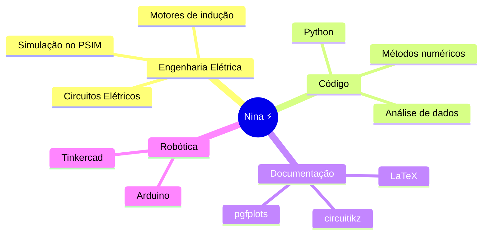

<div align="center">


<a href="https://skillicons.dev"></a>


</div>

> [!TIP]
> Este perfil é interativo: dá para **girar o raio 3D**, ver **as estrelas piscando** e **a luz correndo pelo circuito**, **dar zoom no mapa** e **abrir as seções** escondidas. Tudo renderizado pelo próprio GitHub, sem site externo.


## `whoami`

```python
nina = {
    "nome": "Nicoly Canteiro Araújo",
    "curso": "Bacharelado em Engenharia Elétrica - IFMT Campus Pontes e Lacerda",
    "local": "Pontes e Lacerda, MT, Brasil",
    "estudando": ["Python", "análise de dados", "inteligência artificial", "métodos numéricos"],
    "documentação": "relatórios técnicos em LaTeX",
}
```


## 🧠 Mapa mental




## ⚡ A equação que mais escrevi este semestre

Carga de um capacitor num circuito RC, do meu [relatório de laboratório](https://github.com/niinacanteiro/relatorios-latex):

$$
v_C(t) = V_s\left(1 - e^{-t/RC}\right), \qquad \tau = RC
$$


## 🧊 Um raio em 3D (gire com o mouse ou o dedo)

```stl
solid raio
facet normal 0.0000 0.0000 1.0000
 outer loop
  vertex 6.0 10.0 1.5
  vertex 4.0 10.0 1.5
  vertex 0.0 4.0 1.5
 endloop
endfacet
facet normal 0.0000 0.0000 -1.0000
 outer loop
  vertex 0 4 0
  vertex 4 10 0
  vertex 6 10 0
 endloop
endfacet
facet normal 0.0000 0.0000 1.0000
 outer loop
  vertex 6.0 10.0 1.5
  vertex 0.0 4.0 1.5
  vertex 3.0 4.0 1.5
 endloop
endfacet
facet normal 0.0000 0.0000 -1.0000
 outer loop
  vertex 3 4 0
  vertex 0 4 0
  vertex 6 10 0
 endloop
endfacet
facet normal 0.0000 0.0000 1.0000
 outer loop
  vertex 6.0 10.0 1.5
  vertex 3.0 4.0 1.5
  vertex 1.0 -2.0 1.5
 endloop
endfacet
facet normal 0.0000 0.0000 -1.0000
 outer loop
  vertex 1 -2 0
  vertex 3 4 0
  vertex 6 10 0
 endloop
endfacet
facet normal 0.0000 0.0000 1.0000
 outer loop
  vertex 1.0 -2.0 1.5
  vertex 7.0 5.0 1.5
  vertex 4.0 5.0 1.5
 endloop
endfacet
facet normal 0.0000 0.0000 -1.0000
 outer loop
  vertex 4 5 0
  vertex 7 5 0
  vertex 1 -2 0
 endloop
endfacet
facet normal 0.0000 0.0000 1.0000
 outer loop
  vertex 1.0 -2.0 1.5
  vertex 4.0 5.0 1.5
  vertex 6.0 10.0 1.5
 endloop
endfacet
facet normal 0.0000 0.0000 -1.0000
 outer loop
  vertex 6 10 0
  vertex 4 5 0
  vertex 1 -2 0
 endloop
endfacet
facet normal -0.8321 0.5547 0.0000
 outer loop
  vertex 4 10 0
  vertex 0 4 0
  vertex 0.0 4.0 1.5
 endloop
endfacet
facet normal -0.8321 0.5547 0.0000
 outer loop
  vertex 4 10 0
  vertex 0.0 4.0 1.5
  vertex 4.0 10.0 1.5
 endloop
endfacet
facet normal 0.0000 -1.0000 0.0000
 outer loop
  vertex 0 4 0
  vertex 3 4 0
  vertex 3.0 4.0 1.5
 endloop
endfacet
facet normal 0.0000 -1.0000 0.0000
 outer loop
  vertex 0 4 0
  vertex 3.0 4.0 1.5
  vertex 0.0 4.0 1.5
 endloop
endfacet
facet normal -0.9487 0.3162 0.0000
 outer loop
  vertex 3 4 0
  vertex 1 -2 0
  vertex 1.0 -2.0 1.5
 endloop
endfacet
facet normal -0.9487 0.3162 0.0000
 outer loop
  vertex 3 4 0
  vertex 1.0 -2.0 1.5
  vertex 3.0 4.0 1.5
 endloop
endfacet
facet normal 0.7593 -0.6508 0.0000
 outer loop
  vertex 1 -2 0
  vertex 7 5 0
  vertex 7.0 5.0 1.5
 endloop
endfacet
facet normal 0.7593 -0.6508 0.0000
 outer loop
  vertex 1 -2 0
  vertex 7.0 5.0 1.5
  vertex 1.0 -2.0 1.5
 endloop
endfacet
facet normal 0.0000 1.0000 0.0000
 outer loop
  vertex 7 5 0
  vertex 4 5 0
  vertex 4.0 5.0 1.5
 endloop
endfacet
facet normal 0.0000 1.0000 -0.0000
 outer loop
  vertex 7 5 0
  vertex 4.0 5.0 1.5
  vertex 7.0 5.0 1.5
 endloop
endfacet
facet normal 0.9285 -0.3714 0.0000
 outer loop
  vertex 4 5 0
  vertex 6 10 0
  vertex 6.0 10.0 1.5
 endloop
endfacet
facet normal 0.9285 -0.3714 0.0000
 outer loop
  vertex 4 5 0
  vertex 6.0 10.0 1.5
  vertex 4.0 5.0 1.5
 endloop
endfacet
facet normal 0.0000 1.0000 0.0000
 outer loop
  vertex 6 10 0
  vertex 4 10 0
  vertex 4.0 10.0 1.5
 endloop
endfacet
facet normal 0.0000 1.0000 -0.0000
 outer loop
  vertex 6 10 0
  vertex 4.0 10.0 1.5
  vertex 6.0 10.0 1.5
 endloop
endfacet
endsolid raio
```


## 🌎 Daqui eu programo

```geojson
{
  "type": "FeatureCollection",
  "features": [
    {
      "type": "Feature",
      "properties": { "name": "Pontes e Lacerda - MT", "marker-color": "#7F5AF0", "marker-symbol": "star" },
      "geometry": { "type": "Point", "coordinates": [-59.335, -15.226] }
    }
  ]
}
```


## 📂 Projetos

| | Projeto | O que tem |
|---|---|---|
| 📐 | [**relatorios-latex**](https://github.com/niinacanteiro/relatorios-latex) | Relatórios de circuitos em LaTeX com `circuitikz`, `pgfplots` e `tcolorbox` |
| 🐍 | [**Metodos_Computacionais**](https://github.com/niinacanteiro/Metodos_Computacionais) | Interpolação quadrática em Python |
| 🚦 | [**Manual-de-Instrucao-LaTex**](https://github.com/niinacanteiro/Manual-de-Instrucao-LaTex) | Manual de semáforo com Arduino |

<details>
<summary><b>🔭 O que estou fazendo agora</b> (clique para abrir)</summary>
<br>

- 🐍 Estudando Python, análise de dados e inteligência artificial
- 📐 Praticando métodos numéricos e documentação técnica em LaTeX
- 🤖 Projeto de extensão em robótica com Arduino

</details>

<details>
<summary><b>⌨️ Atalho favorito</b></summary>
<br>

<kbd>Ctrl</kbd> + <kbd>Enter</kbd> no Overleaf: compila o PDF na hora.

</details>


## 🐍 A cobra que come minhas contribuições

<picture>
  <source media="(prefers-color-scheme: dark)" srcset="https://raw.githubusercontent.com/niinacanteiro/niinacanteiro/output/github-snake-dark.svg" />
  <source media="(prefers-color-scheme: light)" srcset="https://raw.githubusercontent.com/niinacanteiro/niinacanteiro/output/github-snake.svg" />
  
</picture>

<div align="center">


</div>


<div align="center">

<a href="https://www.linkedin.com/in/nicoly-canteiro"></a>


</div>
